# Модель данных DMB Backlog

**Версия:** 3.1  
**Дата:** 2026-07-25

---

## ER-диаграмма (Mermaid)

```mermaid
erDiagram
    channels {
        int id PK
        varchar code
        varchar name
    }
    deadlines {
        int id PK
        varchar code
        varchar name
    }
    departments {
        int id PK
        varchar code
        varchar name
    }
    priorities {
        int id PK
        varchar name
    }
    task_types {
        int id PK
        varchar code
        varchar name
    }
    team_types {
        int id PK
        varchar code
        varchar name
    }
    project_statuses {
        int id PK
        varchar code
        varchar name
    }
    business_customers {
        int id PK
        varchar name
        int department_id FK
        timestamp created_at
    }
    statuses {
        int id PK
        varchar code
        varchar name
        int sort_order
        varchar color
    }
    teams {
        int id PK
        varchar name
        int team_type_id FK
        varchar color
        varchar domain
        text description
        varchar pl
        varchar po
        varchar cl
        varchar it_pl
        varchar abbr
        text members
        timestamp created_at
    }
    roles {
        int id PK
        varchar name
        varchar status
        text description
        varchar backlog_dmb_access
        varchar backlog_team_access
        varchar reports_access
        varchar analytics_access
        varchar customer_access
        varchar settings_access
        varchar admin_access
        boolean can_edit_tasks
        boolean can_delete_tasks
        boolean can_export
        timestamp created_at
    }
    users {
        int id PK
        varchar login
        varchar email
        varchar password_hash
        varchar name
        varchar position
        int team_id FK
        int role_id FK
        boolean can_edit
        boolean can_delete
        boolean can_export
        boolean is_active
        timestamp last_login
        timestamp created_at
    }
    projects {
        int id PK
        varchar code
        varchar name
        text description
        int status_id FK
        int responsible_pl FK
        timestamp created_at
    }
    tasks {
        int id PK
        int team_id FK
        varchar title
        text description
        date date_received
        int channel_id FK
        varchar business_customer
        int business_customer_id FK
        int department_id FK
        int project_id FK
        int task_type_id FK
        text involved_teams
        int priority_id FK
        int status_id FK
        int deadline_id FK
        int effort_days
        float effort_rub
        float effort_ba
        float effort_sa
        float effort_fe
        float effort_be
        float effort_test
        float effort_design
        float financial_effect
        float cv
        float ice_score
        int progress
        text what_if
        text dod
        varchar link_mockups
        varchar link_jira
        text rejection_reason
        text comment
        text status_comment
        int owner_id FK
        int responsible_po_id FK
        int business_analyst_id FK
        int it_product_lead_id FK
        boolean key_project
        varchar key_project_status
        varchar directorate_status
        timestamp directorate_status_updated_at
        varchar did_status
        timestamp did_status_updated_at
        boolean is_from_leadership
        boolean is_regular
        int created_by FK
        timestamp created_at
        timestamp updated_at
        boolean is_deleted
        int version
    }
    epics {
        int id PK
        int task_id FK
        varchar title
        text description
        float effort_ba
        float effort_sa
        float effort_fe
        float effort_be
        float effort_test
        float effort_design
        timestamp created_at
        timestamp updated_at
    }
    stories {
        int id PK
        int epic_id FK
        varchar title
        text description
        float effort_ba
        float effort_sa
        float effort_fe
        float effort_be
        float effort_test
        float effort_design
        timestamp created_at
        timestamp updated_at
    }
    display_settings {
        int id PK
        varchar page
        text settings
        timestamp created_at
        timestamp updated_at
    }
    column_labels {
        int id PK
        varchar key
        varchar label
        timestamp created_at
        timestamp updated_at
    }
    tags {
        int id PK
        varchar name
        varchar color
        text description
        int creator FK
    }
    issue_tags {
        int id PK
        int issue_id FK
        int tag_id FK
    }
    project_tags {
        int id PK
        int project_id FK
        int tag_id FK
    }
    task_history {
        int id PK
        int task_id FK
        int changed_by FK
        timestamp changed_at
        varchar field_name
        text old_value
        text new_value
    }
    task_comments {
        int id PK
        int task_id FK
        int user_id FK
        int parent_id FK
        text text
        text mentioned_user_ids
        timestamp created_at
    }
    task_attachments {
        int id PK
        int task_id FK
        int user_id FK
        varchar filename
        varchar original_name
        varchar mime_type
        int file_size
        timestamp created_at
    }
    audit_log {
        int id PK
        int user_id FK
        varchar action
        varchar entity_type
        int entity_id
        text details
        varchar ip_address
        timestamp created_at
    }
    notifications {
        int id PK
        int user_id FK
        int task_id FK
        varchar type
        text message
        boolean is_read
        timestamp created_at
    }
    notification_templates {
        int id PK
        varchar name
        text text
        varchar recipients
        int deadline_days
        varchar repeat_frequency
        int repeat_day
        boolean is_active
        timestamp created_at
        timestamp updated_at
    }
    reports {
        int id PK
        varchar name
        text description
        varchar type
        int created_by FK
        text filters
        text fields
        varchar group_by
        varchar sort_by
        varchar sort_order
        boolean is_public
        timestamp created_at
    }
    dictionary_items {
        int id PK
        varchar dict_type
        varchar name
        varchar code
        varchar color
        int sort_order
        boolean is_active
        timestamp created_at
    }

    business_customers ||--o{ departments : ""
    team_types ||--o{ teams : ""
    teams ||--o{ users : ""
    roles ||--o{ users : ""
    teams ||--o{ tasks : ""
    channels ||--o{ tasks : ""
    departments ||--o{ tasks : ""
    departments ||--o{ business_customers : ""
    projects ||--o{ tasks : ""
    task_types ||--o{ tasks : ""
    priorities ||--o{ tasks : ""
    statuses ||--o{ tasks : ""
    deadlines ||--o{ tasks : "deadline"
    users ||--o{ tasks : "owner/responsible_po/ba/itpl/created_by"
    project_statuses ||--o{ projects : ""
    users ||--o{ projects : "responsible_pl"
    tasks ||--o{ task_history : ""
    users ||--o{ task_history : "changed_by"
    tasks ||--o{ task_comments : ""
    users ||--o{ task_comments : "author"
    users ||--o{ notifications : ""
    tasks ||--o{ notifications : ""
    users ||--o{ reports : "created_by"
    users ||--o{ audit_log : ""
    tasks ||--o{ issue_tags : ""
    tags ||--o{ issue_tags : ""
    projects ||--o{ project_tags : ""
    tags ||--o{ project_tags : ""
    users ||--o{ tags : "creator"
    tasks ||--o{ epics : ""
    epics ||--o{ stories : ""
```



---

## Справочные таблицы (Lookup)

### channels — Каналы поступления
| Колонка | Тип | Описание |
|---------|-----|----------|
| id | int PK | Автоинкремент |
| code | varchar(50) UNIQUE | Код канала |
| name | varchar(100) | Наименование |

### deadlines — Сроки выполнения
| Колонка | Тип | Описание |
|---------|-----|----------|
| id | int PK | Автоинкремент |
| code | varchar(50) UNIQUE | Код срока |
| name | varchar(100) | Наименование |

### departments — Подразделения
| Колонка | Тип | Описание |
|---------|-----|----------|
| id | int PK | Автоинкремент |
| code | varchar(50) UNIQUE | Код подразделения |
| name | varchar(255) | Наименование |

### priorities — Приоритеты
| Колонка | Тип | Описание |
|---------|-----|----------|
| id | int PK | Автоинкремент |
| name | varchar(50) | Наименование |

### statuses — Статусы задач (13)
| Колонка | Тип | Описание |
|---------|-----|----------|
| id | int PK | Автоинкремент |
| code | varchar(50) UNIQUE | Код статуса |
| name | varchar(100) | Наименование |
| sort_order | int | Порядок сортировки |
| color | varchar(20) | Цвет |

### task_types — Типы задач
| Колонка | Тип | Описание |
|---------|-----|----------|
| id | int PK | Автоинкремент |
| code | varchar(50) UNIQUE | Код типа |
| name | varchar(100) | Наименование |

### team_types — Типы команд
| Колонка | Тип | Описание |
|---------|-----|----------|
| id | int PK | Автоинкремент |
| code | varchar(50) UNIQUE | Код типа |
| name | varchar(100) | Наименование |

### project_statuses — Статусы проектов
| Колонка | Тип | Описание |
|---------|-----|----------|
| id | int PK | Автоинкремент |
| code | varchar(50) UNIQUE | Код статуса |
| name | varchar(100) | Наименование |

### business_customers — Бизнес-заказчики
| Колонка | Тип | FK | Описание |
|---------|-----|-----|----------|
| id | int PK | — | Автоинкремент |
| name | varchar(200) | — | Наименование |
| department_id | int | → departments.id | Подразделение |
| created_at | timestamp | — | Дата создания |

---

## Основные таблицы

### teams — Команды
| Колонка | Тип | FK | Описание |
|---------|-----|-----|----------|
| id | int PK | — | Автоинкремент |
| name | varchar(100) UNIQUE | — | Название |
| team_type_id | int | → team_types.id | Тип команды |
| color | varchar(20) | — | Цвет (indigo/emerald/amber/rose/sky/violet/teal/purple/orange) |
| domain | varchar(200) | — | Домен |
| description | text | — | Описание |
| pl | varchar(100) | — | Product Leader |
| po | varchar(100) | — | Product Owner |
| cl | varchar(100) | — | Cluster Lead |
| it_pl | varchar(100) | — | IT Product Lead |
| abbr | varchar(10) | — | Аббревиатура для аватара |
| members | text | — | Состав (через запятую) |
| created_at | timestamp | — | Дата создания |

### roles — Роли
| Колонка | Тип | Описание |
|---------|-----|----------|
| id | int PK | Автоинкремент |
| name | varchar(50) UNIQUE | Название |
| status | varchar(20) | Статус (active/in_dev/archived) |
| description | text | Описание |
| backlog_dmb_access | varchar(20) | Доступ к бэклогу DMB |
| backlog_team_access | varchar(20) | Доступ к бэклогу команды |
| reports_access | varchar(20) | Доступ к отчётам |
| analytics_access | varchar(20) | Доступ к аналитике |
| customer_access | varchar(20) | Доступ к порталу заказчика |
| settings_access | varchar(20) | Доступ к настройкам |
| admin_access | varchar(20) | Доступ к администрированию |
| can_edit_tasks | boolean | Может редактировать задачи |
| can_delete_tasks | boolean | Может удалять задачи |
| can_export | boolean | Может экспортировать |
| created_at | timestamp | Дата создания |

### users — Пользователи
| Колонка | Тип | FK | Описание |
|---------|-----|-----|----------|
| id | int PK | — | Автоинкремент |
| login | varchar(50) | — | Логин |
| email | varchar(255) UNIQUE | — | Email |
| password_hash | varchar(255) | — | Хеш пароля (bcrypt) |
| name | varchar(100) | — | ФИО |
| position | varchar(100) | — | Должность |
| team_id | int | → teams.id | Команда |
| role_id | int | → roles.id | Роль |
| can_edit | boolean | — | Право редактирования |
| can_delete | boolean | — | Право удаления |
| can_export | boolean | — | Право экспорта |
| is_active | boolean | — | Активен |
| last_login | timestamp | — | Последний вход |
| created_at | timestamp | — | Дата создания |

### projects — Проекты
| Колонка | Тип | FK | Описание |
|---------|-----|-----|----------|
| id | int PK | — | Автоинкремент |
| code | varchar(50) UNIQUE | — | Код проекта |
| name | varchar(255) | — | Наименование |
| description | text | — | Описание |
| status_id | int | → project_statuses.id | Статус |
| responsible_pl | int | → users.id | Ответственный PL |
| created_at | timestamp | — | Дата создания |

### tasks — Задачи
| Колонка | Тип | FK | Описание |
|---------|-----|-----|----------|
| id | int PK | — | Автоинкремент |
| team_id | int | → teams.id | Команда |
| title | varchar(255) | — | Название |
| description | text | — | Описание |
| date_received | date | — | Дата получения |
| channel_id | int | → channels.id | Канал поступления |
| business_customer | varchar(200) | — | Бизнес-заказчик (строка) |
| business_customer_id | int | → business_customers.id | Бизнес-заказчик (FK) |
| department_id | int | → departments.id | Подразделение заказчика |
| project_id | int | → projects.id | Проект |
| task_type_id | int | → task_types.id | Тип задачи |
| involved_teams | text | — | Вовлечённые команды |
| priority_id | int | → priorities.id | Приоритет |
| status_id | int | → statuses.id | Статус |
| deadline_id | int | → deadlines.id | Срок выполнения |
| effort_days | int | — | Трудозатраты (дни) |
| effort_rub | float | — | Трудозатраты (руб) |
| effort_ba | float | — | Бизнес-аналитика (дни) |
| effort_sa | float | — | Системная аналитика (дни) |
| effort_fe | float | — | Front-end разработка (дни) |
| effort_be | float | — | Back-end разработка (дни) |
| effort_test | float | — | Тестирование (дни) |
| effort_design | float | — | Дизайн (дни) |
| financial_effect | float | — | Фин. эффект (млн руб.) |
| cv | float | — | C/V (авторасчёт) |
| ice_score | float | — | ICE Score |
| progress | int | — | Прогресс (0-100) |
| what_if | text | — | What-If анализ |
| dod | text | — | Definition of Done |
| link_mockups | varchar(500) | — | Ссылка на макеты |
| link_jira | varchar(500) | — | Ссылка на Jira |
| rejection_reason | text | — | Причина отклонения |
| comment | text | — | Комментарий |
| status_comment | text | — | Комментарий к статусу |
| owner_id | int | → users.id | Исполнитель |
| responsible_po_id | int | → users.id | Ответственный PO |
| business_analyst_id | int | → users.id | Бизнес-аналитик |
| it_product_lead_id | int | → users.id | IT Product Lead |
| key_project | boolean | — | Ключевой проект |
| key_project_status | varchar(50) | — | Статус ключ. проекта |
| directorate_status | text | — | Статус для директорской оперативки (текст) |
| directorate_status_updated_at | timestamp | — | Дата обновления статуса для директорской |
| did_status | text | — | Статус для оперативки ДИД (текст) |
| did_status_updated_at | timestamp | — | Дата обновления статуса для ДИД |
| is_from_leadership | boolean | — | От руководства |
| is_regular | boolean | — | Регулярная задача |
| created_by | int | → users.id | Автор |
| created_at | timestamp | — | Дата создания |
| updated_at | timestamp | — | Дата обновления |
| is_deleted | boolean | — | Мягкое удаление |
| version | int | — | Версия задачи (optimistic lock, инкрементируется при каждом PUT) |
| lock_owner_id | int | → users.id | Блокировка: ID владельца блокировки |
| lock_until | timestamp | — | Блокировка: время окончания (UTC) |

---

## Эпики и истории (Экспресс-оценка)

### epics — Эпики
| Колонка | Тип | FK | Описание |
|---------|-----|-----|----------|
| id | int PK | — | Автоинкремент |
| task_id | int | → tasks.id | Задача |
| title | varchar(255) | — | Название |
| description | text | — | Описание |
| effort_ba | float | — | Бизнес-аналитика (дни) |
| effort_sa | float | — | Системная аналитика (дни) |
| effort_fe | float | — | Front-end разработка (дни) |
| effort_be | float | — | Back-end разработка (дни) |
| effort_test | float | — | Тестирование (дни) |
| effort_design | float | — | Дизайн (дни) |
| created_at | timestamp | — | Дата создания |
| updated_at | timestamp | — | Дата обновления |

### stories — Истории (User Stories)
| Колонка | Тип | FK | Описание |
|---------|-----|-----|----------|
| id | int PK | — | Автоинкремент |
| epic_id | int | → epics.id | Эпик |
| title | varchar(255) | — | Название |
| description | text | — | Описание |
| effort_ba | float | — | Бизнес-аналитика (дни) |
| effort_sa | float | — | Системная аналитика (дни) |
| effort_fe | float | — | Front-end разработка (дни) |
| effort_be | float | — | Back-end разработка (дни) |
| effort_test | float | — | Тестирование (дни) |
| effort_design | float | — | Дизайн (дни) |
| created_at | timestamp | — | Дата создания |
| updated_at | timestamp | — | Дата обновления |

---

## Настройки отображения

### display_settings — Настройки страниц
| Колонка | Тип | Описание |
|---------|-----|----------|
| id | int PK | Автоинкремент |
| page | varchar(50) UNIQUE | Идентификатор страницы (backlog_dmb, team_backlog, shared) |
| settings | text | JSON-объект с настройками колонок |
| created_at | timestamp | Дата создания |
| updated_at | timestamp | Дата обновления |

### column_labels — Метки колонок
| Колонка | Тип | Описание |
|---------|-----|----------|
| id | int PK | Автоинкремент |
| key | varchar(50) UNIQUE | Ключ колонки |
| label | varchar(200) | Отображаемое название |
| created_at | timestamp | Дата создания |
| updated_at | timestamp | Дата обновления |

---

## История, аудит, уведомления

### task_history — История изменений
| Колонка | Тип | FK |
|---------|-----|-----|
| id | int PK | — |
| task_id | int | → tasks.id |
| changed_by | int | → users.id |
| changed_at | timestamp | — |
| field_name | varchar(50) | — |
| old_value | text | — |
| new_value | text | — |

### task_comments — Комментарии к задачам
| Колонка | Тип | FK | Описание |
|---------|-----|-----|----------|
| id | int PK | — | Автоинкремент |
| task_id | int | → tasks.id | Задача |
| user_id | int | → users.id | Автор |
| parent_id | int | → task_comments.id | Родительский комментарий (NULL = корневой) |
| text | text | — | Текст комментария |
| mentioned_user_ids | text (JSON) | — | ID упомянутых пользователей `["1","3"]` |
| created_at | timestamp | — | Дата создания |

### task_attachments — Файловые вложения
| Колонка | Тип | FK | Описание |
|---------|-----|-----|----------|
| id | int PK | — | Автоинкремент |
| task_id | int | → tasks.id | Задача |
| user_id | int | → users.id | Кто загрузил |
| filename | varchar(255) | — | Имя файла на диске (UUID.ext) |
| original_name | varchar(255) | — | Оригинальное имя файла |
| mime_type | varchar(100) | — | MIME-тип |
| file_size | int | — | Размер в байтах |
| created_at | timestamp | — | Дата загрузки |

Файлы хранятся в `backend/uploads/{task_id}/`. Связь `Task.attachments` с `cascade="all, delete-orphan"` обеспечивает автоматическое удаление вложений при удалении задачи.

### audit_log — Аудит
| Колонка | Тип | FK |
|---------|-----|-----|
| id | int PK | — |
| user_id | int | → users.id |
| action | varchar(50) | — |
| entity_type | varchar(50) | — |
| entity_id | int | — |
| details | text | — |
| ip_address | varchar(45) | — |
| created_at | timestamp | — |

### notifications — Уведомления
| Колонка | Тип | FK |
|---------|-----|-----|
| id | int PK | — |
| user_id | int | → users.id |
| task_id | int | → tasks.id |
| type | varchar(50) | — |
| message | text | — |
| is_read | boolean | — |
| created_at | timestamp | — |

### notification_templates — Шаблоны
| Колонка | Тип | Описание |
|---------|-----|----------|
| id | int PK | — |
| name | varchar(200) | Название |
| text | text | Текст |
| recipients | varchar(500) | Роли-получатели |
| deadline_days | int | Дней до дедлайна |
| repeat_frequency | varchar(50) | Регулярность |
| repeat_day | int | День повтора |
| is_active | boolean | Активен |
| created_at | timestamp | — |
| updated_at | timestamp | — |

---

## Теги (many-to-many)

### tags — Теги
| Колонка | Тип | FK |
|---------|-----|-----|
| id | int PK | — |
| name | varchar(100) | — |
| color | varchar(20) | — |
| description | text | — |
| created_at | timestamp | — |
| creator | int | → users.id |

### issue_tags — Связь задач с тегами
| Колонка | Тип | FK |
|---------|-----|-----|
| id | int PK | — |
| issue_id | int | → tasks.id |
| tag_id | int | → tags.id |

### project_tags — Связь проектов с тегами
| Колонка | Тип | FK |
|---------|-----|-----|
| id | int PK | — |
| project_id | int | → projects.id |
| tag_id | int | → tags.id |

---

## Отчёты и словари

### reports — Отчёты
| Колонка | Тип | FK | Описание |
|---------|-----|-----|----------|
| id | int PK | — | Автоинкремент |
| name | varchar(200) | — | Название отчёта |
| description | text | — | Описание |
| type | varchar(20) | — | Тип: standard (предустановленный) / custom (пользовательский) |
| created_by | int | → users.id | Автор (NULL для стандартных) |
| filters | text | — | JSON-массив фильтров `[{"field":"...","operator":"...","value":"..."}]` |
| fields | text | — | JSON-массив полей для отображения `["title","priority_name","..."]` или NULL (все) |
| group_by | varchar(50) | — | Поле группировки: team_name, project_name, status_name, priority_name, department_name |
| sort_by | varchar(50) | — | Поле сортировки |
| sort_order | varchar(4) | — | Направление сортировки: asc (по умолчанию) / desc |
| is_public | boolean | — | Видимость: false = только автор, true = все пользователи |
| created_at | timestamp | — | Дата создания |

**Формат filters:**
```json
[
  {"field": "priority_name", "operator": "equals", "value": "ВЫСОКИЙ"},
  {"field": "team_name", "operator": "in", "value": ["Pre-trade", "Risk"]},
  {"field": "progress", "operator": "gt", "value": 50}
]
```

Операторы: `equals`, `not_equals`, `contains`, `in` (массив), `gt`, `lt`.

**Формат fields:**
```json
["title", "team_name", "priority_name", "status_name", "progress", "financial_effect"]
```

Доступные поля: id, title, description, team_name, priority_name, status_name, project_name, business_customer, department_name, channel_name, task_type_name, deadline_name, owner_name, progress, effort_days, effort_rub, financial_effect, cv, ice_score, key_project, key_project_status, directorate_status, did_status, date_received, created_at, updated_at.

### dictionary_items — Элементы справочников (legacy/admin UI)
| Колонка | Тип | Описание |
|---------|-----|----------|
| id | int PK | — |
| dict_type | varchar(50) | Тип справочника (в т.ч. `competency_cost` — ставка компетенции в руб/день хранится в `code`) |
| name | varchar(100) | Наименование |
| code | varchar(50) | Код |
| color | varchar(20) | Цвет |
| sort_order | int | Порядок сортировки |
| is_active | boolean | Активен |
| created_at | timestamp | — |
| version | int | Версия (optimistic lock, инкремент при каждом PUT) |
| lock_owner_id | int FK→users | Владелец блокировки |
| lock_until | timestamp | Время окончания блокировки (UTC) |

Типы справочников: priority, status, task_type, business_customer, channel, deadline, department, team_type, project_status.

### competency_cost_history — Историчные ставки компетенций
| Колонка | Тип | Описание |
|---------|-----|----------|
| id | int PK | — |
| competency | varchar(100) | Название компетенции |
| year | int | Год действия ставки |
| rate | float | Ставка руб/день |
| is_active | boolean | Активна |
| created_at | timestamp | — |
| updated_at | timestamp | — |

Уникальный ключ: (competency, year). Расчёт `effort_rub` берёт ставку года дедлайна задачи; без дедлайна/года — ставку максимального (актуального) года. Справочник `dictionary_items` с `dict_type='competency_cost'` сохранён в БД только для блокировки справочника в админке; из расчётов и админ-карточки он выведен.

### tasks — вычисляемые поля ФТЗ

Поля `actual_effort_designee`, `actual_effort_analytics`, `actual_effort_be`, `actual_effort_python_be`, `actual_effort_fe`, `actual_effort_test`, `actual_effort_test_auto`, `actual_effort_delivery` — фактические трудозатраты по 8 компетенциям (значения тянутся из внешней БД, связанной с Jira).

Поле `actual_effort_days` — **вычисляемое**: сумма перечисленных 8 полей ФТЗ (если ни одно не заполнено — `NULL`). Автоматически пересчитывается при создании/обновлении задачи (значение из запроса игнорируется) и при старте сервера для всех задач (`recalculate_actual_effort_days_for_all`).

**Блокировка справочников:**
- Аналогична блокировке задач (поле `tasks.lock_owner_id` / `tasks.lock_until`)
- `lock_owner_id` → `users` — кто открыл справочник на редактирование
- `lock_until` — автоистечение через 15 минут; при PUT/DELETE проверяется `_is_dict_lock_active()`
- PUT возвращает HTTP 423 если заблокирован другим пользователем; владелец блокировки может редактировать

---

## Индексы и оптимизация

### Существующие индексы

| Таблица | Индекс | Колонка | Обоснование |
|---------|--------|---------|-------------|
| `users` | `ix_users_email` | email | Уникальный поиск пользователя по email (логин, проверка дубликатов) |
| `tasks` | `ix_tasks_team_id` | team_id | Частая фильтрация задач по команде (бэклог команды) |
| `tasks` | `ix_tasks_key_project` | key_project | Фильтрация ключевых проектов (отчёты, дашборд) |
| `tasks` | `ix_tasks_is_deleted` | is_deleted | Исключение удалённых задач из всех запросов |
| `task_history` | (FK index) | task_id | Быстрый поиск истории изменений по задаче |
| `task_comments` | (FK index) | task_id | Быстрый поиск комментариев по задаче |
| `dictionary_items` | `ix_dictionary_items_dict_type` | dict_type | Фильтрация по типу справочника |
| `notification_templates` | (no explicit) | — | Мало данных (сотни), индекс не требуется |
| `audit_log` | (no explicit) | — | Мало данных, поиск по user_id |
| `tags` | (no explicit) | — | Мало данных |

### Индексы, создаваемые автоматически

SQLAlchemy создаёт индексы для всех колонок с `ForeignKey` при `index=True`. В моделях это:
- `Task.team_id`, `Task.key_project`, `Task.is_deleted`
- `User.email`

### Рекомендации для PostgreSQL (production)

При переходе на PostgreSQL (15+) рекомендуется добавить:

```sql
CREATE INDEX idx_tasks_status_id ON tasks(status_id);
CREATE INDEX idx_tasks_priority_id ON tasks(priority_id);
CREATE INDEX idx_tasks_deadline_id ON tasks(deadline_id);
CREATE INDEX idx_tasks_created_at ON tasks(created_at);
CREATE INDEX idx_task_history_task_id ON task_history(task_id);
CREATE INDEX idx_task_history_changed_at ON task_history(changed_at);
CREATE INDEX idx_task_comments_task_id ON task_comments(task_id);
CREATE INDEX idx_audit_log_created_at ON audit_log(created_at);
CREATE INDEX idx_notifications_user_id ON notifications(user_id);
CREATE INDEX idx_notifications_is_read ON notifications(is_read);
CREATE INDEX idx_epics_task_id ON epics(task_id);
CREATE INDEX idx_stories_epic_id ON stories(epic_id);
```

### Оптимизация запросов

- Все задачи загружаются с `is_deleted == False` (фильтр в каждом запросе).
- Статистика использует агрегатные функции SQL (`COUNT`, `SUM`, `AVG`) с группировкой.
- Отчёты выполняются через один JOIN-heavy запрос.
- Фильтрация на клиенте: ~500 задач загружаются одним запросом (`per_page=1000`).

---

## Сохранность данных

### Резервное копирование

В текущей конфигурации (SQLite):
- Файл `dmb_backlog.db` — вся БД в одном файле.
- Рекомендуется ежедневное копирование через cron/jenkins.
- Для SQLite: `sqlite3 dmb_backlog.db ".backup backup.db"`

Для PostgreSQL (production):
- Настройка WAL-архивирования (`archive_mode = on`).
- Ежедневный `pg_dump` + хранение копий за 30 дней.
- Point-in-Time Recovery (PITR) через WAL-логи.

### Мягкое удаление

Все задачи имеют флаг `is_deleted`:
- DELETE-запросы только устанавливают `is_deleted = True`
- Физическое удаление не выполняется
- Пользователи деактивируются через `is_active = False`
- Элементы справочников деактивируются через `is_active = False`

### Версионирование изменений

- Каждое изменение поля задачи фиксируется в `task_history`:
  - `task_id`, `changed_by`, `changed_at`, `field_name`, `old_value`, `new_value`
- История позволяет восстановить предыдущие значения.
- Лимит истории: последние 50 записей возвращаются API, физического удаления нет.

### Комментарии к задачам

- Комментарии хранятся в `task_comments` (отдельная таблица, не конфликтует с существующими полями `comment` и `status_comment` в tasks).
- При создании комментария:
  - создаётся запись в `task_comments` (task_id, user_id, text, mentioned_user_ids, created_at)
  - создаётся запись в `task_history` (field="comment", new_value=text)
  - для каждого @упомянутого пользователя создаётся уведомление типа `mention` в `notifications`
- Синтаксис @-упоминаний: `@login` (по логину пользователя, без пробелов).

### Аудит операций

- Все write-операции записываются в `audit_log`:
  - `user_id`, `action`, `entity_type`, `entity_id`, `details`, `ip_address`
- Аудит используется для разбора инцидентов и compliance.

### Транзакционная целостность

- SQLAlchemy `session.commit()` — гарантирует атомарность операций.
- `ensure_schema()` запускается при старте сервера и безопасно добавляет недостающие колонки (не изменяет существующие данные).

---

## Бизнес-логика на уровне базы данных

### Расчёт C/V (Cost/Value)

Выполняется **на уровне приложения** (Python), а не на уровне БД:

```python
cv = None
if task.financial_effect is not None and task.effort_rub is not None and task.effort_rub > 0:
    cv = round(task.financial_effect / task.effort_rub, 2)
```

Значение сохраняется в поле `cv` таблицы `tasks` при каждом обновлении задачи (через API).

### Автоматическая миграция схемы

`database.py:ensure_schema()` при каждом запуске:
1. `Base.metadata.create_all()` — создаёт отсутствующие таблицы
2. `inspector.get_columns()` — сравнивает колонки моделей SQLAlchemy с БД
3. `ALTER TABLE ADD COLUMN` — добавляет недостающие колонки
4. Не изменяет и не удаляет существующие данные

### Триггеры (отсутствуют)

На текущий момент триггеры на уровне БД **не используются**. Вся бизнес-логика реализована в Python:
- Расчёт C/V — в `task_to_response()` (tasks_router.py)
- Логирование изменений — в `update_task()` (tasks_router.py)
- Аудит — в `AuditMiddleware` (middleware.py)
- Seed-данные — в `seed.py`

### При seed-запуске

`seed.py`:
- `seed_dict_always()` — upsert записей справочников (выполняется при каждом запуске)
- `seed_initial_data()` — создаёт роли, команды, пользователей, задачи при пустой БД

### Планируемые триггеры для PostgreSQL

При переходе на PostgreSQL рекомендуется создать:

```sql
-- Автоматический расчёт C/V при вставке/обновлении
CREATE OR REPLACE FUNCTION update_cv()
RETURNS TRIGGER AS $$
BEGIN
    IF NEW.financial_effect IS NOT NULL AND NEW.effort_rub IS NOT NULL AND NEW.effort_rub > 0 THEN
        NEW.cv := ROUND(NEW.financial_effect / NEW.effort_rub, 2);
    ELSE
        NEW.cv := NULL;
    END IF;
    RETURN NEW;
END;
$$ LANGUAGE plpgsql;

CREATE TRIGGER trg_tasks_cv
    BEFORE INSERT OR UPDATE OF financial_effect, effort_rub ON tasks
    FOR EACH ROW EXECUTE FUNCTION update_cv();
```
