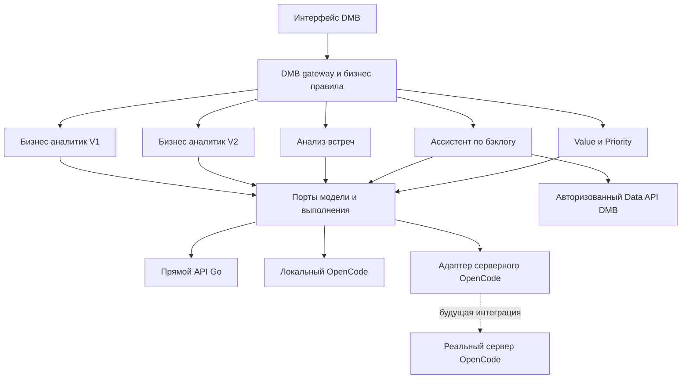

# Техническое задание на выделение агентов в самостоятельные сервисы

Необходимо получить пять независимо собираемых, запускаемых и обновляемых сервисов, сохранив их полноценную локальную работу через API-ключ OpenCode Go. Подключение серверного OpenCode подготавливается через отдельный адаптер и контрактные проверки. Доступ к настоящему серверу для текущей поставки не требуется.

Документ предназначен разработчику, инженеру эксплуатации и тестировщику. Он задаёт целевое поведение, последовательность миграции и доказательства приёмки. Требования к существующему поведению проверяются по коду; приведённые новые пути, поля и команды являются требованиями реализации, а не описанием уже работающего API.

## 1 Статус и обязательные решения заказчика

| ID | Обязательное решение |
|---|---|
| U-01 | Выделить все пять продуктовых агентов в полноценные самостоятельные сервисы. |
| U-02 | Сохранить работоспособность агентов локально через OpenCode Go с API-ключом подписки. |
| U-03 | Предусмотреть будущее выполнение через серверный OpenCode. |
| U-04 | Сейчас нет возможности проверить успешность перехода на настоящий серверный OpenCode. |
| U-05 | Текущая поставка не должна зависеть от появления такого сервера. |

U-01–U-05 прямо следуют из указаний заказчика. Остальные решения настоящего ТЗ — конкретизация реализации в статусе TO-BE DRAFT. Статус документа не означает, что реализация уже существует или принята.

Слова «должен», «необходимо» и «запрещено» обозначают обязательное условие реализации. «Допускается» обозначает разрешённый вариант. «Вне текущей поставки» не включается в её критерии завершения.

### 1.1 Разделение результатов

| Результат | Объём | Статус, допустимый после текущей поставки |
|---|---|---|
| L — локальный переход | Пять сервисов, реальные сценарии через Go, сохранность истории, эксплуатация и откат | `accepted_local` после фактической приёмки |
| C — подготовка серверного подключения | Реализованный адаптер выбранного контракта, эмулятор, обработка отказов, документация подключения | `prepared_contract_tested` после проверок |
| S — реальная серверная интеграция | Доступ к конкретному серверу, сеть, credentials, версия, инструменты, нагрузка и эксплуатация | `not_verified` до будущих испытаний |

**Общий результат текущей задачи: L + C. Результат S в текущую поставку не входит.** Отсутствие S не снижает статус принятого L; успешный C не разрешает объявлять принятым S.

## 2 Цели и границы работ

### 2.1 Цели

| ID | Требование |
|---|---|
| ARC-01 | Каждый агент имеет собственную точку входа, зависимости, конфигурацию, версию, API-контракт, проверки состояния, журнал и инструкции. |
| ARC-02 | Сервис собирается и запускается без импорта backend DMB и без импорта исполняемого кода другого продуктового агента. |
| ARC-03 | Каждый сервис останавливается и обновляется независимо; его недоступность не останавливает DMB и остальные сервисы. |
| ARC-04 | Для работы с реальными предметными данными допускается зависимость от авторизованного API DMB. Самостоятельность не означает копирование всей предметной БД. |
| ARC-05 | Смена места выполнения AI не меняет продуктовый контракт, правила доступа, расчётные формулы и человеческое согласование. |
| ARC-06 | Монорепозиторий сохраняется. Разделение на отдельные Git-репозитории не требуется. |
| ARC-07 | Публичные страницы и существующие клиентские API сохраняют совместимость через gateway и переходные адаптеры. |
| ARC-08 | Изменения выполняются по сервисам с возвратом на предыдущую реализацию без потери пользовательской истории. |

### 2.2 Включено

- Выделение сервиса анализа расшифровок из V1.
- Независимые конфигурация, хранение состояния, миграции, упаковка, запуск и остановка пяти сервисов.
- Сохранение действующих локальных способов работы с Go.
- Разделение модельного транспорта, runtime и предметного workflow.
- Подготовка адаптера серверного OpenCode и разрешённых удалённых инструментов.
- Совместимость с DMB, обработка длительных операций, идемпотентность и восстановление.
- Автономные проверки, локальные интеграционные сценарии, оценка регрессий и эксплуатационные инструкции.

### 2.3 Не включено

- Развёртывание и приёмка настоящего серверного OpenCode.
- Гарантия совместимости с любой будущей версией OpenCode.
- Замена Go другим провайдером или обязательная покупка нового тарифа.
- Перенос бизнес-правил и арифметики в промпты.
- Новые продуктовые возможности, редизайн страниц, транскрибация аудио/видео.
- Выделение каждого внутреннего субагента оценщика в отдельный сервис.
- Внедрение Kubernetes, Kafka, service mesh или централизованной платформы оркестрации без отдельной необходимости.
- Изменение пользователей, паролей, ролей, справочников, состава команд и их ответственных.
- Автоматическое создание ключей OpenCode, изменение подписки или платёжных настроек.

## 3 Исходное состояние и точки изменения

Следующая карта относится к коду и конфигурации, исследованным 02.11.2026. Она не заменяет базовый прогон перед реализацией.

| Контур | Подтверждённая основа | Необходимое изменение |
|---|---|---|
| V1 | Отдельный FastAPI, `business_analyst`, собственные сессии, `X-Agent-Secret`, прямой OpenAI-compatible клиент | Независимая эксплуатация, явные миграции, единый транспортный контракт; удаление ответственности за извлечение встреч |
| V2 | Изолированный fork `business_analyst_experimental`, собственная БД, документы и ревью | Сохранение предметного состояния и независимых настроек; включение в полную схему deployment |
| Встречи | Извлечение в V1; очередь, версия черновика и применение результата в DMB | Собственный `meeting-analyzer`, очередь выполнения и адаптер DMB |
| Бэклог | Собственный сервис, PostgreSQL-очередь, Data API, ModelBroker, OpenCode 1.17.13 в изолированном Docker runtime | Сохранить гарантии; отделить размещение runtime от предметных контрактов |
| Value/Priority | Отдельный API и детерминированное ядро; OpenCode tools вызывают Python CLI | Независимая конфигурация, PostgreSQL-профиль, удалённые tools вместо обязательного локального CLI |

Исходные файлы:

- [Каталог агентов](AGENT_CATALOG.md) и [имена пакетов](../agents/README.md).
- [V1 API](../agents/business-analyst/business_analyst/api/router.py), [V1 схемы](../agents/business-analyst/business_analyst/api/schemas.py), [хранилище V1](../agents/business-analyst/business_analyst/session.py).
- [V2 схемы](../agents/business-analyst-experimental/business_analyst_experimental/api/schemas.py), [эксплуатация V2](../agents/business-analyst-experimental/docs/OPERATIONS.md).
- [Извлечение встреч](../agents/business-analyst/business_analyst/meeting_task_extractor.py), [очередь DMB](../dmb-backlog/backend/services/meeting_analysis.py), [предметный контракт встречи](../dmb-backlog/backend/meeting_contract.py).
- [RuntimePort и DataPort](../agents/backlog-assistant/backlog_assistant/ports.py), [OpenCode runtime](../agents/backlog-assistant/runtime/opencode.py), [Docker launcher](../agents/backlog-assistant/runtime/docker.py), [ModelBroker](../agents/backlog-assistant/bridge/model.py).
- [Контракт оценщика](../agents/value-priority-assessor/docs/COORDINATOR-CONTRACT.md), [CLI bridge](../agents/value-priority-assessor/.opencode/lib/run-cli.js), [методика](../agents/value-priority-assessor/docs/METHODOLOGY.md).
- [Локальный launcher](../scripts/start-project.ps1), [production Compose](../compose.production.yaml), [CI](../.github/workflows/quality.yml).

В исходном launcher присутствует запись SQLite URL для оценщика и копирование параметров модели из V1 в другие сервисы. В production Compose отсутствует полный контур всех пяти ролей. Это точки доработки; существующий launcher нельзя использовать как описание целевой независимости.

## 4 Состав сервисов и владение данными

### 4.1 Идентичность сервисов

| Service ID | Каталог | Python namespace | Локальный порт |
|---|---|---|---:|
| `business-analyst` | `agents/business-analyst/` | `business_analyst` | 9000 |
| `business-analyst-experimental` | `agents/business-analyst-experimental/` | `business_analyst_experimental` | 9300 |
| `meeting-analyzer` | новый `agents/meeting-analyzer/` | новый `meeting_analyzer` | 9500 |
| `backlog-assistant` | `agents/backlog-assistant/` | `backlog_assistant` | 9400 |
| `value-priority-assessor` | `agents/value-priority-assessor/` | `value_priority_assessor` | 9100 |

Порт 9500 — целевое значение для нового сервиса. До использования проверяется отсутствие конфликта. Существующий Data API ассистента на 9450 остаётся отдельной внутренней границей. Bind локальных служебных интерфейсов — `127.0.0.1`; контейнерные внутренние порты не публикуются наружу без необходимости.

### 4.2 Ответственность

| Владелец | Хранит и изменяет | Не получает право изменять |
|---|---|---|
| DMB | Бизнес-записи, авторизацию, связи с задачами, подтверждения, итоговые редакции, проекцию статуса AI | Историю чужого сервиса через прямой SQL |
| V1 | Диалоги, факты, происхождение фактов, черновики, квитанции операций | Пользователей, команды и утверждённые бизнес-решения DMB |
| V2 | Диалоги, документы, источники, предложения, находки ревью, версии предметного состояния | Связанный объект DMB без отдельного подтверждённого действия gateway |
| Встречи | Технические запуски извлечения, временный снимок входа, проверенные AI-кандидаты | Подтверждённые поручения, исполнителей и привязки |
| Бэклог | Разговоры, очередь, исполнения, квитанции чтений и ответы | Предметный бэклог и его ACL |
| Оценщик | Кэш и аудит расчётов, входные снимки, версии методики и разрешённые оценки факторов | Исходную задачу DMB и справочники через агентный маршрут |

Необходимость отдельной БД определяется владением состоянием: сервису не добавляется БД только ради одинаковой структуры. Для предусмотренных долговечных очередей и существующих хранилищ используется PostgreSQL. Один локальный PostgreSQL instance допустим; логические БД и credentials изолируются.

## 5 Целевая архитектура



### 5.1 Слои

1. Product API принимает предметные операции и возвращает предметный результат.
2. Domain/workflow управляет состоянием, фактами, версиями, согласованием и расчётами.
3. ModelPort выполняет ограниченный модельный запрос.
4. RuntimePort выполняет агентное задание с разрешёнными инструментами и наблюдаемым жизненным циклом.
5. Адаптеры реализуют конкретный транспорт, размещение runtime и версионный протокол.

ModelPort не обязан быть HTTP-вызовом в отдельный общий сервис. RuntimePort не обязан использовать OpenCode для локального прямого вызова модели. В текущей поставке допустимы разные внутренние способы выполнения при едином управлении и наблюдаемости.

### 5.2 Общая библиотека

| ID | Требование |
|---|---|
| SDK-01 | Вынести только устойчивые технические контракты: ошибки, correlation, capabilities, лимиты и протоколы модели/runtime. |
| SDK-02 | Использовать отдельный namespace, например `dmb_agent_contracts`; не создавать новые общие top-level пакеты `runtime`, `contracts`, `service`. |
| SDK-03 | Общий пакет не импортирует FastAPI-приложения агентов, ORM DMB и модели предметных документов. |
| SDK-04 | Версия зависимости фиксируется. Независимый образ не требует присутствия соседних исходников во время выполнения. |
| SDK-05 | Колёсный пакет или другой воспроизводимый build artifact включается в сборку; ручное добавление `sys.path` к корню репозитория запрещено. |
| SDK-06 | Дедупликация V1/V2 ограничивается транспортным слоем. Слияние их workflow в рамках миграции не выполняется. |

## 6 Режимы выполнения

### 6.1 Независимые измерения конфигурации

Режим описывается раздельно: `execution_backend`, `model_provider`, `model_protocol`, `runtime_location`, `runtime_contract_version`. Одно поле `provider=opencode` не может обозначать сразу все эти параметры.

| Профиль | execution_backend | model_provider | runtime_location | Назначение |
|---|---|---|---|---|
| `local-go-direct` | `direct` | `opencode_go` | `none` | V1, V2, встречи и оценщик по умолчанию |
| `local-go-opencode` | `opencode` | `opencode_go` через broker | `local_isolated` | Ассистент по бэклогу по умолчанию |
| `remote-opencode-prepared` | `opencode` | определяется разрешённым серверным профилем | `remote` | Подготовленный адаптер; автоматическое включение запрещено |
| `synthetic` | `fake` | `fake` | `test` | Только изолированные тесты и явно обозначенная демонстрация |

| ID | Требование |
|---|---|
| MODE-01 | Локальная приёмка требует реального Go, а не fake/mock. |
| MODE-02 | Подготовка remote-профиля не меняет локальный backend по умолчанию. |
| MODE-03 | Настройки и секреты неактивного remote-профиля не требуются для локального старта и readiness. |
| MODE-04 | Нельзя молча переходить с Go на Zen, платный баланс, другую модель или другой runtime. |
| MODE-05 | Изменение профиля применяется к новым запускам; существующий запуск сохраняет снимок своего профиля. |
| MODE-06 | Fake запрещён в обычном локальном и production-профиле. Отсутствующий ключ приводит к явной ошибке, а не fallback на mock. |
| MODE-07 | Деактивированный агент помечается `disabled`, а не `healthy`; недоступный активный — `unavailable` с причиной. |

### 6.2 Поддержка OpenCode Go

Официальная документация предусматривает прямое обращение к Go, собственный User-Agent клиента и стабильный идентификатор разговора. Для GLM указан Chat Completions endpoint; у других моделей семейство API может отличаться. Назначение Go описано как coding-agent traffic; это не подтверждение применимости подписки к любому многопользовательскому бизнес-сценарию. Условия и доступность задаются провайдером. [OpenCode Go](https://opencode.ai/v2/docs/console/go/).

| ID | Требование |
|---|---|
| GO-01 | Сохранить существующий рабочий Go endpoint, модель и параметры каждого сервиса до подтверждённой миграции конфигурации. |
| GO-02 | Поддержать явную настройку base URL. Смена прежнего `/zen/go/v1` на документированный `/inference/go/openai/v1` выполняется отдельно, с живым smoke и откатом. |
| GO-03 | Для прямого клиента использовать собственный User-Agent продукта. Имитировать OpenCode CLI, скрывать тип нагрузки и обходить ограничения провайдера запрещено. |
| GO-04 | Непрозрачный `x-opencode-session` стабилен для разговора; для операции без разговора — для логического запуска. Он одинаков при транспортном повторе. |
| GO-05 | Внешний session ID не содержит email, ФИО, JWT или открытого идентификатора пользователя. Используется UUID или документированное псевдонимное преобразование. |
| GO-06 | Проверять HTTPS, точный разрешённый origin и отсутствие credentials в URL. Не пересылать Authorization при redirect на другой origin. |
| GO-07 | Обрабатывать JSON, потоковый текст, завершение по лимиту и usage согласно квалифицированной модели. |
| GO-08 | Перед выбором модели проверять совместимость протокола и обязательных возможностей. Замена только `model` для несовместимого API запрещена. |
| GO-09 | 401/403 возвращаются как ошибка авторизации/доступности модели без циклических повторов и без автоматического сброса ключа. |
| GO-10 | Исчерпание квоты обозначается отдельно от невалидного результата. Повторы ограничены deadline и правилами конкретного провайдера. |
| GO-11 | Диагностический живой smoke использует короткие синтетические данные и клиент конкретного сервиса. Health не выполняет платные вызовы. |
| GO-12 | Подтверждение коммерческой применимости Go ведётся отдельно. Отсутствие ответа поддержки не блокирует разработку локального перехода; действительный отказ провайдера нельзя представлять как успешно пройденный live-тест. |

Ключи не передаются в ТЗ или примерах команд. Один разрешённый ключ может использоваться несколькими сервисами через явную настройку; автоматическое копирование между локальными файлами запрещено. Независимость означает независимую конфигурацию, а не обязательную покупку пяти подписок.

## 7 Контракт доступа к модели

### 7.1 ModelRequest

| Поле | Тип и правило |
|---|---|
| `request_id` | UUID, уникален для фактической попытки транспорта |
| `run_id` | UUID логической операции, стабилен при проверке доставки |
| `conversation_ref` | Непрозрачный ID разговора, nullable |
| `purpose` | Enum: `dialogue`, `extraction`, `document_generation`, `document_review`, `factor_assessment`, `answer` |
| `messages` | Валидированные сообщения поддерживаемого протокола; не произвольная структура клиента |
| `system_prompt` | Версионируемый системный промпт сервиса |
| `output_schema` | JSON Schema или null; версия и hash фиксируются |
| `model_profile` | Ссылка на разрешённую конфигурацию, а не произвольный URL пользователя |
| `deadline_at` | Абсолютный UTC deadline; повторы не продлевают его |
| `max_output_tokens` | Положительное ограниченное число; берётся из профиля операции |
| `temperature`, `reasoning_effort` | Передаются только если поддерживаются моделью |
| `allowed_tools` | Только зарегистрированные схемы; пустой список для извлечения встреч |

### 7.2 ModelResult

Результат содержит `text`, `structured`, `finish_reason`, `usage`, `provider_request_ref`, `model_actual`, `attempt_count`, `elapsed_ms`, `validation_status`. Поля провайдера приводятся к типам без потери исходного смысла.

`usage` разделяет input, output, reasoning, cache и стоимость/расход allowance, если они достоверно предоставлены. Неизвестное значение — `null` с причиной, не ноль. Для broker ассистента сохраняется более строгое отклонение ответа при недостоверном usage. Для остальных сервисов поведение при отсутствующем usage задаётся явно и не ослабляет предельный резерв бюджета.

| ID | Требование |
|---|---|
| LLM-01 | Промпт и structured output проходят валидацию до применения к предметному состоянию. |
| LLM-02 | `finish_reason=length` для незавершённого JSON не считается успешным полным результатом. |
| LLM-03 | Данные модели не задают полномочия, URLs, путь к файлу, SQL или выбор credentials. |
| LLM-04 | Настройки модели и schema фиксируются на запуск; изменение `.env` не меняет активную операцию. |
| LLM-05 | Повторы и исправления формата учитываются в одном общем бюджете операции. |
| LLM-06 | Невалидный результат не обнуляет последний валидный черновик и не стирает факты. |
| LLM-07 | Потоковый вывод не публикует внутренние решения, системные промпты и скрытые рассуждения. |
| LLM-08 | Embeddings — отдельная capability; наличие Go chat-модели не означает наличие совместимого embeddings endpoint. |

## 8 Контракт агентного выполнения

### 8.1 RuntimePort

Интерфейс должен выражать следующие операции; конкретные Python-сигнатуры фиксируются в общей библиотеке.

```text
capabilities(profile) -> RuntimeCapabilities
prepare(run_context, tool_grant, result_schema) -> RuntimeHandle
submit(handle, task, dispatch_ref) -> accepted | rejected | unknown
observe(handle, cursor) -> RuntimeEvent[]
inspect(handle) -> RuntimeObservation
collect(handle) -> CandidateResult
cancel(handle, reason) -> CancellationObservation
dispose(handle) -> CleanupObservation
```

`RuntimeHandle` — серверная техническая структура. Product API не возвращает endpoint runtime, password, grant, container ID, OpenCode session ID или provider key. После рестарта сохраняемая часть handle восстанавливает наблюдение и очистку без хранения ключа в очереди.

### 8.2 Обязательные возможности адаптера

| Capability | Поведение при отсутствии |
|---|---|
| `structured_output` | Операция, требующая строгой схемы, отклоняется до модельного вызова |
| `async_dispatch` | Допускается квалифицированная синхронная реализация за worker, но не блокирование API event loop |
| `inspect_delivery` | При неопределённой доставке запрещён повтор submit; операция получает наблюдаемое состояние неопределённости |
| `cancel` | Немедленно запрещается публикация; физическая остановка отслеживается отдельно |
| `cleanup` | Ресурс не считается освобождённым без подтверждения |
| `tool_scoping` | Режим с инструментами запрещён без необходимой изоляции |
| `usage_accounting` | Применяются резервы и политика конкретного сервиса |
| `streaming` | Возможен только явно обозначенный status-only режим; локальное существующее потоковое поведение не регрессирует |

Клиентское `agent` или название профиля не является доказательством наличия capability. Набор возможностей проверяется при инициализации адаптера и фиксируется в диагностике.

## 9 Подготовка серверного OpenCode

### 9.1 Выбор контракта

| ID | Требование |
|---|---|
| REM-01 | Первым reference-контрактом принять уже имеющийся pinned OpenCode 1.17.13, если ADR не обоснует иной конкретный baseline. |
| REM-02 | Зафиксировать OpenAPI snapshot, hash, версию клиента, endpoint mapping и профиль permissions в репозитории. Не использовать `latest`. |
| REM-03 | Серверный адаптер должен выполнять реальное преобразование запросов и ответов reference-протокола. Заглушка, возвращающая успешный ответ, не удовлетворяет ТЗ. |
| REM-04 | Выполнить тесты против отдельного HTTP-эмулятора reference-протокола, а не только замокать методы самого адаптера. |
| REM-05 | Для неизвестной версии сервера возвращать `runtime_version_unsupported`; не продолжать с произвольной конфигурацией. |
| REM-06 | Независимо квалифицировать версию OpenCode и версию протокола модели. |
| REM-07 | Remote-профиль по умолчанию выключен. Включение требует явных настроек и preflight, но не изменения продуктового кода. |
| REM-08 | Перечислить все необходимые направления сети: сервис → сервер; runtime → tool bridge; runtime → model broker, если он предусмотрен. |
| REM-09 | Не считать локальные `127.0.0.1`, абсолютные Windows-пути и `host.docker.internal` доступными удалённому серверу. |
| REM-10 | Изменение API V2 OpenCode оформлять отдельным адаптером или совместимым изменением после тестов. Не переносить permissions V1 в V2 механически. |

Headless сервер предоставляет сессии, сообщения, наблюдение и остановку; его протокол отделён от inference API и credentials модели. [OpenCode Server](https://opencode.ai/docs/server/). В V2 изменены HTTP API и модель permissions; они требуют отдельной квалификации. [OpenCode V2 API](https://opencode.ai/v2/docs/api), [OpenCode V2 Permissions](https://opencode.ai/v2/docs/permissions/).

### 9.2 Размещение и инструменты

Для режима без инструментов адаптер может передать ограниченное одноразовое задание и проверить structured-кандидат. История разговора и бизнес-состояние остаются в сервисе, а не становятся единственным содержимым OpenCode session.

Для режима с инструментами нужен отдельный запуск с ограниченным grant. В текущей поставке реализуются сетевой интерфейс инструментов и проверка привязки к запуску; настоящий сетевой маршрут до сервера остаётся S. Локальная или серверная инфраструктура должна изолировать workspace, state, credentials и список инструментов. Если конкретный сервер не предоставляет необходимую изоляцию, соответствующий профиль объявляется несовместимым.

Не требуется создавать собственный общий сервис управления серверными контейнерами. Интеграция допускается с заранее подготовленными изолированными экземплярами; необходимый provisioning interface документируется как внешняя предпосылка. Общий процесс с несколькими именованными агентами сам по себе не является границей безопасности.

### 9.3 Эмулятор

Эмулятор реализует используемое подмножество reference API: health/version, capabilities/config, создание сессии, dispatch, получение состояния и результата, permission events, abort и удаление. Если reference API не имеет отдельной capability operation, адаптер выводит возможности только из проверяемых ответов и manifest, а не выдумывает endpoint.

Он должен воспроизводить: задержку, разрыв до/после принятия задания, дубликат события, чужой session ID, неверный parent message, невалидный JSON, ошибку инструмента, unexpected permission, несовместимую версию и неуспешную очистку. Фикстуры независимы от реализации клиента и проверяются по snapshot.

Результаты эмулятора маркируются `contract_emulator`. Использование реального локального OpenCode допустимо как дополнительная проверка `local_reference_runtime`; ни один из этих результатов не маркируется `real_remote`.

## 10 Жизненный цикл операции

### 10.1 Состояния и независимые признаки

| Состояние | Смысл | Разрешённый следующий переход |
|---|---|---|
| `queued` | Вход и ключ идемпотентности долговечно приняты; выполнение не начато | `preparing`, `cancelled`, `failed` |
| `preparing` | Получение lease, ресурсов и разрешённого контекста | `running`, `failed`, `cancelled`, `interrupted` |
| `running` | Задание отправлено либо доставка требует выяснения | `validating`, `failed`, `cancelled`, `interrupted` |
| `validating` | Получен кандидат; проверяются схема, источники и предметные инварианты | `completed`, `failed`, `cancelled`, `interrupted` |
| `completed` | Сохранён валидированный результат; это не означает применение в DMB | Терминальное |
| `failed` | Зафиксирован известный отказ | Терминальное |
| `cancelled` | Запрет на публикацию зафиксирован раньше завершения | Терминальное |
| `interrupted` | Потеря исполнения или неопределённая доставка не разрешены безопасно | Терминальное |

Технический статус доставки хранится отдельно: `not_attempted`, `accepted`, `unknown`, `rejected`. Очистка имеет собственный статус: `not_required`, `pending`, `confirmed`, `failed`. `cleanup_pending` не превращает неуспешную операцию в успешную и не скрывается после её завершения.

Результат `completed` может иметь предметное качество `full`, `partial`, `clarification` или `no_results` только для разрешённых схемой операций. Пустое извлечение встречи — валидный результат; невалидный JSON — ошибка. `partial` не подменяет полное БТ без явного указания ограничений.

### 10.2 Конкуренция и отмена

| ID | Требование |
|---|---|
| RUN-01 | Все переходы состояния выполняются compare-and-swap по версии записи и допустимому прежнему состоянию. |
| RUN-02 | Один run имеет не более одного действующего владельца lease; просроченный worker не может завершить run после нового владельца. |
| RUN-03 | До сетевого submit сохраняются dispatch intent, стабильные message/dispatch refs и identity ресурса для очистки. |
| RUN-04 | Неопределённая доставка вызывает observe/inspect того же запуска. Автоматический второй submit запрещён, пока не доказано непринятие первого. |
| RUN-05 | После потери runtime выполнение не переотправляется автоматически. Пользовательский повтор создаёт новый run с явной связью `retry_of`. |
| RUN-06 | Отмена сохраняет `cancel_requested_at` атомарно и проверяется перед каждой публикацией результата. |
| RUN-07 | Если завершение закоммичено раньше отмены, отмена возвращает `already_terminal`; история результата не уничтожается. |
| RUN-08 | Если отмена закоммичена первой, последующий ответ модели не публикуется и не применяется. |
| RUN-09 | Успех abort HTTP не считается доказательством отсутствия работающего процесса. Очистка и отзыв grant проверяются отдельно. |
| RUN-10 | Lease и timeout не продлеваются произвольно после рестарта. Задержка внешнего провайдера не разрешает бесконечный run. |
| RUN-11 | Ошибка очистки не освобождает лимит изолированных runtime, если отсутствие ресурса не подтверждено. |
| RUN-12 | Для последовательных изменений одного диалога сохраняется порядок. Устаревшая версия состояния возвращает конфликт, а не перезапись более нового ответа. |

Техническое повторное получение сохранённого результата разрешено. Новый модельный запуск под старым idempotency key запрещён.

## 11 Внутренний API сервисов

### 11.1 Общие правила

Целевой общий внутренний префикс — `/internal/agent/v1`. Он добавляется как управляющий фасад; существующие `/api/agent/*`, `/api/agent-v2/*`, `/v1/*` ассистента и `/agent/*` оценщика сохраняются на переходный период. Не требуется механически переписывать все предметные API под одну схему.

Все бизнес-операции требуют service authentication и доверенный контекст инициатора. Health не раскрывает конфигурацию или персональные данные. Существующее обязательное mTLS ассистента и Data API не ослабляется ради общего API.

| Метод и маршрут | Семантика |
|---|---|
| `GET /internal/agent/v1/capabilities` | Версия сервиса, схем, поддерживаемые операции и режимы; секреты отсутствуют |
| `POST /internal/agent/v1/runs` | Долговечное принятие операции; обязателен `Idempotency-Key` |
| `GET /internal/agent/v1/runs/{run_id}` | Авторизованный статус и безопасная метаинформация |
| `GET /internal/agent/v1/runs/{run_id}/result` | Валидированный продуктовый результат либо явное ещё не готово/истёк |
| `GET /internal/agent/v1/runs/{run_id}/events` | SSE с resume и повторной авторизацией |
| `POST /internal/agent/v1/runs/{run_id}/cancel` | Идемпотентный запрос отмены |
| `POST /internal/agent/v1/runs/{run_id}/acknowledgements` | Подтверждение получения или применения потребителем; не изменяет бизнес-записи |
| `GET /health/live` | Жив ли процесс; без вызова модели |
| `GET /health/ready` | Готов ли активный профиль принимать работу; без платного inference |
| `GET /metrics` | Технические метрики на внутреннем защищённом интерфейсе |

Для существующих маршрутов health допускаются aliases. Обновление DMB health не должно делать отсутствие отключённого необязательного сервиса причиной глобального отказа.

### 11.2 Создание запуска

```json
{
  "contract_version": "1.0",
  "operation": "meeting.extract",
  "conversation_ref": null,
  "source": {
    "kind": "meeting_capture",
    "ref": "capture-opaque-ref",
    "revision": 7,
    "snapshot_hash": "sha256:example"
  },
  "input": {
    "transcript": "На встрече договорились подготовить описание процесса.",
    "meeting_date": "2026-11-02"
  }
}
```

Пример — форма целевого DTO; `sha256:example` заменяется настоящим вычисленным значением. ID пользователя, роль и возможности поступают через доверенную границу, а не из этого пользовательского JSON. Deadline и профиль выбирает сервис в пределах настроек; клиент не может увеличить бюджет произвольным полем.

Ответ первого принятия — `202 Accepted` с `Location`, `run_id`, `status`, `created_at`, `status_url` и `events_url`. Повтор идентичного запроса возвращает тот же run; допустим `200 OK` с `replayed=true`, если это закреплено в OpenAPI. В обоих случаях новое выполнение не создаётся.

### 11.3 Ошибки

```json
{
  "error": {
    "code": "provider_auth_failed",
    "message": "AI-провайдер отклонил авторизацию. Проверьте настройку ключа.",
    "retryable": false,
    "retry_after_seconds": null,
    "request_id": "00000000-0000-4000-8000-000000000001",
    "run_id": "00000000-0000-4000-8000-000000000002",
    "details": {}
  }
}
```

| HTTP | Код | Поведение |
|---:|---|---|
| 400 | `invalid_request` | Некорректный JSON/заголовок; без постановки в очередь |
| 401 | `service_auth_required` | Не выполнена аутентификация сервиса |
| 403 | `operation_forbidden` | Не хватает capability/доступа |
| 404 | `run_not_found` | В том числе безопасное сокрытие существования чужого запуска |
| 409 | `idempotency_conflict`, `source_revision_conflict`, `already_terminal`, `run_not_ready` | Клиент получает конкретный тип конфликта |
| 410 | `result_expired`, `event_cursor_expired` | Данные удалены по документированной политике |
| 413 | `payload_too_large` | До обращения к модели |
| 422 | `input_validation_failed`, `unsupported_operation`, `model_capability_missing` | Ошибка схемы или несовместимость |
| 429 | `queue_full`, `local_budget_exceeded`, `provider_rate_limited` | Ограниченный Retry-After, если известен |
| 502 | `invalid_model_result`, `provider_protocol_error` | Нельзя подменять успешным пустым ответом |
| 503 | `provider_unavailable`, `provider_auth_failed`, `provider_quota_exhausted`, `runtime_unavailable`, `runtime_version_unsupported` | Без скрытой смены профиля |
| 504 | `operation_deadline_exceeded` | Известен факт превышения; доставка описывается отдельно |

Ответы после долговечного принятия отражают отказ и в run, а не только в HTTP. Gateway может переводить внутренние коды в прежний клиентский формат, сохраняя семантику. Тела ошибок внешнего провайдера не передаются пользователю и не записываются без редактирования секретов.

## 12 Идемпотентность и применение результата

### 12.1 Идентичность операции

Ключ идемпотентности имеет область `(service_id, authenticated_caller, trusted_actor_ref, operation, key)`. Дополнительно сохраняется hash нормализованного валидированного входа, source revision, snapshot hash и влияющего на результат профиля. Порядок полей объекта нормализуется, порядок массивов и содержимое строк сохраняются. Алгоритм canonicalization версионируется.

| ID | Требование |
|---|---|
| IDEM-01 | Одинаковый ключ и одинаковый нормализованный запрос возвращают прежний run и его стабильные item IDs. |
| IDEM-02 | Одинаковый ключ с другим содержимым или источником возвращает 409 без нового вызова модели. |
| IDEM-03 | Конкурентное создание защищено уникальным ограничением БД; process lock недостаточен. |
| IDEM-04 | Ключи разных инициаторов не раскрывают чужие результаты и не объединяют их. |
| IDEM-05 | После терминального отказа старый ключ воспроизводит отказ; осознанный повтор получает новый ключ и `retry_of`. |
| IDEM-06 | После удаления результата остаётся tombstone до истечения гарантированного окна идемпотентности. Старый ключ возвращает 410, а не запускает модель заново. |
| IDEM-07 | Окно действия ключа объявляется в capabilities; его сокращение не применяется задним числом к активным ключам. |

### 12.2 Граница транзакций DMB и агента

Для фоновых операций DMB атомарно сохраняет пользовательский intent и запись доставки в своей PostgreSQL-транзакции. Dispatcher может повторять доставку одного intent с тем же ключом; сервис отвечает прежним run. Полный исходный текст не публикуется в браузерную шину уведомлений.

У сервиса своя очередь и свои worker. DMB хранит только проекцию статуса и необходимые предметные данные, а не одновременно конкурирующую очередь исполнения. Существующий worker встреч на время миграции становится адаптером доставки и получения результата; после переключения он не вызывает LLM напрямую.

Перед применением результата DMB повторно проверяет права, текущую версию объекта, состояние черновика и уникальность применения `(service_id, run_id, consumer_operation)`. Результат и receipt применения фиксируются в одной транзакции DMB. Только после commit отправляется acknowledgement. Потеря acknowledgement вызывает повтор ack, а не повтор создания поручений или редакций.

Нельзя решать распределённую транзакцию общей БД, удержанием SQL-транзакции во время LLM-вызова или неограниченными компенсационными запросами.

## 13 События и пользовательское ожидание

### 13.1 SSE

Событие содержит `id`, `type`, `run_id`, `sequence`, `occurred_at`, `data`. Sequence монотонен внутри run. Поддерживаются `accepted`, `status`, `delta`, `result_ready`, `failed`, `cancelled`, `interrupted` и отдельный heartbeat без изменения предметного состояния.

| ID | Требование |
|---|---|
| EVT-01 | Поддержать `Last-Event-ID`; повтор события безопасен для клиента. |
| EVT-02 | Потеря соединения не отменяет фоновую операцию и не создаёт новый run. |
| EVT-03 | При просроченном cursor возвращается 410; клиент читает текущий snapshot статуса, а не повторяет исходный POST. |
| EVT-04 | Результат долговечно фиксируется до `result_ready`. Отсутствие финального SSE компенсируется GET status/result. |
| EVT-05 | Поток не содержит секретов, скрытых reasoning-полей, внутренних инструкций и полной схемы служебного доступа. |
| EVT-06 | Право на чтение проверяется при подключении и в процессе длительного потока по истечении grant. |
| EVT-07 | Существующие события V1 `ready/status/delta/replace/result` сохраняются клиентским адаптером. |

### 13.2 UI

Редизайн не требуется. Существующие страницы сохраняют URL, поля, навигацию, историю и предметные действия. Добавляются только необходимые состояния: очередь, работа, валидация, отмена, исчерпание квоты, ошибка авторизации и возможность явного повторного запуска.

Нельзя показывать подготовленный серверный режим как доступный пользователю. Внутренние версии runtime и конфигурационные параметры остаются в операторской диагностике. Для частичного ответа отображаются содержательные ограничения. Refresh и переход на другую страницу не приводят к потере принятого задания.

## 14 Требования к бизнес аналитику V1

| ID | Требование |
|---|---|
| BA1-01 | Сохранить существующие chat/new-session/session/list/archive/reset/edit-draft/send-for-review/reopen/cancel-review сценарии и поля AgentResponse. |
| BA1-02 | Сохранить извлечение фактов, provenance, корректировки, историю, фазу диалога и минимальные условия черновика. |
| BA1-03 | Модель не утверждает требование; отправка на ревью требует существующего явного предметного действия и проверок DMB. |
| BA1-04 | Защитные отказы и out-of-domain не превращаются в инфраструктурные ошибки; их поведение сохраняется в корпусе регрессии. |
| BA1-05 | Удалить внутреннюю зависимость от meeting extraction после перевода вызовов DMB; временный совместимый endpoint может делегировать новому сервису без собственной LLM-логики. |
| BA1-06 | Сохранить message receipt, блокировку конкурентных изменений сессии и восстановление после перезапуска. |
| BA1-07 | Реализовать ModelPort-адаптер поверх текущего интерфейса провайдера до изменения workflow. |
| BA1-08 | Перейти с DDL при импорте на явную миграцию со stamp существующей схемы после её проверки. |
| BA1-09 | Существующие session IDs и связи RequirementRequest остаются действительными. Миграция не создаёт новые пользовательские сессии вместо старых. |

В reference remote-режиме V1 передаёт ограниченные модельные подзадачи из своего workflow. Запуск универсального coding-agent с правом читать репозиторий или изменять файлы для диалога запрещён.

## 15 Требования к бизнес аналитику V2

| ID | Требование |
|---|---|
| BA2-01 | Сохранить `assignment_capture` и `requirement_copilot`, их схемы и выбор режима. |
| BA2-02 | Сохранить AssignmentPassport, BusinessRequirementDraftV2, источники, замечания, предложения и историю редакций. |
| BA2-03 | Применение правки требует ожидаемой версии/hash документа. Неактуальное предложение не применяется автоматически. |
| BA2-04 | AI-ревью не изменяет проверяемый документ само; независимость генерации и ревью сохраняется на уровне вызовов и промптов. |
| BA2-05 | Человеческое согласование создаёт предусмотренную редакцию RequirementReview в DMB; повтор доставки не создаёт второй запрос или задачу. |
| BA2-06 | Связанный объект передаётся как авторизованный snapshot. ProposedPatch не является разрешением непосредственной записи. |
| BA2-07 | Сохранить `storage_version`, draft hash и receipts изменяющих действий. |
| BA2-08 | Ошибка, неполный JSON или исчерпание deadline не стирают последнюю проверенную редакцию и источники. |
| BA2-09 | Сохранить независимые настройки V2; наследование V1 становится только явным compatibility option, без записи секретов в файл. |
| BA2-10 | Бюджет длинного документа отличается от бюджета диалогового решения. Ограничения ассистента по бэклогу нельзя применять к V2 без квалификации. |
| BA2-11 | Существующие pilot allowlist, trusted BA/PO context и kill switch не расширяются при миграции. |
| BA2-12 | Не добавлять runtime-импорты V1 и не объединять БД V1/V2. |

## 16 Требования к анализу расшифровок

### 16.1 Область

Новый сервис `meeting-analyzer` извлекает предложения из текста. Загрузка и декодирование TXT/MD/SRT/VTT, хранение пользовательского черновика, выбор связей, отметка проверки и финальное сохранение остаются в DMB.

| ID | Требование |
|---|---|
| MTG-01 | Вход: непустой transcript до 60 000 символов и nullable дата встречи. Текущее ограничение загрузки DMB 240 000 байт не ослаблять. |
| MTG-02 | Результат содержит максимум 60 пунктов `action` или `agreement`. |
| MTG-03 | Сохранить ограничения полей: title 255, description 5000, owner_text/due_text 255, quote 4000 символов. |
| MTG-04 | Каждая AI-цитата — непустая точная непрерывная подстрока исходного transcript; несовпадение отклоняет кандидат целиком. |
| MTG-05 | Дубли пунктов устраняются по типу, нормализованному названию и цитате; IDs создаются один раз и сохраняются в результате run. |
| MTG-06 | Не извлекать явно отвергнутые предложения и не выдавать вопросы/предположения за принятые поручения. Отдельно проверять последнюю отмену решения. |
| MTG-07 | Не вычислять календарную дату по относительному сроку. Не создавать связи с задачами и не разрешать имя в пользователя. |
| MTG-08 | Возвращать `origin=ai`, `selected=false`, `due_date=null`, `link_choice=null`, `task_id=null` в совместимой проекции. |
| MTG-09 | Корректный пустой список — `completed/no_results`; не ошибка и не созданное пустое поручение. |
| MTG-10 | Prompt injection в transcript обрабатывается как недоверенный текст. Инструменты, shell и файловый доступ для этой операции выключены. |
| MTG-11 | Извлечение работает при остановленном V1, включая очередь, retry статуса и авторизацию. |
| MTG-12 | Повторная доставка старого run не перезаписывает отредактированный, заменённый или подтверждённый черновик. |
| MTG-13 | Сохранение поручений остаётся отдельным действием человека. Изменение деталей или связи снимает отметку проверки как прежде. |
| MTG-14 | Текст и тело ответа провайдера не попадают в обычные логи и уведомления. |

### 16.2 Применение

В DMB сохраняется исходный `analysis_run_id` либо явно сопоставленный новый service run ID. Сравниваются версия черновика и hash transcript. При конфликте сохраняется факт неприменённого результата, но предметный черновик не меняется. Просмотр/ручное восстановление результата выполняется отдельным действием с актуальными правами.

При cutover старые `queued` обрабатываются только одним выбранным исполнителем. `running` нельзя передавать новому сервису как новое задание: старый вызов может ещё завершиться. Он дренируется или переводится в `interrupted` с запретом применения запоздавшего результата.

## 17 Требования к ассистенту по бэклогу

| ID | Требование |
|---|---|
| BKL-01 | Сохранить собственную PostgreSQL-очередь, sessions, историю, отмену, feedback и контекстную панель. |
| BKL-02 | Сохранить mTLS, подписанное делегирование, nonce replay protection, срок grant и отзыв разрешений. |
| BKL-03 | Data API сохраняет ограниченные read-only транзакции и проверку актуальных прав на каждый tool. |
| BKL-04 | Сохранить проверку всех receipt-зависимостей ответа, включая нецитированные источники, при публикации и чтении истории. |
| BKL-05 | Числа и таблицы формируются из подтверждённых серверных результатов. Модель не становится источником числовых данных. |
| BKL-06 | Сохранить clarification и детерминированный partial fallback; миграция не расширяет непроверенный свободный текст модели. |
| BKL-07 | Сохранить запрет built-in coding agents, произвольных tools, shell и доступа runtime к ключу модели или Docker socket. |
| BKL-08 | Сохранить bounded lifetime контейнера, resource limits, проверку очистки и удержание слота при её неопределённости. |
| BKL-09 | Рефакторинг общего RuntimePort не ослабляет действующие более строгие гарантии. |
| BKL-10 | Удалённый профиль допускается только при сохранении per-run tool grants, изоляции state и проверяемого cleanup. До этого capability для данного профиля — unsupported. |
| BKL-11 | Документировать два deployment artifact: сервис API/worker и изолированный OpenCode runtime. Runtime image не заменяет образ самого сервиса. |
| BKL-12 | Linux-схема broker/tool bridge не должна зависеть от магического адреса Docker Desktop; проверяется на локальном контейнерном стенде. |

## 18 Требования к оценщику Value и Priority

| ID | Требование |
|---|---|
| VAL-01 | Формулы, веса, овверрайды и правила округления не изменяются в рамках миграции. |
| VAL-02 | Сохранить разделение `value_internal`/`value_external`, сценариев value/priority и полей confidence/logic. |
| VAL-03 | Значение, заданное человеком, не пересчитывается без предусмотренного предметного действия. Отсутствующие вводные не выдумываются. |
| VAL-04 | Основные `/agent/*/full` принимают snapshot задачи и не читают БД DMB напрямую. |
| VAL-05 | Запись результата в задачу выполняет DMB с проверкой прав, версии и edit lock. |
| VAL-06 | Стратегические F5 и зависимости F6 остаются разными полномочиями и отдельными оценками. |
| VAL-07 | Агентные маршруты не получают capability изменения reference YAML, методики, пользователей, ролей и команд. |
| VAL-08 | Для remote runtime предоставить версионируемые HTTP/MCP tools над разрешёнными операциями ядра. Shell-выбор команды, файла и Python-интерпретатора моделью запрещён. |
| VAL-09 | Локальный CLI можно сохранить для оператора и совместимости; удалённое выполнение не требует размещать весь Python-проект рядом с OpenCode. |
| VAL-10 | Токен tools привязан к run и конкретным разрешённым операциям. Вход tools не включает произвольные identity, SQL и URL. |
| VAL-11 | `attribution-run` и административные изменения не входят в автоматический агентный профиль; существующее требование явного подтверждения сохраняется. |
| VAL-12 | Разделить лёгкий расчётный путь и загрузку retrieval: embeddings не загружаются повторно для каждого tool-вызова. |
| VAL-13 | Кэш включает модель, промпт, методику, snapshot и разрешённую область источников. Чужие закрытые данные не переиспользуются из общего кэша. |
| VAL-14 | Локальный профиль оценщика переводится на отдельный PostgreSQL. Существующий SQLite не удаляется; перенос проверяется сравнением записей и контрольных расчётов. |
| VAL-15 | Закрытый корпус K3 не отправляется во внешний AI автоматически. Источники имеют явный признак допустимого маршрута обработки. |
| VAL-16 | Встроенные субагенты остаются внутренними ролями одного сервиса с разными разрешениями. |

Remote tools должны выполнять то же Python-ядро, что HTTP API и CLI, без альтернативных формул в JavaScript/MCP. В manifest хранится соответствие tool → capability → функция ядра → схема входа/выхода.

## 19 Доступ к данным и доверенный контекст

| ID | Требование |
|---|---|
| AUTH-01 | Личность и права формируются DMB после проверки пользовательской сессии. Полям role/user_id из запроса браузера доверять нельзя. |
| AUTH-02 | Service credential доказывает личность сервиса, но сам по себе не даёт доступ к данным любого пользователя. Нужен actor scope или специализированная capability. |
| AUTH-03 | Для snapshot-only операций фиксируются разрешённые поля и origin snapshot; сервис не расширяет его чтением произвольного объекта. |
| AUTH-04 | Для живого чтения учитываются действующие ACL и отзыв сессии. Одного разрешения на момент запуска недостаточно. |
| AUTH-05 | Разрешения на чтение результата и истории проверяются заново; чужой run ID не является capability. |
| AUTH-06 | Существующие mTLS/HMAC границы ассистента сохраняются. Для остальных допускается текущий отдельный service secret на loopback при подготовленной конфигурации TLS для межхостового обмена. |
| AUTH-07 | В межхостовом режиме Basic/service secret передаётся только по проверяемому TLS; отключение verify не допускается. |
| AUTH-08 | Право вызова инструмента проверяется сервером инструмента, а не только permissions OpenCode. |
| AUTH-09 | Для подписи/grant фиксируются audience, issuer, subject, run, capability scope, expiry и при необходимости nonce. Конкретная реализация переиспользует действующие проверенные механизмы. |
| AUTH-10 | DMB frontend не получает и не вызывает напрямую служебные API/OpenCode. |

## 20 Хранение и миграции

### 20.1 Минимальные технические сущности

| Сущность | Обязательные поля и ограничения |
|---|---|
| Run | UUID, service/operation/schema version, actor/caller refs, source ref/revision/hash, статус и row version, профиль выполнения, timestamps UTC, deadline, lease/fencing, delivery, cancel, error, result ref |
| Idempotency receipt | Scope key, request hash/version, run ref, created/expiry; уникальность scope; tombstone после удаления результата |
| Dispatch record | Run ref, attempt/dispatch/message refs, intent time, accepted/unknown, safe runtime handle ref |
| Run event | Run ref + sequence unique, type, safe payload, timestamp |
| Result | Run unique, schema version, payload hash, validated payload, provenance/usage, completed time, retention/ack status |
| Cleanup record | Runtime identity, grant revocation, last attempt, next bounded retry, confirmed removal |
| DMB application receipt | Service + run + consumer operation unique, applied object refs, source revision, committed at |

Не требуется дублировать существующие таблицы с той же семантикой. Сначала составляется mapping прежней схемы к контракту, затем выполняется минимальное расширение. Процессные секреты и полные runtime credentials в Run не хранятся.

### 20.2 Правила миграции

| ID | Требование |
|---|---|
| DB-01 | Использовать отдельный PostgreSQL database/schema с ограниченными credentials; приложение не имеет прав на чужие таблицы. |
| DB-02 | Миграция выполняется отдельной явной командой до старта API/worker, а не при импорте модуля. |
| DB-03 | Для существующей БД baseline/stamp выполняется только после структурной проверки, резервной копии и сверки ожидаемой версии. |
| DB-04 | Предпочитать expand → migrate → switch → contract. Удаление старых полей/таблиц не входит в первую волну переключения. |
| DB-05 | Сохранить ID, порядок сообщений, ownership, связи, версии, архивность и receipts. Контроль количества не заменяет проверку содержимого. |
| DB-06 | Долгие LLM-вызовы не удерживают открытую транзакцию БД и не исчерпывают pool. |
| DB-07 | SQLite допускается только в явно изолированных unit fixtures. Отсутствующий Docker/PostgreSQL не вызывает автоматическую подмену. |
| DB-08 | Миграции, seed и launcher не изменяют защищённые предметные данные. Необходимые инфраструктурные credentials подготавливаются отдельной разрешённой процедурой. |
| DB-09 | Backup и restore проверяются на отдельной disposable БД без изменения рабочих защищённых записей. |
| DB-10 | Downgrade не должен удалять историю; если безопасного schema downgrade нет, откат выполняется совместимым приложением на расширенной схеме. |

### 20.3 Retention

Для новых технических данных установить конфигурируемые начальные значения: run metadata и события — 7 суток после терминального состояния; гарантированная идемпотентность — не менее 7 суток; временный transcript snapshot сервиса встреч — до 24 часов после терминального состояния; результат встреч — до ack и не более 7 суток. Сроки — целевые значения данного ТЗ, не описание текущих политик.

Удаление snapshot не удаляет исходный пользовательский черновик в DMB. После TTL результата сохраняется tombstone до конца idempotency window. Неacknowledged результат при предельном TTL истекает с наблюдаемым `result_expired`, а не порождает автоматический новый анализ. Active run не очищается обычным retention job до обработки deadline и отзыва grants.

Существующие диалоги, документы и утверждённые редакции не получают новую автоматическую политику удаления в рамках миграции. Очистка их истории требует отдельного продуктового решения.

## 21 Очереди и восстановление после отказов

| ID | Требование |
|---|---|
| QUE-01 | PostgreSQL-очередь — источник истины выполнения; Redis допускается для лимитов и сигналов, но потеря Redis не теряет задания. |
| QUE-02 | После 202 принятый run переживает рестарт API/worker. |
| QUE-03 | Захват выполняется транзакционно, например `FOR UPDATE SKIP LOCKED`, с fencing token и конечным lease. |
| QUE-04 | Crash до dispatch intent разрешает безопасное продолжение; crash после неопределённого submit разрешает только наблюдение прежнего dispatch или interrupted. |
| QUE-05 | Сбой после сохранения результата, но до ack/HTTP/SSE, восстанавливается чтением того же результата. |
| QUE-06 | Ограничить число pending jobs и ожидание в очереди. Переполнение отклоняется явно до платного вызова. |
| QUE-07 | Завершение процесса прекращает приём новой работы, сохраняет состояние и выполняет ограниченный graceful shutdown. |
| QUE-08 | После рестарта janitor обрабатывает orphan runtime по сохранённой identity; он не удаляет произвольные контейнеры, каталоги и чужие процессы. |
| QUE-09 | Дубли delivery допускаются; повторные бизнес-эффекты предотвращаются receipts и CAS. |
| QUE-10 | Отложенный retry имеет next-attempt time, конечное число попыток и общий deadline; бесконечные циклы запрещены. |

Реализовать отдельный worker process или обоснованное размещение worker в сервисе с управляемым lifecycle. Обычная daemon thread без долговечной очереди и восстановления недостаточна. Добавлять внешний task queue framework только ради миграции не требуется.

## 22 Конфигурация и управление секретами

### 22.1 Приоритет и валидация

Приоритет: явные параметры запуска → переменные процесса → локальный файл конкретного сервиса → безопасные несекретные defaults. Файл соседнего агента не является неявным источником конфигурации.

| ID | Требование |
|---|---|
| CFG-01 | Конфигурация валидируется до запуска listener/worker; ошибка перечисляет имена отсутствующих настроек без значений. |
| CFG-02 | Launcher не перезаписывает существующие ключ, модель, base URL, DB URL, allowlist и secrets при каждом старте. |
| CFG-03 | Первичная генерация `.env` возможна только при отсутствии файла; шаблон не содержит рабочих секретов и не включает seed. |
| CFG-04 | Устаревшие env names поддерживаются явной таблицей aliases и предупреждением; конфликт разных значений вызывает отказ, а не случайный выбор. |
| CFG-05 | Все новые настройки namespaced. Непрефиксированные `OPENAI_*` V1 сохраняются как compatibility input, не становятся глобальным общим окружением. |
| CFG-06 | Опция наследования V1, если сохранена, только явно включается и разрешает значения в памяти процесса; запись секрета в другой `.env` запрещена. |
| CFG-07 | Secrets не передаются в argv CLI, URL, response, exception body, health, метрики и Git. |
| CFG-08 | Диагностика показывает активный профиль, модель, безопасный origin и источник настройки, но не ключ, DSN credentials, токен или сертификатный private key. |
| CFG-09 | Неактивный remote-профиль не требует secret/URL при локальном старте. |
| CFG-10 | При смене ключа меняется только явно выбранный сервис/secret reference; автоматическая ротация остальных запрещена. |

### 22.2 Логическая модель настроек

Точные имена можно адаптировать к существующему префиксу сервиса, но семантика и mapping обязательны. Для нового сервиса использовать `MEETING_ANALYZER_`; для V1/V2/ассистента/оценщика сохранить понятные существующие префиксы.

| Группа | Поля | Обязательность |
|---|---|---|
| Service | `SERVICE_ID`, `HOST`, `PORT`, `ENVIRONMENT`, `ENABLED` | Для активного сервиса |
| Storage | `DATABASE_URL`, pool size/timeout, migration version | Для сервиса с долговечным состоянием |
| Service auth | `SERVICE_SECRET` или secret reference, TLS paths, trusted caller mapping | По профилю связи; обязательные прежние границы сохраняются |
| Execution | `EXECUTION_BACKEND`, `RUNTIME_LOCATION`, `RUNTIME_PROFILE` | Для активных операций |
| Model | `MODEL_PROVIDER`, `MODEL_PROTOCOL`, `MODEL_BASE_URL`, `MODEL_NAME`, `MODEL_API_KEY`/`MODEL_API_KEY_FILE` | Для локального Go |
| Operation | deadline, input/output bounds, max attempts, max tool calls | Отдельно по типу операции |
| Runtime local | pinned image, state dir, CPU/RAM/PIDs/lifetime | Для `local_isolated` |
| Runtime remote | base URL, reference contract, auth reference, CA, connect/read timeout, tool route profile | Только при явном включении remote |
| Retention | result/events/idempotency TTL, transcript snapshot TTL | Для соответствующих сущностей |
| Limits | queue length, concurrency, global limiter switch/URL | Для active worker |
| Observability | safe log level, OTEL enable/endpoint, metrics binding | Не должны требовать внешнюю облачную регистрацию |

### 22.3 Пример нового сервиса

```dotenv
MEETING_ANALYZER_ENABLED=true
MEETING_ANALYZER_HOST=127.0.0.1
MEETING_ANALYZER_PORT=9500
MEETING_ANALYZER_EXECUTION_BACKEND=direct
MEETING_ANALYZER_MODEL_PROVIDER=opencode_go
MEETING_ANALYZER_MODEL_PROTOCOL=chat_completions
MEETING_ANALYZER_MODEL_BASE_URL=https://opencode.ai/zen/go/v1
MEETING_ANALYZER_MODEL_NAME=glm-5.3-flash
MEETING_ANALYZER_MODEL_API_KEY=
MEETING_ANALYZER_DATABASE_URL=
MEETING_ANALYZER_SERVICE_SECRET=
MEETING_ANALYZER_RUNTIME_LOCATION=none
MEETING_ANALYZER_REMOTE_ENABLED=false
```

Пустые значения обязательных secrets и DSN намеренны; с ними сервис не должен объявлять readiness. Прежний endpoint приведён для сохранения локального baseline. Это целевой формат `.env.example`, а не команда настройки рабочего ключа.

## 23 Запуск и остановка

### 23.1 Совместимость запуска проекта

Сохранить корневые команды:

```powershell
powershell -ExecutionPolicy Bypass -File scripts/start-project.ps1
powershell -ExecutionPolicy Bypass -File scripts/project-status.ps1
powershell -ExecutionPolicy Bypass -File scripts/stop-project.ps1
```

Обычный локальный запуск включает PostgreSQL, Redis, миграции DMB, V1, V2, новый анализ встреч и backend со встроенной раздачей frontend. Ассистент по бэклогу сохраняет существующее условие включения по своему `.env` или явному флагу. Оценщик по-прежнему включается **только явно** через `-IncludeValuePriorityAssessor`. `-WithoutAgents` отключает все пять агентных сервисов и их workers, но не обязан удалять инфраструктуру и данные.

Не включать `RUN_STARTUP_SEED` и не запускать `seed.py`. При отсутствии Docker/PostgreSQL возвращать конкретную недостающую предпосылку. Полный health-check различает включённые, отключённые и неготовые сервисы.

### 23.2 Независимое управление

Добавить или эквивалентно реализовать документированные команды:

```powershell
powershell -ExecutionPolicy Bypass -File scripts/start-agent.ps1 -Agent meeting-analyzer
powershell -ExecutionPolicy Bypass -File scripts/agent-status.ps1 -Agent meeting-analyzer
powershell -ExecutionPolicy Bypass -File scripts/stop-agent.ps1 -Agent meeting-analyzer
powershell -ExecutionPolicy Bypass -File scripts/agent-doctor.ps1 -Agent meeting-analyzer
```

`-Agent` принимает только пять Service ID из раздела 4. Запуск одного агента не включает остальные и не изменяет конфигурацию DMB автоматически. Предпосылки БД/Redis показываются явно; создание/миграция собственного хранилища — отдельная документированная стадия.

| ID | Требование |
|---|---|
| OPS-01 | PID-файл соответствует реальному listener/worker, а не только промежуточному shell/venv-процессу. |
| OPS-02 | Перед остановкой проверяются executable/module, command line identity и принадлежность записи сервису; чужой владелец порта не завершается. |
| OPS-03 | Повторный старт либо возвращает already-running с проверкой identity/health, либо выполняет явный управляемый restart; второй worker незаметно не создаётся. |
| OPS-04 | Doctor по умолчанию read-only, не вызывает модель, не создаёт БД, пользователей, справочники и ключи. |
| OPS-05 | Для живой проверки модели нужна отдельная явная опция `-LiveModelProbe`; она использует синтетический payload и лимит. |
| OPS-06 | Логи и PIDs размещаются в `.runtime/` с отдельными именами; значения secrets отсутствуют. |
| OPS-07 | Штатная остановка ждёт bounded cleanup; неподтверждённая очистка возвращает конкретный статус и сохраняет запись janitor. |
| OPS-08 | После успешного запуска проекта выводятся приложение `http://127.0.0.1:8000`, актуальные API docs и расположение логов. |
| OPS-09 | Статус не проверяет Go платным вызовом и не считает health доказательством успешного LLM-диалога. |
| OPS-10 | Все операции файловой очистки и удаления ресурсов ограничены подтверждённым workspace/state scope. |

## 24 Сборка и локальная топология

### 24.1 Артефакты

Каждый сервис поставляется с `pyproject.toml`/эквивалентным package manifest, lock зависимостей, README, `.env.example`, Dockerfile, health/readiness, migration command, test command и OpenAPI export. Python 3.12 — целевой проверяемый общий runtime; существующее окружение не обновляется без проверки совместимости зависимостей.

Build context не должен включать соседние runtime-данные и секреты. Общая библиотека включается через фиксированный пакет. Root context допустим на build stage, если зависимости явно перечислены и финальный образ не содержит DMB/других агентов.

| ID | Требование |
|---|---|
| BLD-01 | Каждый финальный образ запускается без host repository mount и без pip/npm install во время старта. |
| BLD-02 | Зафиксировать зависимости и immutable base/runtime images; image ID и версии входят в отчёт проверки. |
| BLD-03 | Проверить отсутствие `.env`, credentials, БД, backup, логов, расшифрованного K3, virtualenv и `graphify-out/` в образах. |
| BLD-04 | API/worker работает от непривилегированного пользователя; volumes, tmpfs и необходимые права перечислены. |
| BLD-05 | Docker socket недоступен модельному runtime. Управляющий launcher, если требует Docker, изолируется и получает минимально необходимую область управления. |
| BLD-06 | Не копировать bootstrap NET_ADMIN/capabilities ассистента на все сервисы. Для него сохраняется контролируемый сброс привилегий после настройки сети. |
| BLD-07 | Сервисы не требуют одинаковых версий FastAPI/Pydantic в одном virtualenv; зависимости изолированы. |

### 24.2 Compose

Сохранить действующую лёгкую инфраструктуру `compose.yaml`. Добавить отдельную воспроизводимую локальную контейнерную схему пяти сервисов, например `compose.agents.yaml`, и обновить `compose.production.yaml` по мере реализации.

Profiles должны различать базовые сервисы, необязательный оценщик, ассистента и подготовленный remote-режим. Remote-профиль не создаёт соединение с реальным сервером по умолчанию. Оценщик не становится обязательной зависимостью старта backend, когда он отключён.

Привести зависимости к минимальным: БД и миграции обязательны для конкретного сервиса; недоступный агент не должен останавливать весь backend через безусловный `depends_on`. Функциональная деградация отражается в статусе соответствующей возможности.

Для каждого volume определить владельца, содержимое, backup/restore и политику удаления. `docker compose down -v` не является штатным способом отката или остановки. Локальные TLS certificates и secrets монтируются отдельно и не входят в образы.

## 25 Лимиты и нефункциональные требования

### 25.1 Бюджеты операций

До baseline не уменьшать действующие лимиты и не менять модель ради достижения метрик. Новые значения, где они требуются, документировать как настройки профиля, а не жёстко вшитые глобальные константы.

| Операция | Начальный принцип ограничения |
|---|---|
| V1 dialogue/draft | Сохранить фактический профиль baseline; отдельно ограничить каждый запрос и общий шаг диалога |
| V2 document generation/review | Сохранить отдельный бюджет длинного документа; действующие 150 секунд на действие и gateway 180 секунд проверить на baseline |
| Meeting extraction | До 12 000 output tokens как текущий extractor; общий run не дольше прежнего внешнего ограничения 600 секунд; socket timeout не равен общему deadline |
| Backlog answer | Сохранить текущие строгие лимиты: 60 секунд работы, очередь до 15 секунд, до 6 tools, до 4 модельных запросов; container lifetime 90 секунд |
| Value/Priority | Сохранить ограниченный профиль оценки и параллелизм F5/F6; API timeout 180 секунд не заменяет внутренний budget |

Числа выше — исходные ориентиры конфигурации, а не измеренные SLA. ADR фиксирует фактический baseline и окончательные значения, если код конкретной операции отличается.

### 25.2 Ресурсы и справедливость

| ID | Требование |
|---|---|
| NFR-01 | Начальный локальный профиль допускает не более двух одновременно активных агентных операций во всей платформе; очередь не занимает модельный слот. |
| NFR-02 | Общий лимит полного запуска реализуется на существующей Redis-инфраструктуре или эквивалентном проверенном lease-механизме без нового обязательного сервиса. |
| NFR-03 | Standalone-профиль одного сервиса может работать со своим лимитом 1; он явно сообщает, что межсервисный лимит не применяется. Нельзя выдавать per-process semaphore за глобальный. |
| NFR-04 | Потеря глобального limiter запрещает новые операции в профиле, который обещает глобальный предел; уже принятые задания сохраняются. |
| NFR-05 | Вложенные модельные вызовы одного run учитываются в его бюджете, а не повторно захватывают тот же operation-slot с риском deadlock. |
| NFR-06 | Для ключа/модели учитывается суммарная нагрузка сервисов без публикации ключа или его обратимого отпечатка в метриках. |
| NFR-07 | Для очереди обеспечить конечную ёмкость и отсутствие неограниченного голодания одного пользователя. |
| NFR-08 | Сохранить lazy загрузку тяжёлых компонентов оценщика; модель embeddings закреплена и не скачивается неявно при обычном offline-start. |
| NFR-09 | Холодный старт, RAM, CPU, queue wait и model latency измеряются раздельно; предельный Docker memory limit не выдаётся за фактическое потребление. |
| NFR-10 | Рост числа replicas не создаёт повторных jobs и не умножает разрешённый глобальный budget. |

Приёмочный workload: 20 технических сценариев очереди/статуса с synthetic runtime и 10 конкурентных логических операций с проверкой пределов. Это проверка контроля конкурентности, не высоконагрузочный SLA. Реальные Go-сценарии выполняются последовательно или с явно малым параллелизмом в пределах разрешённого бюджета.

Целевые локальные показатели для технических API без inference на прогретом стенде: p95 принятия run ≤ 1 секунды, p95 чтения статуса ≤ 500 мс при указанном workload. Если исходный стенд не достигает их до миграции, фиксируется измеренный baseline и отдельная причина; нельзя объявлять цель достигнутой без измерений. Для LLM-ответов использовать прежние deadlines и сравнительную регрессию, а не обещание фиксированной задержки внешней модели.

## 26 Наблюдаемость

| ID | Требование |
|---|---|
| OBS-01 | Связать request, run, conversation, dispatch, model attempt, tool call и application receipt через безопасные correlation refs. |
| OBS-02 | Структурированные логи содержат service/version, operation, stage, duration, error code, delivery/cleanup и профиль без secrets. |
| OBS-03 | Полный transcript, промпт, документ, provider response, JWT, cookies и ключи не включаются в обычный лог. |
| OBS-04 | OTEL сохраняется; экспортер может быть отключён локально. Недоступность телеметрии не превращает успешную бизнес-операцию в повторную. |
| OBS-05 | Метрики: queued/active, queue wait, terminal statuses, model attempts/tokens, schema errors, conflicts, cancellation, orphan/cleanup, provider errors. |
| OBS-06 | Labels не содержат user/session/run IDs, текст запроса и другие поля высокой кардинальности. |
| OBS-07 | Разделять счётчики фактических вызовов модели, принятых runs и применённых результатов. |
| OBS-08 | Operator status показывает service readiness, profile, last successful model probe time и дату probe; он не придумывает текущую доступность модели. |

## 27 Безопасность выполнения

| ID | Требование |
|---|---|
| SEC-01 | Deny-by-default для инструментов runtime; разрешён точный manifest, а не wildcard всех MCP servers. |
| SEC-02 | Локальный runtime не получает провайдерный ключ, пользовательский JWT и полный service secret, если достаточно ограниченного broker token. |
| SEC-03 | Изолировать state/workspace/tmp на run или другую доказанно безопасную область; общей mutable home для пользователей нет. |
| SEC-04 | Ограничить egress runtime разрешёнными bridge/model routes. Разрешения OpenCode не заменяют сетевую и файловую изоляцию. |
| SEC-05 | Проверять source refs, receipt refs и result refs на принадлежность run и actor scope. |
| SEC-06 | Входной текст и найденные документы считаются недоверенными данными; инструкции из них не расширяют capabilities. |
| SEC-07 | Не использовать `verify=false`, массовое CORS, публичную публикацию internal API и передачу secrets через браузер как упрощение локального запуска. |
| SEC-08 | Защищённые данные проекта не меняются ни миграцией, ни seed, ни тестовым API-вызовом, ни SQL-скриптом. |
| SEC-09 | Для живого UI использовать существующие готовые QA-профили только на `http://127.0.0.1:8000`, по [паспорту тестовых данных](dev-testing/TEST_DATA_PASSPORT.md). |
| SEC-10 | Новые QA-пользователи, роли, команды и справочники автоматически не создаются. При недостающей роли тест получает BLOCKED с причиной. |
| SEC-11 | Для проверки ролей использовать готовые разрешённые профили или mock-объекты контекста без создания/изменения защищённых записей БД. Даже тестовый seed защищённых сущностей требует отдельного прямого разрешения; disposable/in-memory URL сам по себе не даёт такого разрешения. |
| SEC-12 | Применение результатов касается только разрешённых обычных рабочих записей; поля protected сущностей не передаются в изменяющих запросах. |

Открытая документация провайдера не является разрешением отправить банковский материал. Допустимые классы данных и маршруты задаются конфигурацией обработки источников; для текущих live-проверок используются синтетические тексты.

## 28 Миграция и совместимость

### 28.1 Baseline до изменений

Составить `baseline-manifest` без секретов: Git revision/dirty state, версии зависимостей и images, текущие сервисы/порты, безопасные модельные профили, DB schema versions, контрольные counts/hashes истории и корпуса, функциональные сценарии и измерения. Не копировать `.env` в репозиторий или отчёт.

Baseline отдельно отмечает существующие ошибки. Их наличие не разрешает ухудшить другой рабочий путь. Если Go недоступен до изменений, сначала фиксируется операционная причина; факт успешного соединения не выдумывается.

### 28.2 Последовательность поставок

| Этап | Изменение | Условие перехода |
|---|---|---|
| P0 | Baseline, ADR границ и manifest версий | Зафиксированы рабочие пути и все U-01–U-05 |
| P1 | Namespaced config, независимые scripts, shared technical contracts | Старые сценарии работают; настройки не перезаписываются |
| P2 | Новый meeting-analyzer и совместимый DMB adapter | Встречи проходят локальный Go-сценарий при остановленном V1 |
| P3 | Упаковка, storage и миграции V1/V2/оценщика/ассистента | Каждый сервис автономно проверен и сохраняет историю |
| P4 | Reference remote adapter, emulator, HTTP/MCP tools | Контрактные и отказные проверки C пройдены без подключения к серверу |
| P5 | Полная локальная интеграция, UI, отказоустойчивость и rollback | Результат L принят; C явно отделён от S |
| P6 | Будущая реальная серверная интеграция | Отдельная задача после появления сервера |

### 28.3 Cutover сервиса

1. Сделать проверенную backup/контрольную точку только нужных хранилищ и безопасный manifest настроек.
2. Применить расширяющую миграцию; прежняя версия приложения должна оставаться совместимой.
3. Поднять новый сервис на отдельном временном endpoint без изменения пользовательского маршрута.
4. Выполнить автономные и синтетические проверки; затем предусмотренный ограниченный live Go smoke.
5. Прекратить приём новых изменяющих операций старым путём для данного сервиса; дождаться или явно завершить его active runs.
6. Атомарно переключить routing/config revision; новые операции идут только в один путь.
7. Проверить старую историю, новые операции, receipts, отсутствие дубликатов и наблюдаемость.
8. Сохранить старый artifact и совместимый adapter до завершения локальной приёмки и rollback drill.

Shadow-run с реальной моделью по умолчанию выключен: он удваивает расходы и не должен повторно применять результат. Если нужен сравнительный replay, использовать синтетический корпус, отдельный namespace и запрет записи в DMB.

### 28.4 Откат

Откат переключает новые задания на прежний artifact/profile, но не удаляет историю, таблицы и подтверждённые записи. Каждый начатый run сохраняет свой backend. Незавершённые операции не переотправляются в другой backend автоматически.

Перед откатом проверяются schema compatibility и наличие данных, созданных новой версией. Если старая версия не умеет их читать, использовать совместимый исправленный artifact или read-only adapter; объявлять откат успешным при недоступной новой истории запрещено.

Готовность отката доказывается drill: создать синтетический рабочий результат новой версией, выполнить переключение, открыть старую и новую историю, проверить отсутствие дубликатов, вернуть новую версию. Защищённые данные при drill не изменяются.

## 29 CI и проверки качества

| ID | Требование |
|---|---|
| CI-01 | Независимый job для каждого сервиса: установка lock, import/package check, unit и contract suite. |
| CI-02 | PostgreSQL integration job проверяет migrations, unique constraints, lease/fencing и restart recovery. |
| CI-03 | Remote adapter suite работает с HTTP-эмулятором без Go-ключа и настоящего сервера. |
| CI-04 | Build job собирает каждый сервис и проверяет запуск без repository mount. |
| CI-05 | DMB compatibility suite проверяет старые клиентские API и новую интеграцию; frontend suite — изменённые состояния и resume. |
| CI-06 | Live Go suite запускается явно в подготовленном окружении; отсутствие ключа даёт NOT_RUN/BLOCKED, а не PASS. |
| CI-07 | Исключить live tests из обычного pytest discovery или пометить отдельным явным marker; обычный CI не тратит квоту. |
| CI-08 | Проверять локальные Markdown-ссылки, OpenAPI/schema diff и секреты в изменённых артефактах. |
| CI-09 | Требуемые проверки выполняются для затронутых областей; повторный полный прогон нужен при новых изменениях или обнаруженной проблеме, а не ради числа запусков. |
| CI-10 | Failures security/idempotency/data-loss не маскируются retry теста; исходный отказ сохраняется в evidence. |

Документные и тестовые результаты не должны содержать полный конфигурационный dump. Сбор artifacts использует allowlist безопасных файлов, а не архив всего workspace.

## 30 План испытаний

Подробные шаги и ожидаемые результаты обязательных сценариев приведены в [каталоге испытаний перехода](AGENT_SERVICES_MIGRATION_TEST_PLAN_2026-11-02.md). Каталог является частью настоящего ТЗ. Исполнитель не заменяет его одним общим `pytest passed` или health-check.

### 30.1 Уровни проверки

| Уровень | Назначение | Модель и сервер |
|---|---|---|
| Unit | Валидация DTO, формулы, преобразования, переходы и бюджеты | Без внешних вызовов |
| Contract | OpenAPI/JSON Schema, compatibility, remote adapter | HTTP-эмулятор и закреплённые snapshots |
| PostgreSQL integration | Уникальность, CAS, lease, migrations, outbox/receipt | Disposable БД только с разрешёнными техническими сущностями |
| Local runtime | Изоляция, permissions, bridge, lifecycle и cleanup | Настоящий локальный runtime; синтетические данные |
| Live Go | Работоспособность выбранного ключа/модели и продуктового сценария | Настоящий Go, синтетические материалы |
| Local DMB UI | Gateway, права, история, resume, согласование и применение | Локальное приложение, существующие QA-профили |
| Real remote | Настоящий сервер, сеть, credentials и эксплуатация | В текущей поставке `NOT_RUN` по U-04 |

### 30.2 Корпус регрессии

Подготовить версионируемый корпус минимум из 60 коротких синтетических сценариев: по 12 на каждый продуктовый сервис. Входы, ожидаемые обязательные факты, запрещённые выводы и предметные assertions фиксируются до изменения workflow. Закрытые реальные документы в корпус не добавлять.

Offline replay проверяет инварианты и совместимость на зафиксированных ответах/отказах. Он не подтверждает качество реальной модели. Для live-сравнения выполнить минимум четыре содержательно разных сценария на сервис до и после переключения: обычный путь, уточнение/пустой результат, корректировка/повтор и подходящий защитный случай. Для оценщика live-прогон выполняется только при явном включении его проверки и запуска.

Перед live-suite оператор задаёт конечный предел модельных вызовов и длительности. Считаются все реальные запросы, включая вложенные и transport retries. При исчерпании лимита остаток получает NOT_RUN; нельзя автоматически расширять бюджет или исключать непрошедшие случаи из знаменателя. Прогон не выполняется в рамках подготовки самого ТЗ.

### 30.3 Качество и сравнение

- Для детерминированных формул, ACL, идемпотентности, цитат и сохранности данных требуется 100% прохождение предусмотренных инвариантов.
- Для модельного текста проверяются обязательные смысловые факты, допустимые действия, источники и отсутствие запрещённых добавлений. Дословное совпадение ответов не требуется.
- На фиксированном live-корпусе не допускается ухудшение числа успешно выполненных обязательных assertions относительно baseline при том же профиле модели. Регрессия разбирается по случаю, а не маскируется усреднением.
- Смена модели одновременно с архитектурной миграцией не допускается без отдельного сравнения.
- Неуспех baseline сохраняется в отчёте и не делает новый случай автоматически PASS. Для каждого задана причина: исходный дефект, новая регрессия, внешняя ошибка или непроверенный случай.
- Результаты небольшого синтетического корпуса не объявляются доказательством надёжности на всех реальных бизнес-материалах.

### 30.4 Evidence

На каждый запуск теста сохранить: test ID, Git revision, timestamp UTC, service/artifact version, execution profile, тип проверки (`offline`, `contract_emulator`, `local_reference_runtime`, `live_go`, `local_ui`), безопасную версию модели, входной corpus ID, assertions, итог и код причины. Для бизнес-применения — безопасные refs receipts и counts; не secrets.

Статусы: `PASS`, `FAIL`, `BLOCKED`, `NOT_RUN`. `BLOCKED` содержит конкретную предпосылку и способ устранения. `NOT_RUN` не считается прохождением. Для группы указываются все четыре количества и полный знаменатель.

## 31 Декомпозиция реализации

| Пакет работ | Содержание | Основные области кода | Зависимость |
|---|---|---|---|
| W01 | Baseline inventory, корпус и безопасные manifests | `docs/dev-testing/`, существующие suites пяти сервисов | Нет |
| W02 | ADR технических границ, профилей и reference версии | новый `docs/adr/` или существующее принятое место ADR | W01 |
| W03 | Общие ошибки, DTO и порты модели/runtime | новый технический пакет без предметных ORM | W02 |
| W04 | Resolver конфигурации и env aliases | configs пяти сервисов, launcher helpers | W02, W03 |
| W05 | Независимые scripts и безопасный process lifecycle | `scripts/start-agent.ps1`, status/stop/doctor, корневые scripts | W04 |
| W06 | Durable runs и technical schema нового сервиса встреч | новый `agents/meeting-analyzer/` | W03, W04 |
| W07 | Перенос extractor без изменения продуктовой семантики | новый сервис, V1 compatibility adapter | W06 |
| W08 | DMB outbox/delivery/status/application receipts для встреч | `backend/services/meeting_analysis.py`, gateway и Alembic | W06, W07 |
| W09 | V1 transport boundary и явные миграции сессий | `business_analyst/llm`, `session.py`, API | W03, W04 |
| W10 | V2 transport boundary, версии документов и миграции | `business_analyst_experimental/llm`, API, session | W03, W04 |
| W11 | Оценщик PostgreSQL, remote tools и budgets | `value_priority_assessor`, `.opencode`, tools HTTP/MCP | W03, W04 |
| W12 | Адаптация RuntimePort ассистента без ослабления изоляции | `backlog-assistant/runtime`, bridge, bootstrap | W03, W04 |
| W13 | HTTP reference emulator и remote adapter | общий adapter package и независимый test fixture | W02, W03 |
| W14 | Упаковка пяти сервисов и shared wheel | Dockerfiles, lock files, package manifests | W06, W09–W12 |
| W15 | Compose и включение profiles без необязательных hard dependencies | root Compose, migration commands | W05, W14 |
| W16 | Compatibility API/SSE и минимальные UI-состояния | DMB gateways и соответствующие frontend components | W08–W12 |
| W17 | CI contract/integration/build и проверка документации | `.github/workflows/quality.yml` и отдельные jobs | W13–W16 |
| W18 | Поэтапный cutover, локальная приёмка и rollback drill | scripts, docs, manifests evidence | W17 |

Задачи не следует выполнять одним массовым перемещением каталогов. В W03 сначала вводится совместимый интерфейс; изменение конкретного сервиса завершается его регрессией до перехода к следующему. Независимые работы можно планировать параллельно без совместной записи в одни config/contracts.

Ориентировочная оценка основной реализации — 35–57 человеко-дней; резерв зависит от baseline, миграций истории и несовместимостей runtime. Это плановая оценка, не срок и не критерий приёмки. Реальная серверная интеграция в неё не включается как выполненная работа.

## 32 Критерии приёмки текущей поставки

### 32.1 Локальный результат L

| ID | Критерий | Обязательное доказательство |
|---|---|---|
| ACC-L01 | Все пять сервисов независимо собираются и запускаются | Build artifacts + smoke без соседнего source mount |
| ACC-L02 | Все пять поддерживают рабочий локальный профиль через Go | Live Go сценарии каждого сервиса с собственным клиентом |
| ACC-L03 | Встречи работают без V1 | Остановленный V1 + успешный synthetic live extraction |
| ACC-L04 | Старые диалоги, документы, оценки и связи сохранены | Контроль миграции + открытие истории до/после |
| ACC-L05 | DMB и остальные сервисы переживают отказ одного агента | Failure injection и UI fallback |
| ACC-L06 | Локальный запуск не меняет чужую конфигурацию и secrets | Проверка неизменности файлов без вывода значений |
| ACC-L07 | Повторная доставка не создаёт повторных бизнес-записей | Concurrent/idempotency/CAS/application receipt tests |
| ACC-L08 | Отмена и рестарт не публикуют устаревший результат | Race и crash suite |
| ACC-L09 | Права и источники проверяются на чтении и применении | ACL/grant/revocation suite |
| ACC-L10 | Формулы, цитаты, человеческое согласование и версии соблюдены | Инварианты пяти предметных suites |
| ACC-L11 | Активный локальный режим не зависит от remote settings | Старт при пустом/недоступном remote-профиле |
| ACC-L12 | Есть проверенный по сервисам откат | Rollback drill с сохранением новой и старой истории |
| ACC-L13 | Нет скрытого fake, другого провайдера и платного fallback | Transport assertions, безопасный profile manifest |
| ACC-L14 | Защищённые данные не менялись | Аудит изменяющих полей/операций и безопасная проверка целостности |
| ACC-L15 | Обязательные тесты имеют полный учёт результатов | Каталог с PASS/FAIL/BLOCKED/NOT_RUN, без скрытых пропусков |

### 32.2 Подготовленный результат C

| ID | Критерий | Обязательное доказательство |
|---|---|---|
| ACC-C01 | Выбран конкретный reference protocol | ADR, snapshot и hashes |
| ACC-C02 | Remote adapter реализует используемые операции | Contract suite через независимый HTTP-эмулятор |
| ACC-C03 | Проверены неопределённая доставка, отмена и cleanup | Fault injection suite |
| ACC-C04 | Предметные workflow не зависят от OpenCode DTO | Import/schema boundary tests |
| ACC-C05 | Разрешённые tools доступны по сетевому контракту | HTTP/MCP contract suite с per-run grants |
| ACC-C06 | Требования к будущей сети, изоляции, auth и provisioning перечислены | Deployment assumptions manifest |
| ACC-C07 | Remote не включён и не объявлен реально проверенным | Configuration default + report `real_remote=NOT_RUN` |

Для ассистента C проверяет требуемые условия изоляции и преобразования, но не удостоверяет неизвестный внешний сервер. Включение инструментального remote-профиля до доказательства этих условий запрещено. Это ожидаемая граница U-04, а не основание заблокировать принятый локальный результат.

### 32.3 Блокирующие дефекты

Локальная приёмка невозможна при утрате истории, изменении защищённых данных, утечке секретов, нарушении ACL, дублировании бизнес-эффектов, silent fallback и неисправном обязательном Go-сценарии. Health, unit tests и успешный emulator не компенсируют эти отказы.

Временная внешняя ошибка Go может блокировать live-приёмку конкретного сценария, но не препятствует завершению независимых работ. До восстановления и успешного повторного теста такой сценарий остаётся BLOCKED, а L не объявляется полностью принятым.

## 33 Будущая приёмка настоящего сервера

После появления сервера отдельная задача должна проверить:

1. Точную версию, подлинный OpenAPI и совместимость reference-adapter.
2. TLS, серверную auth и разграничение доступа к sessions, config и credentials.
3. Доступность tool/model routes в обоих направлениях без обращения к локальным loopback-путям.
4. Фактическую изоляцию workspace/state, инструментов, файлов и сети.
5. Отмену, orphan cleanup, рестарт сервера и неизвестную доставку на реальном процессе.
6. Usage, quotas, deadlines и достаточность модели для длинных документов.
7. Параллельных пользователей, отсутствие смешивания истории и отзыв grants.
8. Сохранение предметного результата и возможность возврата на локальный Go.
9. Эксплуатационные ресурсы, backup/restore, обновление и rollback сервера.
10. Разрешённые классы данных и модельный маршрут конкретного окружения.

До этого `S=not_verified`. Нельзя менять этот статус на основании локального mock, наличия конфигурации или успешного соединения с другим сервером/версией.

## 34 Обязательные решения в ADR

ADR записывает принятое техническое решение и последствия. Он не требует нового согласования уже данных U-01–U-05 и не должен приостанавливать обратимую реализацию без фактической причины.

| ADR | Решение | Ограничение |
|---|---|---|
| ADR-01 | Границы пяти сервисов и общего пакета | Без слияния V1/V2 и выделения всех внутренних ролей в микросервисы |
| ADR-02 | Reference OpenCode version и поддерживаемый API subset | Не `latest`, не «все версии» |
| ADR-03 | Модель доверенного actor context | Сохранить более строгую mTLS/HMAC границу ассистента |
| ADR-04 | Mapping старого API к runs и ownership очереди встреч | Только один исполнитель на run |
| ADR-05 | Схемы и baseline/stamp хранения V1/V2 и оценщика | Без удаления истории и protected seed |
| ADR-06 | Env aliases, compatibility inheritance и cutover конфигурации | Без автоматического копирования ключей |
| ADR-07 | Сетевые tools оценщика и remote provisioning assumptions | Без произвольного shell/URL/SQL |
| ADR-08 | Глобальные лимиты и standalone fallback profile | Явные гарантии; per-process не выдаётся за global |
| ADR-09 | Retention, acknowledgements и idempotency tombstones | Не создавать повторную операцию после удаления результата |
| ADR-10 | Backup/restore и rollback compatibility | Сохранить данные, созданные новой версией |

Решения, зависящие от неизвестного будущего сервера, фиксируются как внешние assumptions с тестом в разделе 33. Они не подменяются вымышленными адресами, сертификатами, SLA и подтверждёнными возможностями.

## 35 Поставляемые материалы и документация

Обязательные артефакты:

- Исходники пяти сервисов и общей технической библиотеки.
- Зафиксированные зависимости, package artifacts, Dockerfiles и воспроизводимые образы.
- Product OpenAPI/JSON Schemas и reference OpenCode snapshot с версиями.
- Миграции, baseline checker, команды backup/restore и результаты rollback drill.
- Scripts независимого управления, обновлённые корневые scripts и Compose profiles.
- Эмулятор HTTP-протокола, contract/failure tests и corpus manifest.
- Операционные инструкции локального Go и подготовленного remote-профиля.
- Baseline и итоговая матрица проверок с отчётливым `real_remote=NOT_RUN`.
- Реестр известных ограничений и незакрытых defects без выдачи их за принятые функции.

Вслед за кодом обновить с датой фактической проверки:

| Документ | Что изменить при реализации |
|---|---|
| [Карта проекта](index.md) | Новые документы и фактические статусы этапов |
| [Каталог агентов](AGENT_CATALOG.md) и [agents README](../agents/README.md) | Пять сервисов вместо четырёх после реального выделения встреч |
| [Локальная разработка](LOCAL_DEVELOPMENT.md) | Новые команды, profiles, DB и config precedence |
| [Production runbook](PRODUCTION_RUNBOOK.md) | Только проверенная топология и подготовленные отдельным статусом remote assumptions |
| [Документ встреч](meeting-capture-agent.md) | Новый execution owner, API, очередь, ошибки, сохранённый UX |
| [Навигатор DMB](../dmb-backlog/docs/README.md) | Новые интеграционные контракты и результаты проверок |
| README и профильные API/ARCHITECTURE/OPERATIONS/TESTING пяти агентов | Реализованные контракты и конкретные ограничения |
| Новый README `meeting-analyzer` | Самостоятельная установка, конфигурация, migration/start/status/stop и tests |

Старые исторические отчёты не переписываются в AS-IS. Настоящее ТЗ остаётся целевым документом; результаты реализации публикуются отдельно, а ссылка на них добавляется в паспорт ТЗ.

## 36 Трассировка требований

| Требования | Основные группы испытаний из каталога |
|---|---|
| U-01, ARC, SDK, BLD | T-L, T-O, T-R |
| U-02, MODE, GO, LLM | T-L, T-Q, T-B, T-V, T-M, T-A, T-P |
| U-03, U-04, U-05, REM | T-R, T-L, T-O |
| RUN, IDEM, QUE | T-D, T-R, T-U |
| AUTH, SEC | T-S, T-A, T-P |
| EVT и UI | T-U, T-B, T-V, T-M, T-A |
| BA1 | T-B |
| BA2 | T-V |
| MTG | T-M |
| BKL | T-A |
| VAL | T-P |
| DB | T-D, T-O |
| CFG, OPS | T-L, T-O |
| NFR, OBS | T-O, T-Q, T-D |
| CI и документация | T-O, T-Q |
| ACC-L | Все обязательные локальные группы; конкретные evidence refs в итоговом отчёте |
| ACC-C | T-R, сетевые tools T-P/T-S и manifest предпосылок |

При реализации завести машинно проверяемый mapping каждого requirement ID к одному или нескольким test/evidence IDs. Групповая таблица выше задаёт структуру, но не заменяет точный mapping в итоговой поставке. Исключённое требование получает обоснование и отдельное решение; тихо удалять строку из знаменателя нельзя.

## 37 Риски и действия при отклонениях

| Риск | Признак | Мера и граница приёмки |
|---|---|---|
| Go недоступен по ключу, квоте или условиям провайдера | 401/403/429, quota/access category | Не менять тариф и клиента скрытно; сохранить профиль, зафиксировать BLOCKED live-сценарий и конкретную причину; независимые работы продолжать |
| Старый endpoint перестаёт работать | Подтверждённый provider protocol/endpoint failure | Проверить документированный новый endpoint отдельным smoke; переключить только выбранный сервис с возможностью отката |
| Неизвестная версия будущего OpenCode | Version mismatch или другой schema hash | Остановить remote preflight; добавить отдельную квалификацию, локальный Go не затрагивать |
| Сервер не изолирует пользователей и инструменты | Общий state, лишние permissions, недоказуемый cleanup | Не включать соответствующий remote-профиль; требования остаются в будущей серверной приёмке |
| Двойной анализ встречи при cutover | Старый worker и новый run активны одновременно | Drain/fencing, один routing owner, CAS source revision и уникальный application receipt |
| Потеря истории при schema change | Несовпадение hashes/refs, пропавшие документы или review | Не переключать routing; восстановить из контрольной точки либо исправить миграцию без удаления старых данных |
| Перезапись собственных Go-настроек | Изменения `.env` после обычного start | CFG regression блокирует релиз; resolver исправляется до продолжения |
| Недостаточный бюджет длинного БТ | `finish_reason=length`, schema incomplete | Вернуть явную неполноту, сохранить предыдущую редакцию; не применять короткий бюджет бэклога к V2 |
| Высокая память оценщика | Cold start/повторная загрузка embeddings, OOM | Lazy loading, один retrieval instance на область, явный opt-in; измерить до увеличения параллелизма |
| Недостоверный кэш или источники | Старый model/methodology/scope, отзыв ACL | Версионированный cache key, актуальная авторизация, invalidation и безопасный отказ |
| Ошибка TLS/маршрута tools при контейнеризации | Неизвестная CA, host loopback, недоступный callback | Не отключать verify; показать конкретный маршрут/сертификатную предпосылку без secrets |
| Оценка качества ошибочно заменена health | Health PASS при невалидном предмете | Обязательные live и предметные assertions; отдельный denominator |
| Откат не читает новые данные | Старая версия не знает новую схему документа | Совместимый artifact/read-only adapter; не объявлять rollback завершённым |
| Слишком широкий рефакторинг общего SDK | Изменение workflow сразу нескольких агентов | Малый транспортный пакет, последовательный cutover и регрессия каждого сервиса |

Реестр актуализируется по фактическим отклонениям. Обнаруженный риск сам по себе не разрешает ослабить U-01–U-05, удалить обязательный сценарий или скрыто изменить провайдера.
