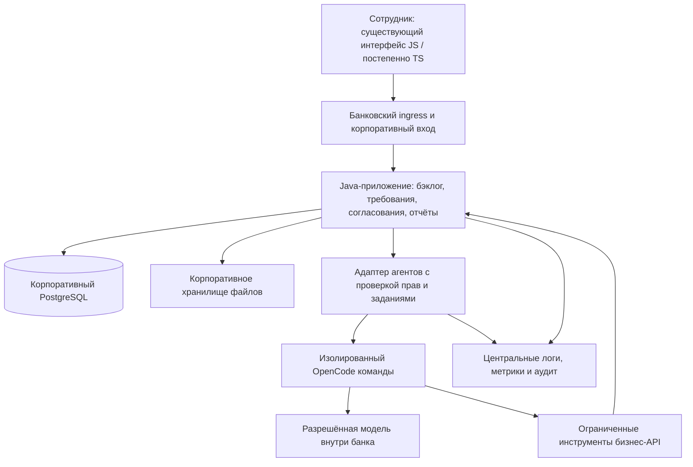

# Готовность Backlog coordinator к платформе банка

Дата выборочной проверки: **24.09.2026**.
Статус: **датированный архитектурный разбор и предложения TO-BE**.
Это не заключение службы ИБ и не подтверждение допуска в промышленную среду.

## 1. Исходные условия и границы проверки

Владелец продукта сообщил:

- Назначение — внутренний инструмент сотрудников: бэклог, требования и согласования.
- ИТ прямо потребовали переписать серверную реализацию на Java; подробного стандарта пока нет.
- На frontend используются JavaScript/TypeScript; обязательность конкретного framework неизвестна.
- Банк ориентируется на импортозамещение и открытые технологии.
- Агенты предположительно будут работать в собственном командном сервисе OpenCode с моделями внутри закрытого контура.
- Redis, возможно, нежелателен; подтверждённого запрета и причины нет.
- Пользователей — десятки. Желательна работа 24/7, возможны согласованные ночные остановки.
- В данных будут ФИО сотрудников и сведения об устройстве внутренних систем.

Проверено текущее рабочее дерево, включая незакоммиченные изменения: точки входа,
аутентификация, аудит, AI-интеграция, хранение сессий, production Compose,
Dockerfile, CI, отдельные тесты и эксплуатационные скрипты. Граф от 09.09.2026
использован только для навигации; выводы сверены с исходниками.

Приложение и тестовые наборы не запускались. Данные БД не читались и не менялись.
Нагрузочные испытания, пентест, восстановление и проверка банковской платформы
не выполнялись. Наличие теста или конфигурации ниже не означает успешного прогона.
Реальные адреса LLM из секретных конфигураций не исследовались.

## 2. Главный вывод

Проект содержит полезное прикладное ядро и заметную подготовку к эксплуатации.
Но поставка пока не является подтверждённо совместимой с платформой конкретного
банка. Требование Java делает перенос прикладного Python-кода необходимым;
оно не доказывает необходимость нового дизайна, смены всех технологий или
разделения каждой предметной области в отдельный сетевой сервис.

Рекомендуемая исходная гипотеза для согласования — Java-приложение с внутренними
модулями, отдельным исполнением фоновых задач при необходимости и изолированным
контуром агентов. Если архитектурный стандарт банка требует самостоятельных
микросервисов, границы следует скорректировать под этот стандарт.

«Platform ready» здесь означает, что приложение можно воспроизводимо собрать,
развернуть, обновить, наблюдать, восстановить и сопровождать штатными средствами
банка, с корпоративной идентификацией и проверяемой защитой данных.

## 3. Что уже есть и должно сохраниться

- PostgreSQL в production, Alembic для основного backend и Prioritiser.
- Объектная авторизация задач, проверка версий, идемпотентность ряда команд.
- Серверные refresh-сессии; access-токен frontend хранит в памяти.
- Транзакционный аудит ORM-изменений в HTTP-контексте:
  [`audit_context.py`](../dmb-backlog/backend/audit_context.py),
  [`test_transactional_audit.py`](../dmb-backlog/backend/tests/test_transactional_audit.py).
- Transactional outbox, повторная доставка и обработка dead letters:
  [`event_outbox.py`](../dmb-backlog/backend/event_outbox.py).
- Таймауты, ограниченные повторы и circuit breaker межсервисных вызовов:
  [`interservice.py`](../dmb-backlog/backend/interservice.py).
- Health/readiness, Prometheus-метрики, трассировка OpenTelemetry, правила alerting.
- Образы с закреплёнными digest, Python lockfiles с хешами,
  запуск прикладных контейнеров от непривилегированного пользователя.
- Ограничения загрузки файлов и ClamAV; unit-тесты и браузерные проверки.

Эти решения следует переносить вместе с поведением продукта. Их наличие
опровергает оценку «в проекте вообще нет промышленной инженерии».

## 4. Подтверждённые разрывы и необходимые изменения

### F01. Несовпадение обязательного стека

**Факт.** Основной backend, BA-агент и Prioritiser исполняют прикладной Python-код.
Текущий frontend — JavaScript. Источники:
[`main.py`](../dmb-backlog/backend/main.py),
[`agents/business-analyst/main.py`](../agents/business-analyst/business_analyst/main.py),
[`Prioritiser Dockerfile`](../agents/value-priority-assessor/Dockerfile),
[`package.json`](../dmb-backlog/package.json).

**Что изменить.** Перенести бизнес-правила и API на разрешённый Java-стек.
Spring Boot — кандидат, конкретные JDK, дистрибутив и версии назначает банк.
Разделить HTTP-контроллеры, прикладные сценарии, доменные правила и адаптеры БД/ИИ.
Например, `tasks_router.py` содержит 2055 строк и непосредственно выполняет
проверки, изменение данных, историю и уведомления. Перевод строк Python в строки
Java без изменения структуры сохранит связанность.

**Приёмка.** Каталог пользовательских сценариев и контрактов проходит на новой
реализации; сохранены права, конфликты, история, расчёты и ошибки. Переход языка
не должен автоматически менять методику расчёта и продуктовые правила.

### F02. Собственная идентификация вместо интеграции с IAM банка

**Факт.** [`auth_router.py`](../dmb-backlog/backend/routers/auth_router.py)
проверяет локальный `password_hash`, создаёт access-токен и refresh-сессию.
В проверенном штатном пути входа нет корпоративного OIDC/SAML.

**Что изменить.** Подключить предоставленный банком SSO. Определить соответствие
корпоративной идентичности локальному профилю и источники ролей/команд, не создавая
второй несогласованный каталог. MFA, отзыв доступа и жизненный цикл сотрудника
увязать с корпоративным процессом. Объектные права проверять на backend даже
после успешного SSO. Отдельно согласовать порядок привилегированных действий.

**Приёмка.** Заблокированный сотрудник теряет доступ в согласованный срок;
пользователь одной команды не получает чужие задачи, файлы, диалоги или RAG-контекст.

### F03. Закрытый AI-контур пока не обеспечен поставкой

**Факт.** Адрес LLM конфигурируется, но значение по умолчанию в
[`agents/business-analyst/config.py`](../agents/business-analyst/business_analyst/config.py) и
[`compose.production.yaml`](../compose.production.yaml) — публичный endpoint.
Адаптер передаёт сообщения на выбранный адрес. Это не доказательство того, что
нынешняя рабочая установка отправляет данные наружу: её секретные настройки
не проверялись. Входной фильтр
[`input_harness.py`](../agents/business-analyst/business_analyst/guardrails/input_harness.py) использует
регулярные выражения для ряда чувствительных данных и prompt injection;
это полезный дополнительный слой, но не полная классификация/изоляция данных.

**Что изменить.** Только утверждённые внутренние адреса моделей, эмбеддингов,
инструментов и телеметрии; сетевой запрет остальных исходящих соединений.
Версионировать модель, параметры, prompt, инструменты и корпус знаний.
Определить сроки хранения диалогов и логов, их доступность, очистку и маскирование.
Фильтровать источники RAG по правам до попадания в контекст модели. Не считать
данные нечувствительными только потому, что система внутренняя.

**Приёмка.** Работа с отключённым внешним доступом; отрицательные проверки
чужих сессий и документов; отсутствие секретов в логах; оценка качества на
согласованной внутренней модели. Качество прежнего внешнего провайдера нельзя
автоматически приписать новой модели.

### F04. Схема БД BA-агента меняется при создании runtime

**Факт.** [`session.py`](../agents/business-analyst/business_analyst/session.py) вызывает `create_all`,
`ALTER TABLE` и backfill в конструкторе `SessionStore`; глобальный экземпляр
создаётся при импорте модуля. В Compose агент имеет две реплики.
Инициализация БД задаёт владельца `dmb` и для БД сессий, и для Prioritiser.

**Что изменить.** Все изменения схемы выполнять отдельным управляемым шагом
релиза, с историей версий и проверкой совместимости. Приложению выдать DML-права,
мигратору — отдельные DDL-права; разделить учётные записи сервисов.
Не выполнять автоматическое изменение справочников или учётных данных при старте.

**Приёмка.** Новый экземпляр приложения стартует с запретом DDL; одновременно
запущенные экземпляры не соревнуются за миграцию. Обновление проверено на копии
разрешённого набора данных и допускает согласованный откат приложения.

### F05. Отказ AI-зависимости влияет на общую readiness

**Факт.** [`main.py`](../dmb-backlog/backend/main.py) возвращает `503` из общей
readiness при отказе BA-агента или включённого Prioritiser. Backend в Compose
также ждёт их готовности при запуске. Для V2 уже реализована неблокирующая проверка.

**Риск.** Если платформа использует эту readiness для маршрутизации, отказ ИИ
может убрать из обслуживания все backend-реплики, хотя обычный бэклог работоспособен.
Сам по себе Compose healthcheck не доказывает автоматическое отключение трафика.

**Что изменить.** Явно выделить критичные и необязательные зависимости.
Сохранять ручную работу при отказе ИИ, показывать понятное состояние AI-функций.
Для долгих операций определить общий бюджет времени, отмену, лимит параллельных
запросов и сохранённый статус задания, чтобы повторы не создавали дублей.

**Приёмка.** При отключении агентов продолжаются чтение/редактирование задач,
согласования и отчёты; AI-ошибка не теряет пользовательский текст.

### F06. Compose ещё не является пакетом для платформы банка

**Факт.** [`compose.production.yaml`](../compose.production.yaml) собирает
прикладные образы из исходников и поднимает PostgreSQL, Redis, Nginx,
Prometheus/Jaeger и хранилища как локальные сервисы/volumes. Пакет Kubernetes/
Helm/OpenShift в исследованном дереве не найден. Две реплики приложения
сами по себе не дают устойчивости к потере хоста, БД или общего диска.

**Что изменить.** Сначала получить целевой шаблон размещения: Kubernetes,
OpenShift либо поддерживаемые VM. Поставлять неизменяемые образы из внутреннего
registry, подключаться к штатным БД, хранению файлов, секретам, PKI и мониторингу.
Зафиксировать CPU/RAM, права процесса, доступные каталоги, probes, остановку,
сетевые разрешения и ротацию секретов. Для Kubernetes применить профиль
безопасности банка; [Pod Security Standards](https://kubernetes.io/docs/concepts/security/pod-security-standards/)
дают проверяемую техническую основу, но не заменяют этот профиль.

**Приёмка.** Штатный pipeline разворачивает приложение без ручной правки контейнера;
оно запускается с политиками целевого окружения и переживает замену экземпляра.

### F07. CI не доказывает работоспособность production-топологии

**Факт.** [Quality Gate](../.github/workflows/quality.yml) запускает backend-тесты
с SQLite. Проверки frontend используют статический сервер; например,
[`notificationSurfaces.spec.mjs`](../dmb-backlog/frontend/e2e/notificationSurfaces.spec.mjs)
подменяет API. Аудит Python-зависимостей направлен на прямые requirements с
`--no-deps`. В этом workflow не обнаружены сборка/сканирование release-образов,
SBOM, подпись и продвижение одного артефакта между средами; отдельного job V2 нет.
Это не исключает существования внешних корпоративных pipeline, которые не предоставлены.

**Что изменить.** Дополнить проверки интеграционным PostgreSQL, реальными
миграциями, двумя экземплярами приложения, сбоями/повторами и сквозными сценариями.
Для Java перенести содержательные сценарии в соответствующий тестовый стек.
Сканировать исходники, секреты, транзитивные зависимости и образы, проверять
лицензии и формировать SBOM по правилам банка. Разделить сборку и развёртывание:
один проверенный артефакт продвигается из среды в среду.

**Приёмка.** В релизном evidence есть результаты именно PostgreSQL/целевого
runtime и пользовательского пути через настоящий backend. Политика допустимых
уязвимостей и исключений определена владельцами процесса.

### F08. Аудит есть, но его полноту и независимое хранение надо доказать

**Факт.** [`audit_context.py`](../dmb-backlog/backend/audit_context.py) пишет
аудит в той же транзакции для ORM-объектов при наличии HTTP-контекста.
Этот механизм сам по себе не покрывает все чтения/выгрузки, отказы авторизации,
фоновые операции и массовые SQL-изменения. Он не доказывает защищённое хранение
за пределами прикладной БД. Технические логи пишутся в stderr и локальный файл.

**Что изменить.** Согласовать каталог значимых событий: входы/отказы,
изменения, решения, привилегированные операции, выгрузки, действия инструментов
агента. Сохранять actor, объект, результат, время, корреляцию и согласованный
состав изменений; подключить централизованный сбор/SIEM и политику хранения.
Не складывать полный чувствительный prompt в общий технический лог.

**Приёмка.** По контрольному действию восстанавливается цепочка «сотрудник —
запрос — агент/инструмент — изменение — результат», включая отказанные действия.

### F09. Наличие backup ещё не подтверждает восстановление

**Факт.** [`backup-production.ps1`](../scripts/backup-production.ps1) требует
остановки writers для согласованной копии. [`verify-backup.ps1`](../scripts/verify-backup.ps1)
проверяет целостность и читаемость, но не запускает восстановленное приложение.
В [`PRODUCTION_RUNBOOK.md`](PRODUCTION_RUNBOOK.md) RPO/RTO и restore drill
явно оставлены внешними условиями допуска.

**Что изменить.** Утвердить допустимую потерю данных и срок восстановления,
согласованные окна обслуживания, защищённое хранение копий, ответственного
и репетицию восстановления приложения, БД, файлов и AI-состояния.
Для этого масштаба ночное окно может быть приемлемым; это решение владельца
сервиса, а не основание обещать нулевой простой.

**Приёмка.** В изолированной разрешённой среде восстановлены данные и пройдены
бизнес-сценарии; измеренные время и потеря данных укладываются в согласованные цели.

### F10. Расхождения кода и документации ухудшают доказательность

**Факт.** [`SECURITY.md`](../dmb-backlog/docs/SECURITY.md) называет аудит
best-effort и неатомарным, хотя текущая реализация транзакционная. В
[`agents/business-analyst/main.py`](../agents/business-analyst/business_analyst/main.py) дважды зарегистрирован один и тот же
`GET /api/agent/ready` — подтверждено статическим разбором AST.
Развивающийся `agents/business-analyst-experimental/` пока не включён в проверенный production Compose/CI.

**Что изменить.** Выбрать состав банковского релиза, определить статус V1/V2,
убрать дублирование маршрутов, актуализировать документы после изменений.
Сохранить управляемый baseline исходников, контрактов и зависимостей.
Экспериментальные компоненты не объявлять production-готовыми без отдельной проверки.

**Приёмка.** Один каталог поставки, однозначные API и документы, соответствующие
конкретному релизу. У каждой включённой компоненты есть сборка и проверки.

## 5. Рекомендуемая целевая структура

Внутри Java-приложения выделить модули задач, требований/ревью, отчётности,
уведомлений, расчётов и интеграций. На первом этапе они могут использовать
общую БД и локальные транзакции, с явным владением таблицами и зависимостями.
[Spring Modulith](https://docs.spring.io/spring-modulith/reference/) — один
из вариантов поддержки модульного приложения, если разрешён банком; он не обязателен.

Адаптер агентов — логическая граница; его необязательно сразу выделять в отдельный
микросервис. OpenCode и сервер модели имеют собственные runtime. Требование Java
следует согласовать для **прикладного кода**, отдельно от готовых платформенных
компонентов, иначе возникает противоречие с выбранным OpenCode.

Frontend можно сохранить вместе с дизайном. TypeScript добавляет статическую
проверку типов и компилируется в JavaScript; его внедрение не требует само по себе
смены интерфейса или перехода на React. Начать с типов API и новых/изменяемых
модулей, затем применять стандарт frontend-команды банка.

В репозитории уже есть [план Java/микросервисной миграции](JAVA_JS_MICROSERVICES_MIGRATION_PLAN.md).
Его каталогизация сценариев и постепенное замещение полезны. Предложение выше
ставит на отдельное согласование степень дробления сервисов; оно не отменяет
существующий план и не является утверждённым решением об изменении его объёма.

## 6. OpenCode — отдельная граница доверия

Штатный текущий BA-сервис — собственное FastAPI-приложение, а не готовая интеграция
с банковским OpenCode. Перенос включает состояние диалога, инструменты, повторы,
отмену, права, версии и обработку ошибок, а не только замену адреса модели.

У OpenCode есть [HTTP API](https://opencode.ai/docs/server/) и
[настройки permissions](https://opencode.ai/docs/permissions/).
Серверный пароль и разрешения инструментов не заменяют корпоративную авторизацию
и изоляцию пользовательских сессий. Рекомендуется:

- Закрыть прямой доступ браузера к административным, файловым и shell API OpenCode.
- Давать агенту только необходимые инструменты предметной области; shell,
  произвольную файловую систему и внешнюю сеть закрыть по умолчанию.
- Проверять пользователя и объект заново при каждом вызове бизнес-инструмента.
  Отдельная сессия или ID команды сами по себе не являются защитной границей.
- Изолировать рабочие каталоги, секреты и контекст; для несовместимых областей
  доверия использовать отдельные процессы/контейнеры.
- Оставить расчёт чисел и проверку бизнес-инвариантов Java-коду; утверждение
  значимых решений — уполномоченному пользователю.
- Обновлять OpenCode, инструменты и модели как версионируемые компоненты поставки.

Ограничение функций и полномочий агента соответствует рекомендациям
[OWASP по Excessive Agency](https://genai.owasp.org/llmrisk/llm062025-excessive-agency/).
Детальная модель угроз и эксплуатационные проверки конкретной версии OpenCode
ещё нужны; в этом разборе его безопасность не сертифицирована.

## 7. Что делать с Redis

Подтверждено использование Redis для rate limiting
([`rate_limit.py`](../dmb-backlog/backend/rate_limit.py)) и Streams для
outbox/SSE ([`events_router.py`](../dmb-backlog/backend/routers/events_router.py)).
Production-валидация требует `REDIS_URL`. Просто удалить контейнер нельзя.

Причину сомнений банка устанавливать догадкой нельзя. Redis использует разные
лицензии для разных версий, что видно из [официальной страницы лицензий](https://redis.io/legal/licenses/);
это возможный предмет согласования, а не установленная причина замечания ИТ.

Варианты в порядке проверки:

1. Использовать уже одобренный банковский сервис того же назначения.
2. Если разрешён Valkey — проверить перенос rate limiter и Streams, TTL,
   replay, повторной доставки, Java-клиента и поведения при отказе.
   [Valkey](https://valkey.io/) использует BSD; есть
   [официальное руководство миграции](https://valkey.io/topics/migration/).
   Это кандидат, а не гарантия полной совместимости любой версии/конфигурации.
3. Для десятков сотрудников рассмотреть PostgreSQL outbox/jobs и чтение событий
   по курсору, с контролируемым polling; общие ограничения запросов вынести в
   gateway либо реализовать транзакционно в БД. Сохранить атомарность, дедупликацию,
   replay, очистку и блокировки нескольких workers. Уведомления в памяти процесса
   не могут быть единственным источником доставки.

Вводить новый Kafka-кластер только ради небольшого бэклога оснований пока нет.
Если корпоративный брокер уже является обязательным стандартом, использовать
его может быть проще, чем поддерживать собственный транспорт.

## 8. Порядок работ и критерии результата

| Этап | Результат | Условие перехода |
|---|---|---|
| 1. Контракт с платформой | Утверждённые Java/runtime, размещение, SSO, БД, файлы, секреты, CI, AI, транспорт событий, владельцы | Есть конкретный банковский шаблон и список требований; Redis и число сервисов не остаются догадками |
| 2. Эталон продукта | Версия исходников и матрица функций, прав, API, расчётов и UI-состояний | Определено, какое поведение должен сохранить перенос |
| 3. Вертикальный Java-срез | Корпоративный вход → чтение/изменение обычной задачи → БД → история/аудит → pipeline | Развёрнут именно на целевой платформе, проверки прав и повторов пройдены |
| 4. Перенос предметных модулей | Задачи, требования, согласования, отчёты, уведомления и расчёты | Сценарии эквивалентны; для каждой области один активный writer |
| 5. Закрытый контур агентов | OpenCode, внутренние модели и ограниченные инструменты | Проверены качество, права, утечки, отмена, таймауты и работа продукта без ИИ |
| 6. Допуск и сопровождение | Пакет проверок ИБ, нагрузки, восстановления, обновления и отката | Есть измеримые результаты, владельцы поддержки и согласованные остаточные риски |

Не связывать смену языка, новый дизайн, новый framework и новую модель в одно
неразделимое переключение. При миграции данных определить совместимость схем,
план переноса и сверку; не допускать неконтролируемой двойной записи старой и
новой реализации. Прикладной откат и откат схемы — разные процедуры.

Импортозамещение не равно любому open source: нужны разрешённые дистрибутивы,
версии, лицензии, внутренние источники зависимостей/образов/моделей и ответственные
за обновления. Конкретный правовой и внутренний режим определяют службы банка.
Как общую основу процесса безопасной разработки можно использовать
[NIST SSDF](https://csrc.nist.gov/pubs/sp/800/218/final); он не заменяет банковский
стандарт и не предписывает язык приложения.

## 9. Что запросить у ИТ следующим сообщением

> Для подготовки Java-версии прошу предоставить эталонный репозиторий приложения
> и минимальные требования к допуску на платформу: разрешённые JDK/framework и
> frontend, целевое размещение, корпоративный вход, БД и учётные записи, файловое
> хранилище, secrets/PKI, CI/CD и проверки ИБ, мониторинг и backup. Отдельно прошу
> уточнить допустимость Redis/Valkey или утверждённый транспорт событий, требования
> к OpenCode и внутренним моделям, а также обязательность разделения приложения
> на микросервисы. Нагрузка — десятки сотрудников; данные — ФИО и сведения о
> внутренних системах; возможны согласованные ночные окна обслуживания.

Отдельно согласовать владельца сервиса и поддержки, класс данных, целевые
доступность/RPO/RTO, состав первого релиза и допустимые исключения.
