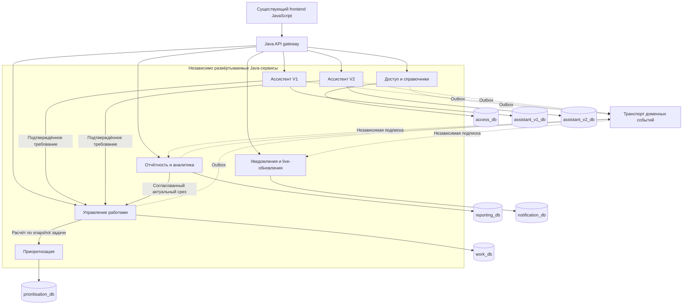

# План перехода на Java, JavaScript и микросервисы

Дата подготовки и выборочной сверки с исходниками: **22.09.2026**.
Целевая микросервисная архитектура конкретизирована: **23.09.2026**.
Статус: **предлагаемый план TO-BE**, не описание уже выполненной миграции.

Цель: перенести серверную реализацию на Java и получить независимо поставляемые
сервисы, сохранив весь существующий функционал, данные и интерфейс JavaScript,
включая малозаметные состояния, оформление и особенности взаимодействия.

Этот документ подготовлен по коду, конфигурации, миграциям и существующим тестам.
Полный аудит поведения, запуск системы, новые снимки интерфейса и испытания
эквивалентности в рамках подготовки плана **не выполнялись**. Дальнейшие этапы
как раз должны дать эти доказательства.

## 1. Основное решение

Существующий frontend уже написан на JavaScript. Его HTML, CSS, JS, шрифты,
иконки, графические библиотеки и ресурсы следует перенести в целевую поставку
без изменений. Переписывание интерфейса на другой framework не требуется для
перехода на Java/JavaScript и не входит в эту трансформацию.

Серверную часть заменяем поэтапно через совместимый входной API. Такой способ
постепенного замещения описан в
[Strangler Fig pattern](https://learn.microsoft.com/en-us/azure/architecture/patterns/strangler-fig).
Конкретная последовательность ниже предложена для этого репозитория.

Перенос языка, изменение владельца данных и изменение транзакционных границ —
разные изменения. Для сложного участка сначала воспроизводим поведение на Java
в прежней границе ответственности, подтверждаем эквивалентность, затем отдельно
выделяем сервис и его хранилище. Промежуточный крупный Java-сервис допустим;
завершение программы требует реальных независимых сервисов.

Требование «всё до мелочей» превращаем в проверяемый договор:

- Каждая наблюдаемая возможность получает идентификатор, источник в коде,
  сценарий, ожидаемый результат и доказательство сохранения.
- Нулевое число необъяснённых функциональных и визуальных различий перед
  переключением соответствующего контура.
- Нельзя понизить важность мелкой детали и исключить её из приёмки. Приоритет
  определяет порядок работ, а не разрешение потерять поведение.
- Исправления старых дефектов и продуктовые улучшения оформляются отдельно.
  Найденный дефект фиксируется в эталоне; его изменение не маскируется миграцией.
- Снимки старой версии не обновляются автоматически ради прохождения новых тестов.

Буквальное равенство пикселей проверяется при одинаковой среде отображения.
Разные ОС, браузеры и шрифтовые движки могут рисовать один интерфейс по-разному;
для каждой поддерживаемой среды нужен собственный эталон. Это ограничение среды,
а не допуск на изменение дизайна. Ответы внешней LLM также не гарантируют
побайтовую повторяемость: детерминированную часть сравниваем точно, содержательную
работу модели — отдельным протоколом из раздела 7.

## 2. От чего отталкиваемся

| Область | Подтверждено при предварительном исследовании | Следствие для плана |
|---|---|---|
| Основной backend | FastAPI, SQLAlchemy; API и значительная часть правил в роутерах | Извлекать спецификацию из исполняемого кода, включая зависимости, middleware и ORM hooks |
| Frontend | Vanilla JavaScript, ES modules, hash routing, локальные CSS и ресурсы | Сохранить текущую поставку интерфейса и внешний API |
| Данные | PostgreSQL, Alembic; 48 объявлений `__tablename__` в основном `models.py` | Это нижняя граница инвентаризации, без таблиц других сервисов, связующих таблиц и расхождений реальной БД |
| Ассистент V1 | Отдельный Python HTTP-сервис `agents/business-analyst/` | Архитектура уже частично сервисная; существующую границу можно использовать |
| Приоритизатор | Отдельный сервис `agents/value-priority-assessor/`, расчёты, LLM, RAG и локальные ML-зависимости | Нужен ранний технический эксперимент по переносу вычислений и поиска на целевой стек |
| Ассистент V2 | Действующий `agents/business-analyst-experimental/`; старый самостоятельный прототип удалён 02.11.2026 | Сохранить действующие режимы V2; учитывать [сохранённые решения](AGENT_V2_RETIREMENT_2026-11-02.md) |
| Live-обновления | Транзакционный outbox, Redis Stream, SSE, повторная доставка и dead letters | Перенос CRUD без событий не обеспечивает сохранения функционала |
| Безопасность | JWT, bcrypt, refresh cookie/сессии, проверки доступа к отдельным объектам | Сохранить не только роли, но и точные правила доступа, отзыва сессий и ошибок |
| Файлы и эксплуатация | Каталог вложений, проверка ClamAV, scheduler, health/readiness, метрики и трассировка | Эти возможности входят в объём миграции |
| Тесты | В рабочем дереве 43 файла `test_*.py` основного backend, 60 frontend `*.test.mjs`, 13 Playwright `*.spec.mjs` | Это число файлов, не число пройденных тестов и не доказательство полноты покрытия |

Playwright сейчас запускает Chromium и локальный static server. Часть сценариев
перехватывает API или работает с каталогами компонентов. Их нужно сохранить,
но дополнить проверками настоящих страниц с обоими backend. Старые отчёты и
граф знаний используются только как указатели для поиска.

В рабочем дереве есть многочисленные изменённые и новые файлы. Текущий HEAD
`ccb843aabb7515bb5b0e1be77e0680dd159dd817` **не описывает целиком** актуальную
версию. Фиксация только этого commit потеряет часть функций и дизайна.

## 3. Этапы, результаты и условия перехода

Оценки ниже — предварительные интервалы для планирования при наличии владельца
продукта/аналитика, технического лидера, 2–3 Java-разработчиков, JS-разработчика,
QA automation и участия DevOps. Это не обещание календарного срока.

| Этап | Работы | Результат | Условие завершения | Ведущие участники |
|---|---|---|---|---|
| 0. Эталон, 2–4 рабочих дня | Определить версию, окружения, поддерживаемые сценарии и состав поставки | Паспорт эталона, manifest, правила изменения baseline | Любой участник может воспроизвести именно выбранную версию | Техлид, владелец продукта, DevOps |
| 1. Анализ AS-IS, 2–4 недели | Каталог функций/UI/API/данных, права, транзакции, интеграции, фоновые задачи | Матрица сохранения, карты состояний и зависимостей, реестр пробелов | Нет необследованных исполняемых областей в согласованном объёме | Аналитик, разработчики, QA |
| 2. Эталонные проверки, 3–5 недель | Характеризационные, контрактные, визуальные, сквозные и отказные проверки | Воспроизводимый набор сравнения старой и новой версии | Каждое требование связано с автоматической либо воспроизводимой ручной проверкой | QA, JS, Java/Python-разработчики |
| 3. Целевая архитектура и эксперименты, 1–2 недели | Границы сервисов/данных, контракты, Java-совместимость, AI/RAG, откат | ADR, карта владельцев данных, результаты экспериментов | Ключевые технические неопределённости сняты | Техлид, Java, DevOps |
| 4. Основа поставки, 2–3 недели | Java-шаблон, gateway, CI, observability, окружения и тестовый стенд | Работающая инфраструктура без изменения пользовательского поведения | Старый интерфейс проходит эталонные проверки через новый вход | Java, DevOps, QA |
| 5. Первый перенос, 1–2 недели | Один ограниченный сценарий чтения, сравнение результатов, переключение | Проверенный образец миграции с откатом | Контракты, дизайн, данные и эксплуатационные проверки пройдены | Java, QA |
| 6. Волны миграции | Последовательный перенос областей по разделу 9 | Java-сервисы и независимое владение данными | Каждый контур проходит полный набор ворот приёмки | Вся команда |
| 7. Финальное переключение, ориентир 2–4 недели | Репетиции, пользовательская приёмка, нагрузка, перенос состояния, наблюдение | Подтверждённая целевая система | Все критерии раздела 11 выполнены | Владелец продукта, QA, DevOps, техлид |
| 8. Вывод Python из эксплуатации | Удаление runtime-зависимостей после контрольного периода | Целевая поставка и актуальные инструкции | Нет обращений к старым сервисам и неперенесённых возможностей | Техлид, DevOps |

Этап 2 начинается после появления первых описанных сценариев этапа 1; ранние
эксперименты этапа 3 также можно вести параллельно анализу. До завершения этапов
1–3 оценивается только подготовительная часть. Срок всей программы рассчитывается
по числу функциональных сценариев, состояниям UI, транзакциям и данным, а после
первого переноса уточняется по фактической скорости команды.

## 4. Эталон и контроль изменения объёма

1. Выбрать каноническую версию: текущая рабочая копия, конкретный стенд или
   согласованная комбинация. До выбора использовать рабочее дерево для анализа,
   не объявляя его автоматически эталоном пользовательской приёмки.
2. Сохранить контролируемый снимок исходников: базовый commit, diff, нужные новые
   файлы и SHA-256 manifest. Не терять незакоммиченный frontend и V2; не включать
   `.env`, секреты, БД, backups, runtime-логи, виртуальные среды и `graphify-out/` в Git.
3. Зафиксировать lockfiles, образы, миграции, настройки флагов без секретов,
   локаль, timezone, браузеры, ОС, размеры окон, DPR и масштаб.
4. Подготовить неизменяемую эталонную поставку и воспроизводимый набор разрешённых
   данных. Вложения, история, агентские сессии и пользовательские настройки входят
   в паспорт состояния. Восстановление копий БД с защищёнными записями требует
   отдельного прямого разрешения по правилам репозитория.
5. Для каждой функции указать статус: активна, доступна по флагу, отдельный CLI/UI,
   диагностическая, недостижима из runtime. Opt-in не означает «можно потерять».
   Недостижимость доказывается анализом вызовов и конфигурации; архивные документы
   и дизайн-прототипы сами по себе не добавляют требований.
6. Все текущие возможности включены по умолчанию. Любое предложение исключения
   требует отдельного решения владельца; при его отсутствии возможность остаётся.
7. Пока идёт миграция, новые изменения продукта получают те же ID, эталоны и
   проверки. Ведётся журнал дельты относительно baseline; перед каждой волной
   проверяется, что изменения старой ветки перенесены в спецификацию и новую версию.

## 5. Анализ функционала: что именно инвентаризировать

Для каждого действия фиксируем акторов, доступность, входы, значения по умолчанию,
валидации и сообщения, переходы состояния, результат на экране, записи БД,
историю, события, повторный вызов, ошибки, конкурентный доступ и отмену.

| Контур | Обязательные подробности |
|---|---|
| Вход и оболочка | Login/logout, refresh/истечение сессии, default route, доступное меню, sidebar, back/forward, прямые ссылки, восстановление после reload |
| Задачи и бэклоги | Все поля карточки, вкладки, inline/quick edit, оба бэклога, Kanban, сортировка и tie-breakers, фильтры, pagination, сохранение состояния таблиц, групповые операции |
| Конкурентная работа | Версии записей, locks/viewers, конфликт сохранения, stale form, повторная отправка, идемпотентность и её срок действия |
| Оценка и планирование | Экспресс-оценка, эпики/stories, трудозатраты, ставки и стоимость, квартальные цели, решения ПИП и возврат на доработку |
| Запросы и ревью | «Мои запросы», черновики, версии, отправка/переоткрытие, review, решения, ограничения редактирования, создание и связи задач |
| Отчётность | Общие отчёты, DMB/командные/директорские/ДИД-представления, аналитика, встречи, статусы и история отчётных статусов, недельный отчёт, экспорт и настройки колонок |
| Импорт/экспорт | CSV/XLS/XLSX, кодировки, русские числа/даты, пробелы, пустые значения, сопоставление полей, дубли, preview, конфликт, частичный отказ, атомарность, имена и формат файлов |
| Обсуждения и файлы | Комментарии/ответы, черновики комментариев, Markdown, ссылки на вкладку/комментарий, ограничения вложений, антивирус, ошибки upload/download, права скачивания |
| Уведомления | Колокольчик, dashboard, центр, toast, счётчики, read/unread, настройки, ссылки, время и дедупликация, scheduler, SSE/reconnect/replay, fallback polling, dead letters |
| Ассистенты | V1 и V2, сохранение фактов/provenance, конфликты, документы/ревизии, streaming, отмена и повтор, review/handoff, восстановление сессии, недоступность LLM, изоляция флагами |
| Приоритизатор | Value internal/external, ручные значения, явное принятие предложения, диапазоны, Cost/CV, факторы, overrides, P1–P5, score, explanations, RAG/аналогии, кэш и повторяемость |
| Управление | Существующие пользовательские возможности справочников, команд, ресурсов, ролей и пользователей; ограничения полей и защищённые операции |
| Настройки и общие элементы | Темы, акценты, compact, подписи полей/колонок, modal/confirm/tooltip, проверка орфографии, keyboard/focus/scroll, пустые/ошибочные состояния |
| Эксплуатационные интерфейсы | CLI и отдельный Streamlit UI приоритизатора, feature flags, health/readiness, метрики, audit, maintenance jobs, backup/restore и стартовые сценарии |

Матрица сохранения создаётся в машиночитаемом виде и используется как backlog:

```text
ID | контур | роль/область доступа | исходный файл/символ | предусловия
   | действие | ожидаемый UI/API/данные/события | негативные варианты
   | эталон/тест | целевой сервис | исполнитель | статус | evidence
```

Примеры отдельных строк: открытие `?task=...&tab=...&comment=...` с возвратом
через Back; сохранение текста после ошибки review; повтор команды с прежним
idempotency key; восстановление SSE по cursor; отображение каждой формы импорта
на узком экране. Одна строка «карточка задачи сохранена» недостаточна.

Полнота проверяется в обе стороны: от пользовательских сценариев к коду и от
каждого router, маршрута, обработчика, job, hook и интеграции к сценарию.
Все недокументированные обработчики и динамические маршруты также учитываются.

## 6. Как сохранить дизайн без отклонений

### 6.1. Сохранение исходной реализации

Сохраняем байты frontend-поставки: HTML/шаблоны, CSS и порядок подключения,
JavaScript, шрифты Inter/Unbounded, Lucide, Chart.js/ECharts, SheetJS и словари
проверки орфографии. Отдельно фиксируем assets, URL `/static`, MIME types,
cache headers и lazy-loaded ресурсы. Даже неизменный CSS может дать другой
результат при ином шрифте, данных или порядке загрузки.

Существующие ключи localStorage/sessionStorage, пользовательские настройки,
hash routes и query-параметры сохраняются. Все необходимые изменения адаптации
должны пройти те же проверки, что и серверный перенос.

### 6.2. Каталог состояний

Собираем эталоны **реальных страниц приложения**, затем дополняем их компонентными:

- Каждый маршрут, динамическая карточка, вкладка, drawer, modal и popup.
- Все роли и области доступа: один экран может иметь разные поля и действия.
- Светлая/тёмная тема, каждый акцент, обычный/compact режим, состояния sidebar.
- Фактические breakpoints и ширины непосредственно до/на/после каждого порога,
  desktop, tablet, mobile, короткий landscape, DPR и масштабирование.
- Initial/loading/skeleton, empty, filled, error, retry, validation, forbidden,
  selected, disabled, focus, hover, drag/drop, success и undo там, где они есть.
- Длинные русские подписи, длинные значения, переносы/ellipsis, переполнение,
  большие таблицы, раскрытые секции, графики, tooltip и легенды.
- Скролл, sticky-элементы, focus trap/return, keyboard navigation, восстановление
  позиции/черновика и предупреждение о несохранённых изменениях.
- Анимации, задержки и промежуточные состояния потоковых ответов.

Полная матрица сочетаний хранится явно. Сокращённый набор для pull request ускоряет
обратную связь; перед приёмкой волны выполняется полный применимый набор.
Непроверенная комбинация не получает статус «сохранено» по умолчанию.

### 6.3. Метод проверки

Используем текущий Playwright и развиваем снимки. В старой и новой версии
фиксируем одинаковые данные, время, локаль, браузер/ОС, viewport/DPR, шрифты
и условия rendering. Не подменяем ожидаемый screenshot результатом новой версии.
Необходимость одинаковой среды отдельно отмечена в
[документации Playwright](https://playwright.dev/docs/test-snapshots).

Для воспроизводимых статических состояний целевой pixel diff равен нулю:
явно задаём `maxDiffPixels: 0`, `threshold: 0` и исключаем скрытые допуски
выбранного comparator. Нестабильный rendering сначала устраняем в стенде.
Динамические значения стабилизируем входными данными/часами; масками нельзя
скрывать контролы, тексты, графики или целые области интерфейса.

Дополняем screenshot сравнением геометрии, computed styles, текстов и DOM/ARIA
контрактов. Анимации проверяем отдельными временными сценариями/кадрами:
отключение анимаций в статическом screenshot не доказывает их сохранение.
Сравниваем и начальное отображение, чтобы не потерять порядок загрузки и мерцание.

Каждое различие получает причину и исправление. При необходимости изменить сам
дизайн требуется отдельная продуктовая задача: миграция не создаёт такого допуска.

## 7. Контракты, данные и перенос Python-семантики

### 7.1. API и вычисления

Снимаем OpenAPI с эталонного приложения для каждого применимого набора флагов,
дополняем реально используемыми HTTP/SSE контрактами. Сохраняем paths, методы,
headers, cookies, коды ответа, JSON, имена полей и текст видимых ошибок.

На Java отдельно воспроизводим различия `null`/missing/empty, defaults, coercion
Pydantic, формат ошибок валидации, Decimal/float, округление, overflow, даты и
timezone, Unicode/case, collation, сортировку пустых значений, pagination,
multipart и сериализацию. Замена FastAPI на Spring не должна незаметно заменить
прежний 422 на иной ответ или поменять формат, который читает frontend.

Одинаковые команды выполняются на изолированных разрешённых наборах данных
старой и новой версии. Сравниваются ответ, итоговые записи, история, audit,
outbox и файлы. Нормализуются только доказанно технические нестабильные поля;
видимые пользователю значения и порядок результатов не нормализуются «для удобства».
Боевые изменяющие команды не дублируются в теневой обработке.

### 7.2. AI и поиск

Сначала фиксируем загружаемые runtime prompts, схемы structured output,
версию/параметры модели, порядок сообщений, tool contracts, знания/индексы,
tokenizer, embeddings, cache keys и правила отказа. Не считаем неиспользуемые
prompt-файлы источником поведения.

Два уровня проверки:

1. Записанные ответы LLM и tool results проигрываются обеим реализациям. Факты,
   provenance, конфликты, ревизии, workflow, валидация, события SSE, итоговые
   документы и защита от повторной отправки должны совпадать точно.
2. Живые диалоги выполняются на фиксированном golden dataset с повторными
   прогонами: сохранность фактов, полнота, корректность решений, источники,
   отсутствие выдуманных данных, число шагов, задержки и стоимость. Критические
   инварианты проходят каждый прогон; для вероятностных метрик заранее задаются
   объём выборки и критерий отсутствия ухудшения, затем результаты оценивает эксперт.

Ранний эксперимент проверяет перенос FAISS/sentence-transformers/Torch-зависимой
цепочки приоритизатора: одинаковую токенизацию, нормализацию, embeddings, ranking,
tie-breakers, BM25/RRF и границы численных результатов. Реализация Java/JS или
совместимый inference runtime выбирается по результатам проверки; замена модели
или индекса не принимается как эквивалентная без доказательств.

Python-сервисы могут временно работать за адаптерами. Если принято требование
полного Java/JavaScript runtime, оставшийся обязательный Python sidecar означает
незавершённую миграцию. Отдельные CLI и Streamlit-сценарии также получают целевую
замену при сохранении их в объёме, включая поведение и оформление UI.

### 7.3. Сохранность состояния

Инвентаризация включает таблицы всех сервисов, индексы/constraints, sequences,
историю миграций, файлы и контрольные суммы, агентские диалоги/ревизии, кэши с
бизнес-значимым состоянием, outbox, idempotency records, сессии и настройки.

Для каждой сущности задаётся единственный владелец записи и карта всех читателей.
Сохраняем ID, внешние ссылки, временные метки, версии, историю и значения.
Проверяем количество строк, контрольные суммы по ключам, содержимое полей,
ссылочную целостность, totals и повторное открытие старых объектов интерфейсом.
Нельзя заменять сверку данных только сравнением количества записей.

Сначала допустим общий PostgreSQL-кластер с явно разделёнными правами и владельцами.
Общая запись нескольких сервисов в одни таблицы не является конечной архитектурой.
В целевом состоянии сервисы имеют собственные схемы/БД и credentials, не используют
чужие таблицы для записи; междоменные чтения идут через API или согласованные проекции.

Для каждого набора таблиц выбирается один процесс миграций. Существующую Alembic
историю сохраняем; перенос под Java-инструмент миграций делается с проверенным
baseline, без автогенерации изменяющего DDL при старте приложения.

## 8. Целевая микросервисная архитектура

Предлагаемый целевой вариант: **семь прикладных Java-сервисов, отдельный Java
API gateway и существующий JavaScript frontend**. Каждый прикладной сервис имеет
собственные данные, API, сборку, миграции и цикл развёртывания. Это рабочий проект
архитектуры TO-BE; проверка всех транзакционных границ входит в этапы 1–3.

### 8.1. Конечная схема

На этой схеме Python-компонентов уже нет. Каждый цилиндр — отдельная логическая
БД PostgreSQL с собственными credentials; физически БД могут находиться в одном
кластере. Стрелки к БД разрешены только её владельцу. Пунктир обозначает события.



Схема показывает основные бизнес-потоки. Дополнительно сервисы обращаются к
Access за актуальным контекстом доступа, владельцам объектов — за проверкой
object-level policy, а AI-сервисы — к внешним LLM. Эти зависимости отдельно
включаются в таймауты, нагрузочные и отказные испытания.

### 8.2. Сервисы и точные зоны ответственности

Имена ниже — предлагаемые технические имена будущих компонентов, а не уже
существующие каталоги или запущенные приложения.

| Сервис | Что ему принадлежит | Что он предоставляет | Что остаётся за его границей |
|---|---|---|---|
| `work-service` | Задачи, проекты, требования/review, эпики/stories, экспресс-оценка, отчётные встречи и статусы, комментарии, метаданные и содержимое вложений, история и блокировки | API бэклогов, карточек, Kanban, customer/review, импорта и связанных команд; согласованные срезы для отчётности | Пользователи и справочники; генерация AI-ответов; методика приоритизации; доставка уведомлений |
| `access-reference-service` | Пользователи, credentials, роли/назначения, refresh-сессии, команды/состав/ответственные, справочники, ставки и ресурсы, общие настройки представления | Совместимые auth/admin/reference API; актуальный контекст пользователя и версии справочников | Решение о доступе к конкретной задаче/запросу — у владельца объекта; бизнес-данные задач не хранятся здесь |
| `reporting-service` | Определения отчётов, пользовательские настройки отчётов, производные аналитические проекции | API отчётов, ДИД/директорских/командных представлений и аналитики; существующие форматы выдачи/выгрузки | Изменение задач, встреч и отчётных статусов выполняет Work |
| `notification-service` | Уведомления, шаблоны, настройки доставки, дедупликация, расписания напоминаний и позиции чтения потока | Центр/колокольчик/dashboard, счётчики, read/unread, snapshot и авторизованный SSE с replay | Не меняет бизнес-статусы задачи или требования; получает основания для уведомлений от владельцев |
| `assistant-v1-service` | Диалоги V1, факты, provenance, черновики, KB/LLM orchestration и состояние сессий | Совместимый chat/streaming API V1, подготовка и передача подтверждённого требования | Review и создание задачи принадлежат Work |
| `assistant-v2-service` | Изолированные сессии V2, поручения, документы, ревизии, замечания и предложения правок | Совместимые сценарии V2, handoff и подтверждённая передача в Work | Не получает прямого доступа к work_db, не обходит allowlist и существующие ограничения применения правок |
| `prioritisation-service` | Численные методики, параметры/снимки знаний, аналогии/RAG, расчётные объяснения и кэш | Value/диапазон, приоритет/факторы по snapshot задачи; сохранённые standalone-возможности | Не изменяет задачи: принятие предложения и сохранение результата выполняет Work по прежним правилам |

Ассистенты V1/V2 разделены на два deployable-компонента, чтобы сохранить текущую
изоляцию, независимые флаги и возможность отключать V2 без нарушения V1.
Семь сервисов — начальная целевая граница, а не требование дробить систему до
заданного количества. Внутри Work остаются модули задач, review, оценки и встреч.
Их последующее выделение возможно только при доказанной автономности.

### 8.3. Распределение существующих данных

| Владелец | Переносимые таблицы/состояние |
|---|---|
| Work | `tasks`, `projects`, `epics`, `stories`, `requirement_requests`, `task_history`, `task_comments`, `task_attachments`, `task_viewers`, `task_jira_links`, `tags`, `issue_tags`, `project_tags`, `reporting_meetings`, `task_reporting_statuses`, `task_reporting_status_revisions`, `reporting_meeting_history`, `timeline_events` и файлы вложений |
| Access & Reference | `users`, `roles`, `refresh_sessions`, `teams`, `team_competency_resources`, `competency_cost_history`, `channels`, `deadlines`, `departments`, `priorities`, `task_types`, `team_types`, `project_statuses`, `business_customers`, `did_client_groups`, `statuses`, `start_shifts`, `dictionary_items`, `display_settings`, `column_labels`, `field_labels` |
| Reporting | `reports`, `user_report_prefs`; новые производные проекции с учётом source version |
| Notifications | `notifications`, `notification_templates`, `user_notification_preferences`; cursor/replay и delivery state |
| Assistant V1 | Существующая БД сессий `agents/business-analyst/`; текущая привязка `agent_sessions` переносится сюда с сохранением ограничения и ID |
| Assistant V2 | Существующая отдельная БД/ревизии `agents/business-analyst-experimental/` и пространства идентификаторов V2 |
| Prioritisation | Собственная БД `agents/value-priority-assessor/`, версии расчётных параметров/знаний, разрешённые локальные индексы и состояние кэша |

`event_outbox`, `idempotency_records` и транзакционный `audit_log` становятся
локальными механизмами каждого сервиса, выполняющего соответствующие команды.
Единая пользовательская лента аудита собирается через API/производную проекцию
Reporting с сохранением фильтров, порядка, прав и свежести. Исходные записи аудита
остаются у владельца транзакции; сбой центрального чтения не должен отменять
уже совершённую локальную запись.

Это покрывает объявления таблиц основного `models.py`; полный анализ отдельно
сверяет фактическую БД, migrations, JSON-поля и хранилища других компонентов.
Внутрисервисные FK сохраняются. Межсервисные ссылки становятся стабильными ID с
проверкой существования/доступности через API и явно определёнными правилами
деактивации/удаления. Автоматическое удаление связанных данных каскадом между
сервисами не вводится. Правила ссылочной целостности проверяются на эквивалентность.

Чужие БД недоступны даже для отчётных SQL JOIN. Сервис получает необходимые данные
через API владельца или собственную восстанавливаемую проекцию. Разделение данных
и контрактное взаимодействие соответствуют принципу
[владения данными сервиса](https://learn.microsoft.com/en-us/dotnet/architecture/microservices/architect-microservice-container-applications/data-sovereignty-per-microservice).
Физический перенос защищённых записей выполняется только по правилам раздела 10.

### 8.4. Внешний API и взаимодействие сервисов

Frontend продолжает обращаться к прежним URL. Gateway маршрутизирует по паре
method/path, сохраняет headers/cookies/status/body и без буферизации передаёт
SSE. Бизнес-валидации, commits и решение о результате команды остаются в сервисах.

| Существующая внешняя область | Целевой обработчик |
|---|---|
| Auth, users, teams и административные операции со справочниками/правами | Access & Reference |
| Tasks, collaboration, customer-запросы, review, express, meetings/statuses и timeline | Work |
| Reports, DID backlog и endpoints аналитики | Reporting, при необходимости с запросом согласованного среза в Work |
| Notifications и общий live event stream | Notifications |
| Chat/sessions/stream V1 | Assistant V1; request/review endpoints из текущего agent-router — Work |
| V2 browser API | Assistant V2; проверка linked objects и команды передачи требования — через Work |
| Расчёт Value/priority из карточки | Work вызывает Prioritisation и сохраняет результат только по текущим правилам |
| Общая административная лента audit | Reporting; доступ и состав строк проверяются сервером |

Один старый router может обслуживать несколько контекстов: нельзя перенаправить
весь `/api/v1/agent` или `/api/v1/tasks` одному сервису только по prefix.
Полная таблица маршрутизации method/path создаётся из инвентаризации M02.

Внутренние синхронные API: HTTP/JSON с версией, service authentication,
подтверждённым actor context, correlation/trace ID, таймаутом и бюджетом повторов.
Пользовательский браузер не имеет доступа к внутренним endpoints. Повтор команды
разрешён только при сохранении её идемпотентности. Сам gateway не выдаёт
дополнительных прав; конечный сервис повторно проверяет применимые политики.

Асинхронные сообщения описываются отдельно от OpenAPI. Предлагаемый envelope:
`event_id`, `event_type`, `schema_version`, `aggregate_type`, `aggregate_id`,
`aggregate_version`, `occurred_at`, `producer`, `correlation_id`, `payload`.
Примеры проектируемых событий: `TaskChanged`, `RequirementReviewed`,
`ReportingStatusChanged`, `ReferenceChanged`. Это новые внутренние контракты;
формат SSE для браузера остаётся прежним.

Транспорт на первом этапе — отдельные доменные Redis Streams с независимыми
consumer groups; существующий короткий поток UI не используется как единственный
журнал доменных изменений. Redis поддерживает независимые группы, подтверждения
и работу с pending-сообщениями; доставка требует обработки повторов и ограничений
хранения. Основание: [Redis Streams](https://redis.io/docs/latest/develop/data-types/streams/).

Каждый producer фиксирует outbox вместе с бизнес-данными. Consumer фиксирует
`event_id` и локальное изменение в одной транзакции, затем подтверждает доставку.
Проверяются пропуски версий, дубли, перестановки, retries и dead letters.
Срок хранения источника/replay, checkpoint каждого обязательного потребителя,
восстановление проекций, persistence и резервирование задаются до запуска.
Trim не должен уничтожать единственную копию неприменённых событий. Потеря Redis
должна восстанавливаться из сохранённого источника; если эти условия не обеспечены,
выбор транспорта пересматривается до переключения. «Exactly once» не обещается.

### 8.5. Транзакции и сохранение пользовательского поведения

**Пример: принятие требования и создание задачи.** Review, `RequirementRequest`
и Task находятся в Work. Если эталон выполняет их изменение атомарно, Java
сохраняет одну локальную транзакцию вместе с audit/outbox. Уведомление и
аналитическая проекция формируются из события после commit. Два сервиса с
независимыми commits здесь не вводятся без доказательства равенства поведения.

**Пример: расчёт приоритета.** Work читает разрешённый snapshot задачи и её версию,
вызывает Prioritisation, проверяет ответ и применяет существующий контракт
сохранения. Поведение при изменении задачи во время расчёта сначала фиксируется
по эталону и воспроизводится, включая конфликт или отказ, если они уже есть.
Расчётный сервис не получает credentials work_db.

**Пример: просмотр отчёта сразу после изменения.** Незаметно устаревший отчёт
не принимается. Где нужна текущая согласованность, Reporting запрашивает
авторизованный срез Work. Проекция допускается только при доказанной достаточной
свежести: версия/checkpoint должны соответствовать запросу; иначе используется
актуальный срез. Нельзя добавить пользователю новый статус ожидания ради удобства
асинхронной архитектуры. Для междоменных срезов требуется отдельный контракт
согласованности; до его проверки этот сценарий не переключается.

**Пример: передача из AI в review.** Ассистент владеет документом/сессией, Work —
заявкой. Передача использует идемпотентную команду и сохраняет уже существующее
поведение confirm/cancel-review при отказе. Анализ проверяет каждый промежуточный
сбой. Введение новой saga не считается автоматическим доказательством эквивалентности.

При недоступности LLM обычные задачи и отчёты продолжают работать. При остановке
Notifications события остаются у источников для восстановления доставки. При
отказе Reporting не блокируется запись задачи. Отзыв доступа не зависит от
запаздывания аналитической проекции; проверка выполняется по актуальной политике.
Точные пользовательские ошибки сверяются с эталоном.

### 8.6. Развёртывание, стек и эксплуатация

- Каждый из семи сервисов и gateway имеет отдельный container image, процесс,
  конфигурацию/секреты, pipeline, миграции, readiness/liveness и rollback.
- API и фоновые workers одного домена могут масштабироваться раздельно, сохраняя
  единое владение его данными. Notification scheduler принадлежит Notifications;
  доменные jobs — своему владельцу. Проверяется отсутствие двойного исполнения.
- Java со Spring Boot — базовый серверный стек. Версии JDK LTS и библиотек
  закрепляются ADR по [официальным требованиям Spring Boot](https://docs.spring.io/spring-boot/system-requirements.html).
  Frontend и browser-тесты остаются JavaScript; Python отсутствует в конечном runtime.
- PostgreSQL хранит бизнес-данные; Redis используется для событий и нужных кэшей.
  Контент вложений имеет отдельный persistent volume под управлением Work с
  сохранением ClamAV и авторизованного скачивания. Доступ нескольких реплик к
  нему проверяется до масштабирования Work.
- Существующие Prometheus/OpenTelemetry и trace ID распространяются через все
  сервисы. Контролируются задержка запросов, ошибки, lag событий, retries/DLQ,
  свежесть проекций, ресурсы JVM, стоимость и время AI-вызовов.
- Развёртывание может начинаться с Compose. Применение Kubernetes определяется
  эксплуатационными требованиями; независимые релизы и изоляция данных обязательны
  при любом выборе среды.
- Репозиторий может оставаться единым, но каждый сервис выпускается отдельно.
  Общие библиотеки ограничены техническими функциями; общая ORM-модель всех
  доменов и обязательный одновременный релиз всех сервисов не допускаются.

### 8.7. Проверяемый результат архитектурной работы

До массовой реализации должны быть готовы:

1. C4 container/deployment diagrams с семью сервисами, gateway, БД, volumes,
   внешними зависимостями и trust boundaries.
2. Полный реестр владельцев всех таблиц/полей/файлов/jobs и карта транзакций;
   отдельный разбор всех прежних JOIN/FK, проходящих через новую границу.
3. Внешний compatibility routing, внутренние OpenAPI и схемы событий с правилами
   версионирования, авторизации, идемпотентности, ошибок и согласованности.
4. Sequence diagrams для review → task, AI → review, task → priority,
   task → notification/report и импорта с отказами на каждом шаге.
5. Независимые pipelines и стенд, доказывающий отдельный релиз каждого сервиса
   при сохранении совместимости с предыдущей версией соседей.
6. Испытания отказа каждого сервиса и транспорта, восстановления состояния,
   performance/SLO и полного равенства пользовательского функционала и дизайна.

Этап 3 заканчивается этим пакетом, а не одним перечнем названий сервисов.
Переходное сосуществование Python и Java описано в разделе 9; общие writable
таблицы и обязательная работа старого backend не являются конечным результатом.

## 9. Последовательность переноса

1. **Совместимый вход и поставка frontend.** Gateway сначала направляет всё
   существующим backend; проверяются static resources, cookies, headers, SSE,
   URL и все эталоны интерфейса. Переключение входа само по себе не меняет систему.
2. **Пилот чтения.** Выбрать после анализа ограниченный read-only расчёт или
   отчёт с известными правами и данными. Выполнять Java в теневом режиме без
   побочных эффектов, сравнивать ответы, затем направить этот сценарий на Java.
3. **Первый контур записи.** Перенести небольшой согласованный агрегат с
   историей, audit, идемпотентностью и outbox. Проверить атомарность и откат с
   новыми записями. Только после этого масштабировать подход на остальные команды.
4. **Основной workflow.** Задачи, оценки, требования/review и связанные статусы
   переносить в порядке зависимостей. Создание задачи из запроса и другие общие
   транзакции не разрывать ради раннего выделения сервиса.
5. **Отчёты, уведомления и фоновые процессы.** Выделить владельцев хранилищ и
   проекции, обеспечить свежесть результатов, расписания и единственное выполнение
   jobs. Граница notifications проверяется на всех трёх поверхностях UI и SSE.
6. **Приоритизатор и ассистенты.** Реализовать Java-эквиваленты после ранних
   экспериментов; перенести состояние, выполнить численные и диалоговые эталоны.
   V1/V2 переключать независимо, сохранив feature flags и fallback, уже существующий
   в продукте; не добавлять новый эвристический ответ при недоступности LLM.
7. **Доступ, нормативные данные и окончательная автономность.** Снять временные
   адаптеры к Python, разделить оставшееся владение, перенести эксплуатационные
   инструменты и завершить независимые контракты релизов.

Порядок шагов 4–7 уточняется по графу зависимостей. Совместимость аутентификации
нужна уже на первом шаге; поздним может быть только переключение её реализации
и хранилища. Перенос AI можно вести параллельно ядру после стабилизации контрактов.

У каждой волны один обязательный пакет: scope/ID сценариев → реализация →
контрактное и визуальное сравнение → сверка данных → отказные проверки →
репетиция отката → пользовательская приёмка → переключение → наблюдение.

## 10. Переключение, откат и защищённые данные

Для каждого контура до переключения готовится исполняемый runbook:

1. Проверенная резервная копия и восстановление в разрешённом окружении.
2. Совместимые аддитивные изменения схемы, один активный writer и версия контракта.
3. Если данные физически переносятся: начальный снимок и последующие изменения
   через выбранный outbox/CDC либо согласованную паузу записи. При смене БД
   проверяются lag, watermark и отсутствие пропущенных изменений.
4. На границе переключения — завершение/дренирование активных команд и фоновых
   jobs, запрет прежнему writer, окончательная сверка, затем включение нового.
5. Canary по целому агрегату/контексту сессии. Случайное распределение изменяющих
   запросов одного объекта между двумя независимыми writer запрещено.
6. Метрики ошибок, p95/p99, SSE, состояние очередей, свежесть проекций и точность
   данных наблюдаются по заранее определённым порогам и периоду.
7. Откат учитывает записи, появившиеся после переключения. Если оба приложения
   работают с совместимым состоянием, проверяется обратное переключение writer.
   При раздельных БД нужен проверенный обратный replay/перенос дельты перед
   возвратом. Возврат маршрута на устаревшую БД не является откатом.

Необратимые удаления/переименования схемы откладываются до конца контрольного
периода. Восстановление старого backup с потерей новых пользовательских действий
не принимается как штатный rollback. Если безопасный rollback пока невозможен,
переключение контура не выполняется.

Отдельное ограничение репозитория: справочники, пользователи/credentials, роли,
назначения, состав и атрибуты команд защищены от создания/изменения/удаления,
включая тесты и скрипты. Сам запрос составить план не разрешает эти операции.
До прямого разрешения используем чтение, mocks и разрешённые готовые наборы;
не запускаем seed и не копируем защищённые записи в новую БД автоматически.
Необходимо учесть и скрытые записи: например, login обновляет данные пользователя.
Физический перенос этих данных будет отдельным конкретным шагом с manifest,
diff ожидаемых изменений и проверенным rollback для разрешения владельцем.

## 11. Критерии приёмки

| Проверка | Обязательный результат |
|---|---|
| Полнота объёма | У 100% пунктов реестра есть реализация, проверка и результат; нет забытых флагов, CLI/UI и фоновых процессов |
| Функционал | Все эталонные сценарии совпадают; нет открытых миграционных отличий, включая мелкие |
| Дизайн | Исходные ресурсы сохранены; полный применимый набор состояний совпадает, стабильные screenshots имеют нулевой diff |
| API | Совпадают используемые HTTP/SSE контракты, ошибки, cookies, фильтры и сериализация |
| Данные | Нет утраты/дублирования, сохранены ID/история/файлы/сессии, сверены поля и контрольные суммы |
| Права | Совпадают положительные и отрицательные проверки для каждой роли и области доступа, включая SSE/download/search |
| Конкурентность | Нет lost updates, повторных бизнес-эффектов и разрыва атомарных операций |
| AI/приоритизация | Точное совпадение детерминированных результатов; выполнен протокол живых прогонов и экспертная приёмка |
| Производительность | На одинаковых данных/нагрузке выполнены SLO относительно baseline: HTTP p95/p99, render/interaction, SSE, import/export, расчёты, память и CPU |
| Отказы | Проверены timeout/разрыв связи, повтор/перестановка событий, падение writer/consumer, Redis/БД/LLM, восстановление scheduler и SSE |
| Эксплуатация | Проверены rollout/rollback и backup/restore; работают runbooks, мониторинг, локальный запуск и логи |
| Микросервисы | Сервисы независимо собираются/развёртываются, имеют владельцев данных и не требуют синхронного релиза всей системы |
| Целевой стек | Ни один сохранённый сценарий не зависит от обязательного Python runtime |
| Приёмка владельца | Сценарии пройдены на одинаковых данных в обеих версиях, подтверждены функциональная и визуальная идентичность |

Существующие Python-тесты остаются эталонным материалом на время перехода.
Ключевые проверки переносятся на Java/JavaScript до удаления старого runtime.
Процент покрытия строк сам по себе не служит критерием сохранения продукта.

## 12. Первые задачи для запуска программы

| ID | Задача | Проверяемый результат |
|---|---|---|
| M00 | Определить baseline с учётом рабочего дерева и стенда | Паспорт версии, список включённых компонентов, manifest |
| M01 | Построить реестр UI и действий | Все routes, динамические переходы, роли, экраны и состояния связаны с кодом |
| M02 | Извлечь API и побочные эффекты | Реестр method/path/SSE/job/hook, валидаций и изменений состояния |
| M03 | Описать данные и транзакции | Все хранилища, владельцы, читатели, общие commits, файлы и очереди |
| M04 | Подготовить эталонный стенд и browser matrix | Повторные прогоны старой версии дают стабильный результат |
| M05 | Сопоставить существующие проверки с реестром | Явный список пробелов вместо предположения о полном покрытии |
| M06 | Записать golden scenarios и screenshots | Эталоны критического пути, затем всех применимых состояний |
| M07 | Выполнить Java compatibility и AI/RAG spikes | Доказательства по сериализации, cookies, SSE, числам и поиску |
| M08 | Выбрать границы и пилот | ADR с транзакциями, владельцами, стоимостью эксплуатации и планом отката |
| M09 | Уточнить backlog и календарный план | Оценка по сценариям, зависимости, исполнители и критерии каждой волны |

Первая контрольная точка — завершённый паспорт и реестр сохранения. Крупную
реализацию Java не следует начинать до появления измеримого эталона для
соответствующего контура. Малые исследовательские эксперименты можно выполнять раньше.

## 13. Основные локальные источники

- [Карта проекта](index.md) и [навигатор документации backend/frontend](../dmb-backlog/docs/README.md).
- [Сборка FastAPI и маршруты](../dmb-backlog/backend/main.py),
  [модели](../dmb-backlog/backend/models.py), [схемы API](../dmb-backlog/backend/schemas.py).
- [Маршрутизация UI](../dmb-backlog/frontend/js/router.js),
  [HTML и ресурсы](../dmb-backlog/frontend/index.html),
  [токены](../dmb-backlog/frontend/css/tokens.css),
  [шрифты](../dmb-backlog/frontend/css/fonts.css).
- [Транзакционные события](../dmb-backlog/backend/event_outbox.py),
  [идемпотентность](../dmb-backlog/backend/idempotency.py),
  [аутентификация](../dmb-backlog/backend/routers/auth_router.py).
- [Архитектура основного приложения](../dmb-backlog/docs/ARCHITECTURE.md),
  [логика страниц](../dmb-backlog/docs/PAGE_LOGIC.md),
  [дизайн](../dmb-backlog/docs/DESIGN_SYSTEM.md).
- [Playwright config](../dmb-backlog/playwright.config.mjs),
  [browser tests](../dmb-backlog/frontend/e2e/), [CI](../.github/workflows/quality.yml),
  [программа DEV-испытаний](dev-testing/README.md).
- [Ассистент V1](../agents/business-analyst/docs/ARCHITECTURE.md),
  [ассистент V2](../agents/business-analyst-experimental/docs/ARCHITECTURE.md),
  [приоритизатор](../agents/value-priority-assessor/README.md),
  [его runtime-зависимости](../agents/value-priority-assessor/requirements.txt).
- [Локальная инфраструктура](../compose.yaml),
  [production-топология](../compose.production.yaml),
  [правила защищённых данных](../AGENTS.md).
