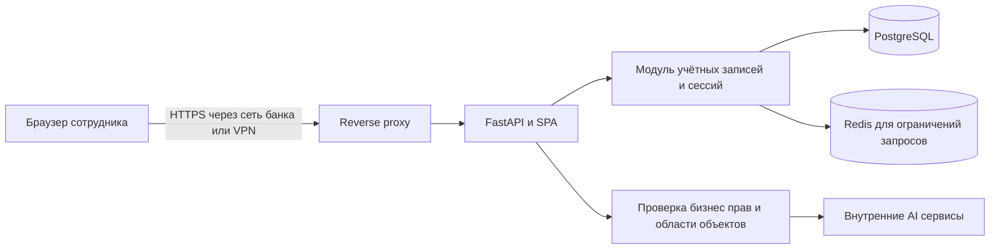

# Проект безопасного управления учётными записями

Статус: реализация в рабочем дереве от 12.10.2026; ввод в эксплуатацию не выполнен.
[Фактический контракт, проверки и процедура cutover](../dmb-backlog/docs/ACCOUNT_SECURITY.md).
Ниже сохранены целевые требования и исходные основания; раздел «Что есть сейчас»
описывает исходное состояние до реализации. В этом чате рабочие пароли не менялись. Уточнение пользователя: сохранить вход
администратора `t.babiak@dmb.ru`; для этого допускается явно включённая совместимость
со старым bcrypt без автоматического rehash и без ввода свыше 72 UTF-8 байт.
Дальнейшие требования обязательной активации относятся к строгому режиму.

Цель — дать сотруднику безопасный вход по логину, самостоятельную смену пароля
и управление своими сессиями, а администратору — создание учётной записи,
выдачу приглашения, восстановление доступа и отключение пользователя.
Для текущего FastAPI-приложения предлагается единый модуль управления доступом
в backend с PostgreSQL и Redis. Отдельный сетевой микросервис на первом этапе
не требуется: он усложнит немедленный отзыв доступа и согласование транзакций.

## Согласованные условия

- Администратор создаёт учётную запись и передаёт пользователю приглашение.
- Развёртывание — DEV-стенд внутри банка, доступ также через корпоративный VPN.
- Идентификатор — логин. Он может выглядеть как почта, но наличие почтового
  ящика не требуется. Письма, SMTP и проверка владения адресом не используются.
- Восстановление доступа выполняется через администратора.
- В первом выпуске используется только логин и пароль, без второго фактора.

Остальные параметры ниже — предлагаемые значения для реализации, а не уже
утверждённая политика банка. Сроки сессий, парольная политика и хранение аудита
задаются конфигурацией. VPN ограничивает сетевой доступ, но не заменяет вход
и проверку прав в приложении.

## Что есть сейчас

| Область | Подтверждённое поведение | Необходимое изменение |
|---|---|---|
| Идентификатор | `User.login` необязателен, длина 50, уникальность не задана; `email` обязателен и уникален | Один канонический уникальный логин; исключить зависимость от реальной почты |
| Вход | `LoginRequest.email: EmailStr`, поиск по `User.email`; UI требует `type=email` | Поле `login` и текстовый ввод без email-валидации |
| Создание пользователя | Общий пароль задан по умолчанию в схеме, admin router и frontend | Удалить все варианты общего/заданного администратором пароля; выдавать приглашение |
| Хэширование | passlib/bcrypt | Argon2id для новых паролей, контролируемый переход существующих |
| Токены | Access JWT в памяти SPA, refresh cookie HttpOnly; refresh-токены хэшируются в БД, ротируются | Сохранить эти свойства, добавить стабильную серверную сессию и версию учётных данных |
| Отзыв | `/logout` отзывает refresh; `get_current_user` проверяет JWT и активность пользователя, но не состояние сессии | Отозванный access JWT должен отклоняться на следующем запросе |
| Время жизни | По умолчанию access 60 минут, refresh 7 суток; `expires_in=3600` захардкожен | Согласовать сроки и вычислять `expires_in` из фактического токена |
| Администрирование | `/users` допускает запись с `admin=partial`; `/admin/users` требует `full` и имеет дополнительные защиты | Все пути изменения пользователя должны вызывать одну политику и один сервис |
| Ограничения входа | 5 запросов в минуту по IP и идентификатору, Redis либо локальная память | Учесть общий VPN/NAT, атомарность и отказ Redis |
| Пользовательский интерфейс | Вход предлагает обратиться к администратору; самостоятельной смены пароля нет | Отдельная доступная всем страница «Безопасность» |
| Customer-only | Router закрывает общий `/settings` | Разрешить отдельный `/account/security` без открытия остальных настроек |

Первичные источники:
[модели](../dmb-backlog/backend/models.py),
[схемы](../dmb-backlog/backend/schemas.py),
[проверка доступа](../dmb-backlog/backend/auth.py),
[auth API](../dmb-backlog/backend/routers/auth_router.py),
[refresh](../dmb-backlog/backend/refresh_sessions.py),
[users API](../dmb-backlog/backend/routers/users_router.py),
[admin API](../dmb-backlog/backend/routers/admin_router.py),
[ограничения запросов](../dmb-backlog/backend/rate_limit.py),
[конфигурация](../dmb-backlog/backend/config.py),
[вход UI](../dmb-backlog/frontend/js/components/login.js),
[администрирование UI](../dmb-backlog/frontend/js/components/admin.js),
[настройки безопасности аккаунта UI](../dmb-backlog/frontend/js/components/accountSecurity.js),
[router UI](../dmb-backlog/frontend/js/router.js),
[auth клиента](../dmb-backlog/frontend/js/auth.js),
[API клиента](../dmb-backlog/frontend/js/api.js).
Это проверка кода, не испытание развёрнутого банковского стенда.

## Логин и профиль

Новые логины: 3–254 символа ASCII, первая позиция — буква или цифра, далее
буквы, цифры, точка, дефис, подчёркивание и `@`. Примеры: `ivan.petrov`,
`petrov_01`, `ivan.petrov@bank`. Символ `@` не меняет семантику логина.
В интерфейсе поле называется «Логин», подсказка — «Выдан администратором».

Перед поиском и проверкой уникальности удаляются крайние пробелы и приводится
к нижнему регистру ASCII. Внутренние пробелы, управляющие и невидимые символы,
кириллица и смешанные алфавиты для новых логинов запрещены. Ограничение длины
входного запроса применяется до обработки. Пароль по этим правилам не преобразуется.
В БД действует unique constraint на `login_normalized`; проверка в приложении
не заменяет ограничение БД при параллельном создании.

Логин не является секретом. ФИО, должность и отображаемое имя хранятся отдельно.
Пользователь видит свой логин, но сам его не меняет. Администратор может изменить
логин после повторного подтверждения пароля; все сессии и приглашения пользователя
отзываются, старое имя остаётся зарезервированным и не передаётся другому человеку.
Старый логин больше не даёт входа. `User.id` и ссылки из задач остаются неизменными.

Поле `email` выводится из аутентификации. На переходном этапе хранится как
legacy-атрибут существующих записей, затем допускает NULL для новых пользователей.
Его нельзя считать подтверждённым контактным адресом и использовать для recovery.
Не создавать фиктивные почтовые адреса ради сохранения старого API.

## Пользовательские сценарии

### Приглашение и первый вход

1. Полный администратор указывает логин и существующие профильные назначения
   в форме создания. Приложение создаёт состояние `invited`; пароля ещё нет.
   Назначение роли/команды остаётся отдельным административным действием;
   публичная форма активации эти поля не принимает.
2. После повторного ввода своего пароля администратор получает одноразовую ссылку
   или код активации, действительный 24 часа. Секрет показывается один раз.
3. Администратор передаёт его адресату через разрешённый корпоративный канал
   после проверки личности. Конкретный канал и контакт поддержки задаёт владелец
   стенда. Автоматической рассылки из системы нет.
4. Пользователь открывает форму «Задать пароль», вводит новый пароль дважды.
   GET страницы не расходует приглашение: предпросмотр ссылки не должен его погасить.
5. Сервер атомарно проверяет назначение, срок и версию приглашения, сохраняет
   хэш, переводит credentials в `ready` и погашает секрет. Затем показывает
   «Пароль установлен. Войдите с вашим логином»; автоматического входа нет.

Истечение приглашения не удаляет пользователя. Повторная выдача отзывает все
предыдущие приглашения. Для `invited`, `reset_required` и отключённого пользователя
обычный вход не выдаёт access/refresh. Публичная регистрация отсутствует.

### Самостоятельная смена пароля

Доступна на `#/account/security` всем вошедшим пользователям независимо от
бизнес-роли и разрешения на общие настройки. Форма: текущий пароль, новый пароль,
повтор нового пароля. Поддерживаются менеджеры паролей, вставка, показ/скрытие,
`autocomplete=current-password/new-password` и сообщения рядом с полями.

Сервер получает владельца из сессии; `user_id`, роль, команда и профильные
атрибуты в запросе запрещены. Повтор нового пароля проверяет UI, парольную политику
и текущий пароль обязательно проверяет сервер. Новый пароль не должен совпадать
с текущим. Ошибка не меняет хэш и не отзывает сессии.

При успехе в одной транзакции обновляются хэш и `password_changed_at`, увеличивается
`auth_version`, отзываются все сессии, recovery/invite и reauth-подтверждения,
записывается событие аудита. Завершается и текущая сессия. UI очищает состояние,
уведомляет остальные вкладки и переводит на вход с сообщением «Пароль изменён.
Войдите снова». Автоматического повторения запроса смены пароля после 401 нет.

### Восстановление через администратора

На экране входа ссылка «Забыли пароль?» открывает инструкцию и контакт поддержки.
Публичного API, которое по одному логину блокирует аккаунт или выпускает секрет,
нет. Контрольные вопросы и дата рождения не используются для подтверждения личности.

Администратор проверяет личность по корпоративному процессу, открывает карточку,
выбирает «Сбросить доступ», указывает основание/номер обращения и подтверждает
свой пароль. В одной транзакции сервер переводит пользователя в `reset_required`,
увеличивает `auth_version`, отзывает сессии и предыдущие секреты, выпускает
одноразовый recovery-код на 30 минут. Старый пароль больше не даёт входа.
Такое немедленное ограничение вызвано подтверждённым действием администратора,
а не анонимным запросом на восстановление.

Получатель самостоятельно задаёт новый пароль. Администратор никогда не вводит,
не просматривает и не получает этот пароль. Истёкший recovery-код не возвращает
доступ со старым паролем: нужен новый код. Отключённый аккаунт нельзя активировать
через recovery; его включение — отдельная операция. Ошибки истёкшего, повторного,
отозванного и неизвестного кода дают одинаковое сообщение.

### Сессии и отключение

Пользователь видит свои активные сессии: браузер/ОС как приблизительную подпись,
создание, последнюю активность, IP, признак «Это устройство». Геолокации по IP нет,
VPN-адрес не считается надёжным идентификатором устройства. Можно завершить одну
сессию или все остальные; для завершения остальных требуется текущий пароль.
Обычный выход завершает текущую серверную сессию целиком.

Полный администратор может отозвать все сессии пользователя, временно отключить
аккаунт и отдельно включить его. Повторное включение не оживляет старые токены.
Recovery не восстанавливает ранее отозванные сессии. Удаление пользователя физически
не применяется: авторство задач и аудит сохраняются.

## Архитектура и границы доверия

Предлагаемые модули backend: `services/accounts.py` для lifecycle и единых
административных проверок, `services/credentials.py` для парольной политики,
`services/auth_sessions.py` для серверных сессий, `services/auth_challenges.py`
для одноразовых подтверждений. Названия новых файлов предварительные.
Роутеры валидируют DTO и вызывают сервисы; изменения credentials не должны
выполняться произвольным `setattr` из общей формы редактирования пользователя.

Проверка доступа каждого API: валидность JWT → активность User → версия credentials
→ активная сессия → актуальные права → доступ к конкретному объекту. Приватные
вложения, экспорт, отчёты, customer API и gateway агентов используют тот же guard.
Фоновая задача не получает полномочия из переданного клиентом `user_id`.
Агенты не получают пароли и recovery-коды, их сервисные ключи отделены от ключей входа.

Для первого выпуска сохраняется access JWT в памяти SPA и refresh cookie HttpOnly.
Это уменьшает объём изменений существующего клиента. JWT содержит `sub`, `sid`,
`auth_version`, `type`, `iat`, `exp`, `iss`, `aud`, `jti`; email и права в него
не помещаются. Разрешённый алгоритм фиксирован сервером. Все поля строго
валидируются; некорректный `sub` даёт 401, а не исключение 500.

## Парольная политика

Предлагается минимум 15, максимум 128 символов Unicode, с разрешёнными пробелами
и кириллицей. Используется NFC до подсчёта длины и хэширования новых паролей,
без `trim`, изменения регистра или обрезания. Управляющие символы отклоняются.
Нет обязательной смеси регистров/цифр, периодической смены по календарю и подсказок
к паролю. Смена требуется при компрометации и восстановлении. Проверяется локальный
список распространённых/скомпрометированных паролей и полное совпадение с логином.
Пароли и их фрагменты не отправляются во внешние сервисы проверки.
Основание: [NIST SP 800-63B-4](https://pages.nist.gov/800-63-4/sp800-63b.html).

Новые пароли хэшируются Argon2id с уникальной солью. Начальная нижняя граница
`m=19456 KiB, t=2, p=1`; параметры повышаются после измерения на DEV-хосте
с учётом параллельных входов. Хэширование выполняется в ограниченном пуле,
без блокировки async event loop и без неограниченной очереди. Параметры хранятся
в encoded hash; для старых хэшей предусмотрена проверка необходимости обновления.
Основание: [OWASP Password Storage](https://cheatsheetseries.owasp.org/cheatsheets/Password_Storage_Cheat_Sheet.html).

Legacy bcrypt проверяется по старым правилам до перехода. Нельзя молча считать
одинаковыми парольные строки после 72 байт и переносить такое совпадение как новый
Argon2id-пароль. Для неоднозначного legacy-ввода и общих стартовых паролей требуется
проверенное приглашение/восстановление. Формат хэша и версия нормализации учитываются
в миграции. Повреждённый хэш закрывает вход и даёт обезличенное событие оператору.

## Сроки и защита сессий

| Параметр | Предлагаемое значение |
|---|---|
| Access JWT | 5 минут; `expires_in` вычисляется из `exp` |
| Абсолютный срок сессии | 8 часов от успешного входа, refresh его не продлевает |
| Неактивность | 30 минут; для полных администраторов 15 минут |
| Подтверждение чувствительного действия | Одноразовое, 5 минут, связано с сессией, действием и целевым пользователем |
| Приглашение | 24 часа |
| Recovery-код | 30 минут |
| Максимум одновременных сессий | 5; при новом входе сверх лимита отзывается самая старая |

«Запомнить меня» в первом выпуске убирается. Браузерная cookie без постоянного
`Max-Age` не является гарантией выхода при закрытии браузера; сроки контролирует
сервер. Cookie: `Secure`, `HttpOnly`, `SameSite=Strict`, без `Domain`, path
`/api/v1/auth`. При выходе cookie удаляется с теми же параметрами.
Основание серверных сроков и отзыва: [OWASP Session Management](https://cheatsheetseries.owasp.org/cheatsheets/Session_Management_Cheat_Sheet.html).

Каждый защищённый запрос читает User и AuthSession из PostgreSQL. Для DEV положительный
кеш допуска не вводится. После commit отзыва следующий запрос со старым access JWT
получает 401. Проверка длительных SSE/AI-потоков повторяется максимум раз в 5 секунд;
при отзыве поток закрывается. Уже отправленные данные отозвать невозможно.
Операции над credentials повторно проверяют актуальность под блокировкой строки.

`last_activity_at` обновляют бизнес-запросы пользователя. Автоматические refresh,
проверки статуса, получение уведомлений и heartbeat не продлевают неактивность.
Длительный AI-поток также ограничен сроком сессии; UI предупреждает об истечении
и сохраняет разрешённый рабочий черновик без credentials.

Refresh ротируется атомарно; токены одной семьи привязаны к стабильному `sid`.
Параллельные refresh в одной вкладке объединяются в один запрос; между вкладками
используются Web Locks и BroadcastChannel. Для старого ротированного refresh
сохраняется ограниченное окно 10 секунд: он не выдаёт токены и получает отдельный
409 `REFRESH_ALREADY_ROTATED`, не уничтожая сессию победителя. Клиент один раз
повторяет refresh после координации с вкладкой-победителем. За пределами окна
reuse отзывает всю AuthSession, включая access. Потеря ответа, которую нельзя
безопасно восстановить, приводит к повторному входу. Историю использованных refresh
нельзя удалять до окончания абсолютного срока семьи.

## Защита приглашений и административных действий

Invitation и recovery — случайные секреты CSPRNG не менее 256 бит; в БД только
SHA-256 digest. Быстрый хэш допустим здесь из-за случайной энтропии, но не для пароля.
У секрета есть назначение, получатель, срок, issuer, версия credentials и признаки
погашения/отзыва. Секрет другого назначения нельзя использовать для входа или reset.
Одновременно действует не более одного password-setup секрета пользователя.
Проверка и погашение происходят в одной PostgreSQL-транзакции с изменением пароля.
Два параллельных запроса не могут успешно использовать один секрет.
Основание: [OWASP Forgot Password](https://cheatsheetseries.owasp.org/cheatsheets/Forgot_Password_Cheat_Sheet.html).

Предпочтительно передавать код отдельно от адреса формы. Если используется ссылка,
секрет находится во fragment `#/activate?token=…`, извлекается в память и сразу
удаляется из адреса через `history.replaceState`. В query HTTP, логах, аналитике,
referer, local/sessionStorage, тикетах и общем audit JSON секретов быть не должно.
Страница установки пароля не подключает внешние скрипты; `Referrer-Policy: no-referrer`,
ответы `Cache-Control: no-store`. После установки парольных полей в DOM не остаётся.

`POST /auth/reauthenticate` проверяет текущий пароль и выпускает одноразовое
подтверждение, связанное с `sid`, `auth_version`, назначением и целевым ID.
Оно не является access-токеном. Изменение логина, выдача/отзыв приглашения,
административный recovery, отключение и изменение полномочий требуют такого
подтверждения, `admin_access=full` и актуальных серверных проверок. Подтверждение
расходуется в той же транзакции, что и действие. Смена своего пароля проверяет
текущий пароль непосредственно, без дополнительного промежуточного шага.

Запрещено отключать самого себя, лишать себя административного доступа и оставлять
систему без активного готового к входу полного администратора. Защита действует
для обоих users API и редактирования самой роли. Одновременные изменения
администраторов сериализуются PostgreSQL advisory lock или отдельной строкой
инварианта; простого `count` перед записью недостаточно. Административный reset
собственного аккаунта запрещён: используется обычная смена пароля либо другой админ.

При потере всех администраторов нужен операторский recovery из защищённой консоли
с отдельным инфраструктурным доступом: выпуск одноразового приглашения существующему
администратору, отзыв его сессий, причина и обязательный аудит. Никакого публичного
bootstrap endpoint, постоянного аварийного пароля или автоматического seed.
Такую команду следует реализовать отдельно; в текущей задаче она не выполняется.

## Предлагаемые API

Все пути ниже имеют префикс `/api/v1`. DTO меняющих запросов используют
`extra=forbid`. Секреты отсутствуют в ответах, кроме однократной выдачи invitation,
recovery или reauth. Все чувствительные ответы — `no-store`.

| Метод и путь | Вход и результат | Доступ |
|---|---|---|
| `POST /auth/login` | `{login,password}` → access JWT, `expires_in`, минимальный профиль; refresh cookie | Анонимный, rate limit и Origin |
| `POST /auth/refresh` | Cookie → новый access и refresh | Cookie, Origin, ограничения |
| `POST /auth/logout` | Отзыв текущего `sid`, удаление cookie, 204 | Текущая cookie и/или access, Origin; повтор безопасен |
| `GET /auth/me` | Актуальный собственный профиль | Активная сессия |
| `GET /auth/password-policy` | Публичные ограничения длины и правил, без blocklist | Анонимный |
| `POST /auth/password/change` | `{current_password,new_password}` → 204 и выход со всех устройств | Активная сессия и текущий пароль |
| `POST /auth/password/setup` | `{token,new_password}` → 204; invitation или recovery | Валидный одноразовый секрет, Origin, rate limit |
| `POST /auth/reauthenticate` | `{password,purpose,target_user_id?}` → одноразовое подтверждение и срок | Активная сессия, ограниченный перечень purpose |
| `GET /auth/sessions` | Только свои сессии, без хэшей/token/family secrets | Активная сессия |
| `DELETE /auth/sessions/{id}` | Отзыв одной своей сессии, 204 | Владелец; чужой/неизвестный ID → 404 |
| `POST /auth/sessions/revoke-others` | `{reauth_token}` → число отозванных сессий | Владелец, подтверждение |
| `GET /auth/security-events` | Собственные события безопасности с пагинацией | Владелец |
| `POST /admin/users` | Создание invited-пользователя без `password`; разрешённые профильные поля и `reauth_token` → профиль | Full admin |
| `POST /admin/users/{id}/invitation` | `{reauth_token}` → одноразовый секрет, срок и ID операции | Full admin, состояние invited |
| `POST /admin/users/{id}/password-reset` | `{reason,reauth_token}` → recovery-секрет и срок | Full admin, проверенная личность |
| `POST /admin/users/{id}/revoke-sessions` | `{reason,reauth_token}` → число отозванных сессий | Full admin |
| `PATCH /admin/users/{id}/login` | `{login,reason,reauth_token}` → профиль и отзыв доступа | Full admin |
| `PATCH /admin/users/{id}/access-state` | `{is_active,reason,reauth_token}` → профиль | Full admin, защита последнего администратора |

Создание invited-записи и выдача приглашения — два явных шага, UI предлагает второй
сразу после первого. При потерянном ответе создания повтор не создаёт дубль благодаря
unique login. При потерянном ответе выдачи секрет не читается повторно из БД:
администратор выпускает новый, автоматически отзывая предыдущий.
Общий idempotency cache не сохраняет пароль, его fingerprint или ответы с секретами.

Переход: старые изменяющие `/users` и `/admin/users` переводятся на единый account
service либо закрываются одновременно с обновлением SPA. Они не могут оставлять
обход через старую схему, общий пароль или `admin=partial`. Read-only каталог
пользователей сохраняет минимальные поля для рабочих сценариев.

Ошибки: неверный вход, неготовая и отключённая учётная запись → одинаковые
401 `INVALID_CREDENTIALS`; неверный setup → `SETUP_TOKEN_INVALID`; недостаток прав
→ 403; неизвестная чужая сессия → 404; конфликт логина виден только администратору
→ 409; политика нового пароля → 422 без эха введённого значения; лимит → 429
с `Retry-After`; недоступность критической инфраструктуры → 503.
Для несуществующего пользователя выполняется dummy password verification;
не обещать математически одинаковое время ответа, проверять отсутствие явного
быстрого пути. UI различает сеть, 429 и неправильные credentials.

## Модель данных

| Сущность | Поля и ограничения |
|---|---|
| `users` | Существующий неизменный `id`; `login` до 254, `login_normalized` unique/not null после миграции; `email` legacy nullable; `password_hash` nullable только для invited; `credential_state` invited/ready/reset_required; `auth_version` bigint; `password_changed_at`; `password_normalization_version`; существующий `is_active` |
| `login_reservations` | `login_normalized` unique, `user_id`, `created_at`, `retired_at`; резервирование прежних логинов без повторной выдачи |
| `auth_sessions` | UUID `id`, `user_id`, `auth_version`, `created_at`, `last_activity_at`, `absolute_expires_at`, `revoked_at`, `revoke_reason`, ограниченные по длине client/IP metadata |
| `refresh_sessions` | Существующая история ротации; добавить FK `auth_session_id`; unique `jti`, token hash, family, expiry, revoked/rotated fields; TTL не больше absolute expiry |
| `auth_challenges` | UUID, user/issuer, `purpose`, unique `token_hash`, `auth_version`, `expires_at`, `used_at`, `revoked_at`; для reauth — `session_id` и целевой action/ID |
| `security_events` | Время UTC, actor/subject/session ID, action, outcome, reason code, request ID, IP; whitelist metadata без credentials |

Индексы: sessions по user/revoked/expiry, challenges по hash и user/purpose,
events по subject/time. Для invite/recovery одна активная запись на пользователя:
условный unique index по непогашенным/неотозванным password-setup challenges;
истёкшая запись явно отзывается при новой выдаче. Временной `now()` не используется
в условии индекса. Ограничения состояния credentials задаются CHECK constraints.

Порядок блокировок для lifecycle: инвариант администраторов при необходимости →
User → AuthSession → AuthChallenge/refresh. Login, refresh, смена пароля и reset
согласуются через блокировку User и повторную проверку версии. Дорогой password hash
вычисляется до короткой транзакции; внутри сверяется исходный hash/version, чтобы
результат проверки старого пароля не воскресил доступ после параллельного reset.

Успешные изменения и их audit event фиксируются атомарно. Если запись обязательного
аудита не удалась, изменение откатывается. Неуспешные попытки записываются отдельно,
без сохранения тела запроса. Предложение хранения: security events 180 дней,
закрытые session metadata 30 дней; использованные token hashes — до absolute expiry
семьи плюс технический запас. Сроки требуют эксплуатационного согласования.

## Ограничения запросов и безопасность DEV стенда

Начальные лимиты для измерения под реальным VPN/NAT: вход — 5 неуспешных попыток
на канонический логин за 5 минут, ограниченная задержка до 15 минут; общий IP —
120 попыток в минуту; reauth/смена — 5 ошибок за 5 минут на user/session;
setup — 5 ошибок на digest токена за 5 минут плюс 60 запросов на IP в минуту;
выдача/reset — 5 операций на цель за час и 30 на администратора за час.
Refresh ограничивается прежде всего по сессии, с отдельным широким IP-пределом
600/мин для общего VPN. Значения конфигурируемые; успешный вход не очищает общий
IP-счётчик. Постоянная блокировка аккаунта от анонимных ошибок не вводится.

Перед дорогим хэшированием действует отдельный предел всех попыток и ограничение
параллелизма. Redis-счётчик, TTL и backoff обновляются атомарно, например Lua-скриптом;
текущие раздельные INCR/EXPIRE не считаются достаточным контрактом.
Ключи идентификаторов — HMAC с отдельным ключом; метрики не содержат логинов.
При отказе Redis операции входа, setup, reauth и изменения credentials закрываются
с 503; работа уже проверенных сессий и logout сохраняется при доступной PostgreSQL.
Refresh при недоступном rate limiter также даёт 503, без обхода на локальную память.

Для банковского DEV обязателен отдельный профиль с `DEBUG=false`, HTTPS и
доверенным корпоративным сертификатом. Статические ресурсы UI размещаются внутри
контура. Наружу публикуется только reverse proxy; БД, Redis и AI endpoints
недоступны браузеру напрямую. Proxy доверяет forwarded-заголовкам только от
своих адресов; приложение проверяет allowlist Host и канонический внешний Origin,
а не строит доверенный Origin из произвольного Host запроса.

На login/refresh/logout/setup и чувствительных POST/DELETE проверяется точный Origin.
CORS не содержит `*` с credentials, для cookie сохраняется SameSite=Strict.
CSRF-проверки не заменяются самим фактом нахождения в VPN. HSTS включается на
проверенном HTTPS-домене. CSP проходит сначала report-only и устранение inline
скриптов/внешних зависимостей, затем enforcement; `frame-ancestors 'none'`,
`object-src 'none'`, `base-uri 'none'`, `X-Content-Type-Options: nosniff`.
Эти заголовки — целевые требования, их наличие в текущем развёртывании не подтверждено.

Пароли, Authorization/Cookie, setup/reauth secrets и их хэши исключаются из
request/response capture, traceback, audit diffs и телеметрии, включая ошибки
Pydantic с полем `input`. Новые таблицы проверяются на автоматический ORM-аудит.
События входа, смены/reset, изменения логина, отзыва, отключения и replay имеют
отдельные коды; пользователь видит свои события, полный админ — разрешённый журнал.

Парольная защита не устраняет XSS, IDOR и доступ через альтернативные API.
До приёмки проверяются экранирование пользовательских полей, права на вложения,
экспорт/списки/агентов и запрет выполнения активных загрузок с origin приложения.
Секреты сервисов хранятся вне Git, ключи разных назначений разделены. Применение
банковских требований к криптографии/SSO остаётся условием будущего промышленного
контура; MFA и интеграция с корпоративным IdP не входят в согласованный первый выпуск.

## Интерфейсы

| Экран | Состав и состояния |
|---|---|
| Вход | Логин, пароль, показ пароля, восстановление через администратора; submitting, неверные credentials, 429 с ожиданием, 503/нет сети |
| Установка пароля | Новый пароль и повтор, понятная политика; недействительное приглашение с инструкцией получить новое; success → обычный вход |
| Безопасность | Read-only логин, дата смены пароля, форма смены, активные сессии, свои последние события |
| Карточка пользователя у администратора | Invited/готов/ожидает восстановления/отключён; выдать/перевыпустить приглашение, reset, отзыв, смена логина, отключение |
| Однократная выдача | Получатель, назначение, срок, копирование секрета по явному нажатию, инструкция передачи; закрытие очищает DOM/память |
| Подтверждение действия | Конкретные последствия, причина где требуется, текущий пароль администратора; без полей роли/команды при reset |

Использовать существующий UI kit, клавиатурную навигацию, focus management и
адаптивную вёрстку. Пароли не сохраняются в черновиках. Кнопка «Безопасность»
доступна через меню пользователя и отдельный разрешённый маршрут customer-only.
Права проверяются API даже при ручном открытии маршрута.
Вкладки получают событие logout/revocation без передачи токенов через localStorage.
При сетевой ошибке logout интерфейс сообщает, что серверное завершение не подтверждено,
и предлагает повтор; локальная очистка сама по себе не объявляется отзывом сессии.

## Миграция и порядок реализации

1. **Основание и инварианты.** Зафиксировать DTO и threat cases; объединить политики
   двух users API. Подготовить additive Alembic-миграцию, сервисы credentials/sessions,
   аудит и конфигурацию. Новые механизмы ещё не включать отдельно от защиты API.
2. **Переход данных.** Подготовить read-only отчёт соответствий login/email,
   коллизий регистра, NULL и несовместимых логинов. Текущий рабочий идентификатор —
   email, поэтому по умолчанию сохранять его как новый login; существующее неиспользуемое
   поле login не включать в поиск автоматически. Иные назначения согласовать явно.
   Никакого угадывания, объединения пользователей и автопереназначения ролей.
3. **Безопасный cutover.** В окно обслуживания применить утверждённое сопоставление,
   ограничения уникальности, резервирование логинов и nullable email/password.
   Старые access без sid/version и старые refresh прекратить принимать.
   Existing accounts перевести через проверенные приглашения, чтобы общий стартовый
   пароль не мог стать доказательством личности. Это разовая контролируемая активация,
   а не регулярная смена паролей. Новые users.id, роли и команды не создаются миграцией.
   Первому существующему полному администратору оператор выпускает приглашение
   через защищённую консоль. Он активирует учётную запись на ограниченно доступном
   стенде, после чего выдаёт остальные приглашения. Открывать обычный доступ до
   появления готового администратора нельзя. Если такого пользователя нет,
   его создание согласуется отдельно, без автоматического seed.
4. **Сквозной выпуск.** Одновременно включить login, setup/reset, смену пароля,
   отзыв, обновлённые users API и SPA. Удалить все fallback общих паролей, email-only
   схемы и кнопку remember. Не оставлять старые маршруты для совместимости с обходом.
5. **Проверка и эксплуатация.** Выполнить матрицу ниже, установить корпоративный
   адрес поддержки, проверить HTTPS/VPN, журналирование, резервное копирование и
   восстановление, выдать приглашения по согласованному списку.

Исходный этап был ограничен проектированием: рабочая БД не читается для инвентаризации
пользователей и не меняется, seed не запускается. Применение сопоставлений,
изменение credentials и создание тестовых пользователей требуют прямого разрешения
по [правилам репозитория](../AGENTS.md), включая изолированные БД. До такого разрешения
допустимы проверки схемы/offline DDL, тесты чистых функций и doubles без создания
защищённых записей. После разрешения интеграционные тесты используют отдельную
PostgreSQL, а не рабочую БД и не SQLite вместо PostgreSQL.

Откат приложения допустим только на версию, понимающую sid/auth_version и новую
модель credentials. Возврат к прежнему входу с общими паролями или без проверки
отзыва недопустим; при неудаче cutover вход закрывается и выполняется исправление.
Backup содержит хэши и персональные данные, шифруется и доступен операторам.
После восстановления backup все сессии/приглашения отзываются, ключи токенов
меняются, чтобы не восстановить ранее отозванный доступ.

Обновляемые при реализации документы:
[API](../dmb-backlog/docs/API_SPEC.md),
[модель данных](../dmb-backlog/docs/DATA_MODEL.md),
[безопасность](../dmb-backlog/docs/SECURITY.md),
[страницы](../dmb-backlog/docs/PAGE_LOGIC.md),
[миграции](../dmb-backlog/docs/SCHEMA_CHANGES.md),
[тестирование](../dmb-backlog/docs/TESTING.md),
[эксплуатация](PRODUCTION_RUNBOOK.md),
[локальный запуск](LOCAL_DEVELOPMENT.md).
Новые параметры описываются в `.env.example` без реальных секретов.

## Критерии приёмки

| Проверка | Ожидаемый результат |
|---|---|
| Логин без @ и логин вида почты | Оба работают без отправки писем; нормализация одинакова при создании и входе |
| Коллизии и гонка создания | Один канонический логин соответствует одному User; прежний зарезервированный логин не переиспользуется |
| Учётка без активации, отключённая, неизвестная | Одинаковый отказ обычного входа; нет токенов и утечки статуса |
| Одноразовый setup | Не даёт бизнес-доступ, GET не погашает; expired/revoked/replay/wrong purpose отклоняются |
| Гонка двух setup | Ровно один commit; повтор не меняет пароль |
| Неверный текущий пароль | Нет изменения, отзыва сессий или потери доступа |
| Смена/reset/logout/отключение | Старые access и refresh больше не работают; re-enable не оживляет их |
| Гонка refresh с reset | Нельзя выдать действующую сессию после отзыва credentials |
| Первый администратор после cutover | Проходит активацию через операторское приглашение и может приглашать остальных; нет тупика при переводе всех пользователей в invited |
| Две вкладки и потеря refresh-ответа | Нет бесконечного retry и выдачи по старому токену; определённый повторный вход при неустранимой потере |
| Чужая сессия и защищённые поля в payload | Нет IDOR, массового присваивания или обхода роли |
| Оба users API и редактирование ролей | Одинаковые полномочия; partial не сбрасывает пароли; последний готовый администратор защищён и при гонке |
| Customer-only | Может менять свой пароль и управлять своими сессиями; прочие настройки остаются закрыты |
| Сроки | Idle/absolute проверяются сервером; polling не удерживает сессию бесконечно |
| Два backend worker и общий VPN IP | Лимиты общие и атомарные; легальные одновременные входы не блокируются порогом 5/IP |
| Redis/PostgreSQL недоступны | Предсказуемые 503, нет fallback с обходом проверки |
| Origin/Host/CSRF | Чужой Origin, поддельный Host и forwarded IP не дают доступ; HTTPS-cookie работает через proxy |
| Логи и аудит | Нет паролей, хэшей, Authorization, cookie или одноразовых секретов, включая 422 и ошибки транзакции |
| UTF-8, длина, bcrypt legacy | Нет скрытого усечения; версия нормализации соблюдается; общий пароль не открывает рабочую сессию |
| SSE, вложения, экспорт и AI gateway | Отзыв и объектные права применяются ко всем каналам |
| UI и сеть | 401/429/503 различимы, keyboard/mobile работают, секреты очищаются; ошибочный logout не объявлен успешным |
| Restore и rollback | Отозванные credentials не оживают после восстановления; старая небезопасная версия не используется как rollback |

До развёртывания владелец стенда задаёт конкретные HTTPS-домен, канал проверки
личности и передачи приглашений, контакт поддержки, операторов аварийного
восстановления и срок хранения security events. Это параметры эксплуатации;
они не препятствуют реализации описанных интерфейсов и сервисов.
