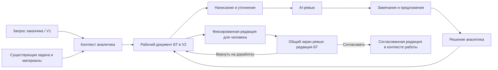

# Агент V2: написание, ревью и сопровождение бизнес-требований

Дата предложения и проверки оснований: **09.10.2026**.  
Статус: **TO-BE с реализованным основным циклом этапов 1–3** по запросу пользователя
09.10.2026. Фактический scope, проверки и ограничения описаны в
[реализации V2](agent-v2-implementation.md). Этот документ сохраняет исходное
предложение; раздел 2 описывает основания до внедрения, а этап 4 остаётся TO-BE.

Основания AS-IS проверены чтением текущего рабочего дерева, включая незакоммиченные
изменения, и существующих тестов. Сервисы, действующая БД, браузерный интерфейс и
ответы реальной LLM в рамках подготовки предложения не проверялись. В ходе
реализации выполнены изолированные и браузерные mock-тесты; пилот с реальной
моделью и рабочей БД ещё требуется.

Документ конкретизирует [концепцию BA Copilot](agent-v2-copilot-concept.md):
выделяет написание и содержательное ревью БТ в основные сценарии, уточняет первый
выпуск и интеграцию с нашей системой. Архитектурные идеи прежнего концепта остаются
направлением развития; их полный объём не является условием первого выпуска.

## 1. Предлагаемое решение

Развивать существующий `agents/business-analyst-experimental/` и страницу `#/agent-v2` как рабочее место
бизнес-аналитика с тремя связанными действиями над одним документом:

1. **Написать БТ** из запроса, контекста задачи и материалов аналитика.
2. **Проверить БТ** по смыслу, полноте, согласованности и подтверждённости.
3. **Доработать БТ** по выбранным AI-замечаниям и замечаниям человека, сохранив версии.

Интервью, анализ процесса, уточнение правил, поиск противоречий и подготовка
критериев результата поддерживают этот цикл. Существующий V1 сохраняет сценарий
сбора исходной потребности у заказчика. V2 обслуживает аналитика и PO, работающих
с материалами и решениями по требованию.

Главный результат — проверяемая редакция БТ, связанная с источниками и работой
в системе. Согласование фиксирует решение уполномоченного человека по конкретной
редакции. Завершение AI-проверки само по себе не означает согласование.

## 2. Что уже есть и где разрыв

| Область | Подтверждённое основание | Предлагаемое развитие |
|---|---|---|
| Рабочее место | Документный UI, входы «проверить», «с нуля», «поручение», редактор разделов, замечания, версии | Сохранить экран; сделать написание и проверку явными действиями с собственными результатами |
| Импорт | Markdown/plain text до 30 000 символов, сопоставление известных заголовков; у неизвестных разделов сохраняются названия, но их содержание не переносится в поля БТ | Добавить семантическую структуру с подтверждением аналитика; сохранить оригинал и показать неперенесённый материал |
| Содержательная проверка | Детерминированный reviewer и эвристики качества: пропуски, отдельные конфликты, измеримость критериев, бизнес-эффект, источники | Сохранить правила и дополнить отдельным LLM-review, адресными замечаниями и решениями по ним |
| Готовность | Отдельный V2 readiness проверяет поля, provenance, конфликты, подтверждение и fingerprint; критерии приёмки в этом gate проверяются по длине и числу слов | Согласовать gate с результатами проверки; разделить полноту, проверенность и человеческое решение |
| AI-команды | Промпт описывает соавтора и reviewer, но обработчик существующего draft ориентирован на изменение facts/metadata | Выделить операции «проверить», «объяснить», «предложить правку», которые не требуют изменения документа |
| Требование | `BusinessRequirementDraftV2` содержит бизнес-цель, границы, сценарии, FR/NFR и метрики; многие элементы — строки | Сделать бизнес-требования самостоятельными элементами со стабильными ID; уровни детализации отображать отдельно |
| Доказательства и версии | Provenance, gaps/conflicts, история ревизий, fingerprint, защита отправленной редакции | Привязать замечание и предложение к редакции, разделу/элементу и источнику |
| Контекст DMB | Авторизованный snapshot Request/Task; gateway передаёт ограниченный набор полей | Передавать разрешённый пакет контекста, включая редакцию БТ, без потери автора и исходных связей |
| Передача в review | V2 создаёт/обновляет `RequirementRequest`, найденный по собственной сессии `v2:...` | Развести приём пользовательского запроса и согласование редакции БТ; исключить дубли запросов/задач |
| Представление на review | Общая карточка ориентирована на поля V1; полный JSON V2 сохраняется, но его дополнительные поля не включены в основные разделы | Показывать всю отправленную редакцию V2, включая бизнес-цель, границы, метрики и замечания |

Особенность runtime: в ветке существующего draft содержательный ответ модели без
новых facts/metadata может закончиться сообщением «В черновике нет новых изменений».
Это вывод по маршрутизации кода, а не результат воспроизведения с реальной LLM.
Поэтому улучшение одного промпта не закрывает сценарий независимого ревью.

Источники: [UI](../dmb-backlog/frontend/js/agent-v2/workspace.js),
[импорт](../agents/business-analyst-experimental/business_analyst_experimental/v2/document_import.py),
[orchestrator](../agents/business-analyst-experimental/business_analyst_experimental/agentic_orchestrator.py),
[reviewer](../agents/business-analyst-experimental/business_analyst_experimental/composer/reviewer.py),
[readiness](../agents/business-analyst-experimental/business_analyst_experimental/v2/readiness.py),
[модели V2](../agents/business-analyst-experimental/business_analyst_experimental/v2/models.py),
[gateway](../dmb-backlog/backend/routers/agent_v2_router.py),
[представление запроса](../dmb-backlog/frontend/js/components/requestPresentation.js).

## 3. Место в нашей системе

Предлагаемые точки входа:

- **Страница «Агент V2»**: «Написать БТ», «Проверить БТ», список документов.
- **Карточка запроса**: «Проработать БТ» с сохранением исходного автора, текста,
  редакции запроса и комментариев ревью. Кнопка доступна по объектным правам.
- **Карточка задачи**: «Открыть БТ» / «Подготовить БТ». При наличии документа
  открывается существующий, создание нового требует явного выбора.
- **Общий экран ревью**: открыть отправленную редакцию БТ, увидеть изменения и
  вернуть её в V2 с замечаниями либо зафиксировать решение.

Список документов показывает название, связанный запрос/работу, рабочую редакцию,
последнее человеческое решение и состояние проверки. Техническая сессия остаётся
деталью хранения.

В [целевой структуре работ](work-structure.md) подготовка БТ может быть рабочей
задачей внутри крупной задачи, непосредственно в проекте или самостоятельной
работой. **Сам документ БТ — результат работы, а не новый уровень иерархии.**
V2 не создаёт собственный аналог рабочей задачи и не вводит вложенные поручения.

Сейчас `WorkTask` ещё не реализована в проверенной модели. Первый выпуск работает
с существующими Request/Task. Поддержка будущей рабочей задачи добавляется через
типизированную связь после внедрения [проекта структуры работ](work-structure-system-design.md).
Техническое исполнение во внешнем IT-трекере остаётся за пределами первого выпуска.

## 4. Основные сценарии

### СЦ-1. Написать БТ по запросу или материалам

1. Аналитик открывает контекст запроса/задачи либо создаёт самостоятельный документ.
2. Добавляет исходное описание и текстовые материалы, выбирает профиль документа.
3. Агент предлагает структуру и черновик по уже известным данным. Пустые места
   обозначает открытыми вопросами; не требует сначала заполнить всё интервью.
4. Аналитик видит основания формулировок, подтверждает или исправляет предложения.
5. Агент уточняет конкретный пробел и обновляет затронутые разделы через предложения.
6. Аналитик запускает проверку, затем готовит редакцию для человеческого решения.

Результат: рабочая редакция БТ, список открытых вопросов и подтверждённые источники.
Числа, сроки, правила и обязательства без основания остаются предложениями или
неизвестными значениями. Подтверждение аналитиком фиксируется как отдельное решение.
Факт наличия утверждения в источнике и подтверждение его правильности аналитиком
хранятся раздельно: импорт документа сам по себе не делает его содержание истинным.

Минимум источников в MVP — несколько отдельно сохранённых текстовых фрагментов
и разрешённый снимок Request/Task. У каждого источника есть ID, версия и адресуемый
текст. Это позволяет показать конфликт двух оснований уже в первом выпуске.

### СЦ-2. Проверить готовое БТ

1. Аналитик открывает существующий документ или вставляет текст.
2. Агент проверяет весь документ либо выбранный раздел без обязательного интервью.
3. Выдаёт ранжированные замечания, связывая каждое с конкретным фрагментом.
4. Аналитик исправляет, отклоняет с объяснением, откладывает или формирует вопрос.
5. Повторная проверка учитывает изменения и ранее принятые решения.

Результат: протокол проверки и предложения. Сам запуск ревью не меняет текст БТ.
Структурные проверки остаются доступны при недоступной LLM; UI явно показывает,
какая часть проверки не выполнена.

### СЦ-3. Доработать после человеческого ревью

Отправленная редакция остаётся неизменной. Замечания человека становятся входом
для следующей рабочей редакции. Агент предлагает адресные изменения; аналитик
принимает их и получает сравнение «отправлено / доработано» и ответ по каждому
замечанию. Повторная отправка создаёт новый пакет проверки и сохраняет историю.

### СЦ-4. Уточнить отдельное бизнес-требование

Команды над разделом или элементом: «Уточни формулировку», «Найди противоречия»,
«Проверь границы», «Предложи исключения», «Подготовь вопросы», «Предложи критерии
результата», «Объясни замечание». Результат — предложение или объяснение, видимое
рядом с исходным текстом. Технические детали сохраняются в соответствующем разделе.

### СЦ-5. Оценить последствия изменения

Аналитик меняет правило или получает новую версию источника. Агент показывает
потенциально затронутые элементы и критерии в доступном контексте. В первом выпуске
достаточно проверки внутри одного документа. Полная трассировка между документами
и работами относится к следующему этапу; полнота найденного влияния не обещается.

## 5. Какой документ готовит агент

БТ должно объяснять изменение в работе бизнеса. Наличие подробностей решения
допустимо, но их уровень должен быть виден и отделён от потребности.

| Раздел | Содержание |
|---|---|
| Основание и проблема | Инициатор, исходный запрос, затронутые участники, текущая ситуация и её последствия |
| Цели и ожидаемый результат | Какое изменение нужно получить; критерии бизнес-успеха и способ проверки |
| Границы | Что включено, что исключено, где применимо требование |
| Бизнес-требования | Отдельные утверждения `BR-001…`, связанные с целью и основанием |
| Процесс и сценарии | Текущее и целевое поведение, основной путь, альтернативы и исключения |
| Бизнес-правила | Условия, ограничения, решения при комбинациях условий |
| Ограничения и зависимости | Внешние условия, связанные работы и договорённости |
| Открытые вопросы и допущения | Что неизвестно, что предположено и какое решение требуется |
| Критерии приёмки результата | Наблюдаемые условия, по которым можно проверить выполнение требований |
| Контекст решения — при необходимости | FR/NFR, данные, интеграции и согласованные технические ограничения |
| Источники и решения | Основания, версии, авторские решения и история изменения документа |

Метрика бизнес-эффекта и критерий приёмки функции не подменяют друг друга.
Если измеримый экономический эффект неприменим, фиксируется обоснованный критерий
результата. Агент не придумывает финансовые значения и не подменяет Task Prioritiser.

Для первого выпуска предлагается один основной профиль «Изменение продукта или
процесса» с условными разделами. Отдельные профили для регуляторных изменений,
исследований и организационных работ вводятся после пилота. Поля существующего
формата импортируются без потери данных; подробности реализации автоматически
не удаляются и не объявляются бизнес-целями.

## 6. Что означает содержательное ревью

| Направление | Пример вопроса агента |
|---|---|
| Соответствие проблеме | Как это требование помогает устранить описанную проблему? |
| Определённость | Что означает «быстро», «доступно», «при необходимости» в данном контексте? |
| Полнота границ | Какие пользователи, операции и исключения входят в изменение? |
| Непротиворечивость | Почему один раздел допускает отмену после исполнения, а другой запрещает? |
| Проверяемость | По какому наблюдаемому результату будет принято требование? |
| Подтверждённость | Откуда взят срок или лимит? Соответствует ли формулировка источнику? |
| Согласованность уровней | Описывает ли пункт бизнес-потребность, правило или предложенный способ реализации? |
| Зависимости | Есть ли условие, без которого требование невыполнимо? Кто может его подтвердить? |

Замечание содержит: ID, тип, важность, адрес фрагмента и редакцию, цитату,
объяснение последствий, источник/основание проверки и предлагаемое действие.
Для пропуска адресом служит раздел, а основанием — правило профиля и недостающая
информация. Для гипотезы агент указывает неопределённость и предлагает вопрос.

При наличии безопасной формулировки добавляется сравнение «было / предлагается».
Изменение бизнес-правила требует человеческого решения. Применение правки,
отклонение замечания и согласование всего документа — разные события.

Важность замечания не определяется наличием уверенного тона у модели. Проверяемое
противоречие, недостаток исходных данных и редакционная рекомендация отображаются
раздельно. Решение о допуске к человеческому ревью принимает серверная политика
по профилю документа; обоснованные исключения видны ревьюеру.

## 7. Интерфейс

Сохранить уже реализованное рабочее место и развить его:

- слева — структура БТ и источники;
- в центре — редактируемый документ, пометки замечаний и сравнение правок;
- справа — вкладки «Проверка», «Помощник», «Вопросы», «История»;
- сверху — название, связанная работа/запрос, состояние сохранения и редакция;
- основные действия — «Сформировать черновик», «Проверить БТ»,
  «Сравнить версии», «Передать на согласование».

При открытии готового документа основное действие — проверка. При создании —
формирование черновика по материалам. Чат остаётся доступен для свободной команды.
На узком экране панели переключаются вкладками.

Вместо общего процента готовности показывать: какие разделы требуют уточнения,
когда и для какой редакции выполнены проверки, какие существенные замечания
остались и какое человеческое решение зафиксировано. Правки после проверки
помечают её результат как относящийся к предыдущей редакции.

## 8. Интеграция с запросами, задачами и ревью

### 8.1. Почему текущую отправку нельзя переименовать в согласование БТ

В текущем gateway запрос ищется по сессии V2. Связанный исходный Request/Task
не становится автоматически целью публикации. Новый `RequirementRequest`
создаётся с текущим оператором как автором. В существующем intake lifecycle
переход запроса в `in_progress` с назначением BA может создать `Task` в статусе
«СБОР ТРЕБОВАНИЙ», если у запроса ещё нет задачи.

Следовательно, проработка БТ существующей задачи через такой путь может создать
новый запрос и затем ещё одну задачу. Кнопку «Передать на согласование» нельзя
просто связать с этим endpoint без изменения доменной семантики.

Основания: [отправка V2](../dmb-backlog/backend/routers/agent_v2_router.py),
[жизненный цикл запроса](../dmb-backlog/backend/routers/agent_router.py),
[RequirementRequest и уникальная task_id](../dmb-backlog/backend/models.py).

### 8.2. Предлагаемое разделение

Сохранить общий экран ревью, добавив явный вид предмета проверки:

| Предмет | Что решает человек | Эффект решения |
|---|---|---|
| Запрос пользователя | Принять потребность в работу, вернуть, отклонить | Существующий lifecycle запроса и его размещение в работе |
| Редакция БТ | Согласовать конкретную редакцию или вернуть с замечаниями | Решение по документу; создание задачи и закрытие запроса не выполняются автоматически |

Для редакций БТ предлагается отдельная запись `RequirementReview` в DMB:
идентификатор артефакта V2, редакция и fingerprint, неизменный пакет документа,
разрешённые ссылки на существующий Request/Task, отправитель, ревьюер и решение.
Это новая модель предмета ревью внутри общей очереди, а не ещё один пользовательский
запрос. Рабочая версия хранится в V2, отправленный пакет — в DMB для воспроизводимого
человеческого решения. Между БД используются идентификаторы и проверенные снимки.

Правила первого выпуска:

1. Контекст Request/Task загружает DMB после проверки доступа; передаются полное
   разрешённое содержание БТ, актуальная версия и необходимые комментарии.
2. Исходный автор запроса сохраняется. Аналитик записывается как редактор БТ.
3. Ручное сохранение документа в V2 не меняет Request или Task.
4. Публикация показывает точную цель и редакцию, требует отдельного действия и
   проверяет ожидаемые версии. Повтор запроса не создаёт дубль.
5. Для существующей Task не создаётся новая Task. Согласование редакции не меняет
   автоматически статус исполнения, финансовую оценку или удовлетворённость запроса.
6. `RequirementRequest.task_id` не используется для хранения всех редакций БТ:
   в текущей модели эта связь уникальна, а редакций у документа может быть много.
7. Отправленная редакция неизменна; последующие правки создают рабочую редакцию.
   AI-patch проверяется относительно текущей рабочей редакции. Решение ревьюера
   проверяется относительно версии и состояния конкретного `RequirementReview`,
   а не относительно последней рабочей редакции аналитика.
8. Права чтения задачи не означают право согласования. Правило выбора ревьюера
   задаётся явно через существующие полномочия; новые роли и назначения не создаются.
9. После согласования доступно действие «Создать следующую редакцию» того же
   документа. Согласованный пакет сохраняется; исходный запрос не переоткрывается.

В MVP у документа не более одного активного человеческого ревью. Новая рабочая
редакция не отменяет уже отправленный пакет: решение по нему остаётся допустимым
и относится только к нему. Для отправки новой редакции вместо ещё рассматриваемой
аналитик явно отзывает прежнюю и отправляет новую; замена выполняется атомарно,
предыдущий пакет сохраняется как отозванный. Решение по отозванному пакету
отклоняется. После возврата повторная отправка сохраняет связь с замечаниями
предыдущего ревью.

В пакете сохраняется версия значимого контекста Request/Task. Если к моменту
решения изменились исходные условия, система показывает изменение и требует
повторной проверки затронутых требований. Изменение несвязанных атрибутов задачи
не должно автоматически обесценивать содержательное ревью.

Предлагаемый минимальный порядок — один ответственный ревьюер и решения
«Согласовать / Вернуть на доработку». Многостороннее согласование и юридически
значимая подпись не входят в MVP. Смысл «согласовать БТ» и полномочия ревьюера
должны быть утверждены до реализации этого действия.

## 9. Технический подход

Переиспользовать отдельный сервис V2, gateway, текущий редактор, хранилище сессий,
провайдера LLM, проверки доступа, provenance, ревизии и fingerprint.
Legacy-каталог `assistant-v2/` не является базой развития.

Разделить операции сервиса:

| Операция | Выход | Изменяет рабочий документ |
|---|---|---|
| Сформировать черновик | Предлагаемая структура, текст, источники, открытые вопросы | После принятия аналитиком |
| Проверить документ/раздел | Структурированные замечания и итог проверки | Нет |
| Объяснить замечание | Объяснение и основание | Нет |
| Предложить исправление | Изменения с исходной редакцией и обоснованием | Нет |
| Применить выбранные правки | Новая рабочая редакция и журнал решения | Да |
| Подготовить пакет ревью | Зафиксированный документ, изменения, открытые вопросы | Не меняет текст |

Для первого выпуска достаточно адреса `artifact_id + revision + section/item_id`,
источника с версией и фрагментом, замечания, предложения и решения аналитика.
Устойчивый `artifact_id` вводится до интеграции согласования и переживает создание
следующей редакции или смену технической сессии.
Стабильные ID нужны прежде всего для отдельных BR и замечаний. Полный граф
FR/NFR/сценариев/критериев и отдельная графовая БД не требуются.

Существующие сессии импортируются через адаптер, неизвестные поля сохраняются.
Изменения контракта версионируются. Детерминированные проверки и LLM-checks
возвращают общий формат замечаний, но сохраняют автора и метод проверки.
Readiness использует согласованный набор результатов вместо параллельных
несогласованных оценок качества.

Промпты написания и ревью разделяются; запуск каждого действия имеет собственный
контракт и фиксирует версии модели/промпта и входную редакцию. Для MVP достаточно
отдельных вызовов существующего провайдера. Несколько автономных AI-агентов,
переход на другой язык backend и замена frontend-фреймворка не нужны.

Предложения по документу и `ProposedPatch` внешнего объекта остаются разными
операциями. Модель не получает прямую запись в DMB. Ограничения на пользователей,
роли, команды, их ответственных и справочники сохраняются. Источники проходят
объектную авторизацию; текст вложенного материала не может задавать инструкции
для инструментов агента.

## 10. Этапы внедрения

| Этап | Состав | Условие завершения |
|---|---|---|
| 0. Контракт и эталоны | Зафиксировать профиль БТ, семантику ревью, пакет контекста; выбрать обезличенные примеры и снять baseline | Есть согласованные примеры хорошего БТ, дефектов и допустимых решений |
| 1. Независимое AI-ревью | Явная команда review, адресные замечания, предложения и решения; повторная проверка; защита версии | Готовое БТ проверяется без интервью и без скрытых изменений текста |
| 2. Совместное написание | Создание из текста/Request/Task, структура BR, источники, вопросы, принятие черновика по частям | Аналитик проходит путь от исходных материалов до проверенной редакции |
| 3. Человеческое ревью в системе | Предмет «редакция БТ» в общей очереди, фиксированный пакет, возврат, сравнение и повторная отправка | Сценарий существующей задачи не создаёт дубли и сохраняет автора запроса |
| 4. Расширение после пилота | DOCX/PDF, внешние хранилища источников, междокументные связи, анализ влияния, новые профили | Польза и качество подтверждены на целевых сценариях |

**Первый законченный продуктовый выпуск включает этапы 1–3:** написание, AI-ревью
и доработку после человеческого решения. Этап 1 — первый технический инкремент,
а не замена всего MVP одной проверкой текста. Для раннего пилота используются
текст и существующие разрешённые данные системы; распознавание сканов и файловый
конвейер не задерживают проверку основной ценности.

Сроки и трудозатраты следует оценивать после выбора минимального профиля и
контракта ревью. Предложение не содержит неподтверждённых календарных обещаний.

## 11. Критерии приёмки и оценка пользы

1. Готовый документ можно проверить без обязательного интервью; команда review
   возвращает результат даже при отсутствии изменений текста.
2. При написании исходные факты сохраняются, неподтверждённые числа и правила
   маркируются как предложения; нерешённый вопрос не маскируется готовой фразой.
3. Каждое замечание имеет проверяемый адрес и основание; противоречие показывает
   обе стороны. Аналитик может отклонить замечание с причиной.
4. AI-ревью не меняет текст; принятые правки создают новую редакцию. Устаревшее
   предложение не перезаписывает ручные изменения.
5. Замечание человека связано с отправленной редакцией, а повторная отправка
   показывает изменения и ответы по замечаниям.
6. Работа с существующей Task не создаёт новый пользовательский запрос или Task
   только ради согласования БТ. Исходный автор запроса остаётся прежним.
7. Согласование относится к конкретной редакции; новая рабочая версия не получает
   автоматически статус согласованной.
8. Отзыв доступа и смена версии проверяются на сервере при чтении, применении
   правки и публикации. Повтор операции не создаёт второй пакет.
9. При недоступной LLM сохраняются документ и ручные правки; непроведённая
   AI-проверка не отображается как успешная.
10. V1 и существующий приём запросов продолжают работать по своим контрактам.

Предлагаемый пилот: 15–20 обезличенных кейсов разных размеров, включая готовые БТ,
неполные запросы, конфликтующие источники и возвраты с замечаниями. Старшие
аналитики заранее размечают существенные дефекты и ожидаемые решения.

Измерять время до проверяемого черновика и готовой редакции, количество возвратов,
долю пропущенных существенных дефектов, ложных замечаний и утверждений без основания.
Сравнивать с выполнением тех же типов задач без V2. Принятые AI-правки и число
написанных страниц сами по себе не доказывают качество. Пороговые значения
фиксируются до пилота после измерения baseline; улучшение скорости не должно
оплачиваться ростом пропущенных критичных дефектов.

## 12. Решения для дальнейшего проектирования

Предлагаемые значения по умолчанию, пока они не утверждены пользователем:

- основной пользователь — BA; PO участвует в уточнении и человеческом решении;
- основной результат — один документ БТ с версиями, без обязательного полного SRS;
- начало работы допускается из запроса, задачи или самостоятельного текста;
- первый профиль — изменение продукта/процесса; остальные профили после пилота;
- общий экран ревью обслуживает разные предметы, не смешивая их lifecycle;
- первый порядок согласования — один уполномоченный ревьюер по конкретной редакции;
- связанные Request/Task используются в первом выпуске; WorkTask подключается позже;
- междокументная трассировка, DOCX/PDF и внешняя IT-интеграция не входят в MVP.

Нужно конкретизировать владельца утверждённого шаблона БТ, критерии выбора
ревьюера, возможность самостоятельного согласования автором и необходимый формат
выгрузки. Эти вопросы не препятствуют проектированию редактора и AI-ревью, но
определяют контракт человеческого согласования и выпуска документа.
