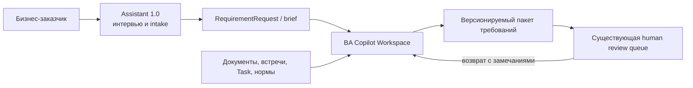
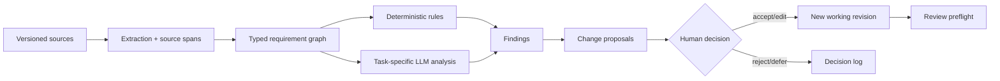

# Концепт полного обновления Assistant V2: BA Copilot

> Уточнение продуктового scope от 09.10.2026: [написание, ревью и сопровождение
> бизнес-требований](agent-v2-business-requirements-proposal.md). Новый документ
> учитывает уже реализованный редактор и уточняет интеграцию согласования БТ
> с запросами и задачами; описание исходных ограничений ниже относится к срезу
> исследования 20.09.2026 и не заменяет проверку актуального кода.
> Основной цикл написания, AI-ревью и согласования редакций реализован 09.10.2026:
> [фактический scope и ограничения](agent-v2-implementation.md).

> Статус: целевой продуктово-технический концепт (TO-BE), не описание реализованного AS-IS.  
> Дата исследования: 20.09.2026.  
> Область: целевой `agents/business-analyst-experimental/` и пользовательский маршрут `#/agent-v2`; legacy-каталог
> `assistant-v2/` не рассматривается как база развития.

> Статус реализации на 20.09.2026: начат первый вертикальный инкремент —
> document-first экран, импорт существующего требования, структурное
> редактирование, единый реестр замечаний и контекстный co-pilot. Полная целевая
> модель `RequirementWorkspace`, trace links и impact analysis остаются TO-BE.

## 1. Решение в одном абзаце

Assistant V2 следует превратить из «чата, который глубже опрашивает пользователя»,
в **рабочее место бизнес-аналитика**: документ требования находится в центре,
ИИ проверяет и улучшает выбранный фрагмент, показывает доказательства и предлагает
контролируемый diff, а аналитик принимает решение. Единицей работы становится не
диалоговая сессия, а `RequirementWorkspace` — кейс с источниками, структурированным
артефактом, замечаниями, трассировкой, решениями и версиями. Чат остаётся
вспомогательным каналом для вопросов и команд.

Это радикальная смена продуктовой модели при выборочном переиспользовании сильных
технических примитивов текущего V2: gateway, изоляции, provenance, fingerprints,
immutable revisions, human-approved patches и существующей очереди review.

## 2. Почему текущий V2 не воспринимается как co-pilot

### 2.1. V1 и V2 решают одну и ту же задачу взаимодействия

Активный продуктовый контракт V1 прямо определяет его как интервью для
бизнес-заказчика: свободное описание превращается в минимально полезный черновик,
агент задаёт один вопрос за раз
([PRODUCT_DIALOGUE_SPEC.md](../agents/business-analyst/docs/PRODUCT_DIALOGUE_SPEC.md)).

V2 добавляет правильные доменные сущности, но оставляет тот же interaction kernel:

- `V2Orchestrator` наследует `AgenticOrchestrator`, а основной ход делегирует
  `super().handle_message(...)`
  ([orchestrator.py](../agents/business-analyst-experimental/business_analyst_experimental/v2/orchestrator.py#L39),
  [orchestrator.py](../agents/business-analyst-experimental/business_analyst_experimental/v2/orchestrator.py#L248));
- prompt по-прежнему требует ровно один вопрос и ожидание ответа
  ([base_guard.md](../agents/business-analyst-experimental/prompts/base_guard.md),
  [requirement_copilot.md](../agents/business-analyst-experimental/prompts/requirement_copilot.md));
- рабочее состояние по-прежнему организовано вокруг slots, history, числа вопросов,
  усталости, summary и draft
  ([state.py](../agents/business-analyst-experimental/business_analyst_experimental/dialogue/state.py#L300));
- для BA/PO встречаются унаследованные формулировки «нужна помощь аналитика» и
  «оставить бизнес-аналитику»
  ([agentic_orchestrator.py](../agents/business-analyst-experimental/business_analyst_experimental/agentic_orchestrator.py#L377),
  [agentic_orchestrator.py](../agents/business-analyst-experimental/business_analyst_experimental/agentic_orchestrator.py#L483)).

То есть V2 изменил глубину интервью и выходной DTO, но не роль ИИ в работе.

### 2.2. Интерфейс делает главным объектом чат, а не требование

Текущий экран начинается с создания сессии и выбора режима/источника/канала.
После этого слева находится высокий chat, справа — inspector
([workspace.js](../dmb-backlog/frontend/js/agent-v2/workspace.js#L148),
[agent-v2.css](../dmb-backlog/frontend/css/agent-v2.css)).

Ключевые ограничения:

- артефакт появляется только после сбора и подтверждения фактов;
- BRD выводится как `<dl>` с техническими именами полей и JSON-значениями;
- ручная правка — выбор одного raw field и полная замена через textarea;
- gaps/conflicts/provenance показаны отдельными пассивными списками;
- quality UI сводится к бинарному readiness и кодам блокеров;
- история ревизий не имеет визуального сравнения;
- список сессий показывает только режим и тип артефакта;
- нет команд над выделенным текстом или разделом.

Это подтверждается реализацией рендера артефакта и edit-form
([workspace.js](../dmb-backlog/frontend/js/agent-v2/workspace.js#L88),
[workspace.js](../dmb-backlog/frontend/js/agent-v2/workspace.js#L105)) и сессий
([workspace.js](../dmb-backlog/frontend/js/agent-v2/workspace.js#L224)).

### 2.3. Модель требования слишком плоская для профессиональной аналитики

`BusinessRequirementDraftV2` наследует `RequirementDraft` V1, а composer сначала
строит старый draft и добавляет новые поля поверх него
([models.py](../agents/business-analyst-experimental/business_analyst_experimental/v2/models.py#L122),
[composer.py](../agents/business-analyst-experimental/business_analyst_experimental/v2/composer.py#L105)).

Сценарии, правила, FR/NFR, критерии, зависимости и риски — преимущественно списки
строк. У элементов нет стабильных ID и типизированных связей. Поэтому невозможно
надёжно ответить на профессиональные вопросы:

- какой источник подтверждает конкретное требование;
- каким критерием проверяется конкретный FR;
- какие сценарии и критерии затронет изменение бизнес-правила;
- где нарушена полнота покрытия;
- какие связи стали подозрительными после новой версии источника.

### 2.4. Проверка качества не является рабочим процессом

В коде одновременно существуют унаследованные `quality_score/issues/findings` и
новый readiness gate. UI исключает `quality_issues` и `review_findings` из показа,
а отправка использует V2 readiness
([workspace.js](../dmb-backlog/frontend/js/agent-v2/workspace.js#L108),
[readiness.py](../agents/business-analyst-experimental/business_analyst_experimental/v2/readiness.py#L64)).

Наличие поля и минимальная длина критерия полезны как guard, но не заменяют
проверки атомарности, однозначности, согласованности, трассируемости, покрытия и
impact analysis. Замечание должно быть объектом работы с адресом, объяснением,
предложением, владельцем и решением, а не только строкой в списке.

### 2.5. Контекст недостаточен

`SourceContext` уже предусматривает attachments и provenance, но frontend передаёт
только тип, канал и короткое описание. Linked snapshot содержит только title и
description и разрешает patch тех же полей
([workspace.js](../dmb-backlog/frontend/js/agent-v2/workspace.js#L260),
[agent_v2_router.py](../dmb-backlog/backend/routers/agent_v2_router.py#L46)).

Без source pack, точных фрагментов и версий документов co-pilot не может
доказательно проверять требование.

### 2.6. Тесты защищают контракты, но почти не защищают co-pilot experience

V2-тесты хорошо покрывают изоляцию, ownership, readiness, provenance, handoff,
fingerprint и stale patch. Frontend-проверки V2 в основном ищут строки в исходнике
([agentV2Fork.test.mjs](../dmb-backlog/frontend/tests/agentV2Fork.test.mjs));
полного браузерного сценария создания, проверки и редактирования BRD нет.

Отдельный риск текущей реализации: модельный runtime ожидает строгий
`TurnDecision` JSON, но V2 prompt set не описывает его полную схему и семантику
операций. Парсер и retry находятся в
[agentic.py](../agents/business-analyst-experimental/business_analyst_experimental/dialogue/agentic.py#L488), а prompt set собирается
только из трёх коротких файлов
([prompts.py](../agents/business-analyst-experimental/business_analyst_experimental/v2/prompts.py#L12)). Это следует проверить и
исправить независимо от редизайна.

## 3. Чёткая граница между Assistant 1.0 и 2.0

| Аспект | Assistant 1.0 | Assistant 2.0 / BA Copilot |
|---|---|---|
| Основной пользователь | бизнес-заказчик | BA/PO и эксперт-ревьюер |
| Главная задача | рассказать о потребности с минимальными усилиями | написать, проверить, согласовать и изменить БТ |
| Единица работы | диалог | аналитический кейс и версионируемый артефакт |
| Основной UX | интервью, один вопрос за раз | документ, findings, источники и предложения изменений |
| Основной вход | свободное описание заказчика | output V1, Request, Task, документ, заметки, существующий BRD |
| Глубина | минимально полезный intake draft | полный выбранный профиль качества и трассируемости |
| Роль ИИ | интервьюер и структурировщик | соавтор, критик, trace/impact assistant |
| Основной выход | черновик для BA/PO | review-ready requirement package |
| Решение и ответственность | передача человеку | аналитик утверждает каждое существенное изменение |

Рекомендуемый сквозной поток:



`assignment_capture` не должен оставаться равноправным разговорным продуктовым
режимом V2. Его полезная часть превращается в быстрое действие **«Добавить источник
или зафиксировать поручение»** внутри workspace. Прямой клиентский intake остаётся
зоной V1.

## 4. Целевая продуктовая модель

### 4.1. North Star

В любой момент BA видит одновременно:

1. актуальную версию требования;
2. проблемы и непокрытые места;
3. источники и степень подтверждения каждого утверждения;
4. конкретные предложения ИИ с before/after;
5. последствия принятия предложения;
6. историю человеческих решений.

Формула продукта: **ИИ предлагает и доказывает; аналитик интерпретирует и отвечает
за решение.**

### 4.2. Принципы

- **Document first.** Артефакт существует с первого экрана и редактируется напрямую.
- **Work first, ask second.** При наличии текста ИИ сначала выполняет анализ; вопрос
  задаётся только при реальном блокере.
- **Evidence before eloquence.** Сначала источник и неопределённость, затем красивая
  формулировка.
- **Diff, not overwrite.** Существенное изменение всегда является предложением.
- **Typed artifacts.** У требований, правил, сценариев и критериев есть ID и связи.
- **Human baseline.** ИИ не утверждает, не согласует и не применяет бизнес-решения.
- **No single magic score.** Качество показывается по измерениям и findings.
- **Progressive disclosure.** BA видит рабочую формулировку; технические hash, paths
  и prompt versions доступны в audit/details, но не доминируют в интерфейсе.

## 5. Информационная архитектура и UX

### 5.1. Главная страница «Требования»

Вместо списка сессий:

- мои кейсы;
- «нужен ответ», «есть блокеры», «готов к review», «вернулся с review»;
- поиск по ID, названию и связанному объекту;
- фильтры по типу, статусу, владельцу и дате изменения;
- быстрые действия: «Проверить существующее требование», «Создать из источников»,
  «Продолжить Request/Task», «Зафиксировать поручение».

Карточка показывает название, linked object, профиль качества, незакрытые P0/P1,
последнюю редакцию, review state и следующий шаг — не технический artifact type.

### 5.2. Requirement Workspace

```text
┌──────────────────────────────────────────────────────────────────────────────┐
│ BR-142 · Автоматическая сверка заявок   rev.7   Есть 2 блокера   [На review]│
├──────────────────┬───────────────────────────────────┬───────────────────────┤
│ Структура        │ Рабочий документ                  │ Co-pilot              │
│ ▸ Проблема       │ AS-IS                             │ 2 критичных замечания │
│ ▸ Цель           │ ...                               │ 4 улучшения           │
│ ▸ Scope          │ TO-BE                             │                       │
│ ▸ Сценарии       │ ... [SRC-03]                      │ [Проверить раздел]     │
│ ▸ Правила        │                                   │ [Создать критерии]     │
│ ▸ FR/NFR         │ FR-01 ...                         │ [Найти противоречия]   │
│ ▸ Критерии       │ AC-01 ... → FR-01                 │                       │
│                  │                                   │ Finding F-17           │
│ Issues  Sources  │                                   │ before / after         │
│ Trace   Versions │                                   │ [Принять][Править]     │
└──────────────────┴───────────────────────────────────┴───────────────────────┘
```

- **Слева:** outline, issues, sources, traceability, versions.
- **В центре:** живой структурированный редактор, inline evidence badges и
  комментарии.
- **Справа:** contextual co-pilot для текущего раздела или выделения.
- **Вверху:** linked object, состояние autosave, профиль качества, compare и review.
- **На узком экране:** эти области становятся вкладками, а не длинной колонкой.

Chat доступен в правой панели, но не занимает основной canvas.

### 5.3. Контекстные действия ИИ

Для выделения, элемента или раздела:

- улучшить однозначность;
- разделить на атомарные требования;
- проверить на преждевременное solution design;
- создать основной, альтернативный, ошибочный и boundary-сценарии;
- предложить проверяемые acceptance criteria, при необходимости Given/When/Then;
- найти конфликт с другими правилами или источниками;
- найти дубликаты;
- предложить FR/NFR без выдумывания технической архитектуры;
- связать с целью, сценарием, правилом, критерием и источником;
- объяснить замечание;
- показать impact выбранного изменения.

Каждый ответ — не абзац в чате, а `ChangeProposal` или `Finding` с адресом в
документе.

### 5.4. Quality Cockpit

Показывает измерения качества, а не один процент:

- полнота относительно выбранного шаблона;
- однозначность;
- атомарность;
- непротиворечивость;
- проверяемость;
- покрытие сценариев и критериев;
- трассируемость к цели и источникам;
- scope/value alignment;
- актуальность источников и suspect links.

Каждое замечание содержит:

- severity и правило проверки;
- точный target/span;
- evidence/source;
- объяснение и неизвестные;
- before/after, если исправление безопасно предложить;
- действия «Принять», «Изменить», «Отклонить», «Отложить»,
  «Вопрос стейкхолдеру»;
- автора решения и revision.

### 5.5. Review preparation и возврат

Перед отправкой BA видит preflight:

- diff с последней отправленной редакцией;
- незакрытые блокеры и принятые исключения;
- состав источников;
- traceability coverage;
- open questions/assumptions;
- change summary для ревьюера.

Возвращённый комментарий превращается в адресованные issues. Workspace показывает
submitted/current diff и позволяет повторно отправить новую immutable revision.

## 6. Основные пользовательские сценарии

### SC-01. Проверить существующее бизнес-требование

1. BA открывает Request/Task или вставляет BRD.
2. Документ отображается сразу, без предварительного интервью.
3. Правила и ИИ формируют ранжированный review pack.
4. BA переходит к каждому finding в тексте, принимает или редактирует patch.
5. Cockpit пересчитывается инкрементально.
6. BA сохраняет revision или отправляет её на human review.

Это рекомендуемый **первый вертикальный инкремент**, потому что он максимально
отличает V2 от V1 и проверяет главную ценность co-pilot.

### SC-02. Создать требование из нескольких источников

1. BA создаёт workspace из результата V1, заметок встречи, документа и Task.
2. ИИ извлекает claims с точными source spans и строит предварительную структуру.
3. Неподтверждённое маркируется как interpretation/hypothesis.
4. BA выбирает шаблон и принимает структуру по частям.
5. Co-pilot формирует вопросы и findings, но не ведёт обязательный линейный опрос.
6. BA доводит документ до review-ready.

### SC-03. Доработать требование после review

1. Комментарии ревьюера импортируются как issues.
2. Co-pilot находит затронутые разделы и предлагает изменения.
3. BA принимает только нужные operations.
4. Система показывает diff и impact на criteria/scenarios/rules.
5. Новая revision повторно отправляется в текущую очередь.

### SC-04. Оценить влияние изменения

1. BA изменяет source или business rule.
2. Связи от изменённого узла помечаются `suspect`.
3. Co-pilot предлагает перечень потенциально затронутых FR/NFR, сценариев,
   критериев, данных и связанных объектов.
4. BA подтверждает или отклоняет каждую связь; ИИ не объявляет impact полным.

## 7. Целевая доменная модель

```text
RequirementWorkspace
  ├── Source[]
  ├── RequirementArtifact
  │     └── RequirementItem[]
  ├── TraceLink[]
  ├── Finding[]
  ├── ChangeProposal[]
  ├── Decision[]
  └── ArtifactRevision[]
```

### 7.1. RequirementItem

Каждый элемент имеет стабильный ID, type, text/structure, status, owner,
provenance и связи. Минимальные типы:

- `problem`, `goal`, `scope_in`, `scope_out`;
- `actor`, `stakeholder`, `scenario`, `exception`;
- `business_rule`, `functional_requirement`, `non_functional_requirement`;
- `acceptance_criterion`, `success_metric`;
- `data`, `integration`, `dependency`, `constraint`, `risk`;
- `assumption`, `open_question`, `decision`.

### 7.2. TraceLink

Типы связей: `derived_from`, `supports`, `refines`, `depends_on`,
`conflicts_with`, `validated_by`, `impacts`, `supersedes`, `implemented_by`.
У связи есть версия, автор, confidence class и `valid/suspect/rejected`.

### 7.3. Finding

`Finding` объединяет сегодняшние gaps, conflicts, assumptions, quality issues и
review findings. Поля: stable ID, category, rule/model version, severity, target,
evidence, explanation, suggestion, owner, status, resolution и revision.

### 7.4. ChangeProposal

Текущий `ProposedPatch` следует обобщить с двух DMB-полей на разрешённые paths
рабочего документа. Операция содержит base revision/fingerprint, before, after,
rationale, evidence, predicted impact и решение человека. Принятые operations
меняют **рабочую** редакцию; публикация в DMB остаётся отдельным явным действием.

### 7.5. Provenance

Минимум для каждого существенного утверждения:

- source ID и версия;
- точный span/page/timestamp/speaker;
- `Source-backed / Analyst interpretation / AI hypothesis / Unresolved`;
- кто и каким процессом создал/изменил элемент;
- model, prompt, retrieval/index и tool versions для AI action;
- human decision и обоснование.

Такое представление согласуется с Entity–Activity–Agent моделью W3C PROV-O.

## 8. Целевая AI-архитектура

### 8.1. Вместо одного интервьюирующего prompt — task-oriented actions

Нужны независимые операции:

- `ingest_sources` — извлечь source-backed claims;
- `structure_artifact` — предложить typed items;
- `critique_selection` / `critique_artifact` — создать findings;
- `suggest_patch` — предложить controlled diff;
- `generate_acceptance_criteria`;
- `reconcile_conflicts` — показать варианты, не выбрать победителя;
- `suggest_trace_links`;
- `analyze_change_impact`;
- `prepare_review_package`;
- `answer_contextual_question`.

Каждая операция получает минимально необходимый контекст и возвращает строгий
JSON Schema. Structured output гарантирует форму, но истинность отдельно
проверяется источниками, правилами и человеком.

### 8.2. Pipeline



Детерминированные проверки и граф дополняют LLM, а не дублируются двумя
конкурирующими «quality» системами.

### 8.3. Правила применения

- форматирование и безопасная классификация MAY применяться автоматически с undo;
- rewrite, decomposition и criteria — только как tracked suggestions;
- conflicts, compliance, critical NFR и stakeholder decisions — обязательный
  human/SME gate;
- baseline, export, review submission и внешняя запись — только явное действие;
- отсутствие источника даёт `unknown`, а не синтезированный факт.

## 9. Что переиспользовать, а что заменить

| Текущий компонент | Решение | Целевое использование |
|---|---|---|
| DMB gateway, trusted identity, pilot/kill switch | сохранить | безопасность и доступ |
| отдельный service/DB/secret/port | сохранить | изоляция rollout |
| SessionStore locking/idempotency | переиспользовать как infrastructure | optimistic concurrency и receipts |
| SourceContext/LinkedObjectSnapshot | расширить | versioned source pack и richer projections |
| field provenance | развить | inline anchored evidence |
| fingerprint/immutable revisions | сохранить | compare, stale protection, audit |
| ProposedPatch + human decision | обобщить | tracked suggestions по document paths |
| existing RequirementRequest adapter | сохранить | публикация в текущую review queue |
| LLM provider, guardrails, audit privacy | сохранить и адаптировать | task-oriented actions |
| `AgenticOrchestrator.handle_message` | заменить | `CopilotOrchestrator` по явным actions |
| DialogueState slots/question/fatigue | заменить как доменное ядро | `RequirementWorkspace` |
| one-question prompt policy | удалить из default flow | вопрос только для blocker/по запросу |
| `BusinessRequirementDraftV2(RequirementDraft)` | заменить | canonical typed schema + import/export adapters |
| две quality/readiness семантики | объединить | единый `QualityPolicy` и findings |
| chat + inspector UI | заменить | document-first 3-pane workbench |
| отдельный `assignment_capture` dialogue mode | свернуть | quick intake/source action |

## 10. Эволюция API

Имена иллюстративные; точный контракт фиксируется отдельным ТЗ.

- `POST /workspaces`, `GET /workspaces`, `GET /workspaces/{id}`;
- `POST /workspaces/{id}/sources`, status асинхронного ingestion;
- `PATCH /workspaces/{id}/items/{item_id}` с expected revision;
- `POST /workspaces/{id}/actions/{action}` для co-pilot operations;
- `GET /workspaces/{id}/findings`, resolve/defer/assign endpoints;
- `GET /workspaces/{id}/trace`, accept/reject suggested link;
- `POST /workspaces/{id}/proposals/{id}/decision`;
- `GET /workspaces/{id}/revisions/{a}/compare/{b}`;
- `POST /workspaces/{id}/review-preflight` и `send-for-review`.

Долгие операции должны показывать прогресс и поддерживать безопасный retry;
существующий SSE можно переиспользовать, но frontend должен действительно его
использовать.

## 11. Качество и readiness

Readiness — это policy gate по профилю артефакта, а не решение модели и не один
процент. Пример gate:

1. нет незакрытых critical findings;
2. обязательные sections объявлены или имеют явное обоснование N/A;
3. ключевые claims имеют разрешённый provenance;
4. каждый FR связан с goal/scenario и хотя бы одним AC либо имеет waiver;
5. нет active suspect links, принятых как проверенные;
6. есть human confirmation текущего revision fingerprint;
7. review package показывает все warnings/waivers.

Разные профили (`feature`, `process change`, `integration`, `regulatory`,
`incident`) задают разные обязательные проверки. Профиль выбирает аналитик или
предлагает ИИ с подтверждением.

## 12. Безопасность и границы

Сохраняются действующие ограничения:

- V2 не создаёт и не изменяет пользователей, роли, команды, справочники и
  ответственных;
- identity/permissions формирует только DMB gateway;
- источники и linked objects проходят object-level authorization;
- загруженные документы считаются недоверенным содержимым;
- raw secrets, сообщения и защищённые данные не попадают в audit;
- модель не имеет прямого инструмента записи в DMB;
- accepted workspace patch и publish to DMB — разные операции;
- отдельная review queue не создаётся.

Дополнительно нужны content isolation для документов, антивирусный/типовой gate
для attachments, retention policy, tenant/domain filters retrieval и журнал
model/prompt/tool versions.

## 13. Метрики и evals

### 13.1. Product metrics

- median time до первой полезной структуры;
- median time до review-ready и до повторной отправки;
- review return rate и число существенных правок;
- доля ключевых claims с валидным источником;
- traceability coverage;
- число найденных/пропущенных critical conflicts;
- accept/edit/reject/defer rate AI proposals;
- false-positive burden: отклонённые findings на 100 items;
- время BA в chat против direct document work;
- удовлетворённость BA и доверие к evidence.

Acceptance rate не является самостоятельным доказательством качества: удобную, но
ошибочную формулировку тоже могут принять.

### 13.2. Evaluation corpus

Нужен обезличенный gold corpus реальных артефактов, размеченный старшими BA/SME:

- drafting: faithfulness, no-invention, completeness, atomicity, unambiguity;
- critique: precision/recall/F1 по типам дефектов;
- conflicts: precision/recall пар и critical missed conflicts;
- traceability: корректность link type/direction и source span;
- impact: recall известных зависимостей и critical missed impact;
- acceptance criteria: testability и happy/negative/boundary coverage;
- system: citation validity, latency/cost, retrieval failures, drift и security.

Нужны реальные кейсы, edge/adversarial примеры и непрерывные regression evals.
LLM-judge допускается только после калибровки на человеческой разметке.

## 14. План перехода

### Этап 0. Зафиксировать baseline

- не расширять текущий chat новыми режимами;
- собрать текущие latency, question count, time-to-draft и review return;
- проверить полный prompt contract и реальные requirement_copilot conversations;
- зафиксировать набор reusable security/integration primitives.

Gate: воспроизводимый baseline и согласованная граница V1/V2.

### Этап 1. Review-first vertical slice

- открыть существующий Request/Task или вставить BRD;
- сразу показать document-first editor;
- выполнить deterministic + LLM review;
- показать адресованные findings и tracked patches;
- применить выбранные patches к working revision;
- сравнить revisions и отправить через текущий review adapter.

Gate: BA выполняет полный сценарий проверки без обязательного интервью и без raw
technical keys в основном UI.

### Этап 2. Workspace foundation

- `RequirementWorkspace`, typed items, findings, decisions и revisions;
- home/list states и autosave;
- contextual actions над selection/section;
- единая mode-aware quality policy.

Gate: основной объект продукта — документ; chat является вспомогательной панелью.

### Этап 3. Sources и traceability

- ingestion документов/заметок/output V1;
- anchored excerpts и source versions;
- typed trace links и coverage matrix;
- suspect links и change-impact preview.

Gate: критичные claims и связи можно проверить до первоисточника.

### Этап 4. Review lifecycle и pilot hardening

- review preflight, returned comments → findings, resubmit diff;
- accessibility, keyboard, responsive tabs, loading/streaming;
- interaction E2E, visual regression, security corpus, performance;
- пилот BA/PO и comparison с baseline.

Gate: подтверждено снижение времени/возвратов без роста пропущенных критичных
дефектов и false-positive burden.

### Этап 5. Решение о rollout

По данным пилота: расширить rollout, изменить scope или остановить продукт.
Shared core с V1 выделять только после стабилизации границ, а не в начале.

## 15. Приёмочные критерии полного обновления

1. Пользователь открывает или создаёт рабочий документ до начала AI-диалога.
2. Существующее требование можно проверить без ответов на линейную анкету.
3. Каждое AI-замечание адресовано конкретному item/span и содержит evidence.
4. Существенное изменение отображается как before/after и требует решения BA.
5. Принятый patch создаёт новую working revision; отклонение/отсрочка сохраняются.
6. Сценарии, правила, FR/NFR и AC имеют stable IDs и типизированные связи.
7. Изменение источника или item показывает suspect/impact links.
8. Readiness вычисляется policy, а все waivers видны в review package.
9. Chat не занимает центральную рабочую область и не является единственным способом
   редактирования.
10. В интерфейсе нет обязательных raw keys, JSON, hash и op/path.
11. Ни одно изменение внешнего объекта не применяется без отдельного явного
    подтверждения и server-side allowlist.
12. Полный браузерный E2E подтверждает create/review/edit/compare/submit/return.
13. Golden/eval corpus измеряет не только happy path, но и false positives,
    hallucinations и пропущенные критичные дефекты.
14. Assistant 1.0 продолжает независимо обслуживать бизнес-заказчика.

## 16. Рекомендуемые продуктовые решения

1. Утвердить позиционирование **BA Copilot / Рабочее место аналитика**.
2. Считать `Review existing requirement` первым вертикальным slice.
3. Убрать `assignment_capture` из числа равноправных разговорных режимов V2.
4. Не развивать текущий `chat + inspector` как конечный UX.
5. Сохранить существующую review queue и безопасный gateway.
6. Разделить working-artifact patch и внешнюю публикацию.
7. До разработки утвердить canonical requirement schema, quality profiles и
   минимальный source pack.

## 17. Основания концепта

- ISO/IEC/IEEE 29148 рассматривает Requirements Engineering как выявление,
  анализ, спецификацию, verification, validation, коммуникацию, управление и
  трассировку, а не только написание текста:
  <https://www.iso.org/obp/ui?_escaped_fragment_=iso%3Astd%3Aiso-iec-ieee%3A29148%3Aed-2%3Av1%3Aen>.
- IIBA включает trace, maintain, prioritize, assess changes и approve; traceability
  используется для coverage и impact analysis:
  <https://www.iiba.org/globalassets/standards-and-resources/core-standard/iiba-core-standard.pdf>.
- IREB AI4RE v1.0.0 (01.03.2026) требует считать AI-output непроверенным draft и
  сохранять ответственность аналитика; среди применений перечисляет formulation,
  validation, decomposition, acceptance criteria, conflicts и dependencies:
  <https://cockpit-v1.ireb.org/media/pages/downloads/ai4re-syllabus-and-study-guide/8217c2dab7-1772528974/ai4re_study-guide_en_v1.0.0.pdf>.
- W3C PROV-O задаёт основу Entity–Activity–Agent для provenance:
  <https://www.w3.org/TR/prov-o/>.
- NIST Generative AI Profile подчёркивает риски confabulation и automation bias,
  а также необходимость provenance, проверки и human override:
  <https://nvlpubs.nist.gov/nistpubs/ai/NIST.AI.600-1.pdf>.
- IBM DOORS Next использует traceability и link validity/suspect links как
  рабочие паттерны requirements management:
  <https://www.ibm.com/docs/en/engineering-lifecycle-management-suite/doors-next/7.1.0?topic=requirements-traceability>,
  <https://www.ibm.com/docs/en/engineering-lifecycle-management-suite/doors-next/beta?topic=projects-link-validity>.
- OpenAI рекомендует task-specific continuous evals, реальные распределения,
  edge/adversarial cases и калибровку LLM-judge; Structured Outputs гарантируют
  схему, но не истинность содержания:
  <https://developers.openai.com/api/docs/guides/evaluation-best-practices>,
  <https://developers.openai.com/api/docs/guides/structured-outputs>.
