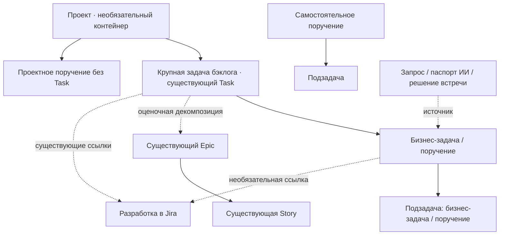
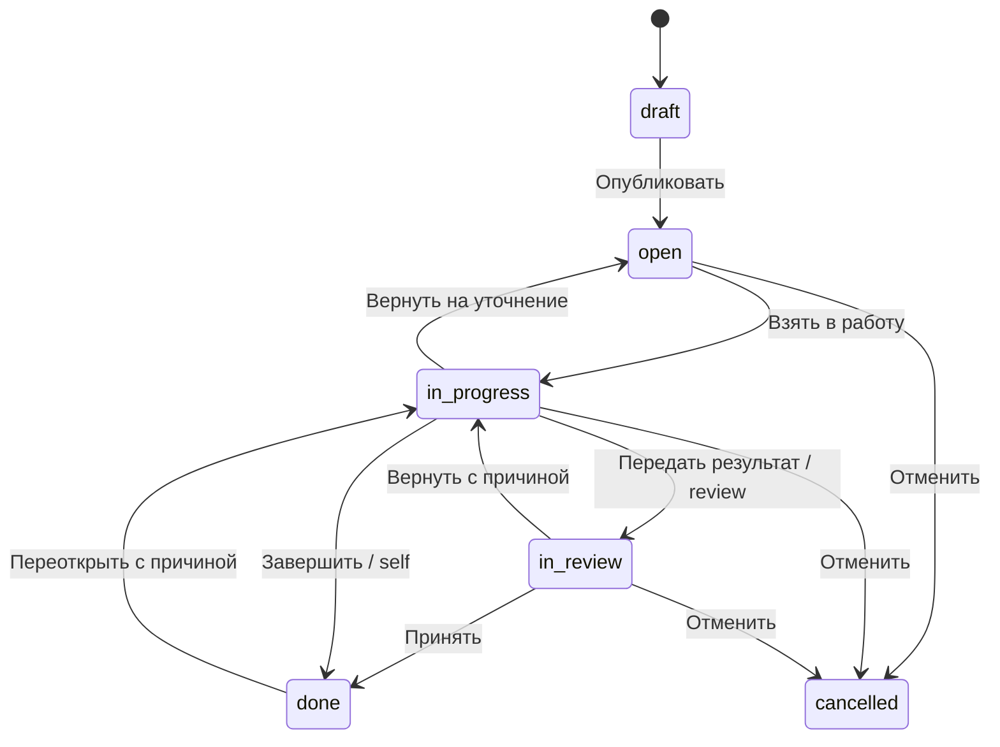

# Иерархия работ и трекер бизнес-задач и поручений

> **Исторический проект; заменён решениями от 09.10.2026.**
> Актуальная целевая структура находится в [«Структуре работ трайба»](../../work-structure.md).
> В ней рабочая задача и поручение — одна сущность, вложенные рабочие задачи
> отсутствуют, связь с внешним IT-трекером через интеграцию входит в целевую модель.
> Противоречащие этому положения ниже не являются действующими требованиями.
> Остальные предложения также требуют отдельного согласования перед реализацией.

Дата: 29.09.2026. Статус: **TO-BE / проект для обсуждения**.
Проверка AS-IS: статический анализ текущего рабочего дерева на 29.09.2026.
Код, БД и работающие сервисы в рамках проектирования не изменяются.

## 1. Решение в одном экране

Сохранить крупную задачу бэклога как единицу управления бизнес-результатом,
приоритетом, эффектом и отчётностью. Добавить внутри системы полноценный
операционный трекер **бизнес-задач и поручений** с исполнителями, сроками,
статусами, результатами, обсуждением и историей. Разработка остаётся в Jira.

Главная новая сущность — **рабочая задача (`WorkItem`)**. У неё два начальных
типа: `business_task` — бизнес-задача, `assignment` — поручение. **Подзадача —
это отношение к родителю, а не третий тип**. Поручение тоже может иметь подзадачи.

Три допустимых контекста корневой рабочей задачи:

1. В составе крупной задачи бэклога; проект определяется через неё.
2. Непосредственно в проекте, без искусственной крупной задачи.
3. Самостоятельно, без проекта и без крупной задачи.



Сплошная линия — включение в контейнер или декомпозиция; пунктирная — отдельная
смысловая связь. Проект не обязателен. Jira и источник поручения не становятся
родителями рабочего дерева.

### Решения пользователя и открытые вопросы

| ID | Решение | Статус |
|---|---|---|
| U1 | Здесь ведутся бизнес-поручения, в Jira — разработка | Подтверждено пользователем 29.09.2026 |
| U2 | Поручения возможны самостоятельно, в проекте и внутри крупной задачи | Подтверждено пользователем 29.09.2026 |
| U3 | Нужна ли явная приёмка постановщиком | Открыто: пользователь предложил подумать |
| U4 | Сотрудники команд и руководители; межкомандные поручения нужны в первой версии | Подтверждено пользователем 29.09.2026 |
| U5 | Интеграция с Jira не нужна | Подтверждено пользователем 29.09.2026; синхронизация и чтение статусов исключены из проекта |

Остальные правила ниже — предложения автора проекта, а не уже согласованные
регламенты. Для приёмки результата предусмотрены два режима; общий режим по
умолчанию должен быть выбран перед пилотом, а не выдан за решение пользователя.

## 2. Что уже есть: проверенный AS-IS

Существующий граф использован только для навигации. Его номера строк местами
устарели; выводы ниже проверены непосредственно по текущим исходникам.
Рабочая БД, количество записей и фактическая конфигурация Jira не исследовались.

| Наблюдение | Первичный источник | Следствие для проекта |
|---|---|---|
| `Project`: код, название, описание, статус, ответственный PL. `Task.project_id` допускает NULL | [models.py](../../../dmb-backlog/backend/models.py), `Project` и `Task`, строки 282–317 | Проект уже существует; не создавать его дубль. Большая задача может быть вне проекта |
| `Task` хранит команду, владельца, бизнес-эффект, приоритет, оценки, progress, отчётные статусы, version | [models.py](../../../dmb-backlog/backend/models.py), `Task`, строки 297–407 | Это крупная управленческая единица; переносить все её поля на мелкое поручение нецелесообразно |
| `Task → Epic → Story` существует; Epic/Story содержат описание, порядок и оценки, но не исполнителя, срок, статус исполнения или приёмку | [models.py](../../../dmb-backlog/backend/models.py), строки 424–467 | Оценочная декомпозиция ещё не является операционным трекером |
| Экспресс-оценка требует декомпозиции и положительной оценки каждого конечного элемента; конечным может быть Epic без Story | [express_router.py](../../../dmb-backlog/backend/routers/express_router.py), `_build_quick_estimate_readiness`; [test_express_response.py](../../../dmb-backlog/backend/tests/test_express_response.py) | Нельзя механически требовать Story для каждого эпика или заменять оценочные листья поручениями |
| CRUD Epic/Story проверяет доступ через Task; удаление Epic физически удаляет Stories каскадом | [express_router.py](../../../dmb-backlog/backend/routers/express_router.py), `create_epic`–`delete_story` | Новый трекер должен иметь собственную историю и мягкое удаление, без этого каскада |
| Есть комментарии, вложения, история, присутствие и события вокруг Task | [models.py](../../../dmb-backlog/backend/models.py), `TaskHistory`, `TaskComment`, `TaskAttachment`, `EventOutbox`; [task_collaboration_router.py](../../../dmb-backlog/backend/routers/task_collaboration_router.py) | Переиспользовать инфраструктуру, но не записывать поручения в таблицу Task ради комментариев |
| Обычное чтение Task зависит от глобального backlog scope или своей команды; customer portal имеет отдельную границу | [auth.py](../../../dmb-backlog/backend/auth.py), `can_access_task`, `task_read_scope_clause` | Назначение исполнителю другой команды требует явной предметной политики доступа |
| `RequirementRequest` имеет свой workflow и отдельного assignee; при передаче `in_progress` создаётся Task, если связи ещё нет | [agent_router.py](../../../dmb-backlog/backend/routers/agent_router.py), `agent_request_status`, строки 930–980; [models.py](../../../dmb-backlog/backend/models.py), `RequirementRequest` | Исполнитель проработки требования не равен автоматически исполнителю любого поручения; сохраняется существующий процесс |
| Assistant V2 формирует `AssignmentPassport`, а отправка в review допускает `BusinessRequirementDraftV2` | [V2 models.py](../../../agent-v2/agent_v2/v2/models.py), `AssignmentPassport`; [agent_v2_router.py](../../../dmb-backlog/backend/routers/agent_v2_router.py), `send_for_review` | Готовый паспорт — источник будущего поручения, но сейчас это ещё не карточка исполнения |
| Jira представлена ссылками `tasks.link_jira` и `task_jira_links` | [models.py](../../../dmb-backlog/backend/models.py), `TaskJiraLink`; [tasks_router.py](../../../dmb-backlog/backend/routers/tasks_router.py), обработка `link_jira` | Из наличия ссылок нельзя заключать, что реализована синхронизация статусов |
| Отчётные встречи и структурированный weekly payload связаны с Task | [reporting_meetings.py](../../../dmb-backlog/backend/reporting_meetings.py); [models.py](../../../dmb-backlog/backend/models.py), `TaskReportingStatus` | Next step из встречи можно превращать в поручение, сохраняя снимок отчёта |

## 3. Продуктовые границы и словарь

| Сущность | На какой вопрос отвечает | Где ведётся |
|---|---|---|
| Проект | В рамках какого изменения мы работаем? | Существующий Project |
| Крупная задача бэклога | Какой бизнес-результат получаем и почему он приоритетен? | Существующий Task, те же ID и API |
| Бизнес-задача | Какой конкретный рабочий результат нужно подготовить? | Новый WorkItem |
| Поручение | Кто, что и к какому сроку должен сделать по постановке? | Новый WorkItem с типом assignment |
| Подзадача | На какую более крупную рабочую задачу приходится эта часть? | Тот же WorkItem с parent_id |
| Пункт чек-листа | Как проверить или выполнить небольшой шаг без отдельного управления? | Часть WorkItem; без своего исполнителя и срока |
| Epic/Story экспресс-оценки | Как разложена и оценена крупная задача? | Существующие таблицы и экран оценки |
| Jira issue | Как выполняется разработка? | Jira; здесь возможна только необязательная обычная ссылка |
| Запрос / бизнес-требование | Какова потребность и как она прошла согласование? | Существующий RequirementRequest / артефакт V2 |
| Цель / KR | Ради какого измеримого результата нужны работы? | Ссылки на существующее представление целей; новый обязательный уровень дерева не вводится |
| Встреча / решение | Откуда возникло поручение? | Источник WorkItem, не родитель |

«Задачи и поручения» — название нового раздела. В смешанных представлениях
сохранять явную подпись **«Задача бэклога»**, чтобы пользователь различал Task и
WorkItem. Не переименовывать весь существующий Task в «эпик»: это сломает смысл
экспресс-оценки и привычные ссылки.

Разработка, баги, спринты, story points, релизы и технический backlog остаются
в Jira. Анализ, согласования, сбор информации, подготовка документов, бизнес-
проверки, организационные действия и контроль исполнения ведутся здесь.
Например, «Реализовать API» — Jira; «Согласовать состав данных API» — поручение.

### Выбор архитектуры

| Вариант | Достоинства | Ограничения | Решение |
|---|---|---|---|
| Расширить только Story | Использует существующий нижний уровень | Требует Task и Epic; не поддерживает самостоятельные поручения; смешивает оценки и исполнение | Не выбирать |
| Добавить parent_id в Task и хранить всё в tasks | Одна таблица | Мелкие работы попадут в финансовые расчёты, отчёты, import, customer и workflow крупных задач | Не выбирать |
| WorkItem рядом с Task, связи с оценкой | Отдельный простой жизненный цикл, самостоятельные поручения, сохранение AS-IS | Понадобится распространить инфраструктуру доступа и совместной работы | Рекомендуется |
| Перенести все бизнес-поручения в Jira | Один технический трекер | Не соответствует U1 | Не входит в выбранное направление |

Полноценность первого выпуска означает завершённый цикл постановки и
исполнения, а не копирование всех возможностей Jira.

## 4. Иерархия и связи

### 4.1. Владение и декомпозиция

- У WorkItem не более одного родителя WorkItem. Родитель определяет контекст.
- У корневого WorkItem ровно один контекст: `backlog_task`, `project` или
  `standalone`. Standalone означает отсутствие бизнес-контейнера, но не отсутствие
  команды ответственности или прав доступа.
- Для корня в Task эффективный проект берётся из Task. Независимый project_id
  поверх этого не задаётся. Изменение проекта Task отражается при следующем чтении.
- Для дочернего WorkItem контекст нельзя задать отдельно; он наследуется от корня.
- Предлагаемый предел интерфейса первого выпуска — три уровня WorkItem:
  рабочая задача → подзадача → ещё одна подзадача. Проект и Task в этот предел
  не входят. Ограничение проверяет сервер.
- Один и тот же результат нельзя включать в дерево дважды. Для работы в интересах
  нескольких задач выбирается один основной контекст, остальные — связи.
- Команда выполнения может отличаться от команды контекста. Это не меняет
  `Task.team_id`, состав команд или PO/PL/CL.
- Нельзя сделать себя своим родителем, вложить предка в потомка, прикрепить
  потомка к другому контексту обычным PATCH или создать ребёнка у завершённого
  родителя без явного переоткрытия.

### 4.2. Типы связей — не заменять одним полем «связанные»

| Связь | Кардинальность | Значение и поведение |
|---|---|---|
| WorkItem → parent | N:1, родитель необязателен | Часть результата; образует дерево |
| WorkItem → основной контекст | Через единственный корень | Где учитывается работа; определяет политику видимости |
| A blocks B | M:N, направленная | B нельзя начать/завершить при неудовлетворённой жёсткой зависимости |
| A relates_to B | M:N, симметричная | Контекстная связь; не влияет на статусы или агрегаты |
| A duplicates B | Много дублей к одной основной записи | Дубль отменяется с причиной; история и ссылка сохраняются |
| WorkItem → Task/Project | M:N, «связано с» | Дополнительные заинтересованные задачи/проекты без двойного учёта |
| WorkItem → Epic/Story | M:N, «относится к оценке» | Трассировка результата к оценочной декомпозиции; не родитель |
| WorkItem/Task → Jira URL | M:N | Необязательная справочная ссылка с подписью; не управляет локальными статусами |
| WorkItem → источник | M:N | Встреча, запрос, паспорт V2, документ; хранит редакцию и происхождение |

Для `blocks`: запрет циклов, включая длинные и конкурентно создаваемые цепочки;
запрет зависимости между предком и потомком, которая противоречит завершению
дерева. Завершённый предшественник удовлетворяет зависимость. Отменённый — нет:
постановщик зависимой работы снимает связь или оформляет исключение с причиной.
«Мягкая» зависимость только предупреждает. Снятие/обход блокировки аудируется.

Переоткрытие предшественника не откатывает автоматически готовые результаты
потом. Открывается сигнал риска для уже начатых/завершённых зависимых работ.

### 4.3. Перенос и удаление

Перенос между Task, проектом или самостоятельным контекстом — отдельная команда
с предварительным просмотром: новое положение поддерева, затронутые связи,
изменение доступа, исполнители, теряющие доступ. Проверяются права в источнике
и назначении, ограничения глубины и зависимости. Переносится поддерево целиком.
Нельзя автоматически открыть его новым людям только из-за drag-and-drop.

Удаление из пользовательского интерфейса означает архивирование. При наличии
незавершённых детей или входящих жёстких зависимостей требуется сначала явное
разрешение этих связей. Отмена родителя не отменяет детей молча: показывается
состав и причины отдельной пакетной операции. Каскадное физическое удаление
рабочих записей и истории не используется.

При удалении/архивировании связанного Task новые записи в нём запрещаются,
активные поручения требуют переноса либо отмены. Существующие команды удаления
Task должны получить этот guard перед включением трекера. Источники и старые
ссылки сохраняются как исторические свидетельства без восстановления доступа.

## 5. Участники, ответственность и доступ

Предметные роли ниже — участие в конкретной работе, не новые глобальные роли БД.

| Участник | Ответственность |
|---|---|
| Автор записи | Кто внёс информацию; может отличаться от постановщика |
| Постановщик | Содержание, ожидаемый результат, срок, приоритет и решение об отмене |
| Исполнитель | Единственный ответственный за выполнение, обновляет ход и результат |
| Соисполнители | Участие без размытия ответственности; при отдельном результате создаётся подзадача |
| Принимающий | Проверка результата, только если включён режим приёмки |
| Наблюдатели | Чтение и выбранные уведомления; подписка сама по себе не даёт доступа |
| Координатор | Разбор входящих, назначение и контроль в разрешённой области |

Одна запись — один основной исполнитель. Назначение не означает согласия
человека с объёмом: кнопки «Взять в работу» и «Уточнить постановку» разделяют эти
события. Отказ/уточнение возвращают задачу в очередь с причиной, сохраняя историю.

### Политика первого выпуска — предложение

1. Пользователь активен; customer-portal-only не получает доступ к внутренним
   поручениям через общий API. Портальный сценарий — отдельное расширение.
   Неопубликованный черновик видит автор и явно уполномоченный им редактор;
   попадание в командную очередь начинается с публикации.
2. Для корня в Task базовый read scope повторяет текущий `task_read_scope_clause`.
   Для project/standalone задаётся ответственная команда контекста; базовый
   доступ — её сотрудники и глобально уполномоченные пользователи.
3. Чтение проекта, роль PL проекта или участие в `involved_teams` сами по себе
   не дают доступ ко всем дочерним работам.
4. Создание в Task требует права редактирования Task. Для project/standalone
   первоначальный scope берётся из текущего task edit scope применительно к
   выбранной ответственной команде. Название должности не заменяет разрешение.
5. Исполнитель получает право менять ограниченный набор исполнительских полей
   своей записи, даже если не может редактировать весь Task: состояние, результат,
   отметку блокировки, свои комментарии и чек-лист. Он не меняет чужой срок,
   постановщика, контекст, права или согласованный объём.
6. Постановщик управляет своей записью при сохранении доступа; координатор с
   edit scope соответствующей области может переназначать и менять постановку.
   Для создания детей требуются доступ к родителю и право исполнения/управления;
   исполнитель может назначить созданного ребёнка себе, а делегировать — только
   при наличии права управления. Это отдельная проверка команды create-child.
7. Межкомандное назначение сопровождается явной предметной выдачей доступа к
   конкретному WorkItem. Это обычная рабочая запись разрешения, не изменение
   ролей, пользователей или членства команды. Нельзя назначить недоступного
   исполнителя и отправить ему бесполезное уведомление.
8. Адресный доступ не раскрывает Task, соседние работы, названия недоступных
   родителей, комментарии предков или общие суммы. Контекст отображается лишь
   разрешённой проекцией; без права на него — «Контекст ограничен».
9. Область адресного доступа по умолчанию — одна запись. Раскрытие поддерева
   является отдельным действием с просмотром состава, без автоматического
   наследования новым детям.
10. При деактивации сотрудника, отзыве grant или потере базового scope доступ
    пересчитывается во всех списках, поиске, вложениях, событиях, экспортах и
    уведомлениях. Сохранять локальный кэш после отзыва нельзя.

| Действие | Постановщик / уполномоченный координатор | Исполнитель | Читатель |
|---|---|---|---|
| Читать разрешённую запись | Да | Да | Да |
| Изменять постановку, срок, исполнителя | Да, с историей | Предложить изменение | Нет |
| Начать работу, передать результат | По праву исполнения/явному замещению | Да | Нет |
| Принимать результат | Только назначенный принимающий либо оформленное замещение | При self-режиме завершает; при review не принимает себя | Нет |
| Комментировать | При comment scope | В своей работе | При comment scope |
| Переносить, отменять, выдавать доступ | По scope и специальным guards | Нет | Нет |

Смена постановщика/принимающего и замещение отсутствующего сотрудника — явные
операции с причиной. Исторический участник остаётся в аудите. Запрет записывать
защищённые поля пользователей, ролей и команд действует и при реализации пилота.

## 6. Жизненный цикл и приёмка результата



Подписи UI: «Черновик», «Открыто», «В работе», «На проверке», «Выполнено»,
«Отменено». Назначение — поле, а не отдельный статус. Просрочка и блокировка —
параллельные признаки; заблокированная работа сохраняет текущую стадию.

| Команда | Обязательные условия |
|---|---|
| Создать черновик | Название, автор, разрешённый контекст |
| Опубликовать | Постановщик, понятный ожидаемый результат, команда ответственности; исполнитель и срок могут ещё уточняться |
| Начать | Активный исполнитель, ожидаемый результат, нет жёстких блокировок; задан срок либо причина «без срока» |
| Передать результат | Текст результата или разрешённое вложение/ссылка, обязательные пункты закрыты, дети завершены/явно отменены, блокировки разрешены |
| Принять / завершить | Правильный completion_policy, право актора, актуальная редакция результата и условия родителя |
| Вернуть с проверки | Причина, ожидаемая доработка; возвращается в работу тому же исполнителю |
| Переоткрыть | Причина; прежний результат и решение сохраняются; дата завершения отражается в истории |
| Отменить | Причина, явное решение по детям и зависимостям; не учитывается как успешное выполнение |

Черновик можно архивировать. Восстановление отменённого требует отдельной команды
`restore` в `open` с причиной и повторной проверкой контекста/доступа. Массовые
переходы выполняются по тем же правилам, без обхода guards.

### Решение U3: два варианта, без преждевременного выбора

| Режим | Подходит для | Цена |
|---|---|---|
| `self` — исполнитель завершает с результатом | Простые организационные действия, подготовка известного артефакта | Ниже административная нагрузка; нет отдельного свидетельства приёмки |
| `review` — исполнитель передаёт, принимающий завершает | Согласования, материалы для решения, результат с критериями качества | Явная ответственность за приёмку; нужна очередь проверок и замещение отсутствующих |

Рекомендация: поддержать оба режима и выбирать по характеру результата.
При создании показывать «Кто подтверждает выполнение». Если выбран `review`,
принимающий обязателен и отличается от исполнителя; постановщик предлагается
как кандидат, а не назначается скрыто. Изменение режима после начала работы
видно в истории; на проверке требуется снять текущую проверку с объяснением.
Принятие привязывается к конкретной редакции результата: изменение результата
инвалидирует неподтверждённое решение, старые решения не переписываются.

Пилот может проверить оба режима на двух типах поручений. Критерии выбора:
доля возвратов, время ожидания проверки, доля поручений без подтверждённого
результата и оценка постановщиков. Сейчас обязательная приёмка не утверждена.

## 7. Сроки, блокировки и агрегаты

### Сроки

- Первый выпуск: `planned_start_date`, `due_date`, `due_timezone` и причина
  отсутствия срока. Дата включительна; просрочка начинается с начала следующего
  дня в указанном часовом поясе. Внутренние timestamps — UTC.
- При переносе даты хранить предыдущий срок, причину и автора. Первоначальный
  согласованный срок сохраняется для анализа переносов.
- Срок ребёнка позже родителя вызывает предупреждение с необходимостью решения
  постановщика, а не тихое изменение родителя. Подтверждённое исключение хранится.
- `in_review` остаётся незавершённым и может быть просрочено; отдельно видны
  «исполнитель передал вовремя» и «результат принят вовремя».
- При переоткрытии просрочка считается по действующему сроку; старое закрытие
  не стирается. Отмена исключается из активной просрочки, но сохраняется в отчёте.
- Нет автоматической поправки на праздники или SLA в часах без отдельного
  согласованного производственного календаря.

### Блокировки

Ручная блокировка хранит причину, ожидаемое действие, ответственного за снятие
и необязательную дату следующей проверки. Зависимости образуют отдельные причины
блокировки. Снятие одной причины не снимает другие. На карточке одновременно
могут отображаться «В работе», «Заблокировано», «Просрочено».

Jira-ссылка — информационный контекст. Она не становится
автоматическим жёстким gate. Поручение
«Провести бизнес-проверку» может оставаться открытым после завершения разработки.

### Прогресс и недопущение двойного учёта

1. `Task.progress`, бизнес-эффект, бюджет и приоритет крупной задачи сохраняют
   прежний смысл. WorkItem не пересчитывает их автоматически.
2. В Task показывается отдельный показатель «Бизнес-работы: 7 из 10 выполнено»,
   число открытых, просроченных и заблокированных работ. Это не 70% бизнес-эффекта.
3. Для дерева считать конечные активные WorkItem. Родителя и его детей вместе
   в сумму не включать. Отменённые исключаются из знаменателя, их количество
   показывается отдельно. Если знаменатель ноль, результат — «нет работ», не 100%.
4. Родитель WorkItem не закрывается автоматически: даже при всех готовых детях
   ему может требоваться интегральный результат или приёмка. Это отображается
   отдельным индикатором «Дети завершены, ожидается завершение родителя».
5. Добавление новой подзадачи может уменьшить долю выполненных листьев. Показывать
   изменение состава; не интерпретировать его как потерю уже выполненного результата.
6. Списки «Мои задачи» считают все назначенные мне открытые WorkItem, включая
   родительские; показатель декомпозиции считает листья. Подписи различают метрики.
7. Полные агрегаты доступны только при праве видеть весь соответствующий scope.
   Для адресного доступа показывается «По доступным работам»; скрытые названия,
   суммы и количество чужих работ не раскрываются.
8. Оценки Epic/Story не суммируются с WorkItem. В первой версии оценки WorkItem
   необязательны и не участвуют в стоимости Task. Учёт времени, ресурсное
   планирование и пересчёт бюджета — отдельное последующее решение.

Закрытие Task при открытых WorkItem: сервер возвращает перечень доступных
препятствий. Уполномоченный пользователь завершает/переносит работы либо оформляет
обоснованное исключение. Нельзя подменять это проверкой только в UI; импорт,
bulk-команды и API должны соблюдать то же правило. Набор терминальных Task
статусов берётся из существующей бизнес-политики, не из придуманных новых ID.

## 8. Пользовательские сценарии и интерфейс

### 8.1. Сквозные сценарии

| Сценарий | Путь | Проверяемый результат |
|---|---|---|
| Декомпозиция крупной задачи | Task → «Работы и поручения» → создать → назначить → срок | WorkItem виден в Task и «Моих задачах», без копии Task |
| Поручение после встречи | Статус встречи → «Создать поручение» → подтвердить формулировку | Сохраняется источник: встреча, Task, редакция и фрагмент; старый отчёт не меняется |
| Самостоятельное поручение | «Задачи и поручения» → создать → «Без проекта» | Полный workflow без фиктивного проекта/Epic/Task |
| Проектное поручение | Проект → работы → создать | Принадлежит проекту, не попадает отдельной крупной задачей в бэклог |
| Несколько исполнителей | Родитель → подзадачи с отдельными ответственными | Родитель координирует общий результат; у каждого своя карточка |
| Межкомандное поручение | Создать → другая команда/исполнитель → просмотр предоставляемого доступа | Получатель видит нужное поручение; закрытые соседние данные недоступны |
| Нужен контекст разработки | Необязательно прикрепить обычную Jira-ссылку | Нет двойного назначения разработчика здесь; ссылка открывается в Jira |
| Возврат результата | Передать → проверить → вернуть с причиной | Исполнитель получает доработку; исходный результат и решение сохранены |
| Перенос standalone в Task | «Изменить контекст» → предпросмотр → подтвердить | Тот же ID, комментарии и история, согласованная новая видимость |
| Паспорт V2 → исполнение | Готовый паспорт → «Создать поручение» → проверить поля → опубликовать | Один WorkItem на подтверждённую редакцию; нет обязательного review требования |

### 8.2. Навигация

Новый раздел **«Задачи и поручения»** с режимами:

- **Мои**: назначено мне; создано мной; ожидает моей проверки; наблюдаю.
- **Команды**: входящие без исполнителя; открытые; просроченные; заблокированные.
- **Все доступные**: поиск и разрешённые области, а не безусловный глобальный реестр.

Представления: список, доска, дерево. Список — основной для сроков и поручений;
доска — по рабочим статусам; дерево — внутри Task/проекта. Доска крупных Task
остаётся отдельной. Общие фильтры: контекст, исполнитель, постановщик, команда,
тип, статус, срок, блокировка и приёмка. Фильтры и вид сохраняются в URL.

Существующие «Мои запросы» продолжают означать входящие бизнес-потребности.
Новая вкладка не заменяет этот путь и не смешивает review требования с приёмкой
выполненного поручения.

### 8.3. Карточка крупной задачи

Добавить вкладку **«Работы и поручения»**: дерево, «Создать», краткие индикаторы
исполнения и ссылки на Jira. Экспресс-оценка остаётся отдельной вкладкой/переходом
с подписью «Декомпозиция для оценки». При просмотре оценочного Epic/Story можно
создать связанную бизнес-работу или выбрать существующую. Обратная ссылка видна
в WorkItem; оценочный элемент не копируется целиком автоматически.

### 8.4. Карточка рабочей задачи

```text
WRK-000142  Согласовать состав полей клиентского отчёта
Поручение  ·  В работе  ·  до 05.10.2026
Контекст: Проект «Отчётность» / TASK-000-042

Ожидаемый результат        Согласованная таблица полей и источников
Постановщик                Анна, команда А
Исполнитель                Борис, команда Б
Кто подтверждает           На обсуждении: исполнитель / принимающий

Обзор | Подзадачи | Связи | Обсуждение | История
Справочная ссылка          Jira DEMO-314 — разработка формы
Результат                  [добавить описание или документ]
Основное действие          [Передать результат]  [Сообщить о блокировке]
```

Это вымышленный пример, не реальные пользователи, команды или Jira-записи.
Минимальная форма: название, тип, контекст, ожидаемый результат, исполнитель,
срок. Постановщик и команда предлагаются из разрешённого контекста; пользователь
видит значения перед публикацией. Остальные поля раскрываются по необходимости.

Быстрое создание допускает черновик с одним названием. AI не обязателен.
Для `self` основная кнопка «Завершить с результатом», для `review` — «Передать
на проверку». Принимающий получает «Принять» и «Вернуть на доработку».

Не скрывать ошибку сохранения или конфликт версий. При `409` сохранять локальный
текст, показать изменившиеся поля и предложить повторное применение. Drag-and-drop
статуса должен показывать те же требования, что и кнопка перехода; клавиатурная
альтернатива обязательна. На мобильном — список вместо многоколоночной доски,
карточка отдельной страницей, видимые подписи полей и действий.

### 8.5. Уведомления и контроль

События: назначено/переназначено, срок изменён, упоминание, комментарий при
подписке, передано на проверку, принято/возвращено, возникла/снята блокировка.
Напоминания: до срока, просрочка, ожидание проверки — с настраиваемой частотой.
Для пилота предложить ежедневную сводку просроченных вместо сообщения при
каждом открытии страницы. Отправку во внешние каналы проектировать отдельно.

Уведомление содержит конкретное действие и прямую ссылку. Группировать по
получателю, work_item и смыслу события. Повтор scheduler не создаёт дубликаты;
изменение срока или закрытие делает прежнее напоминание неактуальным. Назначение
себе по умолчанию не создаёт лишнего уведомления. Доставка — после commit через
outbox; сбой Redis не теряет постановку поручения. Содержимое и target повторно
проверяются по текущим правам при выдаче и открытии.

Контроль руководителя: без исполнителя, открытые по срокам, просрочка, возраст
блокировки, ожидание проверки, переносы сроков, возвраты результатов. Не делать
рейтинг сотрудников по количеству закрытых мелких поручений. Количество работ
не является достоверной оценкой загрузки без сопоставимой трудоёмкости.

## 9. Логическая модель данных

Модель рассчитана на PostgreSQL и текущий модуль Work; это проект новых таблиц,
а не выполненная миграция. `Task`, `Project`, `User`, `Team` используются по
существующим ID. Бизнес-типы/состояния WorkItem — версионируемый кодовый контракт;
они не требуют наполнения защищённых справочников `statuses`/`task_types`.

### 9.1. work_items

| Группа | Поля и ограничения |
|---|---|
| Идентификация | `id` bigint PK; `public_id` unique immutable, например WRK-000142; `kind` = business_task / assignment; `title` 1–255; `description` |
| Дерево | `parent_id` nullable FK work_items; `root_id` not null FK work_items; `sort_order`; `tree_revision` у корня |
| Контекст корня | `context_kind` backlog_task/project/standalone; `backlog_task_id` nullable FK tasks; `project_id` nullable FK projects; `context_team_id` только для project/standalone |
| Участники | `created_by`, `requester_id` обязательны; `assignee_id`, `acceptor_id` nullable FK users; `execution_team_id` nullable FK teams |
| Постановка | `expected_result`, `acceptance_criteria`; `priority` low/normal/high/urgent, independent от инвестиционного приоритета Task |
| Состояние | `status` draft/open/in_progress/in_review/done/cancelled; `completion_policy` self/review |
| Сроки | `planned_start_date`, `due_date`, `initial_due_date`, `due_timezone`, `no_due_reason`; даты публикации/начала/передачи/закрытия |
| Результат | `current_result_revision_id` nullable FK work_item_results; причина отмены |
| Техника | `version` not null; `created_at`, `updated_at`; `archived_at`, `archived_by`; `deleted_at` только для управляемого технического удаления, не обычного UI |

У корня `parent_id = NULL`, `root_id = id`. У ребёнка контекстные поля NULL,
а `root_id` указывает на корень. CHECK требует ровно одну допустимую комбинацию
контекста у корня: Task без project_id; Project без backlog_task_id; standalone
без обоих. У Task-контекста команда безопасности разрешается через актуальный
Task, а не копируется навечно. Эффективные project/context/team возвращаются API
как вычисленные поля; клиент не изменяет их обычным PATCH.

Согласованность root_id и родителей проверяется транзакционно. Для корня ID
выделяется до INSERT, чтобы self-FK был корректен. Архивирование сохраняет ID и
не освобождает public_id. `execution_team_id` задаёт выполнение, не read scope.
Если назначенный сотрудник не входит в выбранную команду выполнения, команда
должна быть уточнена либо оформлено межкомандное назначение; User.team_id не меняется.

### 9.2. Подчинённые таблицы

| Таблица | Назначение и основные поля |
|---|---|
| `work_item_relations` | source_id, target_id, kind blocks/relates/duplicates, hard flag, reason, created_by; FK на оба WorkItem; unique канонической пары/типа |
| `work_item_context_links` | work_item_id и ровно один FK task/project/epic/story; relation; дополнительная трассировка с реальными FK |
| `work_item_sources` | work_item_id, source_system, source_type, source_id, revision, fingerprint, разрешённый excerpt, captured_by/at; локальные request/meeting ID дополнительно проверяются |
| `work_item_results` | work_item_id, revision, result_text, author, submitted_at; неизменяемые редакции результата |
| `work_item_reviews` | work_item_id, result_revision_id, decision accepted/returned, comment, actor, decided_at; решение только к актуальной редакции |
| `work_item_participants` | work_item_id, user_id, collaborator/watcher; unique тройки; не выдаёт доступ сама по себе |
| `work_item_access_grants` | work_item_id, user_id, permission read/execute/review, grant_reason, granted_by/at, revoked_at; отдельная проверка делегирования |
| `work_item_blockers` | work_item_id, reason, owner_id, next_check_date, opened_at, resolved_at; несколько причин одновременно |
| `work_item_checklist_items` | work_item_id, text, required, done, changed_by, order; отдельный исполнитель/срок не поддерживаются |
| `work_item_comments` | work_item_id, author, parent_comment_id, body, edited_at/version; ответы только внутри одной работы |
| `work_item_attachments` | work_item_id, uploader, storage_key, filename, size, media_type, lifecycle; доступ через API, не публичный путь |
| `work_item_history` | work_item_id, actor, action, changed_fields, reason, entity_version, occurred_at, correlation_id; хронология и фильтрация разрешённых значений |
| `work_item_links` | work_item_id, url, пользовательская подпись, created_by/at; unique work_item_id/url; обычные ссылки на Jira или другие материалы без загрузки metadata |
| `work_item_publications` | source_system/session/artifact_revision/fingerprint, work_item_id; уникальность источника для дедупликации публикации из V2/встречи |

Внешний source_id не является произвольным разрешением читать источник. При
показе источника повторно проверяется доступ; сохранённый excerpt не должен
обходить отзыв доступа. Если проверка недоступна, текст скрывается, остаётся
безопасное обозначение происхождения.

Существующие `notifications` расширяются nullable `work_item_id` с FK и правилом:
notification о WorkItem авторизуется через WorkItem, а не через один task_id.
Идентификатор Task для такого уведомления не должен случайно раскрывать родителя.
Уведомления прежних типов продолжают работать. Шаблоны в защищённых справочниках
не наполняются автоматически.

Переиспользовать `event_outbox`, `idempotency_records`, общий аудит и загрузочный
pipeline. Для вложений сохранять существующие ограничения формата/размера,
безопасное имя, проверку прав при download, очистку незавершённых загрузок.

### 9.3. Индексы и конкурентность

- Частичные индексы активных работ: `(assignee_id, status, due_date, id)`,
  `(requester_id, status, id)`, `(execution_team_id, status, due_date, id)`.
- Дерево: `(root_id, parent_id, sort_order, id)`; корни по backlog_task_id и
  project_id. Индекс очереди проверки `(acceptor_id, status, submitted_at, id)`.
- History/comments: `(work_item_id, created_at/occurred_at, id)`; grants по user
  и work_item; зависимости по обоим концам; FK индексировать по реальным запросам.
- Все изменения WorkItem: compare-and-swap по version, атомарная запись истории
  и outbox. Конфликт не перетирает чужую правку.
- Создание/перенос/архивирование детей и завершение родителя берут lock корня
  в одной транзакции. Это закрывает гонку «проверили отсутствие детей —
  параллельно появился новый ребёнок». При переносе блокируются оба корня в
  стабильном порядке; проверяется tree_revision.
- Изменения контекста/статуса Task и команды WorkItem соблюдают единый порядок
  lock Task → корни по ID → записи по ID. Терминальные guards вызываются всеми
  entry points, включая import и bulk.
- Добавление направленных зависимостей первого выпуска сериализуется общей
  короткой advisory-блокировкой графа в PostgreSQL. После неё проверяется цикл
  recursive CTE; блокировка только двух концов недостаточна для длинного цикла.
- Список — cursor pagination, стабильная сортировка с ID, limit ≤ 100.
  Дерево загружается по веткам, без полной загрузки всех поручений в браузер.
  Агрегаты считаются на сервере в той же области доступа.

## 10. API и архитектурные границы

### Размещение

В текущем приложении — отдельный модуль: `work_items_router`, service команд,
policy доступа, query service, схемы и domain events. Бизнес-проверки не
распределять между JavaScript и несколькими route handlers.

В целевом [плане миграции на Java](../../JAVA_JS_MICROSERVICES_MIGRATION_PLAN.md)
контекст Work уже владеет Task, Project, review и встречами. WorkItem принадлежит
тому же контексту; отдельный микросервис ради карточек сейчас не требуется.
Конкретный язык первой реализации выбирается по текущему плану перехода.
Контракт и приёмочные сценарии должны пережить перенос Python → Java.

### Предлагаемые маршруты `/api/v1`

| Метод и путь | Назначение |
|---|---|
| `GET /work-items` | Разрешённый список, фильтры и cursor |
| `POST /work-items` | Создать в явно указанном контексте или у parent |
| `GET /work-items/{id}` | Карточка, computed context, permissions, allowed_actions |
| `PATCH /work-items/{id}` | Изменить поля постановки по version; строгий allowlist |
| `POST /work-items/{id}/transitions` | Команда start/submit/accept/return/complete/reopen/cancel/restore с причиной и версией |
| `GET /work-items/{id}/children` | Страница детей; доступ проверяется на каждый элемент |
| `POST /work-items/{id}/assignment` | Назначить/переназначить; version и явная политика межкомандного доступа |
| `POST /work-items/{id}/move-preview` | Проверить новое положение и показать последствия |
| `POST /work-items/{id}/move` | Применить проверенный перенос по версиям корней и записи |
| `POST /work-items/{id}/archive` | Архивирование после проверки незавершённых связей |
| `GET/POST /work-items/{id}/comments` | Обсуждение; изменение/удаление собственного комментария отдельными командами |
| `POST /work-items/{id}/results` | Новая редакция результата; submit может атомарно создать редакцию и перейти в in_review |
| `GET/POST /work-items/{id}/attachments` | Вложения и metadata; download с повторной авторизацией |
| `GET/POST /work-items/{id}/relations` | Связи, доступ к обеим сторонам, отдельная команда удаления связи |
| `GET/POST /work-items/{id}/blockers` | Открытие и закрытие конкретной причины блокировки |
| `GET/POST /work-items/{id}/checklist` | Пункты и изменения по версии |
| `GET/POST /work-items/{id}/participants` | Участники/подписки; без неявной выдачи прав |
| `GET/POST /work-items/{id}/links` | Обычные URL материалов; изменение/удаление по версии, без запросов к внешним системам |
| `POST /work-items/{id}/access-grants` | Явный grant конкретной записи; отзыв отдельной командой |
| `GET /work-items/{id}/history` | Разрешённая история |
| `GET /tasks/{id}/work-summary` | Отдельные индикаторы бизнес-работ |
| `GET /projects/{id}/work-items` | Проектные корни плюс работы из Task этого проекта, с фильтрацией |
| `POST /work-item-publications/preview` | Проверенный кандидат из V2/встречи, без записи |
| `POST /work-item-publications` | Опубликовать подтверждённую редакцию источника один раз |

Список маршрутов — проект контракта, не текущий OpenAPI. Операции комментариев,
grants, связей, чек-листа и участников получают собственные версии или общий
expected_version WorkItem; окончательно выбрать один вариант до кодирования.
Рекомендация первого выпуска: самостоятельные version для редактируемых
дочерних записей, с увеличением WorkItem.version только для предметных изменений.

На create и остальные повторяемые команды — `Idempotency-Key`, область
`(operation, actor, key)` плюс fingerprint. Повтор иного payload — `409`.
Публикация из источника дополнительно защищена уникальностью источника независимо
от ключа клиента. Авторизация выполняется до возврата сохранённого результата.

`428` — обязательная версия отсутствует; `409` — конфликт версии/состояния/дерева;
`422` — невалидные поля; `403` — недостаточно прав на известное разрешённое действие;
`404` — недоступный/отсутствующий объект без утечки существования.
Структурная ошибка: `code`, `message`, `field_errors`, `blocking_items` только
в разрешённой проекции, `current_version` при праве чтения.

Доменные события: `work_item.created`, `assigned`, `state_changed`,
`due_date_changed`, `result_submitted`, `reviewed`, `moved`, `archived`,
`access_changed`. Минимальный payload: event_id, aggregate_id/version, actor,
occurred_at, correlation_id и разрешённые идентификаторы. Комментарии и полные
описания не рассылаются без повторной проверки прав. Удаление scope из клиентского
кэша обрабатывается как отдельное событие; query cache ключуется scope/version.

## 11. Граница с Jira и публикация из AI

### Jira

| Данные | Владелец |
|---|---|
| Постановка бизнес-поручения, его срок, исполнитель, результат, приёмка | Эта система |
| Статус разработки, разработчик, sprint, техническая оценка | Jira |
| Бизнес-приоритет, эффект, управленческий прогресс крупной задачи | Существующий Task |
| Необязательные ссылки из бизнес-работ на материалы | Эта система |

По решению U5 **интеграция с Jira исключена**: не нужны коннектор, API-доступ,
webhooks, синхронизация, автоматическая загрузка статусов, сопоставление
исполнителей или общая модель Jira-иерархии. Выбор Cloud/Data Center на этот
проект не влияет и не требует уточнения.

Существующие ссылки Task остаются как есть. В WorkItem обычное поле ссылок
может содержать адрес Jira, документа или другого материала; оно необязательно
и не является условием запуска. Название ссылки вводит человек. Сервер не
загружает превью и metadata, браузер открывает ссылку, доступ проверяет внешняя
система. Разрешены безопасные http/https URL, недопустимы исполняемые схемы.

Локальный статус отражает бизнес-работу. Например, разработка может быть готова
в Jira, а поручение «Проверить результат с заказчиком» здесь остаётся в работе.
Пользователь обновляет только состояние своего бизнес-результата. Ни один
пользователь не обязан переносить сюда все технические задачи и их статусы.

### Assistant V2

`AssignmentPassport → preview → подтверждённая публикация → WorkItem`.
Поля passport: title, assignment_statement, expected_result, source_context,
constraints и ссылки — кандидаты для формы. Свободный `deadline_or_urgency`
не превращать в точную дату без подтверждения. Имена участников не превращать
в user_id без выбора существующего доступного пользователя.

Режим requirement_copilot сохраняет существующий маршрут в RequirementRequest.
Он не обязан создавать WorkItem и не должен менять текущий уникальный task_id
запроса. Поручение на анализ требования связывается с запросом через источник.
Если standalone-поручение выросло в крупную задачу, создаётся запрос/Task
посредством разрешённого процесса и связывается с ним; WRK-ID не заменяется TASK-ID.

Публикация сохраняет session ID, редакцию, fingerprint, автора подтверждения и
ссылку на результат. Новая редакция паспорта предлагает diff к существующей
работе, а не создаёт дубль и не затирает результат исполнения. Первая версия
публикации может брать проверенный снимок напрямую; последующие обновления —
только с явно выбранными полями и версиями.

## 12. Совместимость, миграции и эксплуатация

1. Добавочные таблицы и поля; никакой массовой конвертации Task/Epic/Story.
   Старые ID, URL, public_id, импорт и отчёты сохраняются.
2. Существующие данные эпиков/историй остаются оценочными. При создании связанной
   работы показывать источник; без автоматической миграции всех строк в поручения.
3. Существующее хранение Jira-ссылок Task не меняется. Новые обычные ссылки
   WorkItem хранятся отдельно; миграция внешних метаданных не нужна.
4. Признак включения трекера управляет UI и API. Пилот по существующей разрешённой
   группе/команде не требует создания пользователей или изменения их ролей.
   Отдельно разрешать публикацию из V2.
5. При выключении новых записей UI остаётся в режиме чтения/экспорта для уже
   созданных поручений. Откат кода не удаляет новые таблицы и историю.
6. Перед применением миграций: backup, проверка восстановления, миграция на
   отдельном стенде и подтверждённая совместимость. Миграции схемы не заполняют
   защищённые справочники, пользователей, роли или команды.
7. Наблюдаемость: частота/задержка команд, version conflicts, outbox backlog,
   ошибки уведомлений, несогласованные root_id, orphan links,
   публикации-дубликаты. Логи содержат ID и коды, не тексты поручений и секреты.
8. Retention, квоты вложений и полномочия на техническое удаление согласуются
   с действующей политикой эксплуатации до production. Архивирование не является
   физическим удалением. Новый модуль входит в общий backup/restore и runbook.

Не добавлять поле «включить трекер» в защищённые записи команд ради пилота;
использовать конфигурацию приложения. Существующие незакоммиченные изменения
репозитория не относятся к реализации этого проекта.

## 13. План реализации и граница первого выпуска

| Этап | Результат | Зависимости / критерий выхода |
|---|---|---|
| P0. Зафиксировать договорённости | U3, матрица scope, терминология, 10–15 реальных сценариев без переноса персональных данных | Известны пользователи пилота и способ завершения; U4/U5 уже согласованы |
| P1. Модель и команды | WorkItem, дерево, контексты, версии, policy, история, outbox, lifecycle | Проверены независимые поручения, циклы, гонки, изоляция команд |
| P2. Полный рабочий путь | «Мои», очередь команды, карточка, вкладка Task, список/доска/дерево, результат, комментарии/вложения, уведомления | Пользователь ставит, исполняет и закрывает поручение без обходных таблиц |
| P3. Источники и управленческий обзор | V2 → WorkItem, встреча → WorkItem, связи с оценкой, обычные ссылки, summary в Task/проекте | Нет дублей публикации и двойного учёта; исходный review не нарушен |
| P4. Пилот | Согласованная ограниченная группа и реальные рабочие сценарии | Пройдены UAT, негативные права, восстановление и наблюдаемость |
| P5. Расширения | Повторяющиеся поручения, шаблоны, календарный вид, ограниченный портал | Отдельные подтверждённые требования и инфраструктура |

**Состав первого промышленного выпуска:** P1–P4 в согласованном объёме, включая
адресную межкомандную работу согласно U4. Приёмка — в выбранном режиме;
без выбора U3 пилот не должен скрыто задавать обязательность всем поручениям.

За пределами первого выпуска: спринты, релизы, разработка в локальном трекере,
любая интеграция с Jira, автоматическое планирование ресурсов, timesheets,
универсальный конструктор workflow, произвольная глубина, портфели/программы как
новые обязательные уровни, публичный доступ, автоматические поручения без человека.

Оценку сроков в неделях дать после выбора стека первой реализации, состава команды
и U3. Сейчас календарное обещание было бы недоказанным. P1/P2 дают наибольший
объём изменений: доступ, состояние и совместная работа, а не только таблица UI.

## 14. Приёмочные критерии

Это план будущих тестов. Ниже не утверждается, что проверки уже выполнены.
Фикстуры используют существующие read-only представления защищённых субъектов
или in-memory doubles; запись пользователей/ролей/команд без отдельного прямого
разрешения не допускается даже при подготовке тестов.

| ID | Сценарий / Given–When–Then |
|---|---|
| AC01 | Созданы работы в Task, проекте и standalone: все три сохраняются без фиктивных родителей |
| AC02 | Ребёнку передан другой project_id/Task: запрос отклонён; эффективный контекст берётся от корня |
| AC03 | Попытка цикла дерева, превышения глубины или длинного цикла blocks: отклонение без частичных записей |
| AC04 | Два пользователя меняют одну версию: один успех, второй 409; текст второго доступен для восстановления |
| AC05 | Одновременно закрывают родителя и добавляют ребёнка: не возникает закрытого родителя с незавершённым новым ребёнком |
| AC06 | Повтор create/submit/publish после сетевого таймаута: одна запись/редакция и одно доменное событие; другой payload с тем же ключом — 409 |
| AC07 | Исполнитель другой команды получил адресное поручение: видит его и свои действия; родитель, соседи и их агрегаты недоступны |
| AC08 | Отзыв grant/блокировка пользователя: карточка, поиск, вложения, SSE, уведомления и экспорт больше не раскрывают запись |
| AC09 | `self` завершается исполнителем с результатом; `review` требует принимающего, возврат имеет причину, самоприёмка запрещена |
| AC10 | Результат изменился после открытия проверки: принятие старой редакции отклонено; история не перезаписана |
| AC11 | Срок 05.10: до конца этой даты нет просрочки, с 06.10 есть в её timezone; `in_review` учитывается отдельно от передачи вовремя |
| AC12 | Отменённый предшественник не разблокирует автоматически зависимую работу; два blockers снимаются независимо |
| AC13 | Перенос поддерева проверяет оба scope и версии, показывает последствия доступа, сохраняет ID/историю; конкурентный перенос отклонён |
| AC14 | Все дети готовы, родитель ещё на проверке: summary отражает оба факта; Task.progress и финансовый эффект не переписаны |
| AC15 | Родитель+дети, отменённые и связанные работы: сумма листьев без дублей; при отсутствии листьев нет искусственных 100% |
| AC16 | Завершение/удаление Task с открытыми работами через UI, bulk, import и API: единые guards, никакой потери поручений |
| AC17 | Redis/notification worker временно недоступны: поручение сохранено; доставка после восстановления без лавины дубликатов |
| AC18 | В карточке есть Jira-ссылка: приложение не запрашивает Jira и не требует её учётных данных; все операции работают независимо от её доступности |
| AC19 | Одна внешняя ссылка добавлена к нескольким работам: нет двойного учёта бизнес-эффекта и автоматического закрытия WorkItem |
| AC20 | Паспорт V2 опубликован повторно с иным idempotency key: существующая публикация возвращена по source uniqueness; другая редакция предлагает diff |
| AC21 | Эпики, истории, экспресс-оценка, приоритизация, customer requests и отчёты проходят регрессию с прежними контрактами |
| AC22 | Клавиатура и мобильный экран: создание, смена состояния, результат, возврат и ошибки доступны без drag-and-drop |
| AC23 | Архивирование, выключение флага и восстановление backup: записи/вложения/история сохранены, нет необратимой потери при откате |
| AC24 | Ошибочный вложенный comment/source/link с чужим ID: нет обхода прав через связанную сущность или старый snapshot |

Предлагаемый нагрузочный профиль для отдельного стенда: 50 одновременно
работающих пользователей, 100 000 WorkItem, история до 1 млн событий; это тестовый
ориентир, не измеренная текущая нагрузка. Цель для согласования: p95 списка и
карточки ≤ 1 с, команды ≤ 1,5 с. Проверить реальные
индексы и query plans, N+1, размер дерева и scope filtering до фиксации SLO.

## 15. Риски и решения перед разработкой

| Риск | Предложение |
|---|---|
| Три значения слова «задача» | Постоянно различать Task бэклога, WorkItem и Jira issue; показывать тип и контекст |
| Двойная работа и статусные расхождения с Jira | Фиксировать владельца каждого поля; локальный трекер только бизнес-исполнения |
| Новые поручения обходят согласование крупной инициативы | Малые действия разрешены; новый бизнес-объём/бюджет проходит существующий процесс Task и решения о приоритете |
| Межкомандная работа раскрывает весь backlog | Адресные grants и тесты всех read surfaces; не выдавать глобальные роли |
| Приёмка превращается в очередь без ответственного | U3, назначенный принимающий, замещение, время ожидания и напоминания |
| 100% поручений принимают за достижение бизнес-цели | Раздельные метрики и ручное управленческое решение по Task |
| Параллельная миграция на Java удваивает реализацию | Один контракт и UAT; модуль остаётся в Work, стек выбирать до P1 |
| AI создаёт лишние задачи | Preview, подтверждённая редакция, идемпотентность, публикация человеком |

Минимальные решения до пилота: U3 (self/review и default), конкретное право
постановки/делегирования и допустимость работ без срока. U4 и U5 согласованы:
сотрудники и руководители, межкомандная работа, без интеграции с Jira.
Детали адресного доступа, ограничение глубины, уведомления, сроки хранения и
тестовый профиль можно уточнять на P0 без изменения основной модели.

## 16. Источники и граница доказательности

Карта проекта: [docs/index.md](../../index.md). Профильные AS-IS документы:
[модель данных](../../../dmb-backlog/docs/DATA_MODEL.md),
[логика страниц](../../../dmb-backlog/docs/PAGE_LOGIC.md),
[навигатор](../../../dmb-backlog/docs/README.md). Первичные исходники приведены в разделе 2.

Документ учитывает незакоммиченное рабочее дерево на дату анализа. Динамические
тесты, миграции, запуск сервисов и изменение рабочих/защищённых данных в этой
задаче не выполнялись. После уточнения U5 интеграционные предложения по Jira
исключены; проект не требует внешних API или изменений в Jira.
