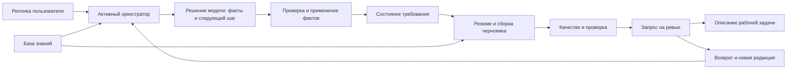

# Аудит логики подготовки бизнес-требований ИИ-ассистентом

Дата проверки: **08.09.2026**. Объект: текущее рабочее дерево Backlog coordinator, включая незакоммиченные изменения. Это датированное исследование, а не описание будущего AS-IS. Рекомендации ниже **не внедрены**.

## 1. Заключение

**Основной недостаток — отсутствие надёжной связи между тем, что пользователь сообщил, тем, что ассистент подтвердил в диалоге, и тем, что фактически оказалось в запросе.** Система уже умеет собирать несколько фактов за ход, адаптировать вопросы и выпускать структурированный черновик. Однако проверены пути, на которых она теряет дополнения и противоречия, повышает статус неподтверждённых предположений, показывает завышенное качество и передаёт дальше неполную либо другую редакцию требования.

Поэтому улучшение только системного промпта или замена модели не решит главную проблему. Часть дефектов возникает **после корректного понимания пользовательской реплики моделью**: Python отклоняет дополнение, не сохраняет конфликт или backend фиксирует устаревший снимок. Более сильная модель может уменьшить вероятность некоторых ошибок, но не устранит эти пути.

Практическая оценка: ассистент пригоден как помощник для первичного сбора и подготовки материала при внимательной проверке человеком. **Текущие показатели «высокое качество», «подтверждено» и успешная отправка не являются достаточными доказательствами содержательной корректности запроса.** Сам институт ревью не компенсирует дефекты, если замечания и потерянные ограничения до ревьюера не доходят.

Первая очередь доработок должна обеспечить четыре свойства:

1. Ни одно принятое дополнение не исчезает; отказ сохранить изменение явно сообщается пользователю.
2. У каждого значимого утверждения устойчиво сохраняются источник, статус достоверности и история изменения.
3. Подтверждается, сохраняется и рассматривается одна и та же редакция документа.
4. Проверка качества оценивает содержание, а все существенные замечания видны человеку, принимающему решение.

Короткий путь к раннему черновику следует сохранить. **Возможность передать аналитику неполное требование сама по себе не является недостатком.** Недостаток возникает, когда неизвестное скрывается, неполнота выглядит высоким качеством или отправка создаёт ложную уверенность в сохранности результата.

## 2. Область, метод и ограничения доказательств

Исследована цепочка:



Проверены активный оркестратор, контракт решения LLM, применение фактов, память диалога, классификация значений, ограничения вопросов, раннее завершение, эскалации, composer, quality/reviewer/gaps, retrieval и локальный корпус, API отправки и возврата, отображение запроса, перенос в задачу и релевантные тесты. Навигация через существующий graphify использовалась только для поиска связей; выводы проверены по исходникам. Исторические отчёты и legacy-реализация не принимались за текущий runtime.

**Уровни доказательств:**

- **Воспроизведено:** выполнен конкретный сценарий на реальных функциях с синтетическими входами. Для диалога подставлялись решения модели и хранилище объектов в памяти; для интеграции — зависимости backend-функций. Это доказывает существование пути ошибки, но не частоту его возникновения.
- **Подтверждено кодом:** установлено наличие/отсутствие конкретного механизма и его использование в активной цепочке.
- **Зона роста:** предлагаемое изменение продукта, для которого необходимо проверить пользу на реальных диалогах. Оно не выдаётся за уже измеренный дефект.

Выполнены **258 тестов агента — все прошли**, 13 предупреждений об устаревающих API библиотек. Также прошли **4 профильных frontend test-файла**. Дополнительные воспроизведения обнаружили проблемы, не покрытые этими тестами.

Рабочие диалоги и содержимое пользовательской БД не исследовались. Защищённые данные не создавались и не изменялись. Backend pytest с фикстурами пользователей, ролей и команд не запускался. In-memory проверки не заменяют PostgreSQL, HTTP и браузерный E2E.

После отдельного явного согласия пользователя выполнен **один сетевой запрос** к настроенной модели `glm-5.1` на `opencode.ai`, с синтетической репликой про экран истории лимита. Внешние повторы ограничены бюджетом в один запрос. Провайдер вернул **HTTP 401 Unauthorized** за 1.78 с: использованные учётные данные не были приняты; точная причина отказа не установлена. Ассистент вернул `unavailable`, карта фактов и решение остались пустыми. Это подтверждает корректную обработку данного отказа авторизации, но **не позволяет оценить содержательное качество реальной модели**. Статистика выдумок, доля пригодных запросов и фактическое время успешного диалога не измерялись. Время 1.78 с относится к отказу, а не скорости генерации.

Первоначальная попытка из ограниченного процесса завершилась `WinError 10013`; автоматическая проверка сетевого запуска потребовала отдельного согласия. После его получения разрешение больше не являлось препятствием — им стал отказ авторизации внешнего сервиса. Для содержательного прогона нужен действующий доступ к провайдеру. Рабочий сервис этим отдельным экспериментом не проверялся; конфигурационные файлы не изменялись.

Материалы воспроизведения:

| Область | Скрипт | Результат |
|---|---|---|
| Оркестрация, эскалации, KB, потеря допущений | [reproduce.py](evidence/ai-ba-2026-09-08/reproduce.py) | [reproductions.json](evidence/ai-ba-2026-09-08/reproductions.json) |
| Факты, corrections, evidence, память, типы | [dialogue_reproduce.py](evidence/ai-ba-2026-09-08/dialogue_reproduce.py) | [dialogue_results.json](evidence/ai-ba-2026-09-08/dialogue_results.json) |
| Качество, противоречия, применимость, gaps | [artifact_reproduce.py](evidence/ai-ba-2026-09-08/artifact_reproduce.py) | [artifact_results.json](evidence/ai-ba-2026-09-08/artifact_results.json) |
| Отправка, возврат, перенос и отображение | [integration_reproduce.py](evidence/ai-ba-2026-09-08/integration_reproduce.py) | [integration_results.json](evidence/ai-ba-2026-09-08/integration_results.json) |
| Ограниченный сетевой эксперимент | [live_probe.py](evidence/ai-ba-2026-09-08/live_probe.py) | [live_probe.json](evidence/ai-ba-2026-09-08/live_probe.json) |

Версия основных исследованных исходников зафиксирована в [source_manifest.json](evidence/ai-ba-2026-09-08/source_manifest.json): SHA-256 43 файлов и Git HEAD с явной отметкой о незакоммиченных изменениях. Итог исполнения воспроизведений и сводка тестов — [verification.json](evidence/ai-ba-2026-09-08/verification.json).

Перед согласованным сетевым экспериментом отпечатки повторно сопоставлены: изменился только `dmb-backlog/frontend/js/components/agentChat.js`. Он не участвует в этом эксперименте в памяти; исследованные исходники модельного решения и оркестрации остались прежними. Выводы первоначального аудита интерфейса относятся к версии из manifest и не означают повторного ревью последующих UI-изменений.

## 3. Как система работает сейчас

Основной runtime создаётся через [get_orchestrator](../../agent/agent/orchestrator.py), строки 1157–1165, и использует `AgenticOrchestrator`. Он наследует часть операций резюме, подтверждения, редактирования и отправки из старого класса. Поэтому ни тезис «всё legacy не используется», ни тезис «диалогом управляет legacy state machine» не описывает текущую реализацию правильно.

Обычный ход сохраняет пользовательское сообщение, проверяет ряд команд и ограничений, вызывает `AgenticBA.decide_strict`, затем применяет факты и выбирает ответ. Модель получает карту значений и недавнюю историю, возвращает JSON с фактами, ответом, фокусом и действием. После этого Python может изменить вопрос или заменить его резюме.

Действующий основной промпт находится **в константе `SYSTEM` файла [dialogue/agentic.py](../../agent/agent/dialogue/agentic.py), строки 29–91**. Файл [prompts/system_prompt.md](../../agent/agent/prompts/system_prompt.md) не передаётся в `decide_strict`. Изменение только этого Markdown-файла не изменит основные решения агента.

Черновик строится преимущественно детерминированным переносом значений в схему. Composer не выполняет отдельного полноценного содержательного синтеза или проверки того, что все бизнес-правила покрыты критериями. Проверка «независимого reviewer» действительно выделена в отдельную функцию, но её семантический охват узок.

В активном retrieval по умолчанию подключён локальный Markdown-корпус. История похожих требований читается отдельным источником. Наличие адаптеров DB/RAG/MCP в репозитории не означает, что они участвуют в каждом диалоге. В частности, модель не получает результаты retrieval до принятия обычного решения текущего хода.

## 4. Приоритеты выявленных недостатков

Приоритет отражает последствия, а не измеренную частоту. **P1** — устранить в первую очередь из-за потери/подмены требований или блокировки основного пути. **P2** — следующая очередь качества и управляемости. **P3** — согласование вспомогательного механизма после исправления главных дефектов.

| ID | Приоритет | Недостаток |
|---|---|---|
| F01 | P1 | Дополнение может быть отвергнуто при ответе «зафиксировано» |
| F02 | P1 | Обнаруженные противоречия не становятся устойчивой частью требования |
| F03 | P1 | Неподтверждённое утверждение может выглядеть фактом; статус предположения нестабилен |
| F04 | P2 | Нестрогие типы JSON меняют смысл фактов и управляющих флагов |
| F05 | P1 | Отдельные предположения стираются перед сборкой черновика |
| F06 | P2 | При невалидной модели потребность восстанавливается эвристикой из истории |
| F07 | P2 | Обычное «нет» перехватывается как команда редактирования |
| F08 | P1 | Некоторые эскалации не позволяют продолжить и исправить причину |
| F09 | P2 | Ограничители вопросов и полей искажают корректный бизнес-смысл |
| F10 | P2 | Разные пути завершения используют несогласованные критерии |
| F11 | P2 | Высокое качество возможно при непроверяемых или отсутствующих критериях |
| F12 | P2 | Согласованное отсутствие интеграций ошибочно блокирует отправку |
| F13 | P2 | Финальная проверка не анализирует связи содержания независимо |
| F14 | P2 | Неизвестность, применимость и доказательства теряются между представлениями |
| F15 | P3 | Реестр пробелов расходится с открытыми вопросами |
| F16 | P2 | Найденный фрагмент KB ошибочно приравнивается к ответу на вопрос |
| F17 | P2 | Резюме и маркировка подтверждения не соответствуют всему содержанию |
| F18 | P1 | Подтверждённая и сохранённая редакции могут различаться |
| F19 | P1 | Повторный claim возвращённого запроса приводит к игнорированию новой редакции |
| F20 | P1 | Риски и зависимости не переносятся в описание рабочей задачи |
| F21 | P2 | На ревью видны не все поля и не все замечания |
| F22 | P2 | Счётчик версии не обеспечивает историю редакций и решений |
| F23 | P2 | Тесты и метрики недостаточны для оценки качества действующего диалога |

## 5. Подробные результаты

### F01. Дополнение отклоняется, но ответ подтверждает его сохранение

**Воспроизведено через активный оркестратор.** Уже сохранено правило «Операции доступны только в рабочие дни». Пользователь добавляет лимит 10 млн. Модель возвращает объединённый текст, точную цитату новой реплики, `correction=false` и ответ «Лимит 10 млн зафиксирован». Пользователь получает этот ответ, но слот остаётся прежним.

Причина: [agentic.py](../../agent/agent/dialogue/agentic.py), строки 371–383, рассматривает любое несовпадение непустых строк как конфликт и принимает замену только при `correction=true`. Добавление второго правила или сценария не выделено в самостоятельную операцию. При этом ответ модели не согласовывается с фактическим результатом применения операций: [agentic_orchestrator.py](../../agent/agent/agentic_orchestrator.py), строки 316–327, 423–432.

**Влияние:** теряются ограничения, исключения, участники и критерии. Пользователь не повторяет их, поскольку считает уже учтёнными.

**Доработка:** явные операции добавления, замены, удаления и подтверждения; отдельные элементы составных полей. Ответ об успешном изменении формировать с учётом результата сохранения. Нельзя заменять проблему слепым объединением всех строк: это сохранит настоящие противоречия как совместимые правила.

**Приёмка:** «рабочие дни» → «добавьте лимит» сохраняет оба ограничения; отклонённое изменение никогда не сопровождается «зафиксировано». Явное исправление сохраняет историю прежнего значения.

### F02. Противоречие замечено, затем исчезает

**Воспроизведено.** Альтернативные сроки формирования отчёта порождают две записи в `decision.contradictions`, включая конфликт, выявленный моделью. После сборки: `draft.conflicts=[]`, `gaps=[]`, качество 100/high, блокировки нет. Следующий ход заменяет последнее решение, окончательно убирая эти предупреждения из текущего контекста.

Источники: [agentic.py](../../agent/agent/dialogue/agentic.py), строки 375–386; [agentic_orchestrator.py](../../agent/agent/agentic_orchestrator.py), строка 323; [quality.py](../../agent/agent/dialogue/quality.py), строки 104–122, 163; [composer.py](../../agent/agent/composer/composer.py), строка 168. В артефакт попадают только конфликты двух встроенных эвристик качества.

**Влияние:** ревьюер не знает, что старый срок, право или ограничение оспорены. Наличие поля `contradictions` в JSON модели создаёт видимость более сильной защиты, чем есть фактически.

**Доработка:** отдельный долговечный реестр с обеими формулировками, цитатами, ID фактов, тяжестью, статусом и решением. Новый ход не закрывает конфликт сам по себе.

**Приёмка:** конфликт переживает последующие ходы, сохранение/восстановление, резюме и экспорт. Для закрытия зафиксировано, какое значение выбрано, кем и на каком основании.

### F03. Цитата не доказывает утверждение; предположение превращается в факт

**Воспроизведены три случая.** На реплику «Нужно поле ИНН в карточке сделки» факт `role="Все сотрудники банка"` с `evidence="карточке сделки"` принимается с уверенностью 1.0 без маркировки предположения. Факт вообще без evidence также принимается как обычное извлечение. Повтор ранее предположительного To-Be без соответствующей маркировки снимает `assumption=true`, даже если пользователь сказал «Пока не уверен».

Причина: [agentic.py](../../agent/agent/dialogue/agentic.py), строки 196–204, 246–252, 382–383, проверяет наличие цитаты в истории, но не её отношение к утверждению. Отсутствующая цитата допускается. `state.set` заменяет прежние метаданные. Готовность ядра в [state.py](../../agent/agent/dialogue/state.py), строки 341–349, определяется заполненностью.

**Влияние:** расширение пользователей, доступа или объёма работ может выглядеть установленным фактом. Числовая confidence не является проверенной вероятностью правильности.

**Доработка:** раздельные состояния «сообщено», «предположение», «подтверждено», «оспорено»; повышение достоверности требует новой содержательно подходящей опоры. Проверять отрицание, состав объектов и смысловую связь цитаты с фактом. Сохранять прежнюю неопределённость при простом повторении.

**Приёмка:** нерелевантная цитата не легитимизирует доступ всем сотрудникам; отсутствие evidence не повышает статус гипотезы; разрешённый ранний черновик явно различает установленное и предположительное ядро.

### F04. Неправильные типы в корректном JSON изменяют управление диалогом

**Воспроизведено.** `value:null` превращается в строку `"None"`; четыре таких значения дают готовность ядра. Строка `"correction":"false"` становится `True` и разрешает перезапись. Аналогично включаются `ready_for_draft` и `use_knowledge_base`, если модель вернула строковое `"false"`.

Источник: [agentic.py](../../agent/agent/dialogue/agentic.py), строки 140–172. Применяются `str()` и `bool()` без строгой проверки исходного типа. Повторный запрос при ошибке синтаксиса JSON эти случаи не исправляет.

**Влияние:** пустые поля засчитываются как собранные, включается неверный маршрут, замена принимается без корректно выраженного намерения модели.

**Доработка:** строгая схема с настоящими boolean, валидируемыми строками и списками, запретом null в утверждениях. Ошибка схемы должна приводить к корректирующему повтору с указанием нарушения, а не к тихому приведению типов.

**Приёмка:** перечисленные значения не меняют карту фактов и не включают действия; корректные JSON boolean обрабатываются без изменений смысла.

### F05. Глобальные предположения стираются перед сборкой

**Воспроизведено.** В состоянии есть предположение «Возможно, требуется согласование руководителем». После команды подготовки черновика в `draft.assumptions` его нет; остаётся лишь общий шаблон о неполноте.

Причина: `AgenticBA.apply` сохраняет `decision.assumptions` в `state.sources`, [agentic.py](../../agent/agent/dialogue/agentic.py), строки 385–386. Перед сборкой `_prepare_summary` **заменяет весь** `state.sources` результатами поиска KB: [orchestrator.py](../../agent/agent/orchestrator.py), строки 827–833. Composer читает предположения из этого же списка, строки 89–93 [composer.py](../../agent/agent/composer/composer.py).

**Влияние:** важное допущение о согласовании, доступе или внешнем условии исчезает именно на переходе от беседы к документу. Слотовые `assumption=true` — другой механизм; они этим конкретным присваиванием не стираются.

**Доработка:** хранить предположения отдельно от найденных документов; объединять источники по устойчивым идентификаторам и назначению, а не заменять общий список. Каждое допущение должно иметь статус проверки.

**Приёмка:** отдельное предположение сохраняется в резюме, черновике, повторной сборке, ручной правке и ревью до явного подтверждения либо отклонения.

### F06. Восстановление после невалидной модели может назначить потребностью отрицание

**Воспроизведено.** В истории есть «Не нужно добавлять экспорт, я спрашиваю только о текущих возможностях». На справочный вопрос модель возвращает невалидный результат. Runtime записывает предыдущую отрицательную реплику в `need_statement` и спрашивает о целевом изменении.

Источники: [agentic_orchestrator.py](../../agent/agent/agentic_orchestrator.py), строки 294–308; [agentic.py](../../agent/agent/dialogue/agentic.py), строки 257–280. Выбирается первая подходящая по длине реплика с подстроками «нуж», «добав», «измен» и т. п. Отрицание и актуальность не анализируются.

**Влияние:** справочная беседа превращается в сбор незаказанной доработки. Это расходится с обещанием fail-closed в [ARCHITECTURE.md](../../agent/docs/ARCHITECTURE.md) и с hard-fail критерием [протокола оценки](AGENT_EVALUATION_PROTOCOL.md).

**Доработка:** после невалидного решения сохранять реплику и давать возможность повтора, не изменяя семантические факты. Если продукту нужно восстановление, показывать кандидат пользователю как непроверенную интерпретацию и получать подтверждение до назначения потребностью.

**Приёмка:** ошибка модели не превращает отрицание, старую отменённую идею или справочный вопрос в установленный факт. Критерии в коде, документации и тестах согласованы.

### F07. «Нет» не воспринимается как ответ на предметный вопрос

**Воспроизведено:** после «Нужны ли интеграции с внешними системами?» пользователь пишет «нет». Результат: `action=edit`, «Опишите правку своими словами», модель не вызвана, интеграции не заполнены.

Причина: [agentic_orchestrator.py](../../agent/agent/agentic_orchestrator.py), строки 250–252, глобально перехватывает `NO_WORDS`. В наборе есть также «не нужно», «завершить», «закрыть» и «отмена»: [orchestrator.py](../../agent/agent/orchestrator.py), строка 65. Контекст последнего вопроса не учитывается.

**Влияние:** самые естественные краткие ответы ломают ход интервью; пользователю приходится угадывать формат ответа. Команда завершения тоже может неожиданно переводить в правки.

**Доработка:** интерпретировать подтверждение/отказ относительно ожидаемого действия. «Нет» на вопрос о наличии интеграций — отрицательный бизнес-факт; «нет» на предложение подтвердить резюме — отказ от подтверждения.

**Приёмка:** отдельные сценарии для отрицательного ответа, отказа подтверждать резюме, отмены редактирования и завершения беседы.

### F08. Эскалация блокирует исправление собственной причины

**Воспроизведено.** Слот регуляторных требований имеет confidence 0.3. Последовательно отправлены два развёрнутых уточнения об отсутствии ограничений и «подготовить черновик сейчас». Все три ответа — `escalated`, ни одного вызова модели. В сообщении при этом обещана возможность продолжить уточнения здесь.

Аналогично `ood_strikes=3` не даёт вернуться к доменному требованию: эскалация срабатывает раньше сброса счётчика.

Источники: [agentic_orchestrator.py](../../agent/agent/agentic_orchestrator.py), строки 259–283; [state.py](../../agent/agent/dialogue/state.py), строки 496–519; [escalation_handler.py](../../agent/agent/dialogue/escalation_handler.py), строки 120–151.

**Влияние:** заказчик не может исправить сомнительный факт через обещанный путь. Реальной автоматической передачи человеку в этой ветке нет; начать заново означает потерять полезную работу. Существующая правка уже готового черновика может обходить часть ситуации, но не помогает, если черновик ещё не создан.

**Доработка:** состояние «нужна помощь» должно разрешать корректирующий ответ и доступный ранний черновик. Проверку нового объяснения выполнять до повторной блокировки. Предлагать только реально доступные действия.

**Приёмка:** любой trigger эскалации имеет проверенный путь продолжения, исправления или передачи сохранённого контекста. Возврат к предметной теме снимает накопленный OOD после проверки реплики.

### F09. Ограничители вопросов и семантические фильтры теряют правильный смысл

**Воспроизведено.** Один вопрос «Как система покажет, какой лимит был превышен?» превращается в общий «Что именно должно отображаться или происходить после изменения?». Если ответ модели начинается с проверочного «Правильно понимаю…?» и затем задаёт целевой вопрос, механическое обрезание оставляет только первый, сохраняя фокус второго.

Также отклоняются роли «Согласующий менеджер» и «Комиссия использует платформу для согласования сделок». Процесс «Внедрение нового инвестиционного продукта» и сценарий проверки внедрённого ограничения попадают под фильтр стратегии внедрения.

Источники: [agentic_orchestrator.py](../../agent/agent/agentic_orchestrator.py), строки 166–176; [agentic.py](../../agent/agent/dialogue/agentic.py), строки 177–216. Ограничение применяется по числу вопросительных слов/знаков и подстрокам.

**Влияние:** пропадает предмет уточнения; пользователь получает повторный общий вопрос или вынужден переименовывать реальную роль. После обрезания короткий ответ может интерпретироваться относительно другого фокуса.

**Доработка:** ограничивать число независимых решений, запрашиваемых за ход. Проверять роль по действиям в системе, а не названию органа. При сомнении сохранять кандидат и уточнять его функцию.

**Приёмка:** придаточное предложение не превращает один вопрос в два; фокус соответствует показанному вопросу; непосредственно работающий в системе согласующий признаётся пользователем.

### F10. Завершение зависит от ветки обработки больше, чем от содержательной готовности

**Подтверждено кодом, ранний переход воспроизведён.** Для `next_action=summarize/draft` вызывается `_pre_summary_gap`, который может требовать критерий/ценность/продукт. Но ветка `ready_for_draft`, лимита вопросов, усталости, вопроса о прогрессе или технического вопроса может перейти к резюме без этой проверки.

Обратная проблема: ветка `_pre_summary_gap` расположена до ограничения количества вопросов. Повторяющееся модельное `summarize` с непроверяемым AC возвращает уточнение раньше применения лимита. Источники: [agentic_orchestrator.py](../../agent/agent/agentic_orchestrator.py), строки 131–163, 363–421; [mode_selector.py](../../agent/agent/dialogue/mode_selector.py), строки 102–111.

**Влияние:** одинаковое содержание может считаться достаточным или недостаточным в зависимости от флага модели. В одном случае вопросник затягивается, в другом оставшийся существенный пробел не объясняется при переходе.

**Доработка:** единое решение о готовности: известное ядро, нерешённые противоречия, оставшиеся вопросы, стоимость их уточнения, намерение пользователя. Ограничение длины беседы должно переводить неизвестное в явные задачи для BA. Не следует делать все необязательные поля обязательными.

**Приёмка:** разные допустимые действия модели при одинаковом состоянии дают согласованную оценку готовности; ранний выход сохраняет причины неполноты; повторный вопрос после отказа уточнять не задаётся без нового основания.

### F11. Метрика качества проверяет преимущественно наличие текста

**Воспроизведено:** «1. Всё должно работать удобно и быстро» считается проверяемым AC. Вместе с ценностью «Для красоты» и заполненными остальными полями получается **100/high**, без замечаний. Один хороший AC маскирует непроверяемый соседний. В то же время наблюдаемый критерий «При пустой выборке пользователь видит сообщение „Данные отсутствуют“» не проходит.

Отдельный пример с AC «Не знаю» даёт **87/high** одновременно с `missing_required` тяжести `critical`: уровень high исключает конфликты, но не critical issues.

Источники: [quality.py](../../agent/agent/dialogue/quality.py), строки 93–101, 132–165. Цифра может быть номером списка; маркеры «если», «формируется» не гарантируют проверяемость.

**Влияние:** оценка направляет диалог к лишним вопросам либо преждевременной уверенности, а ревьюеру сообщает ложный сигнал о проработке.

**Доработка:** оценивать каждый критерий: объект, условие/действие, ожидаемый наблюдаемый результат и связь с требованием. Число обязательно только для действительно количественного ограничения. Развести заполненность, проверяемость, непротиворечивость, достоверность и покрытие.

**Приёмка:** приведённые позитивные/негативные примеры классифицируются правильно; нумерация не улучшает качество; высокий уровень невозможен при критическом содержательном пробеле.

### F12. Отсутствие интеграций ошибочно определяется как конфликт

**Воспроизведено:** потребность «Нужен локальный отчёт без интеграций», To-Be «Формировать отчёт локально без интеграций», поле интеграций «Нет интеграций» → `integration_conflict`, `critical`, `review_blocked=true`.

Причина: [quality.py](../../agent/agent/dialogue/quality.py), строки 113–121, считает наличие подстроки «интеграц» в To-Be положительным требованием обмена. Reviewer превращает этот результат в блокировку: [reviewer.py](../../agent/agent/composer/reviewer.py), строки 33–39.

**Влияние:** корректное согласованное требование невозможно отправить, не изменив формулировку ради обхода эвристики.

**Доработка:** учитывать полярность, объект и границы утверждения. Различать «нет обмена», «нет новых интеграций», «используется существующий обмен». Неуверенность оформлять вопросом, а не недоказанной критической ошибкой.

**Приёмка:** полностью отрицательный пример проходит; явный запрос данных из внешней системы вместе с запретом того же обмена обнаруживается; совместимые ограничения не блокируются.

### F13. Независимая проверка не проверяет содержание независимо от composer

**Воспроизведено:** правило «Оператору запрещено формировать отчёт» и критерий «Оператору доступно формирование отчёта» дают 100/high, без конфликтов, `review_blocked=false`: reviewer не блокирует отправку. Непосредственная отправка этого примера не выполнялась.

Проверка в [reviewer.py](../../agent/agent/composer/reviewer.py), строки 21–50, проверяет несколько непустых полей, наличие AC и источников и готовый список `draft.conflicts`. Нового анализа связей между текстами нет. `_conflicts` в [quality.py](../../agent/agent/dialogue/quality.py) покрывает только два семейства случаев. Если убрать предварительно рассчитанный конфликт одинаковых As-Is/To-Be, reviewer сам его не восстановит.

**Влияние:** противоречащие права, сроки, обязательность, пороги и исключения проходят финальный барьер, даже когда обнаружимы непосредственно в документе.

**Доработка:** отдельный read-only анализ финальной редакции: роли/права ↔ сценарии ↔ правила ↔ AC, числовые ограничения и исключения. Каждое замечание должно показывать конкретные несовместимые утверждения. Проверяющая модель, если применяется, не должна молча переписывать требование.

**Приёмка:** конфликт находится даже при пустых метаданных composer; разные условия или роли не дают ложного противоречия; решение пользователя сохраняется.

### F14. В модельный контекст и артефакт не передаются статусы и доказательства

**Воспроизведено.** После выхода реплик за окно 40 сообщений модель получает `role="инвестор"` без признака предположения, а `value="Не знаю"`, отдельная гипотеза и конфликт отсутствуют в payload. Статусы и маркировка предположения продолжают храниться в Slot, но не передаются в модельный контекст. Из `Fact.evidence` не создаётся долговечная ссылка на исходную реплику: в provenance остаются в основном `llm_extraction`, assumption и confirmed.

Отдельно: «Не применимо» для интеграций, зависимостей и рисков становится в артефакте пустыми списками без происхождения и без открытого вопроса. «Пока не знаю», «Не знаю, уточню у коллег» и «не уверен» при передаче такими значениями считаются filled, тогда как точное «Не знаю» — unknown.

Источники: [agentic.py](../../agent/agent/dialogue/agentic.py), строки 311–320, 382; [state.py](../../agent/agent/dialogue/state.py), строки 11–20, 262–275; [composer.py](../../agent/agent/composer/composer.py), строки 111–120, 147–154.

**Влияние:** повторяются вопросы, забываются оговорки, осознанное исключение аспекта становится неотличимым от пустоты. BA не может быстро проверить происхождение ограничения.

**Доработка:** компактная структурированная память с явным статусом, цитатой/message_id, версией и владельцем уточнения. История нужна для разговора; она не должна быть единственным носителем существенных оговорок. Статус неизвестности возвращать отдельным полем модели.

**Приёмка:** после 100+ сообщений и экспорта сохраняются источник каждого существенного пункта, N/A, неизвестность и предположения. Разговорные варианты «не знаю» не повышают полноту.

### F15. Открытый вопрос может отсутствовать в реестре пробелов

**Воспроизведено:** интеграции «Не знаю» дают открытый вопрос в черновике, но ноль gap по интеграциям.

Причина: [gaps.py](../../agent/agent/dialogue/gaps.py), строки 23–46, собирает quality issues/conflicts и `skipped`, но не все `unknown` и явные `open_questions`. Composer формирует отдельный список другим способом: [composer.py](../../agent/agent/composer/composer.py), строки 60–77. Условие blocking в `open_question_details` привязано к ещё одному подмножеству — отсутствующему hard core.

**Влияние:** разные экраны/механизмы могут показывать разные списки работы для аналитика. Нельзя считать реестр полным источником оставшихся уточнений.

**Доработка:** единый реестр вопросов, из которого получаются все представления; категория, важность, источник, ответственный, статус и решение. «Не знаю» и «отложено» сохранять с причиной.

**Приёмка:** каждый видимый открытый вопрос имеет устойчивую запись; списки в диалоге, JSON и карточке не расходятся, не плодят дубли и не теряют вопросы при пересборке.

### F16. Поиск KB не устанавливает, отвечает ли найденный текст на вопрос

**Воспроизведено на текущем корпусе.** На эталонный вопрос «Где в системе посмотреть историю изменения статуса задачи?» retrieval выдаёт фрагмент о статусе Failed расчёта по сделке и роли клиентского менеджера. Оценки 0.265 и 0.2587 выше порога 0.25, хотя маршрута к истории задачи там нет.

В активной ветке [agentic_orchestrator.py](../../agent/agent/agentic_orchestrator.py), строки 333–351, наличие evidence приводит к ответу «Отвечу по базе знаний» и выдаче первых двух фрагментов. Проверки достаточности ответа нет. Фрагменты обрезаются до 600 символов: [contracts.py](../../agent/agent/kb/contracts.py), строки 47–51. В воспроизведении инструкция обрывается на «1. Выявить ».

Дополнительные ограничения: [retrieval.py](../../agent/agent/kb/retrieval.py), строки 21–23, подключает Markdown по умолчанию; [sources.py](../../agent/agent/kb/sources.py), строки 45–54, не переносит дату/версию из корпуса. В текущем manifest отсутствует доказательная история актуальности утверждений об ограничениях платформы. Это не доказывает, что утверждения неверны, но не позволяет проверить их свежесть.

**Влияние:** справочный ответ не помогает продолжить подготовку БТ; наличие «источников» в черновике может восприниматься как подтверждение требований, хотя поиск выполнялся лишь по общей потребности.

**Доработка:** после retrieval проверять наличие ответа на конкретный вопрос; при отсутствии честно говорить об этом. Использовать законченные смысловые фрагменты, точные цитаты и версии. Различать источник бизнес-факта, справку об AS-IS и просто похожий документ. При работе с историей требований явно показывать её охват и актуальность.

**Приёмка:** приведённый вопрос не получает ответ о Failed как будто он объясняет навигацию; инструкции не обрываются; каждый источник связан с поддерживаемым утверждением.

### F17. Подтверждение резюме не равно подтверждению каждого пункта

**Подтверждено кодом.** Резюме [generator.py](../../agent/agent/dialogue/generator.py), строки 48–74, не выводит As-Is, regulatory_flags и отдельный список assumptions/contradictions, но предлагает подтвердить «собранное». Флаг `state.confirmed` устанавливается целиком. Команда «подготовить черновик сейчас» тоже устанавливает его, не доказывая, что пользователь просмотрел каждое поле: [agentic_orchestrator.py](../../agent/agent/agentic_orchestrator.py), строки 195–205.

При этом глобальный `state.confirmed` **не устанавливает автоматически** `Slot.confirmed` и `field_provenance.confirmed` каждому полю; это отдельно защищено тестом. Проблема относится к смыслу workflow-подтверждения и общей маркировке интерфейса, а не к массовому техническому проставлению индивидуальных подтверждений.

В карточке [requestPresentation.js](../../dmb-backlog/frontend/js/components/requestPresentation.js), строка 172, безусловно используется формулировка «Подтверждённая заказчиком формулировка потребности». Для разрешённого раннего черновика с гипотезами это слишком сильная маркировка. Кроме того, `YES_WORDS` включает «понял», «ясно», «продолжим»; подтверждение интерпретируется через наличие `summary_text`, без идентификатора подтверждаемого предложения.

**Влияние:** согласие продолжить работу может выглядеть содержательным утверждением всего документа; важные ограничения не предъявляются в момент подтверждения.

**Доработка:** привязать действие к показанной редакции и явно назвать его смысл: «подготовить черновик» либо «подтвердить эту редакцию». В резюме показать значимые изменения, отрицания, допущения и открытые вопросы. Маркировать достоверность пунктов отдельно от состояния workflow.

**Приёмка:** поле, не показанное пользователю и не подтверждённое отдельно, не получает ложного подтверждения; «понял» в справочном контексте не утверждает скрытую редакцию.

### F18. Backend может сохранить старую редакцию после подтверждения новой

**Воспроизведено на телах реальных функций с подставными зависимостями.** Backend получает снимок A. Между чтением и подтверждением происходит правка B. Агент проверяет и возвращает B, но `RequirementRequest.draft` сохраняется из A.

Источники: [agent_router.py](../../dmb-backlog/backend/routers/agent_router.py), строки 655–656, 690–708; [orchestrator.py](../../agent/agent/orchestrator.py), строки 1020–1028. Аналогичная последовательность есть при повторной отправке. Существующие блокировки и CAS полезны, но отдельные операции чтения, редактирования и подтверждения не образуют одну фиксацию конкретной редакции.

**Влияние:** заказчик видит обновлённый текст, ревьюер работает по старому. Исправленный критерий или ограничение может не дойти до запроса.

**Доработка:** неизменяемая редакция с ID/хешем; атомарная операция «проверить и зафиксировать данную редакцию», возвращающая именно фиксируемый снимок. Backend сохраняет этот результат. Устаревшая редакция — понятный конфликт, а не молчаливый успех.

**Приёмка:** две вкладки, изменение между GET и POST. Подтверждённый, возвращённый клиенту и сохранённый JSON совпадают; иначе отправка отклоняется до фиксации.

### F19. Возвращённый запрос можно принять на ревью до поступления исправлений

**Воспроизведена полная последовательность с подставными зависимостями.** Запрос имеет статус returned. Ревьюеру доступен claim «Проверить уточнения», хотя заказчик ещё не отправил новую редакцию. Claim переводит в in_review и очищает комментарий. После этого resume автора возвращает 409. Если диалог уже открыт и исправлен, повторная отправка отвечает `success=true`, `sent`, `duplicate=true`, сохраняя прежний draft.

Источники: [agent_router.py](../../dmb-backlog/backend/routers/agent_router.py), строки 103, 363–369, 660–675, 819–839, 934–936; [reviewPage.js](../../dmb-backlog/frontend/js/components/reviewPage.js), строка 351.

**Влияние:** аналитик может рассматривать неуточнённое содержание; автор получает успех для правок, которые не приняты. Утрачивается комментарий, объясняющий нужное изменение.

**Доработка:** отличать «ожидаем уточнений» от «новая редакция поступила». До её отправки повторный claim недоступен. Идемпотентность должна сравнивать идентификатор редакции, а не только существование запроса по session_id. Комментарий возврата хранить как событие.

**Приёмка:** ревьюер не может занять возвращённый запрос до пересдачи; после неё видит новую редакцию и исходные замечания. Ни один несохранённый ответ автора не маскируется как успешная отправка.

### F20. Содержательные ограничения не доходят до рабочей задачи

**Воспроизведено.** `_render_request` не включает риски и зависимости: [agent_router.py](../../dmb-backlog/backend/routers/agent_router.py), строки 252–303. Не включаются также conflicts, review_findings, gaps и происхождение. Задача создаётся из полученного `req.description`, строки 943–947.

В проверке из описания исчезли риск «не проводить расчёт при недоступности лимитов» и зависимость «запуск после поставки АБС». **Они остаются в `RequirementRequest.draft`; речь не о полном удалении из БД, а о потере в рабочем представлении исполнителя.** В сервисе агента есть другой renderer, который включает больше разделов: [schema.py](../../agent/agent/composer/schema.py), строки 120–147.

**Влияние:** команда может начать работу без условия запуска или важного ограничения, хотя ассистент добросовестно их собрал.

**Доработка:** единый контракт публикации и единый renderer; ссылка из задачи на точную редакцию источника. Смысловые ограничения доступны исполнителю непосредственно из рабочего артефакта.

**Приёмка:** заполнить все содержательные разделы, отправить и передать в проработку; ни один пункт не исчезает. Проверяется не только наличие ссылки на запрос, но и удобство обнаружения условий, влияющих на реализацию.

### F21. Человек на ревью получает неполное представление

**Подтверждено прямым вызовом frontend-функций.** Паспорт не показывает отдельные process, priority и department. Process при этом входит в обязательное ядро независимой проверки. `signalCount` возвращает 0 для документа с самостоятельными quality_issues и review_findings.

Источники: [requestPresentation.js](../../dmb-backlog/frontend/js/components/requestPresentation.js), строки 118–129, 171–174, 201–219. Группируются open_questions/conflicts/risks/assumptions; происхождение полей не отображается, источники показаны преимущественно названиями. Часть quality issues composer дублирует в open_questions, поэтому неверно утверждать, что **все** замечания всегда скрыты.

При восстановлении текущей сессии также возвращается меньше контекста запроса, чем при открытии из истории: [agent_router.py](../../dmb-backlog/backend/routers/agent_router.py), строки 492 и 608–622. Это ухудшает согласованность цикла возврата.

**Влияние:** нужное замечание или бизнес-контекст не участвует в решении BA; наличие источника нельзя быстро проверить по конкретной формулировке.

**Доработка:** единый список замечаний с удалением дублей и указанием тяжести; показ всех значимых полей, происхождения и исходной цитаты; одинаковое восстановление контекста всеми путями.

**Приёмка:** матрица «поле/замечание в JSON → место на ревью» не имеет необъяснимых пропусков; 0 сигналов действительно означает отсутствие замечаний в согласованной модели отображения.

### F22. Нет полноценной истории редакций и решений по запросу

**Подтверждено кодом.** Модель хранит текущий draft и счётчик конкурентных изменений: [models.py](../../dmb-backlog/backend/models.py), строки 792–817. Повторная отправка перезаписывает draft/description и очищает комментарий. Outbox сохраняет перечень изменённых полей, но не предыдущий документ и текст решения, строки 1119–1134.

API не возвращает полноценную историю редакций. «Ключевые события» в интерфейсе при её отсутствии синтезируются из текущего статуса и дат: [requestPresentation.js](../../dmb-backlog/frontend/js/components/requestPresentation.js), строки 235–248.

**Влияние:** трудно установить, что проверял аналитик, как заказчик устранил замечание и почему изменилось ограничение. Это также мешает собирать точную обратную связь о недостатках ассистента.

**Доработка:** неизменяемые отправленные версии, отдельные события решений, связь замечания с пунктом и редакцией, сравнение до/после. CAS-version оставить для конкуренции, не выдавая её за историю содержания.

**Приёмка:** после двух возвратов видны обе причины, все отправленные документы, изменения и закрытие каждого замечания; текущее состояние не переписывает прошлые события.

### F23. Зелёные тесты не доказывают качество действующего ассистента

**Подтверждено кодом и прогоном.** Автофикстура [conftest.py](../../agent/agent/tests/conftest.py) включает mock. Основные agentic-тесты во многих случаях заранее задают `TurnDecision`. API-фикстура [test_api.py](../../agent/agent/tests/test_api.py), строки 10–16, подставляет `AgentOrchestrator`, хотя рабочий factory использует `AgenticOrchestrator`. Поэтому часть API-проверок проходит для иной управляющей логики.

Есть полезные [golden dataset](AGENT_GOLDEN_DATASET.md), [протокол](AGENT_EVALUATION_PROTOCOL.md) и [live E2E-скрипт](../../agent/tests/e2e_scenarios.py). Последний содержит и некоторые семантические проверки, поэтому он не является исключительно проверкой HTTP/action. Но существующие проверки не покрывают показанные многоходовые потери и не заменяют оценку связности итогового БТ. Старые результаты не служат baseline текущего дерева.

Метрики также требуют проверки: [metrics.py](../../agent/agent/dialogue/metrics.py) хранит агрегаты в памяти процесса, а новый прямой путь `_compose_current_draft` не вызывает тот же update, что наследованный `_handle_confirm`. Нельзя без сверки использовать эти показатели для сравнения вариантов диалога.

**Доработка:** отдельные строгие тесты мутаций и настоящего активного API, многоходовый корпус с ожидаемыми фактами/запретами, слепая BA-оценка редакций и устойчивые события воронки. Ошибка сохранности важнее среднего балла.

**Приёмка:** контрпримеры этого отчёта включены в регрессию; любой путь подготовки черновика одинаково учитывается в измерениях; версия модели, промпта, KB и кода фиксируется для серии.

## 6. Зоны роста с наибольшим влиянием на результат

### 6.1. Представлять требование набором связанных утверждений

Сейчас составные поля в основном являются строками. Для управления смыслом нужны отдельные пункты с ID, типом и источником: бизнес-правило, сценарий, критерий, ограничение, допущение. Пример связей: `потребность → ожидаемый результат → сценарий → правило → критерий`.

Это даст безопасные дополнения и удаления, локальное исправление одного условия, проверку покрытия и понятные замечания BA. Не обязательно показывать пользователю технические идентификаторы или сложную форму: он продолжает говорить обычным языком.

**Эффект:** меньше потерянных условий и повторной аналитической работы. **Как измерить:** доля правильно сохранённых утверждений; количество «осиротевших» правил без критерия; доля пунктов с проверяемым источником.

### 6.2. Выбирать вопросы по влиянию ответа на требование

Следующий вопрос должен закрывать наиболее значимую неопределённость: кто действует, какое решение принимает, что меняется, что запрещено и как проверить результат. Для изменения поля полезны обязательность, условия заполнения, видимость и поведение при отсутствии значения. Для интеграции — бизнес-событие, нужные данные, задержка с точки зрения процесса и действия при сбое; выбор очереди/протокола обычно можно отложить.

Перед вопросом полезно проверять: ответ уже известен; пользователь признал, что не знает; вопрос влияет на объём или приёмку; можно ли сформировать полезный черновик без ответа. Модель должна объяснять важность существенного вопроса одной короткой фразой.

**Эффект:** более короткие и содержательные диалоги. **Как измерить:** доля повторных вопросов, доля ответов «уже говорил», полезность следующего вопроса по BA-оценке, время до пригодного черновика, а не просто число ходов.

### 6.3. Адаптировать глубину к характеру изменения и риску

Минимальное ядро разумно для старта. Дальше глубина должна зависеть от неопределённости и возможных последствий, а не только роли пользователя, его многословности и счётчика вопросов. Для простого визуального изменения не нужен полный опросник. Для изменения прав, денежных ограничений или контрольного процесса нужно уточнить отрицательные сценарии и исключения либо явно передать эти вопросы аналитику.

Числа нельзя придумывать ради SMART. Если у заказчика нет baseline и целевой метрики, корректный результат — наблюдаемый ожидаемый эффект и конкретное открытое измерение с владельцем.

**Эффект:** меньше лишних вопросов при сохранении полноты важных требований. **Проверка:** сопоставить пары простых и рискованных изменений; короткий путь не должен скрывать существенные ограничения.

### 6.4. Формировать документ, пригодный без чтения всей переписки

Полезный запрос должен объяснять проблему и её последствия, границы изменения, текущее и целевое поведение, участников и права, основной и отрицательные сценарии, бизнес-правила, критерии, зависимости, допущения и вопросы. Обязательность разделов зависит от запроса.

Нужна отдельная проверка синтеза: не просто перенести фразы, а устранить повторы, раскрыть ссылки «это/такой же», сохранить отрицания и условия, не добавить новых обязательств. Результат синтеза проверяется обратно против набора утверждений и источников. Удаление повторов не должно удалять различающиеся условия.

**Эффект:** меньше возвратов к заказчику, меньше ручного восстановления контекста. **Проверка:** BA получает только документ и объясняет задачу, ограничения и способ приёмки без доступа к разговору.

### 6.5. Сделать ревью рабочим циклом обратной связи

Ревьюеру нужны точная редакция, изменения после предыдущего просмотра и замечания к конкретным пунктам. Автору — понятные вопросы, на которые ещё нет ответа. Ответ на замечание должен менять связанный пункт, а не просто добавлять очередной абзац в общую переписку.

Причины возврата полезно классифицировать: потерян факт, добавлен неподтверждённый факт, непроверяемый AC, конфликт, недостаточный контекст, неверные границы. Из повторяющихся причин формируется регрессионный корпус. Не следует автоматически переносить решения из одного требования в другие как универсальные факты.

**Эффект:** качество растёт по реальным причинам возврата. **Проверка:** доля закрытых замечаний, число возвратов, объём содержательной правки BA и время до принятия в работу.

### 6.6. Развести справку, подтверждение AS-IS и похожие требования

Источник об устройстве системы, исторически одобренный запрос и реплика текущего заказчика имеют разную доказательную силу. Похожий запрос не доказывает, что функция уже реализована или подходит текущей роли. История должна обозначать статус решения, дату, границы применимости и степень сходства.

Нужен управляемый корпус с владельцами документов, версиями, датой проверки и списком реально подключённых источников. Сначала следует измерить качество retrieval и достаточность ответов на эталонных вопросах; подключение более сложного RAG без этой оценки может только увеличить количество правдоподобных нерелевантных ссылок.

## 7. Предлагаемый порядок доработок

Оценка относительной трудоёмкости предварительная: S — локальный контракт/логика, M — несколько компонентов и регрессия, L — изменение модели данных и жизненного цикла. Это не календарное обязательство.

| Пакет | Содержание | Связанные выводы | Размер | Проверяемый результат |
|---|---|---|---|---|
| 1. Сохранность смысла | Операции над фактами, строгая схема, устойчивые evidence/assumptions/conflicts, согласование reply с записью | F01–F06, F14 | L | Ни одного молча потерянного/повышенного в статусе утверждения в негативном корпусе |
| 2. Надёжная передача | Фиксация редакции, исправление returned/claim, единый перенос разделов | F18–F20 | M–L | Подтверждённый JSON совпадает с сохранённым; все условия доступны исполнителю |
| 3. Выход из тупиков | Контекстные да/нет, исправимые эскалации, сохранение смысла вопроса | F07–F09 | M | Все отрицательные/эскалационные сценарии имеют понятное продолжение |
| 4. Честная оценка | Критерии по пунктам, корректные отрицания, независимая содержательная проверка, единые gaps | F10–F13, F15 | M–L | Высокий статус не соседствует с критическим пробелом; ложные блокировки устранены |
| 5. Проверяемое ревью | Полнота резюме и карточки, история редакций, замечания и источники | F17, F21–F22 | L | BA видит доказательства и изменения, автор отвечает на конкретные замечания |
| 6. Измерение и улучшение | Активный API в тестах, содержательная серия, метрики всех путей, качество KB | F16, F23 | M | Есть воспроизводимый baseline и доказательства улучшения по каждой итерации |

Пакеты 1 и 2 имеют наибольший приоритет. Измерительный корпус из пакета 6 нужно начать одновременно с ними, чтобы исправления были проверяемы. Пакет 3 можно делать параллельно. Выбор модели и настройку стиля разумно сравнивать после появления устойчивых контрактов и baseline.

## 8. Приёмочная программа качества

Расширить существующий golden dataset многоходовыми случаями. Для каждого сохранять входные реплики, ожидаемые факты, допустимую неопределённость, запрещённые добавления, ожидаемое следующее действие и итоговый документ.

| Группа | Обязательные варианты |
|---|---|
| Богатая первая реплика | Все факты извлечены; роль и уже названные фильтры не переспрашиваются |
| Добавление | Второе правило/роль/критерий сохраняется вместе с первым |
| Исправление/удаление | «Не менеджер, а руководитель»; «уберите экспорт»; без остатка старого обязательства |
| Противоречие | Разные сроки, права, пороги; различающиеся условия не дают ложного конфликта |
| Неизвестность | «Пока не знаю», «уточню у коллег», «не применимо»; после длинной истории смысл сохранён |
| Достоверность | Цитата о другом объекте; отсутствие цитаты; повтор гипотезы; отрицание пользователем |
| Короткие ответы | «Да», «нет», «не нужно», число, роль; интерпретация по последнему вопросу |
| Критерии | Нумерация, смешанные хорошие/плохие AC, наблюдаемый результат без чисел |
| Усталость и помощь | Ранний черновик, отказ от уточнения, возврат после OOD, исправление причины эскалации |
| Справка | Ответ есть/нет в KB; похожий фрагмент не отвечает; историческое решение не равно AS-IS |
| Модельный сбой | Невалидный JSON, неверные типы, пустое решение, timeout; карта фактов не выдумывается |
| Передача | Два окна, правка во время отправки, все разделы в задаче, повтор запроса |
| Ревью | Два возврата; невозможность claim до новой редакции; сохранность комментариев и diff |

**Безусловные критерии:** 0 молча потерянных утверждений в принятом наборе проверок; 0 выданных за подтверждённые выдуманных обязательств; 0 скрытых известных противоречий; 0 расхождений подтверждённой и сохранённой редакции; 0 успешных ответов на несохранённую новую редакцию. Это предлагаемые критерии приёмки исправлений, не измеренные текущие показатели эксплуатации.

**Содержательные метрики:** полнота извлечения по утверждениям; доля неподтверждённых добавлений; доля повторных вопросов; полезность следующего вопроса; покрытие правил критериями; доля запросов, принимаемых BA без повторного обращения к уже отвеченным вопросам; объём содержательной правки; время до пригодного запроса.

Начинать с небольшого набора и минимум трёх прогонов стохастических сценариев, как предусмотрено текущим протоколом. Фиксировать версии кода, активного промпта, модели и KB. Сравнивать кандидаты на одинаковых сценариях; часть документов давать BA без названия версии. Не назначать произвольный процент «хороших диалогов» до baseline и не компенсировать потерю требования высоким средним баллом.

## 9. Пример желаемого результата на одном запросе

Исходная потребность: «Сейчас причина переноса даты сделки записывается в комментарий. Руководителю трудно её найти. Нужно обязательное поле „Причина переноса“, которое заполняет руководитель группы при изменении даты. Причина должна оставаться в истории».

Полезный следующий вопрос: **«Что должно произойти, если руководитель меняет дату и оставляет причину пустой?»** Он уточняет наблюдаемое поведение обязательности. Варианты реализации система заранее не объявляет требованиями.

После ответа «Не сохранять новую дату и показать сообщение, что нужно указать причину» черновик может содержать:

| Раздел | Содержание и статус |
|---|---|
| Проблема | Причина переноса находится среди комментариев и трудно обнаруживается — сообщено заказчиком |
| Роль и процесс | Руководитель группы; изменение плановой даты сделки — сообщено |
| Целевое поведение | При изменении даты руководитель указывает отдельную причину; она сохраняется в истории — сообщено |
| Правило BR-1 | При изменении даты причина обязательна — сообщено |
| Критерий AC-1 | При изменении даты без причины новая дата не сохраняется, показано сообщение о необходимости причины — уточнено пользователем, покрывает BR-1 |
| Критерий AC-2 | После успешного изменения даты указанная причина доступна в истории — следует из явно названного результата, формулировка показана заказчику |
| Открытый вопрос | Причина — свободный текст или значение из перечня; заказчик ещё не сообщил |
| Открытый вопрос | Кому доступна история; не выводить права всех ролей из основной роли |
| Вне установленного объёма | Формат хранения, срок хранения, экспорт, SLA и интеграции не определены; не добавлять их как требования |

Важно сохранять разницу между «не обсуждалось» и «явно исключено». Такая формулировка позволяет BA продолжить работу, не восстанавливая уже сообщённые факты и не принимая выдуманные параметры за договорённость.

## 10. Что следует сохранить

Сильные стороны реализации: несколько фактов из одной реплики, естественный свободный ввод, отделение черновика от решения BA, явное редактирование разделов, возможность раннего черновика, сохранение пользовательской реплики до обращения к модели, история явно обозначенных corrections, блокировка отправленного диалога, имеющиеся механизмы идемпотентности/конкурентности и эталонные сценарии в документации.

Доработки должны укрепить эти механизмы. Не требуется возвращать жёсткий линейный опросник или запрашивать все поля при любом изменении. Требуется сделать естественный разговор **проверяемым и сохраняющим смысл на каждом переходе**.

## 11. Воспроизведение и границы изменений

Из корня репозитория, локально, без сети и рабочих БД:

```powershell
python -B docs/dev-testing/evidence/ai-ba-2026-09-08/reproduce.py
python -B docs/dev-testing/evidence/ai-ba-2026-09-08/dialogue_reproduce.py
python -B docs/dev-testing/evidence/ai-ba-2026-09-08/artifact_reproduce.py
python -B docs/dev-testing/evidence/ai-ba-2026-09-08/integration_reproduce.py
```

Скрипты сохраняют синтетические результаты рядом с собой. Это доказательства поведения исследованной версии, а не tests, которые должны оставаться зелёными после устранения дефектов: часть assertions намеренно фиксирует текущее ошибочное поведение. Сетевой `live_probe.py` требует отдельного явного `--execute`; он не входит в приведённую локальную последовательность.

В ходе аудита изменены только отчётные материалы, скрипты воспроизведения, их результаты и навигационная ссылка. Исполняемый код продукта не исправлялся, конфигурация запуска и `.env` не менялись, коммит не создавался. Существовавшие до аудита изменения рабочего дерева сохранены.
