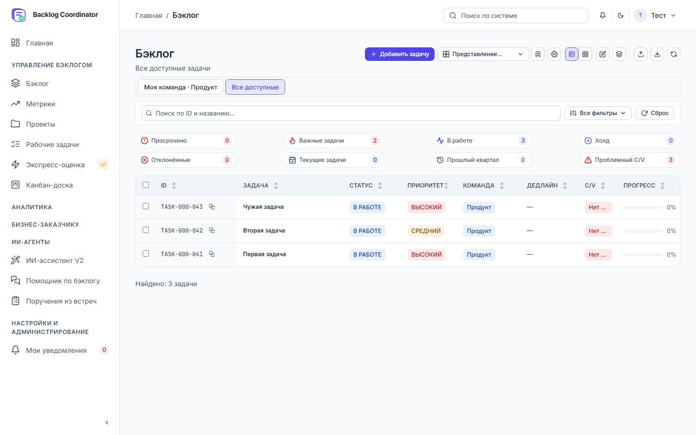
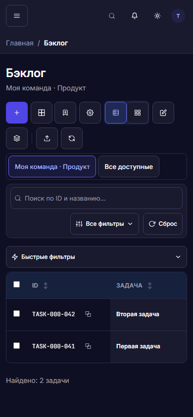

# Единый бэклог — приёмка 03–04.11.2026

Реализован один экран «Бэклог» с областями «Моя команда» и «Все доступные».
**Все 166 критериев проверены и пройдены в границах объединения.** У каждого ID
ниже — отдельный результат и исходники проверок. По дополнительному запросу
исправлены все шесть ошибок общей unit-регрессии: **498/498 PASS**.
Расширенный browser-набор дал 154 PASS и 27 FAIL. Шесть density-падений закрыты
последующей проверкой **18/18 PASS**; ещё **21 сценарий рабочих задач остаётся открытым**.

[AS-IS и эксплуатация](../../dmb-backlog/docs/BACKLOG_WORKSPACE.md),
[ТЗ](../backlog-unification-spec.md), [программа](../backlog-unification-test-plan.md),
[машиночитаемая матрица 166 ID](evidence/backlog-unification-2026-11-03/acceptance.json).

## Выполненные проверки

| Набор | Результат | Доказательство |
|---|---|---|
| Приёмка объединения до follow-up, Chromium mock API | 298 PASS, 0 FAIL/SKIP/FLAKY | [каждый тест](evidence/backlog-unification-2026-11-03/browser-main.json) |
| Дополнительный BU-S07 после сверки матрицы | 1 PASS | [служебные поля view](evidence/backlog-unification-2026-11-03/browser-service-fields.json) |
| Глобальный frontend unit после исправлений | 498 PASS / 498; 0 FAIL/SKIP | [границы регрессии](evidence/backlog-unification-2026-11-03/regression.json) |
| Повторная browser-регрессия затронутых экранов | 154 PASS, 27 FAIL; без пропусков | [каждый тест](evidence/backlog-unification-2026-11-03/browser-unit-repair.json) |
| Финальная плотность/полнота приоритета после исправлений | 18 PASS, 0 FAIL/SKIP | [квитанция](evidence/backlog-unification-2026-11-03/browser-unit-repair-density.json) |
| Последний снимок + шестиключевой перенос | 23 PASS | unifiedBacklogLifecycle.test.mjs / unifiedBacklogPreferences.test.mjs |
| Серверная object policy, без БД/conftest | 3 PASS + import 1 PASS с 8 subcases | acceptance_backlog_policy.py / acceptance_backlog_import.py |
| Живая PostgreSQL: готовые QA-профили, CRUD собственной Task | 13 PASS | [live UI](evidence/backlog-unification-2026-11-03/live-ui.json) |
| Живая PostgreSQL: bulk, version409, replay, transfer403 | 18 PASS | [live bulk](evidence/backlog-unification-2026-11-03/live-bulk.json) |
| Живая PostgreSQL: запрещённая команда/неизвестный справочник | 6 PASS; created=0 | [live import](evidence/backlog-unification-2026-11-03/live-import.json) |
| Геометрия полной оболочки | 7 размеров × 2 темы × 2 области; coarse pointer/contrast | [измерения](evidence/backlog-unification-2026-11-03/geometry.json) |
| Настоящий browser tab zoom 200% | all/team PASS | [zoom](evidence/backlog-unification-2026-11-03/zoom.json) |
| Снимок и отрисовка, 5 пар на каждом из 6 наборов | Бюджет +20% соблюдён | таблица ниже |

Браузерные fixtures перехватывают API и не обращаются к БД. Живые standalone-
сценарии не записывают trace/video/screenshots с реквизитами. Использованы готовые
ready-профили только на http://127.0.0.1:8000. Обычные собственные QA Task после
CRUD/bulk удалены. Справочники, пользователи, роли, состав и атрибуты команд не
изменялись; seed и Task Prioritiser не запускались. Первое исследование импорта
получило 403 до разбора строк и ничего не создало; итоговый разрешённый профиль
проверил отдельные построчные ошибки и неизменность наборов справочников.

Локальный запуск прошёл start-project.ps1 в диагностическом режиме -WithoutAgents
после ошибки предпосылок AI runtime. PostgreSQL, Redis, миграции и backend прошли
health-check; полный стек AI здоровым не объявляется. После исправления import
перезапущен только принадлежащий запуску backend; /api/v1/health — 200.

## Исправления, выявленные проверками

- Повторная отрисовка при init, превышавшая бюджет: один финальный render после полного снимка.
- Отмена Back при dirty уничтожала цель history: сохранён индекс, отмена возвращает позицию без подмены записи.
- Частичные персональные колонки отменяли shared defaults; загрузка page-state сбрасывала ширины; исправлены merge и синхронизация списка колонок.
- Смена команды могла восстановить старый default/поиск: прежняя team-state не применяется к новой команде.
- Потеря горизонтальной прокрутки и фокуса после исчезновения строки: позиция и доступная цель восстановлены.
- Сохранение карточки вне фильтра не обновляло список без SSE: callback привязан к владельцу и контексту.
- Неопределённый bulk network-result ошибочно выглядел гарантированным отказом: показана неопределённость, повтор записи не автоматический, экспорт заблокирован до сверки.
- Неизвестное явное task-action право использовало legacy fallback: теперь отказ; отсутствие значения сохраняет совместимость.
- Импорт не проверял object-policy каждой строки: добавлен can_edit_task перед persist, чужая команда даёт fatal permission_denied.
- Logout/отзыв read при открытой карточке: немедленная очистка содержимого и запросов без служебной записи старой сессии; write403 при сохранённом read сохраняет draft и блокирует повторную запрещённую запись.
- Исправлены ложный dirty у адаптированного view, конфликт одновременного rename, marker/quota/read-back ошибки, loading-счётчики и чрезмерный preview DOM.

## Производительность

Одни fixtures, машина, Chromium и задержка API 35 ms; пять пар на размер.
Снимок сравнивается с неизменённым HEAD loader. Полный browser цикл включает
init и две requestAnimationFrame до доступной выдачи; сравнивает HEAD renderer
с единым контроллером **при одинаковых текущих общих зависимостях**, а не весь
старый checkout. Исходный вариант с регрессией сохранён [отдельно](evidence/backlog-unification-2026-11-03/browser-performance-before-fix.json).
Это сравнительная приёмка, не производственный SLA.

| Task | Запросы | Peak ≤ | Снимок baseline/current, ms | Выдача baseline/current, ms | Выдача current/baseline |
|---:|---:|---:|---:|---:|---:|
| 0 | 1 | 2 | 46.4 / 46.7 | 348.0 / 344.8 | 0.991 |
| 1 | 1 | 2 | 45.7 / 47.5 | 369.9 / 296.9 | 0.803 |
| 100 | 1 | 2 | 46.5 / 45.5 | 745.1 / 765.8 | 1.028 |
| 101 | 1 | 2 | 46.5 / 46.9 | 744.4 / 736.2 | 0.989 |
| 1000 | 1 | 2 | 45.7 / 47.1 | 796.9 / 863.1 | 1.083 |
| 2501 | 3 | 2 | 93.3 / 92.5 | 966.0 / 927.4 | 0.960 |

[Все пять измерений снимка](evidence/backlog-unification-2026-11-03/snapshot-performance.json)
и [все пять browser-пар](evidence/backlog-unification-2026-11-03/browser-performance.json)
содержат calls/peak. Последняя Task набора 2501 найдена и выгружена; team-запросы
и отсутствие фонового all проверяются отдельными lifecycle-сценариями.

## Полнота инвентаря

| Сохранённая функция | Проверки |
|---|---|
| 41 поле, подписи/значения/порядок, CSV | unifiedBacklogInventory, backlogFieldParity, taskCsv unit |
| Поиск/многозначные/диапазоны/пустые/8 quick flags/закрепления/reset | unifiedBacklogFilters, unifiedBacklogQuickFilters unit, backlogAuditState/Remaining |
| Saved views, defaults, migration, concurrent owners, revisions | unifiedBacklogState/Inventory, unifiedBacklogPreferences unit |
| URL/menu/alias/history/карточка/обратные переходы | unifiedBacklogNavigation/CardFlows, taskOpenRouting unit |
| Table/cards, сортировка/resize/fix/selection/pages | unifiedBacklogState/Lifecycle/Filters, backlogAuditRemaining |
| Quick edit/dirty guards/частичный успех/409/403/logout | unifiedBacklogEditing/Failure/Revocation, historyConflict |
| Создание, duplicate, bulk, импорт/CSV/XLS/XLSX, экспорт | unifiedBacklogCreation/Bulk/Operations, uiKitTaskForms, import suites и live receipts |
| Все 6 CARD_TABS, comments/mentions/files/история/ПИП/WorkTask | unifiedBacklogCardFlows, taskCardIncrement, cardCommentsLinksFiles, uiKitTaskForms |
| Канбан/экспресс-оценка/отчётные workspaces | uiKitKanban/Express/ReportingWorkspaces |
| Full snapshot/ABA/cancel/realtime/visibility/dispose/rollback | unifiedBacklogLifecycle/Realtime/Inventory, backlogTaskLoader unit |
| Responsive/keyboard/contrast/touch/zoom/error states | unifiedBacklogVisual/Supplement/Filters, backlogAuditRemaining, zoom receipt |

## Закрытие шести ошибок общей регрессии — 04.11.2026

Повторный полный `node --test --test-concurrency=1 frontend/tests/*.test.mjs`: **498 PASS / 498**, без ошибок,
пропусков и исключения файлов. Файлы выполнялись последовательно после завершения browser,
чтобы не искажать измерительный тест конкурирующей нагрузкой. Адресный набор ownership: **20 PASS**.
`npx playwright test --config=playwright.ui-regression.config.mjs`:
**154 PASS, 27 FAIL**, проверены AI-действия, метрики, рабочие задачи, карточка/геометрия
единого бэклога. Все browser API — fixtures; защищённые данные не менялись.

| Ошибка | Исправление |
|---|---|
| ID страниц внутри core AI CSS | Общие AI-правила независимы от страниц; прежняя modal-специфичность перенесена в adapters.css |
| Не объявлен --danger-color | Использован существующий --danger-text обеих тем |
| Проверка вкладок у WorkTask с секциями | Удалён мёртвый tab-handler; revealSection открывает native details. Тест проверяет актуальные секции и отсутствие phantom tabs |
| Высота shared поля задана страницей | Удалены height/min-height у контрола, обёртка подстраивается под общую геометрию |
| Четыре таблицы без рецепта | Для замеров, периодов, точных значений графика и сравнения версий добавлен ui-table-data |
| Текст сброса 11 px | Использован общий --text-control-sm |

[Новая квитанция и SHA исправленных исходников](evidence/backlog-unification-2026-11-03/unit-repair.json),
[предыдущий результат с шестью FAIL](evidence/backlog-unification-2026-11-03/regression-before-unit-repair.json),
[текущее состояние регрессии](evidence/backlog-unification-2026-11-03/regression.json).
Первый адресный browser-прогон обнаружил также превышение высоты строк на 768 px
в обеих темах. Принудительный перенос сигналов устранён для очереди от 460 px;
полное название контекста остаётся в подсказке. Измеренная высота проблемных строк
снизилась с 145/159 до 125/119 px при пределе 130 px. После исправления заново
выполнен весь набор из 181 browser-проверки. Финальное уточнение flex-shrink
сохраняет полную подпись приоритета; оно повторно проверено всеми 18 density-сценариями.

Тестовые запреты CSS/типографики/таблиц не ослаблялись. Единственная коррекция
ожидания связана с уже существующим интерфейсом WorkTask без вкладок.

Глобальный SHA-сертификат UI Kit остаётся историческим: для его обновления нужен
весь глобальный browser-набор, а здесь повторно выполнены полный unit и все
затронутые поверхности. Прежние 298 browser-проверок, live и performance выше
сохраняют даты/границы исходного прогона и не выдаются за повторно выполненные.
Backend suites с защищёнными fixtures не запускались.

[Очередь 768 px, light](evidence/backlog-unification-2026-11-03/queue-768-light-unit-repair.png),
[dark](evidence/backlog-unification-2026-11-03/queue-768-dark-unit-repair.png) — финальная раскладка с полной подписью приоритета.

## Дополнительные browser-находки вне шести unit-ошибок

Расширенный набор не полностью зелёный: 154 PASS, 27 FAIL. Его полный
обезличенный список сохранён в browser-unit-repair.json. Есть устаревшие ожидания
признака «Препятствие», вкладок/навигации и режима заголовка WorkTask.
Из 27 первичных падений шесть density-кейсов закрыты последующим прогоном 18/18;
оставшиеся 21 — отдельные сценарии рабочих задач с прежними ожиданиями.
Они не заменялись фиктивными проверками ради зелёного отчёта. Геометрия широкой
очереди дополнительно исправлена и повторно проверена 18 density-сценариями.
Статус 166 критериев относится к ранее выполненной предметной приёмке;
расширенный browser-набор не объявляется полностью пройденным.

## Индивидуальная матрица

166 PASS, 0 FAIL, 0 NOT RUN в области объединения. В JSON сохранены также исходный
сценарий/ожидание и названия выполненных browser-тестов, соответствующих evidence-файлам.

| ID | Проверка | Статус | Доказательство |
|---|---|---|---|
| BU-R01 | Открыть меню с двумя доступами | PASS | [unifiedBacklogNavigation.spec.mjs](../../dmb-backlog/frontend/e2e/unifiedBacklogNavigation.spec.mjs), [unifiedBacklogContext.test.mjs](../../dmb-backlog/frontend/tests/unifiedBacklogContext.test.mjs) |
| BU-R02 | Первый вход P1 и P4 | PASS | [unifiedBacklogContext.test.mjs](../../dmb-backlog/frontend/tests/unifiedBacklogContext.test.mjs), [unifiedBacklogNavigation.spec.mjs](../../dmb-backlog/frontend/e2e/unifiedBacklogNavigation.spec.mjs) |
| BU-R03 | Повторный вход после явного выбора области | PASS | [unifiedBacklogNavigation.spec.mjs](../../dmb-backlog/frontend/e2e/unifiedBacklogNavigation.spec.mjs), [unifiedBacklogContext.test.mjs](../../dmb-backlog/frontend/tests/unifiedBacklogContext.test.mjs) |
| BU-R04 | Прямой bare `#/backlog` после сохранённой team | PASS | [unifiedBacklogNavigation.spec.mjs](../../dmb-backlog/frontend/e2e/unifiedBacklogNavigation.spec.mjs) |
| BU-R05 | Открыть `#/team-backlog?task=41&tab=com&comment=9` | PASS | [unifiedBacklogNavigation.spec.mjs](../../dmb-backlog/frontend/e2e/unifiedBacklogNavigation.spec.mjs), [unifiedBacklogRouteState.test.mjs](../../dmb-backlog/frontend/tests/unifiedBacklogRouteState.test.mjs) |
| BU-R06 | Открыть legacy bare-backlog под P3 | PASS | [unifiedBacklogNavigation.spec.mjs](../../dmb-backlog/frontend/e2e/unifiedBacklogNavigation.spec.mjs) |
| BU-R07 | Явный недоступный scope/неизвестный scope/новая bv | PASS | [unifiedBacklogRouteState.test.mjs](../../dmb-backlog/frontend/tests/unifiedBacklogRouteState.test.mjs) |
| BU-R08 | q/filters содержат кириллицу, &, +, %, кавычки | PASS | [unifiedBacklogRouteState.test.mjs](../../dmb-backlog/frontend/tests/unifiedBacklogRouteState.test.mjs) |
| BU-R09 | Повреждённый filters, опасный prototype-key, повтор scalar либо превышение лимита | PASS | [unifiedBacklogRouteState.test.mjs](../../dmb-backlog/frontend/tests/unifiedBacklogRouteState.test.mjs) |
| BU-R10 | Back/Forward после scope/filter/view/page | PASS | [unifiedBacklogLifecycle.spec.mjs](../../dmb-backlog/frontend/e2e/unifiedBacklogLifecycle.spec.mjs) |
| BU-R11 | Вводить поиск и получать refresh | PASS | [unifiedBacklogInventory.spec.mjs](../../dmb-backlog/frontend/e2e/unifiedBacklogInventory.spec.mjs) |
| BU-R12 | Закрыть карточку на page=2 с фильтрами | PASS | [unifiedBacklogSupplement.spec.mjs](../../dmb-backlog/frontend/e2e/unifiedBacklogSupplement.spec.mjs) |
| BU-R13 | Открыть разрешённую задачу вне текущего отбора | PASS | [unifiedBacklogSupplement.spec.mjs](../../dmb-backlog/frontend/e2e/unifiedBacklogSupplement.spec.mjs) |
| BU-R14 | Ввести отрицательные/non-integer task/comment и неизвестный tab | PASS | [taskOpenRouting.test.mjs](../../dmb-backlog/frontend/tests/taskOpenRouting.test.mjs) |
| BU-R15 | Быстро открыть две задачи с задержанным первым ответом | PASS | [taskOpenRouting.test.mjs](../../dmb-backlog/frontend/tests/taskOpenRouting.test.mjs) |
| BU-R16 | Передать внешний/javascript return_to либо чужой путь | PASS | [unifiedBacklogRouteState.test.mjs](../../dmb-backlog/frontend/tests/unifiedBacklogRouteState.test.mjs) |
| BU-A01 | Проверить P1/P2 в обеих областях | PASS | [unifiedBacklogLifecycle.spec.mjs](../../dmb-backlog/frontend/e2e/unifiedBacklogLifecycle.spec.mjs) |
| BU-A02 | P1 открывает свою задачу в all и team | PASS | [unifiedBacklogLifecycle.spec.mjs](../../dmb-backlog/frontend/e2e/unifiedBacklogLifecycle.spec.mjs) |
| BU-A03 | P1 открывает чужую/без команды | PASS | [unifiedBacklogLifecycle.spec.mjs](../../dmb-backlog/frontend/e2e/unifiedBacklogLifecycle.spec.mjs) |
| BU-A04 | P4 меняет свою/чужую/без команды | PASS | [taskCardPermissions.test.mjs](../../dmb-backlog/frontend/tests/taskCardPermissions.test.mjs), [acceptance_backlog_policy.py](../../dmb-backlog/backend/acceptance_backlog_policy.py) |
| BU-A05 | Явный task_edit=none при legacy-read_write | PASS | [unifiedBacklogLifecycle.spec.mjs](../../dmb-backlog/frontend/e2e/unifiedBacklogLifecycle.spec.mjs), [unifiedBacklogNavigation.spec.mjs](../../dmb-backlog/frontend/e2e/unifiedBacklogNavigation.spec.mjs) |
| BU-A06 | Известный legacy-профиль без task_* | PASS | [taskCardPermissions.test.mjs](../../dmb-backlog/frontend/tests/taskCardPermissions.test.mjs), [acceptance_backlog_policy.py](../../dmb-backlog/backend/acceptance_backlog_policy.py) |
| BU-A07 | Неизвестный явный capability | PASS | [unifiedBacklogLifecycle.spec.mjs](../../dmb-backlog/frontend/e2e/unifiedBacklogLifecycle.spec.mjs) |
| BU-A08 | P3/P6/P7/P8 | PASS | [unifiedBacklogLifecycle.spec.mjs](../../dmb-backlog/frontend/e2e/unifiedBacklogLifecycle.spec.mjs), [unifiedBacklogNavigation.spec.mjs](../../dmb-backlog/frontend/e2e/unifiedBacklogNavigation.spec.mjs) |
| BU-A09 | P12 с командным read_all/write_all | PASS | [unifiedBacklogLifecycle.spec.mjs](../../dmb-backlog/frontend/e2e/unifiedBacklogLifecycle.spec.mjs) |
| BU-A10 | Comment/delete имеют scope, отличный от edit | PASS | [taskCardPermissions.test.mjs](../../dmb-backlog/frontend/tests/taskCardPermissions.test.mjs), [acceptance_backlog_policy.py](../../dmb-backlog/backend/acceptance_backlog_policy.py) |
| BU-A11 | Права отозваны при открытом списке/карточке | PASS | [unifiedBacklogFailure.spec.mjs](../../dmb-backlog/frontend/e2e/unifiedBacklogFailure.spec.mjs), [unifiedBacklogRevocation.spec.mjs](../../dmb-backlog/frontend/e2e/unifiedBacklogRevocation.spec.mjs) |
| BU-A12 | Получить 403 при сохранении | PASS | [unifiedBacklogFailure.spec.mjs](../../dmb-backlog/frontend/e2e/unifiedBacklogFailure.spec.mjs), [unifiedBacklogRevocation.spec.mjs](../../dmb-backlog/frontend/e2e/unifiedBacklogRevocation.spec.mjs) |
| BU-A13 | Перенести Task другой команде командным редактором | PASS | [liveBacklogBulkAcceptance.mjs](../../dmb-backlog/frontend/e2e/liveBacklogBulkAcceptance.mjs), [taskCardPermissions.test.mjs](../../dmb-backlog/frontend/tests/taskCardPermissions.test.mjs) |
| BU-A14 | Diff/трафик/миграция/подготовка тестов | PASS | [liveBacklogAcceptance.mjs](../../dmb-backlog/frontend/e2e/liveBacklogAcceptance.mjs), [liveBacklogImportAcceptance.mjs](../../dmb-backlog/frontend/e2e/liveBacklogImportAcceptance.mjs) |
| BU-A15 | Изменить подписи доступов в админке | PASS | [moduleContracts.test.mjs](../../dmb-backlog/frontend/tests/moduleContracts.test.mjs), [taskCardPermissions.test.mjs](../../dmb-backlog/frontend/tests/taskCardPermissions.test.mjs), [uiKitKanban.spec.mjs](../../dmb-backlog/frontend/e2e/uiKitKanban.spec.mjs), [uiKitExpress.spec.mjs](../../dmb-backlog/frontend/e2e/uiKitExpress.spec.mjs) |
| BU-S01 | Разные q/filter/columns в all и team | PASS | [unifiedBacklogNavigation.spec.mjs](../../dmb-backlog/frontend/e2e/unifiedBacklogNavigation.spec.mjs) |
| BU-S02 | Полный URL bv=2 с пустыми параметрами при старом локальном поиске | PASS | [unifiedBacklogInventory.spec.mjs](../../dmb-backlog/frontend/e2e/unifiedBacklogInventory.spec.mjs), [unifiedBacklogRouteState.test.mjs](../../dmb-backlog/frontend/tests/unifiedBacklogRouteState.test.mjs) |
| BU-S03 | URL с выборкой и локальный default-view | PASS | [unifiedBacklogInventory.spec.mjs](../../dmb-backlog/frontend/e2e/unifiedBacklogInventory.spec.mjs) |
| BU-S04 | Первый вход без history и с default-view | PASS | [backlogAuditClosure.spec.mjs](../../dmb-backlog/frontend/e2e/backlogAuditClosure.spec.mjs) |
| BU-S05 | Настроить/сохранить/переименовать/обновить/удалить view | PASS | [unifiedBacklogOperations.spec.mjs](../../dmb-backlog/frontend/e2e/unifiedBacklogOperations.spec.mjs) |
| BU-S06 | Применить адаптированный старый view | PASS | [unifiedBacklogState.spec.mjs](../../dmb-backlog/frontend/e2e/unifiedBacklogState.spec.mjs) |
| BU-S07 | Saved-view содержит task/page/selection | PASS | [unifiedBacklogState.spec.mjs](../../dmb-backlog/frontend/e2e/unifiedBacklogState.spec.mjs) |
| BU-S08 | Явные false и пустой pinned-массив | PASS | [unifiedBacklogPreferences.test.mjs](../../dmb-backlog/frontend/tests/unifiedBacklogPreferences.test.mjs) |
| BU-S09 | Shared financial/effort и персональные значения | PASS | [unifiedBacklogState.spec.mjs](../../dmb-backlog/frontend/e2e/unifiedBacklogState.spec.mjs) |
| BU-S10 | Resize после пользовательского выбора колонок | PASS | [unifiedBacklogState.spec.mjs](../../dmb-backlog/frontend/e2e/unifiedBacklogState.spec.mjs) |
| BU-S11 | Logout/login другой учёткой | PASS | [unifiedBacklogRevocation.spec.mjs](../../dmb-backlog/frontend/e2e/unifiedBacklogRevocation.spec.mjs), [unifiedBacklogPreferences.test.mjs](../../dmb-backlog/frontend/tests/unifiedBacklogPreferences.test.mjs) |
| BU-S12 | Смена команды при сохранённой team-state | PASS | [unifiedBacklogState.spec.mjs](../../dmb-backlog/frontend/e2e/unifiedBacklogState.spec.mjs), [unifiedBacklogPreferences.test.mjs](../../dmb-backlog/frontend/tests/unifiedBacklogPreferences.test.mjs) |
| BU-S13 | Одновременно записать разные views, один view и колонки из двух вкладок | PASS | [unifiedBacklogInventory.spec.mjs](../../dmb-backlog/frontend/e2e/unifiedBacklogInventory.spec.mjs), [unifiedBacklogPreferences.test.mjs](../../dmb-backlog/frontend/tests/unifiedBacklogPreferences.test.mjs) |
| BU-M01 | Полный legacy-набор из шести ключей | PASS | [unifiedBacklogPreferences.test.mjs](../../dmb-backlog/frontend/tests/unifiedBacklogPreferences.test.mjs) |
| BU-M02 | Legacy без владельца: обе области и reload без баннера | PASS | [unifiedBacklogInventory.spec.mjs](../../dmb-backlog/frontend/e2e/unifiedBacklogInventory.spec.mjs) |
| BU-M03 | Принять перенос, затем войти другим userId | PASS | [metricsQuarterly.spec.mjs](../../dmb-backlog/frontend/e2e/metricsQuarterly.spec.mjs), [unifiedBacklogPreferences.test.mjs](../../dmb-backlog/frontend/tests/unifiedBacklogPreferences.test.mjs) |
| BU-M04 | Открыть ручной перенос через «Операции» | PASS | [metricsQuarterly.spec.mjs](../../dmb-backlog/frontend/e2e/metricsQuarterly.spec.mjs), [unifiedBacklogInventory.spec.mjs](../../dmb-backlog/frontend/e2e/unifiedBacklogInventory.spec.mjs) |
| BU-M05 | Повторить перенос того же набора | PASS | [unifiedBacklogPreferences.test.mjs](../../dmb-backlog/frontend/tests/unifiedBacklogPreferences.test.mjs) |
| BU-M06 | Повреждён один JSON, остальные валидны | PASS | [metricsQuarterly.spec.mjs](../../dmb-backlog/frontend/e2e/metricsQuarterly.spec.mjs), [unifiedBacklogPreferences.test.mjs](../../dmb-backlog/frontend/tests/unifiedBacklogPreferences.test.mjs) |
| BU-M07 | Старые settings/order/widths/fixed/sort | PASS | [unifiedBacklogPreferences.test.mjs](../../dmb-backlog/frontend/tests/unifiedBacklogPreferences.test.mjs) |
| BU-M08 | Одинаковые id/name view в team и backlog | PASS | [metricsQuarterly.spec.mjs](../../dmb-backlog/frontend/e2e/metricsQuarterly.spec.mjs), [unifiedBacklogPreferences.test.mjs](../../dmb-backlog/frontend/tests/unifiedBacklogPreferences.test.mjs) |
| BU-M09 | Удалённый defaultId/неизвестная колонка/дубликаты | PASS | [metricsQuarterly.spec.mjs](../../dmb-backlog/frontend/e2e/metricsQuarterly.spec.mjs), [unifiedBacklogPreferences.test.mjs](../../dmb-backlog/frontend/tests/unifiedBacklogPreferences.test.mjs) |
| BU-M10 | Добавлена новая колонка в текущий каталог | PASS | [metricsQuarterly.spec.mjs](../../dmb-backlog/frontend/e2e/metricsQuarterly.spec.mjs), [taskCardInlineEdit.test.mjs](../../dmb-backlog/frontend/tests/taskCardInlineEdit.test.mjs), [unifiedBacklogPreferences.test.mjs](../../dmb-backlog/frontend/tests/unifiedBacklogPreferences.test.mjs) |
| BU-M11 | q, quick/range/text/empty tokens в старом view | PASS | [metricsQuarterly.spec.mjs](../../dmb-backlog/frontend/e2e/metricsQuarterly.spec.mjs), [unifiedBacklogPreferences.test.mjs](../../dmb-backlog/frontend/tests/unifiedBacklogPreferences.test.mjs) |
| BU-M12 | Существующий пользовательский v2 плюс legacy | PASS | [taskCardInlineEdit.test.mjs](../../dmb-backlog/frontend/tests/taskCardInlineEdit.test.mjs), [unifiedBacklogPreferences.test.mjs](../../dmb-backlog/frontend/tests/unifiedBacklogPreferences.test.mjs) |
| BU-M13 | Storage quota/read-back/marker exception и одновременный claim двух userId | PASS | [metricsQuarterly.spec.mjs](../../dmb-backlog/frontend/e2e/metricsQuarterly.spec.mjs), [unifiedBacklogPreferences.test.mjs](../../dmb-backlog/frontend/tests/unifiedBacklogPreferences.test.mjs) |
| BU-M14 | Нет доступа к одной импортированной области | PASS | [metricsQuarterly.spec.mjs](../../dmb-backlog/frontend/e2e/metricsQuarterly.spec.mjs), [unifiedBacklogPreferences.test.mjs](../../dmb-backlog/frontend/tests/unifiedBacklogPreferences.test.mjs) |
| BU-M15 | Включить старую сборку после работы v2 | PASS | [metricsQuarterly.spec.mjs](../../dmb-backlog/frontend/e2e/metricsQuarterly.spec.mjs), [unifiedBacklogInventory.spec.mjs](../../dmb-backlog/frontend/e2e/unifiedBacklogInventory.spec.mjs), [unifiedBacklogPreferences.test.mjs](../../dmb-backlog/frontend/tests/unifiedBacklogPreferences.test.mjs) |
| BU-F01 | Искать внутренний/public ID, название, описание | PASS | [adminAuditFixes.spec.mjs](../../dmb-backlog/frontend/e2e/adminAuditFixes.spec.mjs), [backlogAuditState.spec.mjs](../../dmb-backlog/frontend/e2e/backlogAuditState.spec.mjs) |
| BU-F02 | Ввести поиск до завершения загрузки | PASS | [adminAuditFixes.spec.mjs](../../dmb-backlog/frontend/e2e/adminAuditFixes.spec.mjs), [unifiedBacklogNavigation.spec.mjs](../../dmb-backlog/frontend/e2e/unifiedBacklogNavigation.spec.mjs) |
| BU-F03 | Экспорт/сохранение view до debounce поиска | PASS | [adminAuditFixes.spec.mjs](../../dmb-backlog/frontend/e2e/adminAuditFixes.spec.mjs), [unifiedBacklogFilters.spec.mjs](../../dmb-backlog/frontend/e2e/unifiedBacklogFilters.spec.mjs) |
| BU-F04 | Несколько значений одной категории и разных полей | PASS | [adminAuditFixes.spec.mjs](../../dmb-backlog/frontend/e2e/adminAuditFixes.spec.mjs), [unifiedBacklogRouteState.test.mjs](../../dmb-backlog/frontend/tests/unifiedBacklogRouteState.test.mjs) |
| BU-F05 | Пустой набор/«Все»/empty/null/false/0 | PASS | [adminAuditFixes.spec.mjs](../../dmb-backlog/frontend/e2e/adminAuditFixes.spec.mjs), [adminAuditReview.spec.mjs](../../dmb-backlog/frontend/e2e/adminAuditReview.spec.mjs), [filterCardinality.test.mjs](../../dmb-backlog/frontend/tests/filterCardinality.test.mjs), [backlogEmptyValues.spec.mjs](../../dmb-backlog/frontend/e2e/backlogEmptyValues.spec.mjs) |
| BU-F06 | Text/date/number range и обратные границы | PASS | [adminAuditFixes.spec.mjs](../../dmb-backlog/frontend/e2e/adminAuditFixes.spec.mjs), [adminAuditReview.spec.mjs](../../dmb-backlog/frontend/e2e/adminAuditReview.spec.mjs), [backlogAuditRemaining.spec.mjs](../../dmb-backlog/frontend/e2e/backlogAuditRemaining.spec.mjs) |
| BU-F07 | Закрыть черновик фильтра Escape/снаружи | PASS | [unifiedBacklogFilters.spec.mjs](../../dmb-backlog/frontend/e2e/unifiedBacklogFilters.spec.mjs) |
| BU-F08 | Team-filter в team и all | PASS | [adminAuditFixes.spec.mjs](../../dmb-backlog/frontend/e2e/adminAuditFixes.spec.mjs), [filterCardinality.test.mjs](../../dmb-backlog/frontend/tests/filterCardinality.test.mjs), [unifiedBacklogLifecycle.spec.mjs](../../dmb-backlog/frontend/e2e/unifiedBacklogLifecycle.spec.mjs) |
| BU-F09 | Импортировать team-view с чужой team-name | PASS | [adminAuditFixes.spec.mjs](../../dmb-backlog/frontend/e2e/adminAuditFixes.spec.mjs), [adminAuditReview.spec.mjs](../../dmb-backlog/frontend/e2e/adminAuditReview.spec.mjs), [unifiedBacklogState.spec.mjs](../../dmb-backlog/frontend/e2e/unifiedBacklogState.spec.mjs) |
| BU-F10 | Все восемь quick-флагов отдельно | PASS | [adminAuditFixes.spec.mjs](../../dmb-backlog/frontend/e2e/adminAuditFixes.spec.mjs), [unifiedBacklogQuickFilters.test.mjs](../../dmb-backlog/frontend/tests/unifiedBacklogQuickFilters.test.mjs) |
| BU-F11 | Включить пересекающиеся quick-флаги | PASS | [adminAuditFixes.spec.mjs](../../dmb-backlog/frontend/e2e/adminAuditFixes.spec.mjs), [unifiedBacklogQuickFilters.test.mjs](../../dmb-backlog/frontend/tests/unifiedBacklogQuickFilters.test.mjs) |
| BU-F12 | Граница Q1/Q4/года и C/V=unknown/1/>1 | PASS | [unifiedBacklogQuickFilters.test.mjs](../../dmb-backlog/frontend/tests/unifiedBacklogQuickFilters.test.mjs) |
| BU-F13 | Quick-count при поиске/других фильтрах | PASS | [backlogAuditState.spec.mjs](../../dmb-backlog/frontend/e2e/backlogAuditState.spec.mjs), [unifiedBacklogSupplement.spec.mjs](../../dmb-backlog/frontend/e2e/unifiedBacklogSupplement.spec.mjs) |
| BU-F14 | Закрепить 0/5 фильтров, удалить шестой, восстановить defaults | PASS | [adminAuditFixes.spec.mjs](../../dmb-backlog/frontend/e2e/adminAuditFixes.spec.mjs), [unifiedBacklogFilters.spec.mjs](../../dmb-backlog/frontend/e2e/unifiedBacklogFilters.spec.mjs) |
| BU-F15 | Выполнить три разных reset-действия | PASS | [adminAuditFixes.spec.mjs](../../dmb-backlog/frontend/e2e/adminAuditFixes.spec.mjs), [unifiedBacklogFilters.spec.mjs](../../dmb-backlog/frontend/e2e/unifiedBacklogFilters.spec.mjs) |
| BU-T01 | Параметризовать все ключи каталога, включая 41 baseline | PASS | [unifiedBacklogInventory.spec.mjs](../../dmb-backlog/frontend/e2e/unifiedBacklogInventory.spec.mjs) |
| BU-T02 | Пустые/нулевые/неизвестные значения | PASS | [backlogEmptyValues.spec.mjs](../../dmb-backlog/frontend/e2e/backlogEmptyValues.spec.mjs), [taskDisplay.test.mjs](../../dmb-backlog/frontend/tests/taskDisplay.test.mjs) |
| BU-T03 | Jira array/JSON/string, unsafe URL и HTML-текст | PASS | [cardCommentsLinksFiles.spec.mjs](../../dmb-backlog/frontend/e2e/cardCommentsLinksFiles.spec.mjs), [taskCsv.test.mjs](../../dmb-backlog/frontend/tests/taskCsv.test.mjs) |
| BU-T04 | Resize/reorder/fix/auto-size, затем view/import/reset | PASS | [unifiedBacklogFilters.spec.mjs](../../dmb-backlog/frontend/e2e/unifiedBacklogFilters.spec.mjs) |
| BU-T05 | Сортировка справочников и пустых значений, column-sort+toolbar | PASS | [moduleContracts.test.mjs](../../dmb-backlog/frontend/tests/moduleContracts.test.mjs) |
| BU-T06 | 100/101 запись, сокращение списка на последней странице | PASS | [unifiedBacklogLifecycle.spec.mjs](../../dmb-backlog/frontend/e2e/unifiedBacklogLifecycle.spec.mjs), [backlogAuditRemaining.spec.mjs](../../dmb-backlog/frontend/e2e/backlogAuditRemaining.spec.mjs) |
| BU-T07 | Перейти на другую страницу при horizontal scroll | PASS | [unifiedBacklogState.spec.mjs](../../dmb-backlog/frontend/e2e/unifiedBacklogState.spec.mjs) |
| BU-T08 | Table/cards для одинаковой выборки | PASS | [customerPortalResponsive.spec.mjs](../../dmb-backlog/frontend/e2e/customerPortalResponsive.spec.mjs), [unifiedBacklogFilters.spec.mjs](../../dmb-backlog/frontend/e2e/unifiedBacklogFilters.spec.mjs) |
| BU-T09 | Header-select на 101+ задачах со смешанными правами | PASS | [customerPortalResponsive.spec.mjs](../../dmb-backlog/frontend/e2e/customerPortalResponsive.spec.mjs), [taskDisplay.test.mjs](../../dmb-backlog/frontend/tests/taskDisplay.test.mjs), [unifiedBacklogLifecycle.spec.mjs](../../dmb-backlog/frontend/e2e/unifiedBacklogLifecycle.spec.mjs) |
| BU-T10 | Перелистнуть, затем сузить фильтр/отозвать права | PASS | [customerPortalResponsive.spec.mjs](../../dmb-backlog/frontend/e2e/customerPortalResponsive.spec.mjs), [unifiedBacklogLifecycle.spec.mjs](../../dmb-backlog/frontend/e2e/unifiedBacklogLifecycle.spec.mjs) |
| BU-T11 | Сменить область/пользователя с выделением | PASS | [unifiedBacklogLifecycle.spec.mjs](../../dmb-backlog/frontend/e2e/unifiedBacklogLifecycle.spec.mjs), [unifiedBacklogRevocation.spec.mjs](../../dmb-backlog/frontend/e2e/unifiedBacklogRevocation.spec.mjs) |
| BU-T12 | Loading/empty/error при horizontal scroll | PASS | [workVisualReview.spec.mjs](../../dmb-backlog/frontend/e2e/workVisualReview.spec.mjs), [backlogAuditRemaining.spec.mjs](../../dmb-backlog/frontend/e2e/backlogAuditRemaining.spec.mjs), [backlogAuditClosure.spec.mjs](../../dmb-backlog/frontend/e2e/backlogAuditClosure.spec.mjs) |
| BU-E01 | Каждый разрешённый quick-edit тип поля | PASS | [unifiedBacklogEditing.spec.mjs](../../dmb-backlog/frontend/e2e/unifiedBacklogEditing.spec.mjs), [unifiedBacklogOperations.spec.mjs](../../dmb-backlog/frontend/e2e/unifiedBacklogOperations.spec.mjs) |
| BU-E02 | Правки плюс сортировка/страница/фильтр/скрытие колонки | PASS | [unifiedBacklogEditing.spec.mjs](../../dmb-backlog/frontend/e2e/unifiedBacklogEditing.spec.mjs) |
| BU-E03 | Смена области с dirty: три исхода диалога | PASS | [unifiedBacklogOperations.spec.mjs](../../dmb-backlog/frontend/e2e/unifiedBacklogOperations.spec.mjs) |
| BU-E04 | Смена table/cards, saved-view, import/bulk или другой страницы | PASS | [backlogAuditRemaining.spec.mjs](../../dmb-backlog/frontend/e2e/backlogAuditRemaining.spec.mjs), [unifiedBacklogSupplement.spec.mjs](../../dmb-backlog/frontend/e2e/unifiedBacklogSupplement.spec.mjs) |
| BU-E05 | Back/Forward и Escape при dirty | PASS | [unifiedBacklogEditing.spec.mjs](../../dmb-backlog/frontend/e2e/unifiedBacklogEditing.spec.mjs) |
| BU-E06 | Ошибка сохранения перед сменой области | PASS | [unifiedBacklogFailure.spec.mjs](../../dmb-backlog/frontend/e2e/unifiedBacklogFailure.spec.mjs) |
| BU-E07 | Частичный успех quick-save | PASS | [unifiedBacklogFailure.spec.mjs](../../dmb-backlog/frontend/e2e/unifiedBacklogFailure.spec.mjs) |
| BU-E08 | Проверить PATCH/request payload | PASS | [unifiedBacklogEditing.spec.mjs](../../dmb-backlog/frontend/e2e/unifiedBacklogEditing.spec.mjs), [unifiedBacklogFailure.spec.mjs](../../dmb-backlog/frontend/e2e/unifiedBacklogFailure.spec.mjs), [unifiedBacklogOperations.spec.mjs](../../dmb-backlog/frontend/e2e/unifiedBacklogOperations.spec.mjs) |
| BU-E09 | Старый пустой type и неизменённые пустые справочники | PASS | [unifiedBacklogOperations.spec.mjs](../../dmb-backlog/frontend/e2e/unifiedBacklogOperations.spec.mjs) |
| BU-E10 | Status/progress-предложение, отмена и явное сохранение | PASS | [unifiedBacklogCardFlows.spec.mjs](../../dmb-backlog/frontend/e2e/unifiedBacklogCardFlows.spec.mjs) |
| BU-E11 | 409 из другой сессии | PASS | [backlogAuditRemaining.spec.mjs](../../dmb-backlog/frontend/e2e/backlogAuditRemaining.spec.mjs), [historyConflict.spec.mjs](../../dmb-backlog/frontend/e2e/historyConflict.spec.mjs) |
| BU-E12 | 401/offline/timeout во время записи | PASS | [unifiedBacklogFailure.spec.mjs](../../dmb-backlog/frontend/e2e/unifiedBacklogFailure.spec.mjs) |
| BU-E13 | Двойной click/Enter по сохранению | PASS | [unifiedBacklogFailure.spec.mjs](../../dmb-backlog/frontend/e2e/unifiedBacklogFailure.spec.mjs), [unifiedBacklogSupplement.spec.mjs](../../dmb-backlog/frontend/e2e/unifiedBacklogSupplement.spec.mjs) |
| BU-E14 | SSE/таймер/Refresh с dirty или открытым диалогом | PASS | [unifiedBacklogLifecycle.spec.mjs](../../dmb-backlog/frontend/e2e/unifiedBacklogLifecycle.spec.mjs) |
| BU-E15 | Завершение записи после logout/scope-перехода | PASS | [unifiedBacklogFailure.spec.mjs](../../dmb-backlog/frontend/e2e/unifiedBacklogFailure.spec.mjs), [unifiedBacklogSupplement.spec.mjs](../../dmb-backlog/frontend/e2e/unifiedBacklogSupplement.spec.mjs) |
| BU-O01 | Пустая team с правом создания | PASS | [backlogFieldParity.spec.mjs](../../dmb-backlog/frontend/e2e/backlogFieldParity.spec.mjs) |
| BU-O02 | Создание из team и all с 0/1/несколькими team-фильтрами | PASS | [unifiedBacklogCreation.spec.mjs](../../dmb-backlog/frontend/e2e/unifiedBacklogCreation.spec.mjs) |
| BU-O03 | Создание/отмена/дубль/ошибка формы | PASS | [uiKitTaskForms.spec.mjs](../../dmb-backlog/frontend/e2e/uiKitTaskForms.spec.mjs) |
| BU-O04 | Созданная Task вне текущего фильтра | PASS | [unifiedBacklogCreation.spec.mjs](../../dmb-backlog/frontend/e2e/unifiedBacklogCreation.spec.mjs) |
| BU-O05 | Bulk с выделением и без него | PASS | [unifiedBacklogBulk.spec.mjs](../../dmb-backlog/frontend/e2e/unifiedBacklogBulk.spec.mjs) |
| BU-O06 | Bulk exclude/поля/предпросмотр/подтверждение | PASS | [unifiedBacklogBulk.spec.mjs](../../dmb-backlog/frontend/e2e/unifiedBacklogBulk.spec.mjs) |
| BU-O07 | Версия/доступ меняются после preview | PASS | [liveBacklogBulkAcceptance.mjs](../../dmb-backlog/frontend/e2e/liveBacklogBulkAcceptance.mjs) |
| BU-O08 | Сетевой повтор bulk | PASS | [unifiedBacklogBulk.spec.mjs](../../dmb-backlog/frontend/e2e/unifiedBacklogBulk.spec.mjs) |
| BU-O09 | Разные разрешения bulk/reporting/quarterly | PASS | [unifiedBacklogBulk.spec.mjs](../../dmb-backlog/frontend/e2e/unifiedBacklogBulk.spec.mjs) |
| BU-O10 | Импорт всех поддерживаемых форматов на fixtures | PASS | [importAudit.spec.mjs](../../dmb-backlog/frontend/e2e/importAudit.spec.mjs), [backlogAuditClosure.spec.mjs](../../dmb-backlog/frontend/e2e/backlogAuditClosure.spec.mjs) |
| BU-O11 | Импорт с чужой командой/неизвестным справочником | PASS | [liveBacklogImportAcceptance.mjs](../../dmb-backlog/frontend/e2e/liveBacklogImportAcceptance.mjs), [acceptance_backlog_import.py](../../dmb-backlog/backend/acceptance_backlog_import.py) |
| BU-O12 | Частичный импорт, закрытие при отправке, retry | PASS | [importFeedback.spec.mjs](../../dmb-backlog/frontend/e2e/importFeedback.spec.mjs), [importRetry.spec.mjs](../../dmb-backlog/frontend/e2e/importRetry.spec.mjs), [importGuards.spec.mjs](../../dmb-backlog/frontend/e2e/importGuards.spec.mjs) |
| BU-O13 | Экспорт с фильтрами на нескольких страницах | PASS | [unifiedBacklogOperations.spec.mjs](../../dmb-backlog/frontend/e2e/unifiedBacklogOperations.spec.mjs) |
| BU-O14 | CSV со строками =,+,-,@, кавычками и переносами | PASS | [unifiedBacklogOperations.spec.mjs](../../dmb-backlog/frontend/e2e/unifiedBacklogOperations.spec.mjs) |
| BU-O15 | Экспорт при dirty/неполной загрузке/0 строк | PASS | [unifiedBacklogState.spec.mjs](../../dmb-backlog/frontend/e2e/unifiedBacklogState.spec.mjs) |
| BU-O16 | Экспорт при выделенных строках | PASS | [unifiedBacklogOperations.spec.mjs](../../dmb-backlog/frontend/e2e/unifiedBacklogOperations.spec.mjs) |
| BU-C01 | Все актуальные CARD_TABS из baseline-инвентаря | PASS | [backlogAuditRemaining.spec.mjs](../../dmb-backlog/frontend/e2e/backlogAuditRemaining.spec.mjs), [unifiedBacklogCardFlows.spec.mjs](../../dmb-backlog/frontend/e2e/unifiedBacklogCardFlows.spec.mjs) |
| BU-C02 | Строка/карточка/keyboard/open-task/copy-link | PASS | [backlogAuditRemaining.spec.mjs](../../dmb-backlog/frontend/e2e/backlogAuditRemaining.spec.mjs), [unifiedBacklogNavigation.spec.mjs](../../dmb-backlog/frontend/e2e/unifiedBacklogNavigation.spec.mjs) |
| BU-C03 | Комментарий/упоминание/черновик и целевой comment deep link | PASS | [taskCardIncrement.spec.mjs](../../dmb-backlog/frontend/e2e/taskCardIncrement.spec.mjs), [cardCommentsLinksFiles.spec.mjs](../../dmb-backlog/frontend/e2e/cardCommentsLinksFiles.spec.mjs), [uiKitTaskForms.spec.mjs](../../dmb-backlog/frontend/e2e/uiKitTaskForms.spec.mjs) |
| BU-C04 | Файлы/ссылки/скачивание/удаление последнего вложения | PASS | [taskCardIncrement.spec.mjs](../../dmb-backlog/frontend/e2e/taskCardIncrement.spec.mjs), [cardCommentsLinksFiles.spec.mjs](../../dmb-backlog/frontend/e2e/cardCommentsLinksFiles.spec.mjs) |
| BU-C05 | История/версии/ПИП/рабочие задачи/зависимости | PASS | [unifiedBacklogCardFlows.spec.mjs](../../dmb-backlog/frontend/e2e/unifiedBacklogCardFlows.spec.mjs) |
| BU-C06 | Сохранить Task так, чтобы она вышла из фильтра | PASS | [unifiedBacklogCardFlows.spec.mjs](../../dmb-backlog/frontend/e2e/unifiedBacklogCardFlows.spec.mjs) |
| BU-C07 | Закрыть карточку после удаления её строки | PASS | [unifiedBacklogCardFlows.spec.mjs](../../dmb-backlog/frontend/e2e/unifiedBacklogCardFlows.spec.mjs), [unifiedBacklogInventory.spec.mjs](../../dmb-backlog/frontend/e2e/unifiedBacklogInventory.spec.mjs) |
| BU-C08 | Перейти в статусы встречи и вернуться | PASS | [unifiedBacklogCardFlows.spec.mjs](../../dmb-backlog/frontend/e2e/unifiedBacklogCardFlows.spec.mjs) |
| BU-C09 | Квартальное обновление и expressEstimate с возвратом | PASS | [unifiedBacklogCardFlows.spec.mjs](../../dmb-backlog/frontend/e2e/unifiedBacklogCardFlows.spec.mjs) |
| BU-C10 | Уведомления/аналитика/отчёты/review/project/workRelations | PASS | [unifiedBacklogCardFlows.spec.mjs](../../dmb-backlog/frontend/e2e/unifiedBacklogCardFlows.spec.mjs), [unifiedBacklogRouteState.test.mjs](../../dmb-backlog/frontend/tests/unifiedBacklogRouteState.test.mjs) |
| BU-C11 | Помощник по бэклогу и контекстная помощь | PASS | [moduleContracts.test.mjs](../../dmb-backlog/frontend/tests/moduleContracts.test.mjs), [backlogAssistant.test.mjs](../../dmb-backlog/frontend/tests/backlogAssistant.test.mjs) |
| BU-C12 | Общие компоненты в канбане и прочих потребителях | PASS | [uiKitKanban.spec.mjs](../../dmb-backlog/frontend/e2e/uiKitKanban.spec.mjs), [uiKitExpress.spec.mjs](../../dmb-backlog/frontend/e2e/uiKitExpress.spec.mjs) |
| BU-D01 | 0/1/1000/2501 Task | PASS | [unifiedBacklogLifecycle.test.mjs](../../dmb-backlog/frontend/tests/unifiedBacklogLifecycle.test.mjs) |
| BU-D02 | Загружать team, имея глобальное чтение | PASS | [unifiedBacklogNavigation.spec.mjs](../../dmb-backlog/frontend/e2e/unifiedBacklogNavigation.spec.mjs) |
| BU-D03 | Задержать/переставить ответы страниц | PASS | [unifiedBacklogLifecycle.test.mjs](../../dmb-backlog/frontend/tests/unifiedBacklogLifecycle.test.mjs) |
| BU-D04 | Посчитать concurrency | PASS | [unifiedBacklogLifecycle.test.mjs](../../dmb-backlog/frontend/tests/unifiedBacklogLifecycle.test.mjs) |
| BU-D05 | A(team)→B(all)→A(team) с поздними ответами | PASS | [unifiedBacklogLifecycle.spec.mjs](../../dmb-backlog/frontend/e2e/unifiedBacklogLifecycle.spec.mjs) |
| BU-D06 | Logout/смена команды/прав при pending | PASS | [unifiedBacklogState.spec.mjs](../../dmb-backlog/frontend/e2e/unifiedBacklogState.spec.mjs), [unifiedBacklogLifecycle.test.mjs](../../dmb-backlog/frontend/tests/unifiedBacklogLifecycle.test.mjs) |
| BU-D07 | Уйти в другую страницу при долгой загрузке | PASS | [backlogTaskLoader.test.mjs](../../dmb-backlog/frontend/tests/backlogTaskLoader.test.mjs), [unifiedBacklogLifecycle.spec.mjs](../../dmb-backlog/frontend/e2e/unifiedBacklogLifecycle.spec.mjs) |
| BU-D08 | Отказ страницы 2+ | PASS | [unifiedBacklogLifecycle.test.mjs](../../dmb-backlog/frontend/tests/unifiedBacklogLifecycle.test.mjs) |
| BU-D09 | Отказ обновления прежнего полного снимка | PASS | [unifiedBacklogLifecycle.spec.mjs](../../dmb-backlog/frontend/e2e/unifiedBacklogLifecycle.spec.mjs) |
| BU-D10 | Дубли ID/неустойчивый total/pages | PASS | [unifiedBacklogLifecycle.test.mjs](../../dmb-backlog/frontend/tests/unifiedBacklogLifecycle.test.mjs) |
| BU-D11 | Фильтровать/листать полный снимок | PASS | [unifiedBacklogInventory.spec.mjs](../../dmb-backlog/frontend/e2e/unifiedBacklogInventory.spec.mjs), [unifiedBacklogLifecycle.test.mjs](../../dmb-backlog/frontend/tests/unifiedBacklogLifecycle.test.mjs) |
| BU-D12 | Одновременно таймер/SSE/manual-refresh/save-callback | PASS | [unifiedBacklogRealtime.spec.mjs](../../dmb-backlog/frontend/e2e/unifiedBacklogRealtime.spec.mjs) |
| BU-D13 | Dirty/выделение/форма во время invalidation | PASS | [unifiedBacklogLifecycle.spec.mjs](../../dmb-backlog/frontend/e2e/unifiedBacklogLifecycle.spec.mjs), [unifiedBacklogSupplement.spec.mjs](../../dmb-backlog/frontend/e2e/unifiedBacklogSupplement.spec.mjs) |
| BU-D14 | Скрыть вкладку и вернуть её | PASS | [unifiedBacklogRealtime.spec.mjs](../../dmb-backlog/frontend/e2e/unifiedBacklogRealtime.spec.mjs) |
| BU-D15 | 20 раз войти/сменить scope/выйти | PASS | [unifiedBacklogLifecycle.spec.mjs](../../dmb-backlog/frontend/e2e/unifiedBacklogLifecycle.spec.mjs) |
| BU-D16 | Сравнить baseline и итог на тех же fixtures, пять повторов | PASS | [unifiedBacklogPerformance.spec.mjs](../../dmb-backlog/frontend/e2e/unifiedBacklogPerformance.spec.mjs), [unifiedBacklogLifecycle.test.mjs](../../dmb-backlog/frontend/tests/unifiedBacklogLifecycle.test.mjs) |
| BU-D17 | Событие task.activity.changed/reconnect | PASS | [unifiedBacklogRealtime.spec.mjs](../../dmb-backlog/frontend/e2e/unifiedBacklogRealtime.spec.mjs) |
| BU-V01 | Все размеры из §16, обе области и темы | PASS | [unifiedBacklogVisual.spec.mjs](../../dmb-backlog/frontend/e2e/unifiedBacklogVisual.spec.mjs), [workVisualReview.spec.mjs](../../dmb-backlog/frontend/e2e/workVisualReview.spec.mjs) |
| BU-V02 | 320/390 px с длинной командой и открытой sidebar | PASS | [unifiedBacklogSupplement.spec.mjs](../../dmb-backlog/frontend/e2e/unifiedBacklogSupplement.spec.mjs), [unifiedBacklogVisual.spec.mjs](../../dmb-backlog/frontend/e2e/unifiedBacklogVisual.spec.mjs), [workVisualReview.spec.mjs](../../dmb-backlog/frontend/e2e/workVisualReview.spec.mjs) |
| BU-V03 | ≤480 px: компактная панель | PASS | [unifiedBacklogFilters.spec.mjs](../../dmb-backlog/frontend/e2e/unifiedBacklogFilters.spec.mjs), [workVisualReview.spec.mjs](../../dmb-backlog/frontend/e2e/workVisualReview.spec.mjs) |
| BU-V04 | Высота ≤600 px, zoom 200% | PASS | [unifiedBacklogVisual.spec.mjs](../../dmb-backlog/frontend/e2e/unifiedBacklogVisual.spec.mjs), [workVisualReview.spec.mjs](../../dmb-backlog/frontend/e2e/workVisualReview.spec.mjs) |
| BU-V05 | Keyboard-only: область/поиск/фильтры/колонки/таблица/пагинация | PASS | [unifiedBacklogSupplement.spec.mjs](../../dmb-backlog/frontend/e2e/unifiedBacklogSupplement.spec.mjs), [workVisualReview.spec.mjs](../../dmb-backlog/frontend/e2e/workVisualReview.spec.mjs) |
| BU-V06 | `/`, R, Escape в вводе и модальных слоях | PASS | [unifiedBacklogFilters.spec.mjs](../../dmb-backlog/frontend/e2e/unifiedBacklogFilters.spec.mjs), [unifiedBacklogSupplement.spec.mjs](../../dmb-backlog/frontend/e2e/unifiedBacklogSupplement.spec.mjs), [workVisualReview.spec.mjs](../../dmb-backlog/frontend/e2e/workVisualReview.spec.mjs) |
| BU-V07 | Popover/диалог/карточка: открыть/отменить/закрыть | PASS | [workVisualReview.spec.mjs](../../dmb-backlog/frontend/e2e/workVisualReview.spec.mjs), [uiKitTaskForms.spec.mjs](../../dmb-backlog/frontend/e2e/uiKitTaskForms.spec.mjs), [importGuards.spec.mjs](../../dmb-backlog/frontend/e2e/importGuards.spec.mjs), [uiKitReportingWorkspaces.spec.mjs](../../dmb-backlog/frontend/e2e/uiKitReportingWorkspaces.spec.mjs) |
| BU-V08 | Empty/error/loading/partial/offline/no-team/denied | PASS | [workVisualReview.spec.mjs](../../dmb-backlog/frontend/e2e/workVisualReview.spec.mjs), [unifiedBacklogLifecycle.spec.mjs](../../dmb-backlog/frontend/e2e/unifiedBacklogLifecycle.spec.mjs), [unifiedBacklogFailure.spec.mjs](../../dmb-backlog/frontend/e2e/unifiedBacklogFailure.spec.mjs), [backlogAuditState.spec.mjs](../../dmb-backlog/frontend/e2e/backlogAuditState.spec.mjs) |
| BU-V09 | Изменение чисел/страницы | PASS | [moduleContracts.test.mjs](../../dmb-backlog/frontend/tests/moduleContracts.test.mjs), [unifiedBacklogInventory.spec.mjs](../../dmb-backlog/frontend/e2e/unifiedBacklogInventory.spec.mjs) |
| BU-V10 | Измерить computed styles/контраст/touch targets | PASS | [unifiedBacklogSupplement.spec.mjs](../../dmb-backlog/frontend/e2e/unifiedBacklogSupplement.spec.mjs), [unifiedBacklogVisual.spec.mjs](../../dmb-backlog/frontend/e2e/unifiedBacklogVisual.spec.mjs) |
| BU-V11 | Table scroll с закреплённым ID/selection и открытым меню | PASS | [backlogAuditRemaining.spec.mjs](../../dmb-backlog/frontend/e2e/backlogAuditRemaining.spec.mjs) |
| BU-V12 | Скриншоты полной оболочки и записи ошибок браузера | PASS | [unifiedBacklogVisual.spec.mjs](../../dmb-backlog/frontend/e2e/unifiedBacklogVisual.spec.mjs) |
| BU-G01 | Просмотреть итоговую архитектуру/поиск копий | PASS | [moduleContracts.test.mjs](../../dmb-backlog/frontend/tests/moduleContracts.test.mjs) |
| BU-G02 | Сверить baseline-инвентарь с итогом | PASS | [unifiedBacklogInventory.spec.mjs](../../dmb-backlog/frontend/e2e/unifiedBacklogInventory.spec.mjs), [unifiedBacklogCardFlows.spec.mjs](../../dmb-backlog/frontend/e2e/unifiedBacklogCardFlows.spec.mjs) |
| BU-G03 | Проверить импорты/cache-version/холодный старт браузера | PASS | [moduleContracts.test.mjs](../../dmb-backlog/frontend/tests/moduleContracts.test.mjs), [unifiedBacklogNavigation.spec.mjs](../../dmb-backlog/frontend/e2e/unifiedBacklogNavigation.spec.mjs) |
| BU-G04 | Выполнить применимые существующие suites после аудита setup | PASS | [uiKitKanban.spec.mjs](../../dmb-backlog/frontend/e2e/uiKitKanban.spec.mjs), [uiKitExpress.spec.mjs](../../dmb-backlog/frontend/e2e/uiKitExpress.spec.mjs), [uiKitReportingWorkspaces.spec.mjs](../../dmb-backlog/frontend/e2e/uiKitReportingWorkspaces.spec.mjs), [uiKitTaskForms.spec.mjs](../../dmb-backlog/frontend/e2e/uiKitTaskForms.spec.mjs) |
| BU-G05 | Проверить документацию и локальные Markdown-ссылки | PASS | local Markdown link verification, docs/index.md, BACKLOG_WORKSPACE.md |
| BU-G06 | Проверить diff/status и состав поставки | PASS | git diff --check, scoped diff/status and artifact audit, no commit or staging |
| BU-G07 | Пройти безопасный сценарий отката на fixtures | PASS | [unifiedBacklogInventory.spec.mjs](../../dmb-backlog/frontend/e2e/unifiedBacklogInventory.spec.mjs) |
| BU-G08 | Проверить итоговый отчёт | PASS | 166 unique IDs, exact correspondence to test plan, evidence receipts, explicit regression limits |

## Визуальные доказательства

[Моя команда 1440](evidence/backlog-unification-2026-11-03/team-dark-1440x900.png),
[all 320](evidence/backlog-unification-2026-11-03/all-light-320x780.png),
[all zoom200](evidence/backlog-unification-2026-11-03/all-zoom200.png),
[team zoom200](evidence/backlog-unification-2026-11-03/team-zoom200.png).

[SHA-256 исполняемых модулей](evidence/backlog-unification-2026-11-03/source-sha256.json)
привязывает результаты к проверенной реализации. В поставке нет runtime-логов,
реквизитов или дампов БД; полный локальный вывод остаётся в игнорируемой .runtime/.
Коммит и staging не выполнялись.

Финальная сверка: [166 ID, локальные ссылки и SHA кода](evidence/backlog-unification-2026-11-03/verification.json).

Исторический SHA исходной приёмки сохранён. Последующие изменения `app.js`
отмечены в verification.json; он не подменяется новым хешем задним числом.
SHA текущих исправлений находятся в unit-repair.json и совпадают с исходниками.

## Компактный переключатель областей — 04.11.2026

По замечанию пользователя отдельная широкая полоса удалена. Переключатель
«Моя команда / Все доступные» встроен рядом с названием бэклога через общий
pageHeader/segmentedControl; длинное название команды сохранено в подсказке.
Дублирующая подпись области под заголовком убрана. Права, фильтры, сохранённое
состояние и логика перехода не менялись.

Функциональность: **15/15 browser PASS** (в том числе 5 регрессионных сценариев
навигации), **17/17 unit UI Kit PASS**. Дизайн: просмотрена полная оболочка
1440 px до/после в двух темах, после — также 320/390/1920 px, обе области.
UI Kit: общие кнопки small, штатные pressed/focus и touch targets; отдельные
размеры/типографика контролов на странице не вводились.

[Квитанция и каждый тест](evidence/backlog-compact-2026-11-04/results.json).
До/после получены на одних mock-данных: baseline восстанавливает прежнюю
разметку шапки в перехвате модуля, код на диске не откатывался.
Живая PostgreSQL-проверка заблокирована: приложение на 127.0.0.1:8000
не запущено (connection refused). Она не выдаётся за выполненную.
Механический Impeccable scan обнаружил 27 прежних предупреждений в других
селекторах общего pages.css; у новых селекторов находок нет. Эти предупреждения
не объявляются исправленными в рамках компактного переключателя.

[До, light](evidence/backlog-compact-2026-11-04/light-1440-before.png) ·
[После, light](evidence/backlog-compact-2026-11-04/light-1440-all.png) ·
[До, dark](evidence/backlog-compact-2026-11-04/dark-1440-before.png) ·
[После, dark](evidence/backlog-compact-2026-11-04/dark-1440-all.png) ·
[390 px](evidence/backlog-compact-2026-11-04/dark-390-team.png) ·
[320 px](evidence/backlog-compact-2026-11-04/light-320-all.png).

## Полное удаление баннера переноса — 04.11.2026

По прямому запросу пользователя удалены разметка баннера, его обработчики
и проверка показа. Старые ключи не удаляются, автоматический перенос не
запускается. Ручной перенос остаётся в меню «Операции» с подтверждением.
ТЗ и критерии BU-M02/BU-M04 обновлены под это решение (версия 1.1).

Проверены обе области с существующими legacy-ключами, повторный вход через
reload, отсутствие DOM баннера/его кнопок, отсутствие auto-claim, сохранность
исходных значений и явный ручной импорт: **2/2 PASS**. Использован mock API,
БД не изменялась. Полная оболочка осмотрена; от баннера не осталось пустого блока.
Impeccable scan изменённого модуля: находок нет. Старые результаты программы
с предложением переноса являются историческими и не описывают новое поведение.

[Квитанция](evidence/backlog-no-banner-2026-11-04/results.json) ·
[Все доступные](evidence/backlog-no-banner-2026-11-04/all.png) ·
[Моя команда](evidence/backlog-no-banner-2026-11-04/team.png).

## Одинаковые размеры четырёх кнопок — 04.11.2026

«Добавить задачу», «Представление…», «Моя команда» и «Все доступные»
на широком экране имеют общие ширину (190 CSS px) и высоту штатного `small`.
Исправлено неверное значение `sm` при вызове UI-компонента; две области делят
переключатель поровну. Общие рецепты `ui-action-equal`/`ui-segmented-equal`
принадлежат UI Kit; мосты modal-совместимости пересобраны генератором.
На экранах ≤1024 px действия сохраняют штатный иконочный вид, переключатель —
компактную ширину с равными сегментами, все четыре элемента — общую высоту.

Функциональность: **13/13 browser PASS**, **13/13 unit UI Kit PASS**.
Измерено равенство четырёх высот на 320/390/1440/1920 px в light/dark,
равенство четырёх ширин на desktop, проверены обе области, keyboard и маршруты.
Дизайн: осмотрены полные mock-экраны до/после и мобильная тёмная тема.
Live: **4/4 PASS**, обе области на 1440/390 px, существующая готовая BA-учётка;
действия видны только по её правам, задачи и защищённые сущности не менялись.
Механический scan затронутых модулей UI Kit: находок нет.

[Результаты](evidence/backlog-equal-actions-2026-11-04/results.json) ·
[До](evidence/backlog-equal-actions-2026-11-04/light-before.png) ·
[После](evidence/backlog-equal-actions-2026-11-04/light-after.png) ·
[Тёмная тема](evidence/backlog-equal-actions-2026-11-04/dark-after.png) ·
[390 px](evidence/backlog-equal-actions-2026-11-04/dark-390.png).

## Заголовок и переключатель строго в одной строке — 04.11.2026

По уточнению пользователя заголовок «Бэклог» и оба сегмента больше не
разделяются переносом. Общий вариант UI Kit `ui-page-header-inline-context`
сохраняет эту группу, а доступное место/переносы отдаёт действиям справа.
Ширина четырёх текстовых кнопок 190 CSS px на desktop и их общая small-высота
сохранены. На мобильном — прежняя общая высота 44 px, компактные иконки;
в самом узком заголовке текст сегмента может сокращаться с полным доступным именем.

**15/15 browser PASS, 13/13 unit UI Kit PASS, 4/4 live PASS.** В browser
проверены обе темы на 320/390/1280/1440/1920 px: общий вертикальный центр
заголовка/переключателя, одинаковые четыре высоты и desktop-ширины, отсутствие
page overflow, keyboard и сохранение маршрутов. Полные mock-экраны осмотрены
до/после и на 320 px. Live: обе области на 1440/390 px с готовым BA-профилем,
расхождение центров **0 px**, переполнение **0 px**; видимость действий по правам
сохранена. Для каждой live-ширины использован новый документ после resize.
Задачи и защищённые данные не менялись.

Механический scan: 27 ранее существовавших замечаний других селекторов pages.css;
у новой компоновки находок нет. Их закрытие этой правке не приписывается.

[Квитанция](evidence/backlog-inline-heading-2026-11-04/results.json) ·
[До](evidence/backlog-inline-heading-2026-11-04/light-before.png) ·
[После](evidence/backlog-inline-heading-2026-11-04/light-after.png) ·
[Тёмная тема](evidence/backlog-inline-heading-2026-11-04/dark-after.png) ·
[320 px](evidence/backlog-inline-heading-2026-11-04/dark-320.png) ·
[390 px](evidence/backlog-inline-heading-2026-11-04/dark-390.png).
