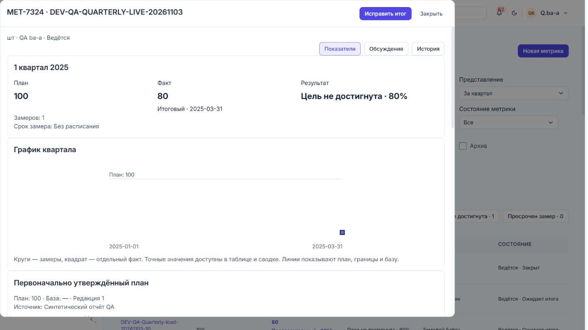

# Квартальные метрики — 03.11.2026

Реализована квартальная модель по [ТЗ](../metrics-quarterly-spec.md).
Проверка объединяет расчётные, контрактные и конкурентные тесты PostgreSQL,
браузерные фикстуры, живой прогон готовых QA-профилей и нагрузочный набор.
Статусы ниже относятся к этому локальному стенду и указанным сценариям.

## Реализация

- Аддитивная схема: nullable-поля метрики/периода, редакции плана и факта,
  подтверждения закрытия, область года и интервалы паузы. Прежние записи
  маркируются legacy_v1 без переноса фактов или закрытий.
- API v2: строгие команды с Decimal-строками, явный факт, закрытие владельцем,
  адресные исправления, пакетные планы, расчёт года, SQL-фильтры и пагинация.
  Версия, блокировка метрики и идемпотентность защищают совместное редактирование.
- UI: квартальный/годовой реестр, карточка «Показатели / Обсуждение / История»,
  формы, графики, исходный план, подтверждения, ручная миграция, общие компоненты
  фильтров, таблиц, выбора сущностей, диалогов и колонок.
- Legacy: исходные ID, связи, файлы, комментарии, KR и снимки встреч сохраняются.
  Некалендарное покрытие задаётся вручную новыми планами; прежний период остаётся
  самостоятельным и не входит в новые суммы. V1 блокирует новую/смешанную модель.

Основные исходники:
[правила](../../dmb-backlog/backend/services/metric_quarterly_rules.py),
[сервис](../../dmb-backlog/backend/services/metric_quarterly_service.py),
[SQL-проекции](../../dmb-backlog/backend/services/metric_quarterly_query.py),
[контракт](../../dmb-backlog/backend/metric_quarterly_contract.py),
[API](../../dmb-backlog/backend/routers/metrics_quarterly_router.py),
[интерфейс](../../dmb-backlog/frontend/js/components/metricsQuarterly.js),
[миграция UI](../../dmb-backlog/frontend/js/components/metricsMigration.js).
[OpenAPI](../../dmb-backlog/docs/METRICS_QUARTERLY.openapi.json) сгенерирован из router.

## Матрица AC

Обозначения: Q — [test_quarterly.py](../../dmb-backlog/backend/metric_tests/test_quarterly.py),
C — [test_quarterly_concurrency.py](../../dmb-backlog/backend/metric_tests/test_quarterly_concurrency.py),
B — [metricsQuarterly.spec.mjs](../../dmb-backlog/frontend/e2e/metricsQuarterly.spec.mjs).
Имена тестов ниже можно искать непосредственно в этих файлах.

| AC | Результат и доказательство |
|---|---|
| 01 | PASS — Q atomic_creation_idempotency_and_legacy_guard: невалидная строка откатывает создание |
| 02 | PASS — тот же тест: повтор ключа возвращает тот же ID |
| 03 | PASS — Q draft_first_approved_plan_and_archive; проверки validate/start; legacy regression сохраняется |
| 04 | PASS — Q calendar и moscow_date_boundary: кварталы, високосный год, московская полночь |
| 05 | PASS — Q future_and_version: будущие факты/закрытия запрещены; capability вводов выключена |
| 06 | PASS — Q zero_plan_and_missing, registry_same_period_filters_and_zero; B empty-card |
| 07 | PASS — Q volume: 80%, 120%, 0; zero_plan_and_missing: null при плане 0 |
| 08 | PASS — Q change_and_threshold_range: 80%, −20%, запрет равной базы |
| 09 | PASS — Q change_and_threshold_range: отрицательный порог; сервер сравнивает без процента |
| 10 | PASS — Q range_fact_independent_of_observations и включительные границы |
| 11 | PASS — Q close_boundary_and_early_confirmation закрывает без замеров; обязательный Fact.value в контракте |
| 12 | PASS — Q fact_measurement_close_correction и живой прогон: замер не меняет факт |
| 13 | PASS — тот же тест: исправление замера сохраняет факт и выставляет расхождение |
| 14 | PASS — Q retry_close_plans_and_duplicate_date; B quarterly duplicate measurement correction keeps typed value |
| 15 | PASS — Q close_boundary_and_early_confirmation: 31 марта отказ, 1 апреля разрешение |
| 16 | PASS — тот же тест: отдельное подтверждение ранней даты, дата сохраняется |
| 17 | PASS — Q fact_measurement_close_correction; живой итог 80 при плане 100 закрыт |
| 18 | PASS — Q owner_gate_and_foreign_ids, existing_roles_v2: editor не-владелец и owner без edit |
| 19 | PASS — Q fact_measurement_close_correction: новая редакция, исходное закрытие сохранено |
| 20 | PASS — Q closed_plan_revision_preserves_initial, migration_keeps_materials_and_report_snapshot |
| 21 | PASS — Q closed_plan_revision_preserves_initial: следующий квартал не изменился |
| 22 | PASS — C: два независимых HTTP-редактора одной версии, один 200 и один 409 |
| 23 | PASS — Q retry_close_plans_and_duplicate_date и fact replay: число редакций/истории не растёт |
| 24 | PASS — Q annual_coverage: 450; при пропуске II квартала final=null |
| 25 | PASS — Q annual_coverage: last не заменяет отсутствующий IV квартал III-м |
| 26 | PASS — Q ratio: 91/110×100=82.7272727273 |
| 27 | PASS — Q ratio и проверка signatures в annual: missing_components/not_comparable |
| 28 | PASS — Q annual_coverage: все отменены → null; coverage возвращает исключения и причины |
| 29 | PASS — Q annual_coverage; карточка разделяет confirmed/preliminary/final и область |
| 30 | PASS — Q registry_same_period_filters_and_zero; B JSON-кодирование быстрых выборок; SQL общий ACL |
| 31 | PASS — URL хранит контекст; B direct URL и legacy toolbar regressions; живое закрытие карточки сохраняет 2025/Q1 |
| 32 | PASS — Q owner_gate_and_foreign_ids; выбор period_id определяет год, сводку, замеры и действия |
| 33 | PASS — Q pause_resume_excludes_pause_slots: пауза не создаёт новые пропуски |
| 34 | PASS — Q draft_first_approved_plan_and_archive: active блокирует архив, восстановление сохраняет данные |
| 35 | PASS — Q migration_no_implicit_fact_or_closure, manual_legacy_coverage_preserves_original |
| 36 | PASS — Q migration_keeps_materials_and_report_snapshot: ID, файлы, связи, комментарии, KR snapshot и meeting snapshot неизменны |
| 37 | PASS — Q atomic_creation_idempotency_and_legacy_guard, rollback_switch_preserves_reads |
| 38 | PASS — Q existing_roles_v2; живые ba-b, tribe-lead, customer-a; B read-only card |
| 39 | PASS — B 401/409/422/503, TimeoutError/AbortError: форма и ввод сохраняются; одинаковый ключ повтора |
| 40 | PASS — B 320/390/768/1024/1440, обе темы, клавиатура, zoom 200%, длинные названия/Decimal; снимки просмотрены |
| 41 | PASS — Q decimal_rejects, precision_passport_and_source_snapshot: 99.9999999999 не округляется до достижения |
| 42 | PASS — SQL-guard во всех интеграционных тестах и нагрузке; защищённые таблицы только читаются |
| 43 | PASS — воспроизводимый нагрузочный отчёт ниже, все три бюджета выполнены |
| 44 | PASS — Q rollback_switch_preserves_reads: 503 записи v2, чтение доступно, v1 небезопасная запись запрещена |

## Фактические прогоны

Из `dmb-backlog/backend`, интерпретатор корневого окружения:

```powershell
D:/Проект/.venv/Scripts/python.exe -m pytest metric_tests --confcutdir=metric_tests --basetemp D:/Проект/.runtime/quarterly-20261103-15 -q
```

**60 passed**. Включены прежние тесты; их семантика не заменена новой.
Есть предупреждения зависимостей Pydantic/SQLAlchemy/httpx, ошибок тестов нет. Последнее
адресное дополнение проверило сохранение ссылки на исходный замер при закрытии
неизменённого факта: **1 passed, 34 deselected**.

```powershell
D:/Проект/.venv/Scripts/python.exe -m pytest metric_tests/test_quarterly.py -k retry_close_plans --confcutdir=metric_tests --basetemp D:/Проект/.runtime/quarterly-20261103-16 -q
```

Транзакционные тесты используют внешнюю транзакцию с откатом и SQL-guard.
Конкурентный тест создаёт только временные метрики и очищает точные ID.

Из `dmb-backlog`:

```powershell
node node_modules/@playwright/test/cli.js test --config=playwright.metrics.config.mjs --output=D:/Проект/.runtime/quarterly-browser-20261103-05
node node_modules/@playwright/test/cli.js test --config=playwright.metrics.config.mjs metricsQuarterly --output=D:/Проект/.runtime/quarterly-browser-20261103-07
```

Полная регрессия: **49 passed** (20 квартальных + 29 legacy/UI Kit).
Расширенный квартальный набор: **22 passed**; две добавленные проверки —
исправление дубликата с сохранением ввода и большое Decimal на 320 px.
Ошибки HTTP в этом наборе моделируются фикстурой, а права/конфликты/версии
дополнительно проверены реальным PostgreSQL API и живыми сессиями.

При разработке тесты обнаружили дефект наследования типа у перенесённого
плана при последующем пересмотре; исправлено сохранением типа самого периода.
Также исправлены нормализация маршрута при первом открытии, JSON множественных
быстрых фильтров, сохранение исходного утверждённого плана после черновика.

## Живой прогон

Стандартный запуск завершился итоговым health-check без seed, PostgreSQL/Redis
использованы штатно. QA ba-a создал **MET-7324**
`DEV-QA-QUARTERLY-LIVE-20261103`, четыре плана 2025 года по 100.
Замер 80 оставил факт пустым. Явное использование создало preliminary 80;
подтверждение владельца закрыло I квартал с final 80, результатом «Цель не
достигнута · 80%» и сохранённым исходным планом 100.

QA ba-b и tribe-lead видят карточку без кнопок изменения. Чтение чужой команды
разрешено текущей общей policy; изменение запрещено. Customer-a по прямой
ссылке возвращён в свой портал, раздел метрик отсутствует. Сессия ba-a
восстановлена штатным входом. Реквизиты не выводились и не сохранялись в артефактах.
Тестовая метрика сохранена как доступное доказательство; рабочие данные не очищались.



[Мобильная форма, тёмная тема](metrics-quarterly-assets/mobile-dark-fact-form.png),
[мобильный годовой реестр](metrics-quarterly-assets/mobile-dark-year.png).

## Нагрузочная проверка

[Машиночитаемый отчёт с 40 замерами каждого сценария](metrics-quarterly-load-20261103.json).
[Воспроизводимый скрипт](../../dmb-backlog/backend/metric_tests/benchmark_quarterly.py).

```powershell
# Из dmb-backlog/backend; имя файла для каждого прогона новое.
D:/Проект/.venv/Scripts/python.exe metric_tests/benchmark_quarterly.py D:/Проект/.runtime/quarterly-benchmark-20261103-v10.json
```

Dell Latitude 3410, Intel Core i5-10210U, 8 логических CPU, 8 339 001 344 байта RAM.
PostgreSQL 16 (точная сборка в JSON). 1 000 временных метрик, 4 000 периодов,
100 000 замеров; 10 параллельных читателей, три прогрева, по 40 HTTP-запросов.
p95 — 38-е значение отсортированного набора из 40. Первая страница 25 строк;
карточка — первое чтение её проекции, без загрузки всей истории. Транспорт —
FastAPI ASGI TestClient в процессе, реальный PostgreSQL; задержка внешней сети
не измерялась. Авторизация использует существующего пользователя без изменения ролей.

| Сценарий | p95 | Бюджет | SQL на запрос | Максимальный ответ |
|---|---:|---:|---:|---:|
| Квартальный реестр | 0,586 с | ≤1 с | 6 | 16 226 байт |
| Годовой реестр | 0,551 с | ≤1 с | 6 | 40 851 байт |
| Карточка | 0,285 с | ≤1,5 с | 12 | 14 533 байт |

Данные нагрузки — volume, планы 100, preliminary 80, cadence=none, без пауз;
сложные расписания проверены функционально, но не отдельным нагрузочным профилем.
Скрипт выполняет ANALYZE только своих таблиц после массовой загрузки и удаляет
созданные данные по возвращённым точным ID. Защищённые записи не создаются.

Предыдущие прогоны бюджет реестров не проходили: v1 5,918/4,909 с;
v5 1,043/1,251 с; v7 0,866/1,201 с; v9 2,498/4,192 с.
Оптимизация: пакетные SQL-проекции, один групповой расчёт счётчиков,
компактный ответ, объединённое чтение фактов/настроек, transaction-local JIT off.
После повторных массовых вставок/удалений потребовалась актуальная статистика
планировщика; ANALYZE включён в воспроизводимую подготовку. Более ранние
провалы не скрываются и не считаются успешными измерениями.

## Миграция и откат

На проверенном стенде Alembic имеет один head `c140b87d29e6`, он применён.
Схема v2 — `f8d123e94052` после `e7c012d83f41`; индексы — `c140b87d29e6`
после актуальной параллельной миграции `b0f345ab6274`. Граф не заменялся
устаревшей ревизией из документа. Преобразование смысла — отдельная команда,
а не SQL-backfill. Разрушительный downgrade ревизий запрещён.

При дефекте записи установить `METRICS_QUARTERLY_WRITE_ENABLED=false` и
перезапустить совместимый backend. Новые команды возвращают 503, чтение и
аудит остаются. Старые v1-команды по v2 по-прежнему возвращают 409.
Это режим текущего совместимого build, не разрешение запускать старый бинарник.

## Проверка документации

Проверены 192 локальные Markdown-ссылки в обновлённых профильных документах
и навигаторах: отсутствующих файлов нет. OpenAPI содержит 30 путей; дублирующих
маршрутов и определений в новых Python-модулях нет.

## Границы проверки

Приёмка локальная: не проверялись внешний сетевой latency, production-sized
каталог пользователей и отдельная нагрузка с ежедневным расписанием у всех
метрик. Эти условия не входят в заданный числовой набор AC-43. Логи и временные
результаты находятся в `.runtime/`; в документацию включены только выбранные
снимки и обезличенный отчёт. Коммит не создавался; чужие изменения рабочего
дерева не включались в отдельную поставку и не отменялись.
