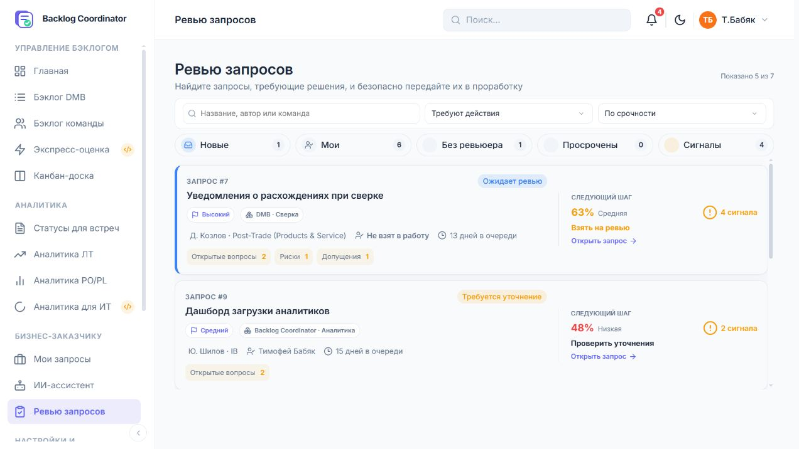
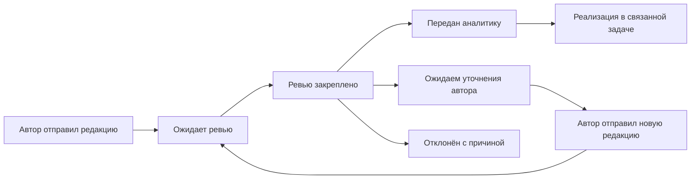

# Ревью запросов: задачи пользователей, клиентские пути, дизайн и поведение

**Проверено 8 сентября 2026 года.** Это датированный аудит рабочего дерева и локального интерфейса, а не утверждённый проект нового дизайна. В рамках этой задачи код приложения и бизнес-записи не изменялись; добавлены материалы аудита и ссылки на них. Во время подготовки результата в проект параллельно вносились изменения frontend и backend. Поэтому исходный срез и последующая сверка разделены ниже; **34 пункта нельзя считать 34 всё ещё открытыми дефектами**.

**Главный вывод:** у страниц есть хорошая визуальная основа, но пока они надёжнее показывают паспорт запроса, чем помогают провести полный цикл ревью. Наиболее значимые проблемы относятся к достоверности состояния, повторному уточнению, сохранению замечаний и передаче контекста. Перестановка блоков и обновление цветов нужны, но сами по себе эти проблемы не закроют.

## Обновление после параллельных изменений проекта

Основные наблюдения и снимки относятся к исходному просмотру примерно 15:15–15:33 МСК. Во время финальной сверки после 15:40 обнаружены существенные изменения. Они проверены **по коду**, без применения миграций и повторного полного прогона интерфейса. Это не доработки, выполненные в рамках данного аудита.

| Пункт исходного аудита | Что изменилось к финальной сверке | Как трактовать вывод теперь |
|---|---|---|
| R01: claim возвращённого запроса | Backend больше не предлагает claim для returned, переход returned→in_review убран; исправлен и клиентский fallback | Исходный дефект устранён на уровне просмотренного кода; остаётся приёмка живого цикла автора и ревьюера |
| R02: нет редакций и истории решений | Добавлены revision_history/status_history, сохранение событий/снимков, миграция, API и вывод отправленных редакций | Нельзя больше утверждать полное отсутствие механизма. Проверить применённую миграцию, два цикла возврата, полноту старых данных и удобство сравнения |
| R03: игнорируются новые findings | signalGroups теперь включает quality_issues, review_findings и gaps, добавлена дедупликация | Исходное полное игнорирование устранено в коде и узкой пробе; рабочие состояния замечаний, важность и качество дедупликации требуют доработки |
| R05: риски/зависимости не попадают в описание | Новый общий renderer переносит все поля для новых/повторных отправок | Частичное исправление: старые сохранённые description не обязательно пересобраны; задача ещё требует прямой связи с принятой редакцией |
| R28: в паспорте нет ряда полей и источников | Добавлены основные роли/затронутые пользователи/процесс/подразделение/приоритет, происхождение полей и сведения источников | Первоначальный вывод о полном отсутствии этих полей устарел; проверить читаемость расширенного паспорта и рабочий сценарий дубликатов |
| R08: неверные или отсутствующие targets сигналов | Дополнено сопоставление некоторых полей | Ошибка сохраняется для пустых дополнительных секций: новая узкая проба подтверждает отсутствующий target для data_integrations |

Подробная актуализация: [backend и workflow](evidence/review-ux-2026-09-08/delta-review.md), [frontend](evidence/review-ux-2026-09-08/frontend-delta.md). Разделы 1–10 ниже сохраняют исходный аудиторский срез, объяснение последствий и целевой результат. Слова «сейчас»/«текущий» в описаниях исходных сценариев относятся к этому срезу. При формировании задач разработки следует сначала учитывать эту таблицу и delta-документы; наличие нового кода не равнозначно проверенному исправлению на работающем стенде.

**Приоритет оставшейся работы:** сохранность комментария и мобильного предупреждения; корректная версия решения; legacy-описания; достоверная очередь/поиск/следующий запрос; контраст и порядок чтения. Новые механизмы истории и полноты данных нужно принять отдельным сквозным сценарием, а не разрабатывать повторно по первоначальным рекомендациям.

У новой истории обнаружено отдельное ограничение: перенос прежней причины возврата создаёт legacy-событие с текущим временем фиксации, а UI не поясняет различие этой даты и фактической даты прежнего решения. Поэтому точность старых дат нельзя считать восстановленной. Подробности и хеши среза — в backend-delta. Контроль изменений завершён примерно в **15:47 МСК**; более поздние изменения относятся уже к следующей проверке.

## Как читать результаты

- Этот документ — целостный продуктовый разбор, карта путей, перечень проблем и план улучшений.
- [Поведение frontend и 16 подробных дефектов](evidence/review-ux-2026-09-08/frontend-analysis.md) — условия, причинность, функции, проверки и рекомендации F01–F16.
- [Жизненный цикл, роли и 15 проблем workflow](evidence/review-ux-2026-09-08/workflow-analysis.md) — контракты и последствия WF-01–WF-15.
- [Визуальный дизайн и доступность](evidence/review-ux-2026-09-08/design-analysis.md) — каскад CSS, контраст, структура чтения и критерии доступности.
- [Протокол живого интерфейса](evidence/review-ux-2026-09-08/browser-observations.md) — проверенные действия и ограничения наблюдений.

Подробные отчёты пересекаются намеренно: одна проблема может одновременно иметь серверную причину, ошибку поведения и визуальное проявление. Их количества **не следует складывать**. Ниже проблемам присвоены единые номера R01–R34.

Обозначения доказательности: **UI** — воспроизведено в браузере; **PROBE** — выполнена изолированная проверка текущей функции на данных в памяти; **CODE** — подтверждено текущим кодом, без изменения живых записей; **DESIGN** — экспертная оценка удобства, которую нужно проверить на пользователях. P1 означает риск неверного решения, потери результата работы или блокировки ключевого пути; P2 — существенное препятствие; P3 — улучшение удобства. P0 по результатам этой проверки не заявляется. Приоритеты — рекомендация аудита, не утверждённая очередь разработки.

## 1. Область и ограничения

Исследованы очередь `#/review`, карточка `#/review/{id}`, взятие на ревью по коду, модальные формы передачи/возврата/отказа, путь автора после возврата по контракту и переход к созданной задаче. Живой интерфейс открыт в существующей авторизованной сессии на `http://127.0.0.1:8000`. В очереди было 7 записей, в стандартной выборке «Требуют действия» — 5. Прочитаны карточки #9, #8 и #12; просмотрен переход к TASK-000-251.

Визуально проверены светлая тема, исходное окно около 1272×716, мобильный viewport 390×844 и широкий 1440×900. Наблюдалось также более узкое окно, но измеряемые выводы мобильного теста опираются на 390×844. Тёмная тема разобрана по CSS и расчётам контраста, без полноценного визуального прогона. В конце проверок инструмент снимков стал нестабилен; неудачные/масштабированные кадры не используются как доказательства дефекта продукта.

Решения по настоящим запросам не отправлялись. Тестовый текст в форме возврата закрыт без сохранения; выбор аналитика отменён. Не создавались пользователи, справочники, роли или команды, не менялись их атрибуты. Полный backend suite с создающими такие данные фикстурами не запускался. Результат проверки реальных серверных операций не подменяется результатом изолированных проб.

Интервью, наблюдения за реальными рабочими сменами, статистика возвратов, утверждённый SLA и нагрузочный профиль отсутствовали. Поэтому роли ниже — модель работ на основании реализованного процесса, а не выдуманные результаты исследования. Частоту дефектов и экономию времени в процентах аудит не приписывает.

## 2. Какую работу должны выполнять эти страницы

Ревью — точка передачи ответственности за потребность. Пользователь должен ответить на пять вопросов: **что нужно изменить; зачем; достаточно ли данных для следующего этапа; что ещё требует решения; кто отвечает дальше**. Запрос после ревью ещё не равнозначен утверждённому плану реализации: в текущем коде передача создаёт задачу на стадии «СБОР ТРЕБОВАНИЙ».

| Рабочая роль | Задача в конкретной ситуации | Что нужно знать до действия | Признак успешного пути |
|---|---|---|---|
| Ревьюер очереди | Начать рабочий день и выбрать следующее дело | Что ждёт именно меня, где нет владельца, что поступило повторно, что давно лежит | Следующий запрос выбран по понятной причине; ожидание заказчика не выглядит моей просроченной работой |
| Ревьюер запроса | Проверить потребность и пригодность к проработке | Проблема, пользователь, текущий/целевой процесс, эффект, критерии, ограничения и источники | Решение связано с прочитанной редакцией и имеет основания |
| Заказчик | Получить и закрыть замечания | Что исправить, где, зачем и как отправить ответ | Каждый вопрос понятен, прошлые сведения сохранены, новая редакция явно передана |
| Бизнес-аналитик | Начать проработку переданного запроса | Исходная потребность, принятые решения, открытые вопросы и риски | Из задачи доступен полный контекст именно принятой редакции |
| Координатор | Разблокировать зависшее ревью | Неверная команда, отсутствие аналитика, недоступный ревьюер, история решений | Запрос можно перенаправить или передать без пересоздания и ручного вмешательства в БД |

Эти рабочие роли не являются новыми ролями доступа. Фактическое право определяется `review_access = none/team/all`, областью команды и владельцем запроса; техническая матрица приведена в workflow-анализе. Выбор аналитика ограничивается активными BA соответствующей команды. Самостоятельное ревью автором с правом ревью явно не запрещено: необходимость независимого согласования должна быть отдельным продуктовым решением.

### Что проверяет человек, а что помогает проверить ИИ

| Предмет проверки | Хороший вопрос ревьюера | Как интерфейс должен помогать |
|---|---|---|
| Проблема | Какое конкретное затруднение существует и у кого? | Показать основного пользователя и текущий процесс рядом с проблемой |
| Результат | Как изменится работа пользователя? | Отделить требуемый результат от предложенного автором способа реализации |
| Ценность | Почему потребность нужно прорабатывать? | Показать бизнес-обоснование и источник утверждения; не требовать искусственной денежной оценки для любого случая |
| Проверяемость | По какому наблюдаемому результату примут работу? | Нумерованные критерии, замечания к конкретным пунктам, примеры неопределённости |
| Ограничения | Какие правила, интеграции и зависимости обязательны? | Не скрывать существенные ограничения под неопределённым названием «Дополнительные материалы» |
| Достаточность | Чего не хватает именно для начала следующего этапа? | Разделить блокирующие пробелы, вопросы для аналитика и справочные сведения |
| Риски | Риск не исследован или осознанно принят? | Отдельное решение по риску с причиной; наличие риска само по себе не означает плохое требование |
| Ответственность | Кто продолжает и какую информацию получает? | Показать команду, аналитика, стадию задачи и сохраняемый контекст перед подтверждением |

Процент качества не заменяет эти вопросы. Принудительный запрет передачи при любом «сигнале» тоже не рекомендуется: часть рисков допустимо принять, а часть уточнений относится уже к проработке. Правило блокировки должно опираться на согласованный критерий готовности к следующему этапу.

## 3. Что уже сделано хорошо

1. Очередь имеет настоящий поиск, сортировки, быстрые фильтры, счётчик и крупные карточки-ссылки. Состояние фильтров и прокрутки сохраняется в сессии.
2. Запрос содержит понятный набор основных смысловых полей, критерии приёмки, участников и следующий шаг. Причина возврата выделяется отдельно.
3. На desktop действия отделены от чтения, а отказ визуально менее заметен, чем передача. Это снижает вероятность случайного выбора разрушительного исхода.
4. Перед созданием задачи прямо объясняются последствия и требуется выбрать аналитика; подтверждение до выбора неактивно.
5. В формах причины есть подписи, обязательность, пояснение, сохранение ввода при самой API-ошибке и защита при обычном закрытии. Escape вызывает предупреждение, фокус возвращается на исходную кнопку после отмены.
6. Доступные действия приходят с сервера; есть проверка версии и чужого владения. Нельзя объявлять отсутствие авторизации только по тому, что route существует в SPA.
7. После успешного действия предусмотрено устойчивое сообщение со ссылками на очередь/задачу/следующий запрос. Ссылка из уже переданного запроса в существующую задачу проверена и работает.
8. Есть SSE-обновление страниц; открытая review-модалка защищена от прямой замены содержимого при событии. Утверждение «интерфейс вообще не обновляется» было бы неверным.

Эти решения стоит сохранить при переработке, закрыв их неполные и конфликтующие ветви.

## 4. Клиентские пути: подробный разбор

### Путь 1. Выбрать следующий запрос в начале дня

**Сейчас:** открыть «Ревью запросов» → увидеть «Требуют действия» → сравнить карточки и пять счётчиков → при необходимости изменить один фильтр и сортировку → открыть запрос. Стандартная сортировка называется «По срочности», хотя фактически смешивает просрочку, отсутствие ревьюера, доступность действия, количество сигналов и качество. Бизнес-приоритет и приближение будущего срока не определяют этот порядок напрямую.

**Проблема решения:** пользователю приходится догадываться, почему запрос первый. «Мои» включает и мои ревью, и назначенную мне проработку. «Требуют действия» содержит возвраты, ожидающие автора. Фильтры «мои», «сигналы», «статус» взаимоисключающие, а естественная рабочая выборка «мои повторные запросы с замечаниями» не собирается.

**Предлагаемый путь:** открыть режим «Нужно моё решение» → увидеть новые, повторные и текущие ревью с причиной приоритета → сузить команду/ревьюера/тип замечаний независимо → открыть запись. В соседних режимах — «Ожидаем других» и «История решений». Числа должны явно относиться либо ко всей доступной очереди, либо к текущему срезу.

**Приёмка:** человек может объяснить, почему верхний запрос нужно открыть сейчас; ни один ожидающий заказчика запрос не выдаётся за его необходимое действие; активные ограничения видны без раскрытия меню.

### Путь 2. Найти известный запрос из разговора или уведомления

**Сейчас:** интерфейс показывает «Запрос #8», но поиск `#8` в «Все запросы» возвращает 0 из 7. Ввод номера не входит в поисковый индекс. По названию запрос можно найти только среди статусов, возвращённых сервером; после отказа он исчезнет даже из «Все».

**Предлагаемый путь:** вставить номер, заголовок или ссылку → получить точное совпадение → увидеть актуальный статус и последнее решение, включая закрытые записи. При ограничении доступа отличать невозможность просмотра от нулевого совпадения, не раскрывая чужие сведения.

**Приёмка:** `8`, `#8` и поддерживаемый публичный идентификатор находят #8; отклонённый запрос доступен в явной истории; очистка поиска не маскирует оставшиеся фильтры.

### Путь 3. Прочитать новое требование и взять ответственность

**Сейчас:** заголовок/статус → четыре этапа → четыре плитки сводки → сигналы → паспорт → критерии → дополнительные материалы. На исходном desktop до содержательной проблемы приходится пройти несколько уровней служебной информации. На мобильном перед паспортом дополнительно стоят решение и все участники: в измеренном #8 паспорт начинался примерно на 1410 px от верха viewport при высоте экрана 844 px.

**Проблема чтения:** интерфейс рано предлагает действие, но поздно раскрывает потребность. На desktop паспорт разбит на две колонки: это удобно для коротких полей, но плохо поддерживает длинный связный текст, сопоставление причин и результата. При отсутствии структурированного draft исходный `description` вообще не показывается, хотя автор видит его в своём портале.

**Предлагаемый путь:** краткая формулировка проблемы и ожидаемого результата → владельцы/срок текущего этапа → действие «Начать ревью» → полное чтение в одной основной колонке, с закреплённым оглавлением. Метаданные раскрываются по необходимости. Для legacy-запроса — «Исходное описание; структурированный паспорт отсутствует».

**Приёмка:** на первом экране можно понять суть запроса, а не только его административное состояние; весь исходный бизнес-текст доступен; короткие и длинные запросы не требуют разных обходных путей.

### Путь 4. Проверить замечания и сформировать решение

**Сейчас:** жёлтый блок объединяет открытые вопросы, противоречия, риски и допущения; число равно сумме элементов этих массивов. Новая модель `review_findings`/`quality_issues` игнорируется. Неизвестная оценка становится «0% Низкая», а полнота может подменить качество. Некоторые сигналы открывают произвольный раздел или не делают ничего.

**Критическая задача пользователя:** отделить недостаточность информации от принятого ограничения. Четыре известных бизнес-риска не обязательно важнее одного противоречия, запрещающего начать работу. Список сейчас не позволяет зафиксировать результат рассмотрения каждого пункта.

**Предлагаемый путь:** «2 вопроса требуют решения, 1 риск принят» → открыть замечание → увидеть связанное поле и источник → выбрать «Уточнить», «Принять как риск», «Не относится» либо прочитать ответ автора → принять итоговое решение. Сводный процент оставить вторичной справкой с объяснением и датой расчёта.

**Приёмка:** каждый открытый finding виден ровно один раз, имеет важность и корректный target; решения по замечаниям сохраняются; отсутствие оценки отличается от плохой оценки.

### Путь 5. Вернуть запрос на уточнение

**Сейчас:** заполнить обязательный комментарий → подтвердить возврат. Автор получает возможность вернуться в исходный диалог. Однако returned сразу вновь получает действие claim, прежний ревьюер может забрать запрос до ответа и очистить причину. После такого claim автор больше не проходит проверку resume. Коллега видит тот же claim, но получает конфликт владельца.

**Проблема ответственности:** одна и та же запись одновременно означает «автор должен ответить» и «ревьюер должен начать». Это не вопрос копирайтинга: неправильный переход меняет доступность авторского пути.

**Предлагаемый путь:** отметить конкретные поля → собрать понятный заказчику список вопросов → сохранить комментарий → отправить возврат → показать «Ожидаем ответа заказчика с …». Запрос уходит из требующих моего решения. Автору доступна точка входа к уточнению. Если ревьюер ошибся, отзыв возврата должен быть отдельным объяснимым действием с сохранением истории.

**Приёмка:** до новой отправки автора claim отсутствует и запрещён API; причина не исчезает; автор понимает, какие именно ответы позволят продолжить рассмотрение.

### Путь 6. Проверить повторную редакцию

**Сейчас:** новая отправка перезаписывает draft/описание/заголовок той же записи, очищает прежнего ревьюера и причину. «Ключевые события» реконструируют создание и текущее состояние; содержательные версии и цепочка замечаний в доступном контракте отсутствуют. Техническая `version` увеличивается и при сменах статуса, поэтому не является номером редакции текста.

**Цена для пользователя:** он вынужден заново читать весь запрос и помнить предыдущую претензию. Новый ревьюер не может достоверно понять, что уже обсуждали. Формулировка «Проверить уточнения» не подтверждается показом самих уточнений.

**Предлагаемый путь:** уведомление/очередь «Получен ответ» → старая причина + ответы по пунктам → сравнение редакций с подсветкой изменённых разделов → проверить изменения и связанные места → решение. Сохранить прежнего ревьюера как предпочтительного владельца повторного рассмотрения, если это соответствует политике распределения.

**Приёмка:** после двух возвратов доступны обе причины и три редакции; пользователь может объяснить изменения без воспоминаний и внешних сообщений.

### Путь 7. Передать аналитику

**Сейчас:** нажать «Передать в проработку» → два GET → окно выбора BA → подтвердить → создаётся задача. Доступный аналитик корректно выбирается, подтверждение активируется после выбора. Но подготовка формы не показывает loading и не защищена от многоклика. Версия из нового GET может отличаться от версии прочитанного паспорта. В задачу не переносятся риски/зависимости/противоречия и не создаётся явная обратная ссылка на принятую редакцию.

**Предлагаемый путь:** одно окно открывается сразу → загрузка доступных аналитиков → команда, аналитик, стадия «Сбор требований» и ссылка на передаваемую редакцию → проверка версии → подтверждение → устойчивый результат с номером задачи и следующим действием. При отсутствии BA — отдельное состояние с владельцем решения проблемы, а не только пустой select.

**Приёмка:** решение относится к прочитанной редакции; повторный клик не открывает второй диалог; все существенные сведения доступны аналитику из задачи; при ошибочной команде есть разрешённое перенаправление рабочего запроса.

### Путь 8. Отказать, обработать серию запросов или пережить сбой

Это три завершающих проверки качества процесса. После отказа запись должна находиться в истории, а статус не должен говорить «Ожидает следующего этапа». После последовательных решений A и B следующий запрос не должен возвращать пользователя в уже обработанный A. После конфликта или сбоя хорошо сформулированный комментарий должен сохраниться.

Сейчас все три сценария имеют пробелы: закрытые исключаются серверной очередью; next вычисляется по старому `reviewRows`; «Обновить данные» после ошибки принудительно закрывает окно без сохранения текста. При ожидании PUT ввод снова может включить подтверждение, поскольку валидность не учитывает отправку.

**Предлагаемый результат:** достоверный терминальный экран; следующая запись из актуальной очереди; в конце серии «Больше нет запросов, требующих решения»; восстановление комментария и сравнение версии после ошибки. Автоматически повторять содержательное решение на новой редакции нельзя.

## 5. Единый перечень проблем и улучшений

### Достоверность и целостность решения

| ID | Приоритет / доказательство | Проблема и пользовательское последствие | Конкретная доработка | Подробное основание |
|---|---|---|---|---|
| R01 | P1 · UI/PROBE/CODE | Возврат сразу можно забрать обратно, причина стирается, авторский путь блокируется | Разделить ожидание автора и полученный ответ; убрать claim до ресабмита | WF-01, снимок #9 |
| R02 | P1 · CODE | История не сохраняет доступную цепочку причин/редакций; повторное ревью опирается на память | Неизменяемые события решений и snapshots редакций, diff и ответы на замечания | F16, WF-02 |
| R03 | P1 · PROBE/CODE | Сигналы новой модели качества не видны, возможен ложный «Сигналов нет» | Общий нормализатор findings, важность, статус рассмотрения, дедупликация | F02, WF-07 |
| R04 | P1 · PROBE/CODE | Legacy description отсутствует в ревью; содержательная запись выглядит пустой | Общий fallback исходного текста и доступ к полному описанию при частичном draft | F03 |
| R05 | P1 · PROBE/CODE | При передаче задача не получает риски, зависимости, противоречия и прямой доступ к редакции | Полный snapshot и двусторонняя связь request/revision/task | WF-03 |
| R06 | P2 · CODE | Передача использует свежую техническую версию, которую человек мог не прочитать | Сравнить renderedVersion с GET; показать изменения до решения | F12, WF-11 |
| R07 | P2 · PROBE/CODE | Нет оценки превращается в 0%; полнота подменяет качество | Nullable отдельные показатели, статус и дата проверки | F15 |
| R08 | P2 · UI/CODE | Кнопки сигналов ведут в отсутствующие/неверные разделы | Стабильные field IDs, обязательный target даже для пустого раздела, честное fallback-объяснение | F07, WF-09; #9 и #12 |

### Очередь и распределение работы

| ID | Приоритет / доказательство | Проблема и пользовательское последствие | Конкретная доработка | Подробное основание |
|---|---|---|---|---|
| R09 | P2 · CODE | «Все запросы» исключает отклонённые и запланированные; решение не находится | История решений либо честное «Все активные» с отдельным поиском закрытых | F05, WF-05 |
| R10 | P2 · UI/PROBE | Отображаемый номер нельзя найти поиском | Поддержать #ID/ID/публичный номер и точное совпадение | F14; поиск #8 |
| R11 | P2 · DESIGN/CODE | Статус, моя роль и сигналы конкурируют в одном select | Режим работы + независимые фильтры; разделить «Моё ревью» и «Моя проработка» | Раздел «Очередь» frontend-анализа |
| R12 | P2 · CODE | «Просрочены» не имеет штатного срока ревью; создаёт ложное представление о контроле | Утвердить отдельный срок рассмотрения; до этого честный возраст этапа | WF-06 |
| R13 | P2 · CODE/DESIGN | «По срочности» — скрытая смесь качества/сигналов/действий; возраст от создания включает ожидания | Явные основания порядка; время с последней отправки и в текущем этапе | WF-13 |
| R14 | P2 · PROBE/CODE | «Следующий запрос» использует старый список и может дать A→B→A | Обновлять очередь после решения; выбирать следующий только из актуальных actionable | F04 |
| R15 | P2 · PROBE/CODE | Карточка не учитывает статус связанной задачи, detail учитывает | Общий stage resolver и согласованные фильтры/подписи | F06, WF-14 |
| R16 | P2, до P1 при блокировке · CODE | Нельзя освободить/передать ревью и перенаправить ошибочную команду | Разрешённые операции над запросом с причиной и журналом; без изменения состава команд | WF-04 |
| R17 | P2 · CODE | Нет сохранённого персонального уведомления автору о возврате/решении; SSE помогает только открытому UI | Использовать общий inbox и актуальные следующие действия; согласовать с notification policy | WF-12 |
| R18 | P3 · CODE, риск масштаба | Все draft загружаются сразу, весь список рендерится на ввод; фильтр не передаётся ссылкой | После измерения объёмов: серверные срезы, пагинация, компактные строки, URL-состояние | WF-15; лаг на большом объёме не измерялся |

### Формы, ошибки и восстановление

| ID | Приоритет / доказательство | Проблема и пользовательское последствие | Конкретная доработка | Подробное основание |
|---|---|---|---|---|
| R19 | P1 · UI/CODE | Мобильное предупреждение о потере текста обрезает кнопки | Исправить конфликт grid/flex в notice; min-width:0 и перенос; проверить 320/390 | F01; снимок предупреждения |
| R20 | P2 · CODE | «Обновить данные» после ошибки уничтожает комментарий | Черновик по request/action/revision, восстановление и сравнение | F10, WF-10 |
| R21 | P2 · CODE | Input/change вновь включает подтверждение при незавершённом PUT | Единое isSubmitting; snapshot payload; контроль закрытия и повторного клика | F09 |
| R22 | P2 · CODE | Подготовка передачи без обратной связи допускает несколько окон | Одно окно loading/error/ready; pending/open guard | F11 |
| R23 | P2 · PROBE/CODE | Фильтр стирает ошибку загрузки и показывает старый список как актуальный | Модель loading/ready/stale/error; предупреждение не исчезает от фильтра | F08 |
| R24 | P2 · CODE | Поздний ответ detail может перерисовать уже другой маршрут | Generation token/отмена запроса, skeleton, проверка актуальности render/init | F13; race в живой сети не выполнялась |
| R25 | P2 · CODE/DESIGN | Return/reject различаются слабо по объяснению результата; нет черновика промежуточного ревью | Разные последствия и поля причин, адресные замечания, сохранение рабочих заметок | Формы и пути 5–8 |

### Дизайн, содержание и доступность

| ID | Приоритет / доказательство | Проблема и пользовательское последствие | Конкретная доработка | Подробное основание |
|---|---|---|---|---|
| R26 | P2 · UI/DESIGN | На mobile паспорт далеко после метаданных/участников; решение видно до сути | Краткая потребность сверху, вторичные метаданные свернуть, доступное действие после чтения | Mobile #8: паспорт ≈1410px |
| R27 | P2 · CODE/DESIGN | Длинное чтение в двух колонках, переводы строк plain-text схлопываются | Основной текст в одной колонке; сохранить абзацы; вторичные поля компактно | `field`, `.review-requirement-grid` |
| R28 | P2 · CODE/DESIGN | Существенные правила/интеграции/регуляторика скрыты как дополнительные; источники — только названия | Явное оглавление всех непустых/проблемных разделов; источник, фрагмент и версия | WF-08, `extraDetails` |
| R29 | P2 · UI/CSS/расчёт | Неконтрастные метаданные и сигнальные цвета затрудняют чтение | Раздельные semantic-text/semantic-fill токены и проверка состояний обеих тем | Design-анализ и DOM-измерения |
| R30 | P2 · UI/CODE | У кнопки «Отмена» доступное имя «Закрыть диалог»; label/name расходятся | Сохранять видимое имя Cancel, aria-label только для крестика | `modalAccessibility`; DOM формы |
| R31 | P2 · CODE | Mobile визуально переносит aside раньше main, порядок DOM/Tab иной; focus списка отключён | Согласовать смысловой/визуальный порядок; явный focus-visible; один main landmark | Design-анализ |
| R32 | P3 · UI/CODE | Часть имён иконок отсутствует в поставленной Lucide; пустые кружки вместо обозначений | Проверить совместимость набора, заменить имена или обновить комплект согласованно | Console warnings и DOM `i[data-lucide]` |
| R33 | P2/P3 · CODE/DESIGN | Статус повторяется в нескольких блоках; «сроки» содержит даты создания/обновления; отказ «ждёт этапа» | Один набор точных терминов и сценарию соответствующий next step | `nextStep`, summary, participants, journey |
| R34 | P3 · DESIGN | В очереди проценты и taxonomy доминируют; весь текст карточки образует длинное имя ссылки | Приоритет причины открытия/владельца/давности, компактная плотность, короткое имя ссылки + описание | UI очереди и frontend/design-анализ |

Не все пункты таблицы — программные ошибки. R11, часть R25–R28 и R34 требуют проверки предлагаемого решения на рабочих сценариях. Отсутствие SLA, независимого согласования или переназначения становится дефектом бизнес-правила только после утверждения соответствующего требования; сейчас зафиксированы конкретные разрывы пользовательского пути.

## 6. Визуальный разбор по экранам

### Очередь: сейчас хорошо видна карточка, хуже видна логика работы

В исходном окне помещаются примерно две полные карточки. Область списка ограничена `clamp(280px,52vh,620px)`, поэтому даже при увеличении окна рабочая площадь используется не полностью. Для семи записей это терпимо; при десятках повышает стоимость сравнения. Нужна компактная плотность строк как вариант для регулярного ревью, с сохранением карточек для мобильного и обзорного режима. Не следует сжимать текущие карточки уменьшением уже мелкого шрифта.

Важнее всего на строке должны быть: идентификатор и название; состояние следующего действия; его владелец; время ожидания этого действия; причина приоритета. Продукт, команда и автор нужны для контекста. Оценка ИИ и число справочных рисков должны помогать, а не визуально выдавать окончательный вердикт.

Быстрые кнопки «Новые» и «Без ревьюера» в текущем наборе показывают одинаковые числа. Это не ошибка подсчёта, но полезность двух отдельных больших индикаторов нужно проверить на реальных объёмах. «Мои 6» рядом с «Показано 5» технически объяснимо разными срезами, но область подсчёта не очевидна. Пять статичных счётчиков не заменяют понятного режима работы.

### Деталь: служебные сведения опережают бизнес-содержание

Верх экрана расходует пространство на заголовок, badge, этапы и повторный статус в summary. При возврате добавляется ещё плашка причины. Это информация разной ценности: причина возврата действительно важна, повторение статуса — обычно нет. В текущей #9 приоритетный блок должен говорить «Ожидаем ответа на два вопроса», а не «Начните ревью».

Названия «AS-IS» и «TO-BE» в оглавлении требуют знания внутреннего языка анализа, хотя полные заголовки рядом используют русский. Предлагаются «Как сейчас» и «Что должно измениться»; профессиональные обозначения можно оставить вторым уровнем. Критерии приёмки стоит нумеровать AC-1/AC-2 либо обычными числами: ревьюер сможет адресно сослаться на пункт. Декоративный круг не должен выглядеть как уже проверенный чекбокс.

Часть сведений черновика отсутствует в детальном паспорте: отдельная основная роль (`primary_role`), затронутые пользователи (`affected_users`), бизнес-процесс (`process`), подразделение (`department`), приоритет и найденные дубликаты. Это отдельная проблема полноты представления, а не только свёрнутое отображение материалов. Сведения нужно показывать при наличии, сохраняя различие основного пользователя и затронутых групп. Приоритет заметен в очереди, но не доступен в таком же виде при детальном чтении. Подробное основание — WF-08.

Список замечаний перед всем паспортом полезен при повторном ревью, когда контекст уже знаком. При первом чтении лучше кратко показать проблему и результат, затем замечания. Это аргумент за разную расстановку акцентов по сценарию, а не за два полностью разных интерфейса.

### Мобильная карточка: требуется перестроить порядок

При 390×844 административная сводка занимает почти весь первый экран; нижняя часть показывает кнопки решения. Паспорт начинается после блока участников. Пользователь может передать запрос, так и не увидев его содержание, либо долго прокручивать, после чего возвращаться к действию вверх.

Предлагаемый порядок: заголовок/состояние → краткая потребность → «Что проверить» → паспорт → решение. Отдельная компактная закреплённая кнопка «К решению» или панель действия допустима, если не закрывает текст, клавиатуру и фокус. Полный список участников — раскрываемый вторичный блок. На ширине 320px интерфейс должен обходиться без горизонтальной прокрутки формы; горизонтальная навигация разделов не должна быть единственным способом добраться до скрытого раздела.

### Формы: хорошая основа, неполное восстановление

Предупреждение действительно появляется, но внутренний ряд шире диалога. DOM-измерение: группа действий доходила примерно до x=427 при правой границе диалога около x=374. Причина — поздний общий CSS превращает grid в flex-row. Исправлять нужно композицию предупреждения, а не делать текст ещё меньше.

Возврату полезны контекст запроса и адресные вопросы: «В критерии 2 укажите период расчёта; без него нельзя проверить результат». Отказу — причина и понятная окончательность решения, при необходимости ссылка на дубликат/альтернативный путь. Передаче — краткая сводка команды/аналитика/стадии и подтверждённой редакции. Поле ввода должно получать удобный начальный фокус; сейчас первым оказывается крестик.

### Контраст и визуальная семантика

В измеренном desktop `request-summary small` имеет 10px и цвет `#94a3b8`; качество средней категории и сигналы используют `#f59e0b`. Это не просто впечатление от скриншота: значения подтверждены computed styles. Расчёты и селекторы приведены в design-анализе.

| Комбинация из действующих токенов | Контраст, примерно | Вывод для обычного мелкого текста |
|---|---:|---|
| Белый / зелёный `#10b981` | 2.54:1 | Недостаточно для текста основной кнопки |
| Белый / красный `#ef4444` | 3.76:1 | Недостаточно для обычного текста кнопки |
| Белый / жёлтый `#f59e0b` | 2.15:1 | Недостаточно для числа в сигнальном badge |
| `#94a3b8` / светлый `#f8fafc` | 2.45:1 | Недостаточно для мелких заголовков summary |
| Жёлтый `#f59e0b` / `#f8fafc` | 2.05:1 | Недостаточно для подписей сигналов/оценки |

Для обычного текста ориентир WCAG AA — 4.5:1; для крупного — 3:1. Само увеличение насыщенности заливки не гарантирует читаемость: нужны отдельные цвета текста на светлой и тёмной теме, включая hover/focus/disabled. Неактивные элементы имеют исключение из требования контраста, поэтому бледную **disabled** кнопку без выбора аналитика не следует считать тем же дефектом, что активную зелёную кнопку. [W3C: Contrast Minimum](https://www.w3.org/WAI/WCAG22/Understanding/contrast-minimum.html).

Отмена с доступным именем, не содержащим видимого «Отмена», затрудняет голосовое управление. Переполнение формы и невидимый фокус требуют отдельных проверок: общий Tab trap сам по себе их не закрывает. [W3C: Label in Name](https://www.w3.org/WAI/WCAG22/Understanding/label-in-name.html), [Reflow](https://www.w3.org/WAI/WCAG22/Understanding/reflow.html), [Focus Visible](https://www.w3.org/WAI/WCAG22/Understanding/focus-visible.html).

## 7. Предлагаемая модель интерфейса и процесса

Это предложение TO-BE, требующее продуктового решения; оно не описывает внедрённое поведение.

У каждого узла должно быть однозначно понятно, кто должен действовать. Редакции и события сохраняются независимо от текущего статуса. Время ожидания автора и команды учитывается раздельно. Переназначение владельца — отдельное событие с разрешениями и причиной, без подмены содержательной редакции.

| Поверхность | Предлагаемая структура | Поведение |
|---|---|---|
| Очередь | Режим работы; поиск; независимые фильтры; компактные строки/карточки | Объяснимый порядок; актуальные totals; сохранение среза и позиции; явная история |
| Заголовок запроса | ID, название, стадия, краткая потребность, следующий ответственный | Сразу понятно, о чём запрос и от кого ожидается действие |
| Основное чтение | Потребность → изменения → замечания → полный паспорт → решение | Одна колонка длинного текста, доступное оглавление, сохранение абзацев |
| Замечание | Поле, источник, важность, текст, ответ, статус | Открыть контекст; запросить уточнение; принять риск с причиной; устранить дубликат |
| Повторное ревью | Старая причина + новые ответы + diff | Сначала изменения, полный паспорт всегда доступен |
| Решение | Передать / уточнить / отклонить с различимыми последствиями | Привязка к просмотренной редакции; сохранение черновика; единое pending-состояние |
| Результат | Что применилось, кто отвечает, связанная задача, следующий запрос | Следующий из актуальной выборки; после завершения серии — честный конец очереди |

Не рекомендуется начинать с массового принятия/отказа: текущая задача требует содержательного индивидуального решения, а доверие к состоянию ещё нарушено. Массовое распределение владельцев можно рассмотреть отдельно после определения полномочий. Не стоит также добавлять новый чат только ради комментариев: сначала нужны адресные замечания, версии и связанная история.

## 8. План доработок

### Пакет A. Восстановить доверие и сохранность

R01–R08, R19–R21: корректный цикл возврата, полное содержание, единые findings, передаваемый snapshot, прочитанная версия, сохранённый комментарий и доступное предупреждение. Зависимость: сначала определить каноническую модель замечаний/редакций, затем строить по ней UI; историю нельзя достоверно восстановить одним frontend-рендером из updated_at.

**Результат пакета:** ни одна существенная часть потребности не исчезает между автором, ревьюером и аналитиком; восстановление ошибки не уничтожает работу; ревьюер принимает решение по известной редакции.

### Пакет B. Замкнуть ежедневную очередь

R09–R17, R22–R24: история закрытых, поиск ID, однозначные режимы работы, реальные сроки/возраст, актуальный next, единые стадии, перенаправление и уведомления. Формы loading/error должны быть исправлены до добавления новых сценариев.

**Результат пакета:** можно обработать серию запросов, дождаться ответа автора, продолжить с прежнего места и найти собственное решение без внешней переписки и ручных URL.

### Пакет C. Сделать содержательное ревью удобным

R25–R34: порядок чтения, мобильная композиция, доступность, типографика, контекст источников, чек-лист рассмотрения замечаний, компактная очередь. R18 реализовать после измерения реальных объёмов; наличие `.all()` само по себе не доказывает текущую медленную работу.

**Результат пакета:** человек быстрее находит основания решения и реже возвращает запрос по той же причине. Оценку трудоёмкости в днях без выбора архитектуры версий/замечаний и без команды исполнения этот аудит не даёт.

## 9. Приёмочные сценарии и оценка эффекта

| Проверка | Что должно быть доказано |
|---|---|
| Первый запрос без замечаний | Видны проблема/результат, корректный владелец, только разрешённые действия, передача создаёт одну задачу |
| Новая модель finding без legacy-массивов | Замечание видно в агенте, очереди и detail одинаково; нет ложного зелёного состояния |
| Старый запрос только с description | Исходный текст читается и не превращается в пустой паспорт |
| Два цикла возврата | Сохраняются причины, авторы, даты и редакции; claim до ответа невозможен |
| Принятый риск | Риск остаётся в контексте, но имеет решение и не выдаётся за нерассмотренный пробел |
| Пустое поле с замечанием | Ссылка открывает существующую секцию с объяснением недостающих данных |
| Решение после изменения другой сессией | Пользователь видит diff; непрочитанная редакция не принимается молча |
| 409 / сеть / повтор | Комментарий сохраняется; понятен применённый результат; нет второго submit и второй модалки |
| Серия из 10 решений | Каждый актуальный запрос посещается один раз; в конце нет петли по обработанным |
| Неверная команда / нет BA / ревьюер отсутствует | Есть разрешённый путь восстановления без правки защищённых справочников и пользователей |
| Отклонение и последующий поиск | Причина остаётся доступной в истории; поиск по номеру работает |
| Передача в задачу | Полный контекст и ссылка на принятую редакцию доступны из точки начала работы аналитика |
| 320/390/768/1440 px, zoom 200% | Все действия достижимы; текст формы не обрезается; закреплённые элементы не закрывают фокус |
| Только клавиатура / screen reader | Логичный порядок, видимый фокус, корректные имена, явный результат навигации и сохранения |
| Большая очередь на согласованном объёме | Измерены загрузка/ввод/перерисовка, нет подмены ошибки старым snapshot |

Для пользовательской проверки нужны разные задачи и опыт: регулярный ревьюер, человек с редким ревью, автор возвращённого запроса и аналитик-получатель. Небольшую качественную сессию можно начать с 5–7 участников, не выдавая её за статистическую оценку всей организации. Давать участнику цель («проверьте, что изменилось после возврата»), а не инструкцию нажать конкретную кнопку.

Сначала измерить baseline, затем сравнивать: время до понимания потребности; время нахождения нужного запроса; время повторного ревью; долю повторных возвратов по уже заданному вопросу; случаи потери комментария; ошибочные попытки чужого claim; долю передач с полным контекстом; успешность восстановления после 409. Для UX лучше считать время до **обоснованного решения**, а не только время до нажатия «Передать».

В продуктовые события достаточно включать ID запроса/редакции, тип действия, результат и длительность. Полный текст требований и комментариев в аналитические события включать не требуется. Пороговые значения и SLA следует согласовать по данным, а не назначать из общих UX-эвристик.

## 10. Что требует решения владельца продукта

1. Является ли ревью проверкой готовности к бизнес-анализу или полноценным согласованием реализации? Текущий переход создаёт «СБОР ТРЕБОВАНИЙ»; от этого зависит строгость gate.
2. Какие замечания блокируют передачу, кто вправе принять риск и как фиксируется причина?
3. Возвращается ли повторная редакция прежнему ревьюеру или снова в общую очередь?
4. Как считаются сроки команды и ожидание автора; есть ли норматив и рабочий календарь?
5. Кто вправе перенаправлять рабочий запрос и освобождать/передавать ревью?
6. Нужен ли самостоятельный `approved` после передачи, как он достигается и чем отличается от стадии задачи?
7. Допускается ли независимое переоткрытие отказа, либо автор создаёт новый связанный запрос?

Эти вопросы не препятствовали проведению аудита. Они нужны для выбора целевой реализации и не означают, что обнаруженные ошибки следует оставлять до большого редизайна.
