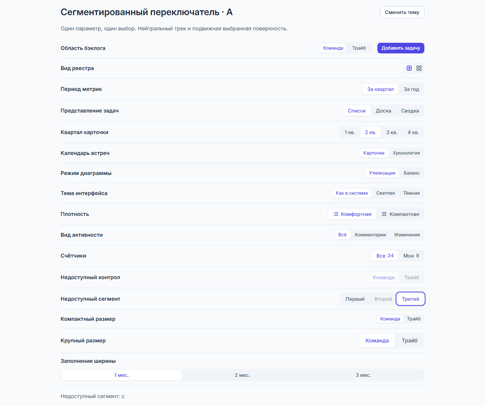
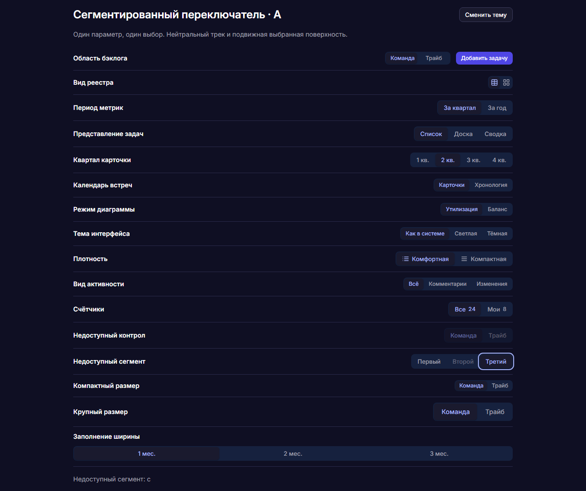
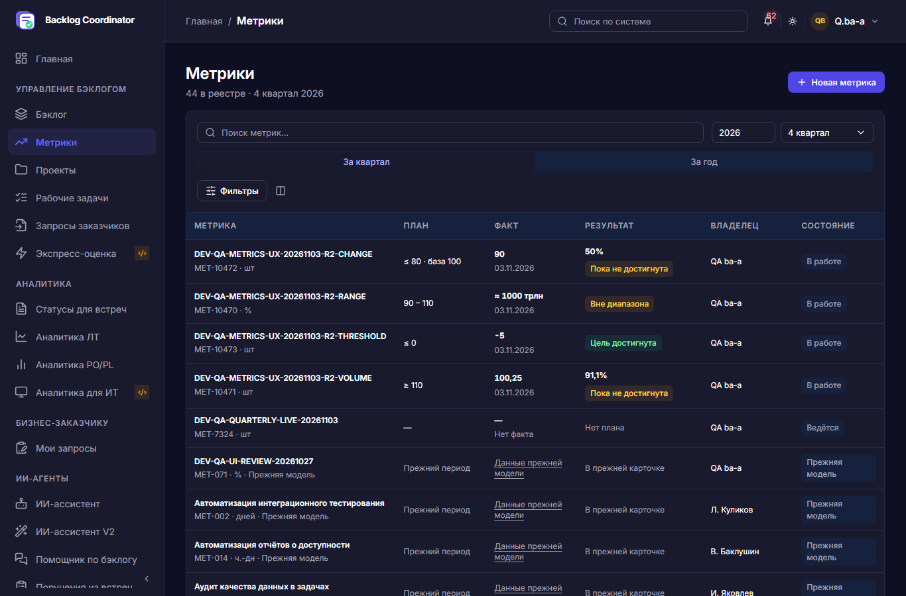
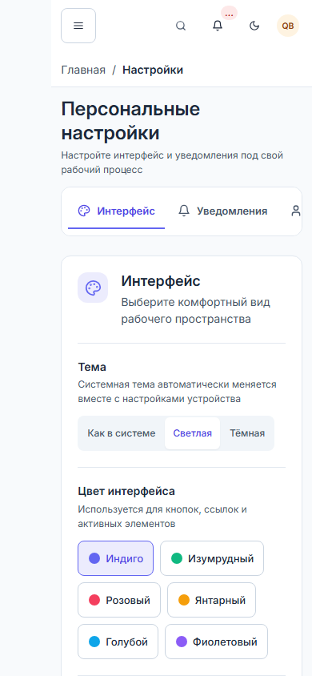

# Внедрение сегментированного переключателя А

Проверено 04.11.2026. Пользователь выбрал вариант А и разрешил внедрение по
системе. [Контракт и полная матрица применения](../../dmb-backlog/docs/SEGMENTED_CONTROL.md).

## Результат реализации

Единая нейтральная подложка, одна подвижная выбранная поверхность, общие размеры
24/28/32/40px и сенсорные цели от 44px. Старые локальные selected-стили удалены.
Двенадцать групп в десяти потребителях используют общий генератор; SPA runtime
обслуживает lazy-монтаж, диалоги, resize и контролируемый выбор. Клавиатура:
один вход по Tab, Left/Right, Home/End, сохранение фокуса при перерисовке.
Отказ или ошибка доменного действия не меняют выбор оптимистично.

Реестр и карточка используют существующие композиции проекта. Вкладки разделов,
независимые фильтры, вкл/выкл, палитры и решения с последствиями оставлены своим
семействам по семантике; это не пропущенные сегменты.

API, права, схема данных и правила сохранения не менялись. Живые проверки —
готовые QA-сессии, чтение и смена локального представления; изменение рабочих
и защищённых записей заблокировано в проверочном браузере. Автосохранение месяца
старта использует прежний обработчик и не испытывалось записью в живую БД.

## Функциональность

- Общий компонент и полная SPA: 9/9 PASS — обе темы, 320/390/1280px, иконки,
  disabled, клавиатура, resize, контролируемый отказ, reduced motion,
  forced colors, освобождение observers, бэклог и смена вида встреч.
- Дополнительный сценарий текущей карточки: 1/1 PASS — фильтры активности
  сохраняют черновик комментария и не выполняют запись.
- Потребители: в общем прогоне 100/110 PASS. Найденный дефект сенсорной цели
  исправлен (40 → 44px); отдельная повторная проверка 1/1 PASS.
- Девять сценариев `workVisualReview.spec.mjs` остаются незелёными: они ищут
  старую `.work-card-title`, свойства и вкладку активности, тогда как fixture
  открывает текущий редактор (`can_edit:true`). Они не заменены более слабыми
  проверками; актуальный фильтр активности проверен отдельно.
- Релевантные проверки токенов, владения компонентом, экспортов и канонических
  UI-импортов: 13/13 PASS. Генерируемые реестры обновлены и проверены.
- Общий unit-прогон не объявлен зелёным: сохраняются несвязанные контрактные
  расхождения документов/таблицы, нестабильный performance-критерий и ошибки
  `VirtualAlloc failed` при недостатке памяти. Его результат не подменён
  успешными точечными проверками.

## Визуальная оценка

Осмотрены полные экраны, обе темы, настольная и мобильная ширины. Общий вид А
применён к областям, периодам, представлениям, плотности/теме и месяцу старта.
Светлая выбранная поверхность и акцентный текст отделяют выбор от основной
кнопки действия. Каталог показывает все размеры и состояния:

Живые примеры с реальными данными:

Живой компонент наблюдался в обеих темах на бэклоге, метриках, рабочих задачах,
настройках, экспресс-оценке и квартальном обновлении. Для встреч есть первоначальный
живой снимок готовой панели, однако повторная live-проверка переключения не
завершилась: панель оставалась в «Загрузка отчётных встреч…». Смена представления
и возврат фокуса подтверждены отдельным полным SPA-сценарием с изолированным API.
V1-метрики и все состояния квартальной карточки не объявляются live-принятыми.

`test:design`: сначала собраны и осмотрены полные снимки (10/10 сценариев PASS
в режиме capture). Объяснённый diff внедрения: исчезла рамка группы представлений,
высота панели уменьшилась на 8px; мобильный select сохранён. После осмотра
эталоны обновлены, прогон обновления — 10/10 PASS. Каталожные эталоны также
сверены с уже существующим блоком «Узкие рабочие поверхности»; сам блок не
добавлялся этой поставкой.

Обычная повторная screenshot-регрессия остаётся открытой: обнаружен новый diff
в строках рабочих задач — моноширинные ID и однострочное обрезание длинного
названия вместо прежнего переноса. Сам переключатель на полном diff совпадает.
Повторно эталоны ради зелёного результата не обновлялись. Часть общего прогона
также прерывалась нехваткой памяти и удалением файлов трассировки; успешные
точечные проверки затем выполнены последовательно в отдельном `.runtime/`.

## Соответствие UI Kit и ограничения

У компонентов один владелец внешнего вида — `ui/segmented.css`. Размеры и палитра
берутся из действующих токенов; высота считается по всему контролу, включая
подложку. Для четырёх кварталов используются короткие подписи и полные доступные
имена. Проверены скрытие, disabled, клавиатура, reduced motion и forced colors.

Impeccable detect отмечает импортированные правила общего production CSS
(Inter, действующий индиго, старые акценты и анимации других семейств). Это не
основание менять согласованный шрифт или палитру в данной задаче. Новых подобных
правил переключатель не вводит. Локальные Markdown-ссылки профильных документов
проверены, 9 документов без несуществующих целей.

Внедрение семейства выполнено. Полная продуктовая UX/UI-приёмка всей системы
не заявляется; перечисленные ограничения регрессии и live-покрытия остаются
открытыми независимо от успешных проверок компонента.
