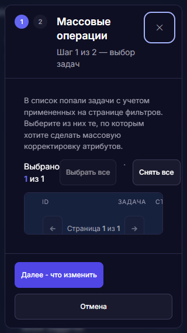
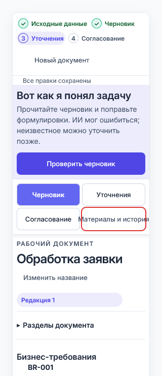

# Аудит типографики UI kit — 19.10.2026

Статус: **решения T01–T11 приняты; выбран комплектный JetBrains Mono, B01 включён в исправления**.
При исходном диагностическом прогоне продукт не изменялся. Выполненные после
согласования изменения и фактические результаты проверок фиксируются отдельно:
[исправления и повторное ревью](UI_TYPOGRAPHY_FIXES_2026-10-19.md).

## Заключение

Общий Inter и общие контролы не означают единую типографическую систему.
На реальных модулях остаются локальные шкалы размеров, насыщенности,
заголовков диалогов и мелких подписей. Часть различий может быть предметно
оправдана; их нельзя автоматически исправлять одним глобальным правилом.

## Метод и границы

- Исходная инвентаризация: 113 поверхностей `migration-matrix.json`, 38 связанных
  браузерных наборов. Сценарии выполняются на реальных модулях с изолированными
  ответами API; защищённые данные БД не изменяются.
- Отдельный диагностический слой сохраняет вычисленные семейство, размер,
  насыщенность, начертание, межстрочный и межбуквенный интервалы, размеры,
  переполнение, текст и контекст экрана/диалога. Скрытые элементы не принимаются
  за визуальные находки. Промежуточные значения анимации не считаются шкалой.
  Демонстрационные `/ui-catalog/` и `/modal-catalog.html`, искусственный триггер
  диалога и элементы Reference исключаются из реестра продуктовых расхождений.
  Проверка загрузки шрифта на каталоге приводится отдельно как контроль файла
  шрифта, а не как доказательство состояния конкретного экрана приложения.
- Сравнение штатных эталонных изображений отключено только в диагностических
  копиях тестов: Chromium-эталон не является эталоном Firefox/WebKit. Исходные
  тесты и изображения не меняются. Проверки выполняются мягко, а в облегчённом
  сборщике их нарушения записываются отдельно от завершения сценария, чтобы
  продолжать сбор состояний без перезапуска браузера после каждого наблюдения.
  **Завершение диагностического сценария не означает регрессионный PASS.**
- Chrome 154.0.8037.99, Edge 155.0.4283.62, Playwright Firefox 155.0,
  Playwright WebKit 26.6. Установленный пользовательский Firefox 158.0
  не подменяется в отчёте протестированной сборкой Firefox 155.0.
- **WebKit на Windows не подтверждает Safari на macOS/iOS.** Также не проверены
  системные окна выбора файлов и нативные выпадающие списки ОС.
- Firefox не поддерживает `hasTouch` в этом инструменте: такие контексты
  исполняются без эмуляции touch. Их результаты не доказывают работу Firefox
  с coarse pointer. Ширина 320/390 px означает проверку узкого viewport.
- Проверки `CSS zoom` не выдаются за нативное увеличение браузера или настройку
  размера системного шрифта. Применимые варианты тем/плотности/размеров задаются
  исходными сценариями, полного декартова произведения нет.
- Живой QA-стенд при проверке статуса: backend process=running,
  health=unreachable; вспомогательные сервисы остановлены. PostgreSQL и Redis
  healthy. Этот прогон не заменяет живой проход под QA-учётными записями.

## Решения по обнаруженным различиям

Ниже перечислены группы решений. Измеренные места приложены отдельным
реестром; примеры не объявляются единственными вхождениями.
Главный заголовок диалога и заголовки его внутренних разделов — разные роли;
предложение унификации не означает одинаковый размер у них обоих.

| ID | Различие и примеры | Рекомендуемое решение | Альтернатива |
|---|---|---|---|
| T01 | Содержательные подписи 8–10.5 px: компетенции и шкала загрузки экспресс-оценки — 8 px; готовность/результат недели — 9 px; предупреждения и метаданные помощников — 9–10 px. Инициалы аватаров — отдельная декоративная роль. | Подписи и метаданные от 12 px; 11 px только для явно согласованных плотных таблиц; декоративные счётчики оценивать отдельно. | Сохранить плотную шкалу, перечислив допустимые роли 9–11 px. |
| T02 | Помимо токенов 400/500/600/700 используются 550/650/750/800/900: помощник по бэклогу, директорский и недельный отчёты, карточка задачи. Variable Inter поддерживает промежуточные веса — это не отсутствие шрифта. | Согласовать короткую семантическую шкалу и убрать случайные локальные веса. | Оставить дополнительные веса с документированными ролями. |
| T03 | Заголовки окон: «Закрыть без сохранения?» — 14/600; завершение экспресс-оценки — 17/600; обычные окна — 18/600; конфликт версий — 18/700; редактор требования — 20/600; клиенты ДИД — 24/600; карточка задачи — 20/800. Интервалы также отличаются. | Утвердить роли: компактное подтверждение, обычный диалог, большое рабочее окно. Общие заголовки 18/600; исключения по роли. | Сделать все заголовки окон одного размера либо сохранить текущие адресные исключения. |
| T04 | Кнопки этапов V2 («Черновик», «Уточнения», «Согласование», «Материалы и история») меняют вес 500→600 при выборе. Общие кнопки используют 500. | Выделение выбранного состояния цветом/фоном; вес 500 сохранять. | Объявить эти элементы навигационными вкладками с отдельной ролью 600. |
| T05 | `--font-mono` объявляет JetBrains Mono/Fira Code, но комплектных файлов нет. Результат зависит от системной замены; отдельные участки задают Consolas явно. | Выбрать один комплектный моноширинный шрифт с лицензией и единый токен. | Явно разрешить системный monospace либо использовать Inter для идентификаторов. |
| T06 | Пустые разделы требований и некоторые пустые значения оформлены курсивом, но `fonts.css` содержит только normal Inter. Браузер может синтезировать наклон. | Для служебного пустого текста использовать прямое начертание и вторичный цвет. | Добавить настоящее курсивное начертание и проверить его во всех движках. |
| T07 | У страниц собственные шкалы заголовков, включая 19/21 px, дробные rem-значения и адаптивные размеры; общие страницы используют другую роль. | Общие заголовки страниц привязать к единой роли, заголовки документа/аналитики выделить отдельно. | Сохранить разные композиции с явной таблицей исключений. |
| T08 | Часть подписей аналитики и аватаров имеет `line-height: normal`, остальные — числовой интервал. Высота normal зависит от шрифта и движка. | Читаемому тексту задать числовые роли интервалов; аватары и декоративные метки отдельно. | Допустить normal в перечисленных ролях после сравнения браузеров. |
| T09 | `requirementWorkspace.html:4` принудительно ставит Arial поверх базового Inter. Это дефект достоверности тестового стенда, а не доказательство Arial в рабочем приложении. | Привести стенд к шрифтам приложения и повторить проверки. В текущем аудите дополнительный прогон подменяет только тестовый HTML-ответ. | Отдельно поддерживать сценарий fallback Arial, не использовать его как основной эталон. |
| T10 | Многоточия и прокрутка текста требуют различать допустимое сокращение ID/заголовка и потерю инструкции/ошибки. Автоматические размеры дают кандидатов, а не готовый список дефектов. | Важные инструкции/ошибки переносить; сокращённые значения должны раскрываться доступным способом. | Разрешить сокращения в явно перечисленных плотных ролях. |

| T11 | Автотема без data-theme при светлой ОС сохраняет часть светлых текстовых цветов от тёмной палитры. В требованиях контраст подписей ниже 4.5:1. | Дополнить семантические цвета автотемы и проверять auto/light/dark отдельно. | Требовать явную тему на всех входах и исключить auto как поддерживаемый режим. |

### Предлагаемый контракт для решения

Это предложение, **не применённое к продукту**. Размер / вес / межстрочный
интервал указаны в px, кроме самого веса. На узких экранах текст переносится;
уменьшение шрифта ради сохранения строки не используется.

| Роль | Размер / вес / интервал | Уточнение |
|---|---|---|
| Заголовок страницы | 24 / 600 / 30 | Текущая общая роль UI kit. |
| Короткое подтверждение | 16 / 600 / 22 | Отдельная роль вместо случайных 14 px. |
| Обычный диалог | 18 / 600 / 24 | Единая роль для общих форм и подтверждений. |
| Большое рабочее окно | 20 / 600 / 26 | Карточка задачи и большие редакторы; заголовок задачи может иметь согласованную роль 700. |
| Основной текст | 14 / 400 / 21 | Инструкции, ошибки, содержательные сообщения. |
| Подпись поля | 12 / 500 / 18 | Обязательность и ошибки не передаются только весом. |
| Кнопка / поле | 13 / 500 или 400 / 20 | Сохранить текущие общие роли; навигацию выделить отдельно. |
| Метаданные | 12 / 400 / 18 | Роль 11 px допустима только в согласованных плотных таблицах. |

Для KPI, кода, идентификаторов и декоративных счётчиков нужны именованные
исключения. Они не должны незаметно менять типографику основного текста.
Диаграммы также требуют явного решения: в графе зависимостей аналитики
`analytics.js` подписи узлов имеют 11 px / 500, подписи рёбер — 9.5 px / 600.
Шкалы и часть легенд Chart.js в `reports.js` используют 11 px. Это отдельные
canvas-подписи; обычный обход DOM их не измеряет. Рекомендуется согласовать
для диаграмм минимум 11–12 px и проверить размещение подписей после изменения.

## Межбраузерное измерение Inter

### Подтверждённый случай T10.1: массовые операции, 320×568

В `modal.js` строки и шапка списка задач используют сетку
`22px 130px 1fr 150px 120px`. На узком экране колонка названия сжимается
до 16 px при ширине текста около 524 px. На снимке строки задач не читаются;
увеличение размера самого шрифта проблему не решает. Это риск выбора
неверных задач перед массовым изменением.

Рекомендуется мобильное представление карточками: checkbox, ID и полное
название в доступной строке. Альтернатива — переработанная таблица с
достаточной высотой и явным раскрытием названия. **Требуется выбор решения.**

### Случай T10.2: действие «Материалы и история», 320 px

При 320×740 и явной светлой теме границы самого текста измерены через DOM Range:
Chrome/Edge — текст 140.69 px при кнопке 125 px; Firefox — 140.67/125 px;
WebKit — 140.68/121 px. Надпись выходит за рамку на 7.83–9.84 px с каждой
стороны. Это не только потеря внутренних отступов: глифы действительно
выходят наружу. overflow:visible сохраняет текст видимым, поэтому случай
не следует описывать как обрезание. Вес 500; проблема есть во всех четырёх движках.

Рекомендуется отдельная полная строка для этого действия. Альтернатива —
разрешённый перенос надписи внутри общей сетки навигации. Размер шрифта
уменьшать не рекомендуется. **Требуется выбор решения.**

Снимок обновлён: Inter, явная светлая тема; красная рамка добавлена только
для обозначения границы кнопки. Исходный продукт не изменён.

### T11. Контраст текста в автотеме

При отсутствии data-theme и светлой системной теме измерены цвета текста
и послойно смешанный фон. Контраст: ✓Исходные данные: auto 1.4:1 / light 7.13:1; ✓Черновик: auto 1.4:1 / light 7.13:1; 3Уточнения: auto 1.72:1 / light 5.41:1; 4Согласование: auto 2.56:1 / light 7.58:1; Редакция 1: auto 1.72:1 / light 5.41:1; Ещё 16 разделов: auto 1.99:1 / light 6.29:1.
Это поддерживаемая CSS-ветка auto, воспроизведённая на стенде требований
во всех четырёх движках. Явная светлая тема использует другие семантические
цвета. Результат не означает, что штатная светлая тема приложения сломана.
Порог 4.5:1 взят из существующих проверок проекта для обычного текста;
это адресное измерение, а не сертификация доступности всего продукта.

### Фактические метрики шрифта

Контрольная строка содержит полный русский алфавит с Ё/ё, латиницу, цифры,
№, ₽ и стрелку. Inter загружается во всех четырёх движках; проверены веса
400/500/600/650/700/750/800. В Chrome/Edge дополнительно получены реальные
platform fonts для глифов: Inter Variable, custom font.

При 16 px и весе 400 ширина контрольной строки: Chrome/Edge 906.328 px,
Firefox 906.417 px, WebKit 912 px. У Inter в этих сборках возможны различия
метрик. Само числовое расхождение не объявляется визуальным дефектом;
важны переносы, читаемость и доступность действий.

Отдельное решение по приёмке: допускаем небольшие различия метрик при сохранении
читаемости или требуем одинакового переноса в перечисленных критичных местах.
Нативный Safari остаётся отдельным незакрытым пунктом.

## Результаты и материалы

### B01. Попутный дефект модального состояния, не типографики

В испытательных Firefox 155.0 и WebKit 26.6 сценарий повторного закрытия
изменённой формы размещения запроса после «Продолжить редактирование»
останавливается: родительский нативный `dialog` перехватывает клик по
«Закрыть без сохранения». Зафиксировано в Firefox на dark/1440×900 и в
WebKit на light/640×360, в исходной последовательности действий без force-click.

В `confirmAction()` контейнер выбирается через
`document.activeElement.closest('dialog[open]')`, а после закрытия первого
подтверждения фокус восстанавливается в `requestAnimationFrame`. Это даёт
объяснение симптома: при временном фокусе на body следующее подтверждение
может попасть вне активного нативного диалога. Причину следует закрепить
адресной регрессией; подменять её предположением о дефекте Firefox нельзя.

Рекомендуемое решение: надёжно определять владельца активного модального
окна независимо от текущего фокуса и проверить повторное открытие во всех
движках. **Требуется решение, включать ли это исправление в следующий пакет
вместе с типографикой.** Продукт в текущем аудите не исправлялся.

Повторный адресный прогон подтвердил гонку также в Chrome: overlay оказался
дочерним BODY, hit-test попадал в SELECT под ним, клик заблокирован.
В Firefox тот же результат; в текущем повторе Edge/WebKit подтверждение
попало внутрь DIALOG и сработало. Ранее WebKit воспроизводил блокировку.
Это зависимость от времени восстановления фокуса, а не постоянная
особенность конкретного движка. Данные: [адресные измерения](evidence/typography-2026-10-19/reproduced.json).

### Итог покрытия и проверок

- Матрица: 113 поверхностей, 38 наборов, по 448 исходных сценариев на движок.
  Снимки получены для 448/448 Chrome и Edge, 447/448 Firefox и WebKit.
  Отсутствующие исходные сценарии требуют неподдерживаемого clipboard-read;
  два дополнительных прохода проверили отображение состояний с имитацией
  буфера, без утверждения о работе нативного буфера.
- Дополнительные сценарии с Inter и повторные случаи Chrome/Edge: 78 завершены.
  Отдельная галерея: 23 настоящих модальных формы × 4 движка = 92 снимка.
- В облегчённом заключительном сборе завершены 606 из 610 сценариев;
  четыре остановки разобраны: две clipboard-read, одна навигация автосохранения
  WebKit без достигнутой кнопки закрытия, один B01. Пропуск навигационного
  состояния остаётся ограничением покрытия, а не доказанным дефектом шрифта.
- **8 строгих исходных тестов загрузки Inter в ECharts/Chart.js прошли**:
  по два в Chrome, Edge, Firefox и WebKit. Диагностические мягкие проверки
  и количество собранных снимков не выдаются за регрессионный PASS.
- Контрольный манифест: 159 файлов исходников/шрифтов/стендов, изменений
  продуктовых исходников в ходе этого аудита нет.

[Визуальный реестр всех измеренных мест](evidence/typography-2026-10-19/index.html) ·
[92 снимка модальных окон](evidence/typography-2026-10-19/dialogs.html) ·
[Покрытие по сценариям](evidence/typography-2026-10-19/coverage.md) ·
[Манифест исходников](evidence/typography-2026-10-19/source-manifest.json).

Реестр содержит повторения состояний и кандидатов для сравнения; его числа
не являются количеством независимых дефектов. В T03 есть внутренние
заголовки разделов; в T10 — допустимые сокращения. Решения принимаются
по подтверждённым случаям в этом отчёте, а не массово по селектору.
Например, scrollWidth кнопки «Отправить снова» в Firefox превышал clientWidth,
но Range подтвердил, что текст находится внутри рамки; обрезание исключено.
Заголовки таблиц при стабильном подключённом DOM во всех движках: высота40 px,
текст12/600, интервал букв0.48 px. Прежние нулевые размеры отсоединённых
узлов исключены из находок.

### Что требуется для полной приёмки

Нужны решения по T01–T11 и B01, затем исправления и строгие регрессии.
Также остаются живой проход под QA-учётками после восстановления health
локального приложения, нативный Safari macOS/iOS, пользовательский Firefox158,
нативные системные контролы и масштаб браузера. До этого формулировка
«все экраны и основные браузеры полностью проверены» была бы недостоверной.

**Решения получены:** рекомендации и шкала приняты; выбран комплектный
JetBrains Mono, B01 включён в исправления. Небольшие различия метрик
допускаются при сохранении читаемости и доступности действий.
Результаты после согласования — в [повторном ревью](UI_TYPOGRAPHY_FIXES_2026-10-19.md).
