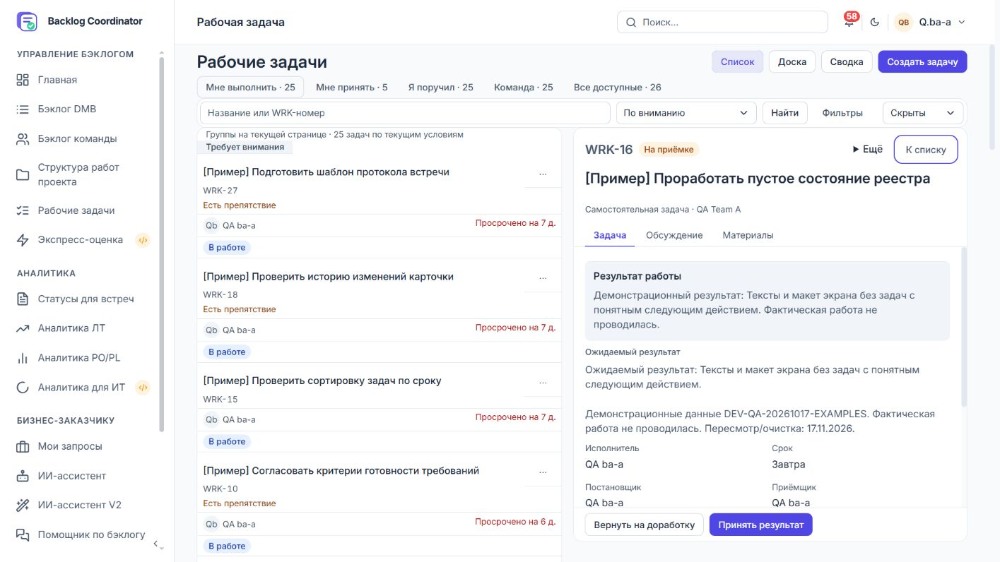

# Доработки рабочих задач по дизайн-ТЗ

Дата проверки: **21.10.2026**. Статус: реализована основная UI-поставка;
полная приёмка всех 32 критериев ТЗ не объявляется закрытой.

Основание: [аудит](../work-tasks-design-proposal.md), [ТЗ](../work-tasks-redesign-spec.md).
Текущие контракты: [рабочие задачи](../../dmb-backlog/docs/WORK_TASKS.md),
[доска](../../dmb-backlog/docs/WORK_BOARD.md).

## Реализовано

- Общие режимы, компактная оболочка, атомарные фильтры, чипы, поиск с задержкой
  и немедленным Enter. Сброс не меняет подборку и режим.
- Различение отсутствующего значения, исключённой метрики и настоящего нуля.
- Пять колонок списка, компактные строки, нейтральные названия, сокращённые
  даты с полной доступной подписью, приёмщик, меню и сохранение серверного порядка.
- Четыре активные колонки доски, явное включение выполненных и периода,
  отсутствие pager на единственной странице, мобильный выбор колонки.
- Общая карточка для чтения, результат перед свойствами при приёмке/выполнении,
  свойства после описания, отдельный редактор препятствия, редкие команды в меню,
  материалы и переключатель истории/комментариев.
- Создание с командой и приёмкой на первом экране, выбор вида контекста,
  шаблоны с подтверждением заменяемого содержимого.
- Сохранение экземпляра редактора при изменении ширины и режима, сравнение
  версий при 409 с явной повторной записью, защита открытого меню от SSE.
- Вычисляемые API-проекции next_step/readiness/summary_states и проверка
  принадлежности выбранной задачи текущему списку. Миграций БД нет.
- [Каталог реальных компонентов](../../dmb-backlog/frontend/ui-catalog/work-tasks.html)
  с длинными русскими строками, выбранностью, приоритетами и состояниями действий.

## Проверки

Playwright: общий прогон семи наборов дал **116 PASS / 1 FAIL** из 117.
FAIL был гонкой теста: Escape отправлялся до снятия aria-busy после перехода.
Добавлено ожидание окончания записи. Повтор двух затронутых наборов подтвердил
все прежние 32 сценария; новая проверка Back/Forward сначала выявила перекрытие
основной области боковой панелью только в тестовой оболочке. После задания
отступа оболочки новая проверка прошла. Итого **118 различных сценариев PASS**
по совокупности общего и адресных повторных прогонов, а не один чистый прогон 118.

Наборы: `workWorkspace`, `workPagesUx`, `workTaskDrawer`, `workRedesign`,
`workSplitWorkspace`, `workBoard`, `workProductivity` в `frontend/e2e`.
Проверены адаптивные размеры 320/390/768/1024/1280/1440/1920 и обе темы;
мобильный бюджет первого элемента доски измеряется отдельными assertions.
Конфликт проверяет отсутствие автоматической повторной записи и новую version.
Back/Forward проверяет восстановление выбранной карточки без мутаций.

Backend: **16 PASS** (`work_tests/test_work_board.py` и
`work_tests/test_work_presentation.py`) через проектный `.venv`.
Изолированные тесты не создают пользователей, роли, команды или справочники.
Живая PostgreSQL не подменялась SQLite.

Живой smoke: готовый QA ba-a, чтение списка на локальном приложении;
проверены подписи сроков, имена принимающих и компактная оболочка.
Дополнительно открыта карточка приёмки: результат расположен первым. Живой
обзор выявил сжатие строк в двухпанельном режиме; исправлен display таблицы
и tbody, добавлена проверка ширины строки и ячейки. Повтор 33 сценариев
`workRedesign`/`workSplitWorkspace` и адресная проверка геометрии — PASS.

Backend перезапущен отдельно с `RUN_STARTUP_SEED=false`, health-check вернул ok.
Защищённые и обычные рабочие записи живой БД в этом прогоне не изменялись.
Ролевые прогоны из прежних отчётов не считаются повторной приёмкой нового UI.

## Незакрытая полная приёмка

| Область | Что остаётся подтвердить/доставить |
|---|---|
| AC-03, 20, 22 | Полная матрица восстановления фокуса/прокрутки после маршрутизации, недоступный sessionStorage и внешнее закрытие вкладки |
| AC-09, 16, 18 | Все комбинации нескольких сигналов, недостающих условий, возвращённого результата и участника на живой ролевой матрице |
| AC-23–26 | Повтор live offline/курсор/смена даты/отзыв ACL и всей ролевой матрицы на новой поставке |
| AC-27–29 | Полная визуальная приёмка 200%, touch, экранный диктор и измерение контраста всех состояний; автотест overflow не заменяет её |
| AC-31 | HTTP p95, 10 параллельных читателей, 10 000 работ и ресурсный профиль — нагрузочный критерий не закрыт |
| AC-32 | Отдельный флаг отката визуальной поставки и проверка возврата старого совместимого интерфейса не реализованы; существующий флаг канбана решает другую задачу |
| Пилот | Исследование с 5–8 участниками и замер целевых пользовательских сценариев не проводились |

Текущий откат требует предыдущего проверенного frontend-артефакта. Новые
API-поля аддитивны, данные/история не мигрируются и при откате не удаляются.
Откат локально не выполнялся; отсутствие миграции само по себе не закрывает AC-32.

Коммит не создавался. В рабочем дереве есть многочисленные изменения,
существовавшие до этой задачи; их нельзя включать в поставку автоматически.
