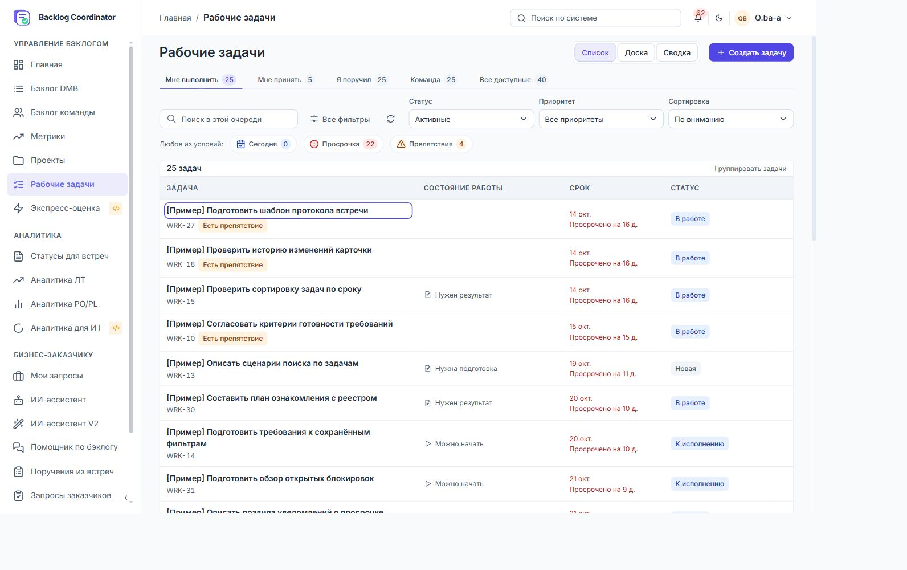
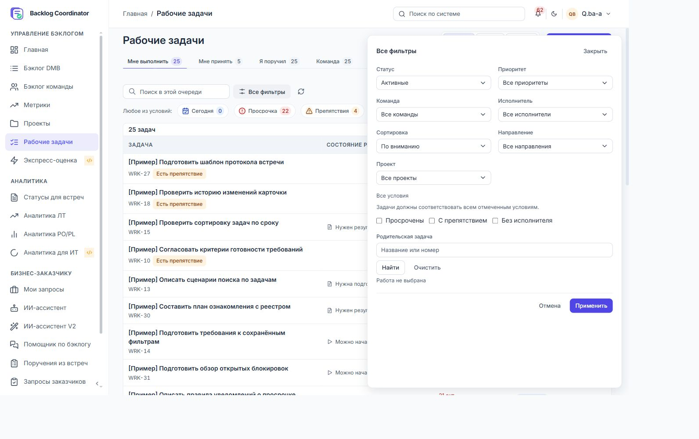
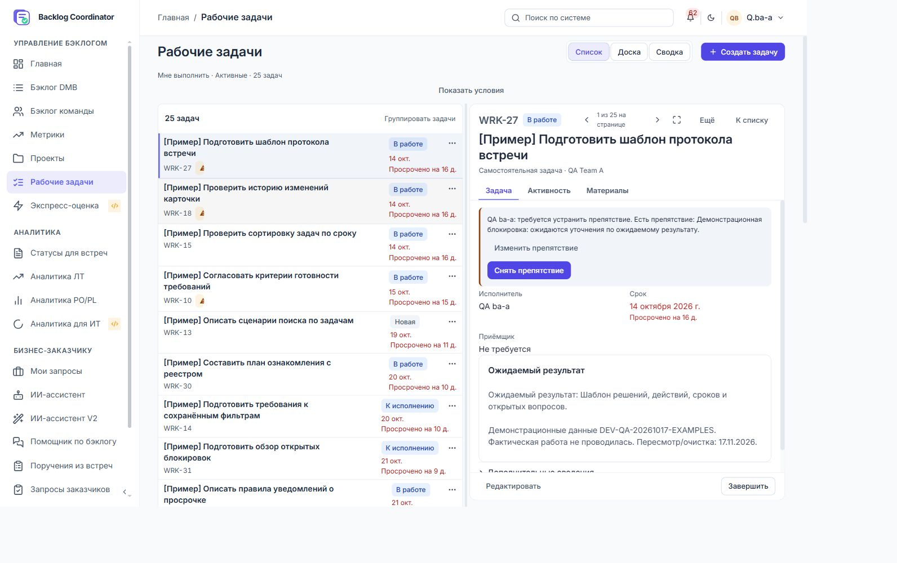
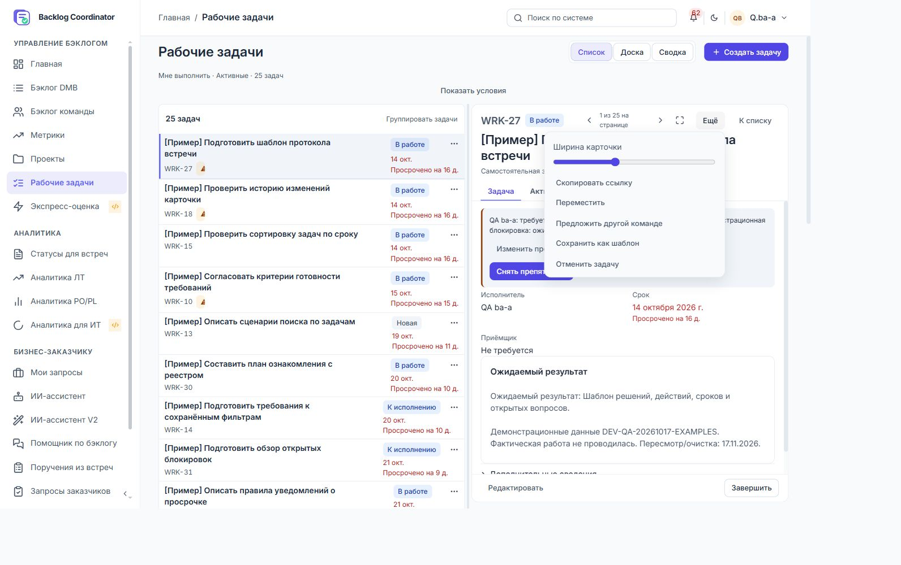
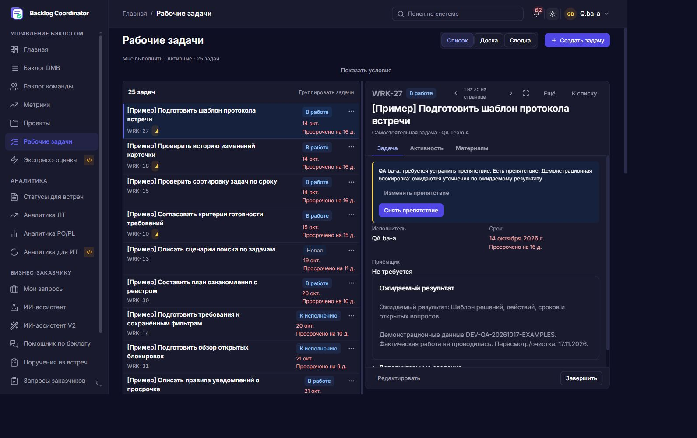
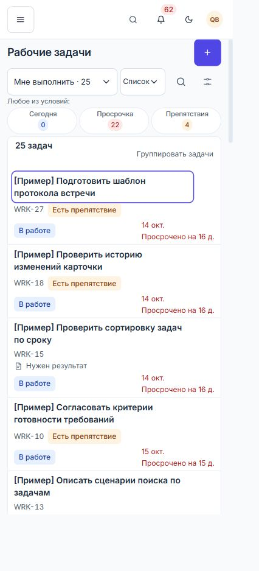
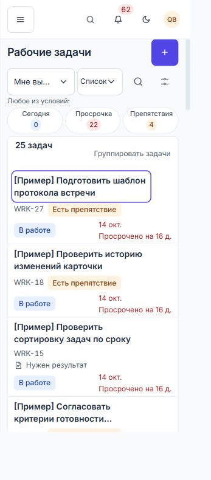
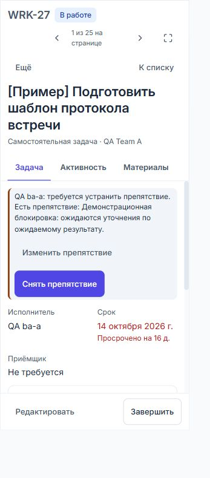
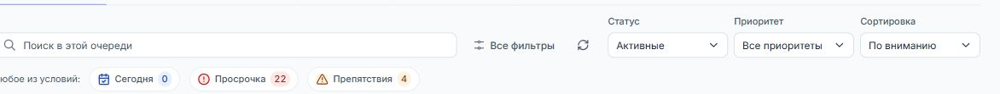
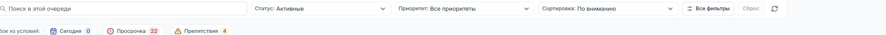

# Исправления визуального ревью рабочих задач — 30.10.2026

Статус: изменения V01–V28 реализованы. Это отчёт о поставке и адресной
повторной проверке, а не полная приёмка всех ролей и сценариев раздела.
Исходные наблюдения сохранены в [ревью](WORK_TASKS_VISUAL_REVIEW_2026-10-30.md).

## Изменения

| ID | Реализация | Основание повторной проверки |
|---|---|---|
| V01 | Текст просрочки использует `danger-text`, включая дополнительную строку срока | Расчёт фактической пары цветов выделенной строки в обеих темах в `workVisualReview` |
| V02 | Все фильтры открываются поверх очереди; панель имеет собственную прокрутку и закреплённое применение | Автотест координат; в живой оболочке сдвиг 0 px, восемь полных строк |
| V03 | Инспектор получает компактную строку: название, контекст, сигнал, статус и срок | Автобюджет 88 px; живые первые строки 74,70–80,72 px |
| V04 | «Ещё» использует общий ActionMenu/Popover, закрывается после команды и по Escape | Автотест и живой замер: заголовок и вкладки сдвинулись на 0 px |
| V05 | Название и создание объединены; очередь и представление находятся рядом, поиск раскрывается кнопкой, хлебные крошки скрыты на телефоне | Живой экран 390 × 844: первая строка на 281,41 px, четыре полных записи |
| V06 | Тон предупреждения отделён от отступов; свойства имеют одинаковые строки подписи и значения | Автотест обеих тем; живые дельты подписи и значения 0 px |
| V07 | Календарная дата с годом показана постоянно; относительное состояние вынесено ниже | Живой WRK-27 и автотесты сегодня, завтра, прошлый год, отсутствие срока |
| V08 | Ограничены ширины flex/grid-потомков, мобильных контролов и панели фильтров; устранён перенос скрытых подписей в геометрию | Автотест списка, фильтров и возврата из карточки; живой 320 px: scrollWidth 312 px. Маскировка корневым overflow-x:hidden не добавлялась |
| V09 | Частые настольные условия имеют видимые связанные подписи | Проверка геометрии label вместо прежнего требования скрыть его |
| V10 | Над инспектором остаётся подборка, статус, количество и указание дополнительных ограничений | Осмотр живого контекста и регрессия сохранения очереди |
| V11 | Быстрые выборки явно подписаны «Любое из условий», полная панель — «Все условия» | Сохранён тест OR; строка применённых условий объясняет сочетание |
| V12 | Статическая колонка называется «Состояние работы», тексты описательные: «Можно начать», «Нужен результат» | Живой список; действия статуса остаются в меню/карточке |
| V13 | Название списка имеет 14 px / 20 px и вес 600 | Вычисляемый стиль задан последним предметным правилом; снимки обеих тем |
| V14 | Группировка перенесена в заголовок очереди, состояние отражено aria-pressed | Регрессии списка; счётчики групп по-прежнему относятся к текущей странице |
| V15 | Команды изменения и снятия препятствия собраны в одном содержательном блоке; повтор состояния в личной очереди убран | Живой WRK-27; регрессии записи препятствия |
| V16 | Предыдущая/следующая задача и полный экран постоянно доступны в шапке; показана позиция на странице | Тест последовательной навигации, изменения ширины и сохранения контекста |
| V17 | Полный экран ограничивает область чтения; свойства и ожидаемый результат занимают соседние столбцы, на телефоне складываются | Регрессии полного экрана и адаптивности; текст результата ограничен 76ch |
| V18 | Название карточки — 22/28, ID — 13/20, секции — 15/20 | Осмотр живой карточки обеих тем |
| V19 | Просмотр и навигация находятся в шапке, редактирование и решение — в футере, операции препятствия — в его блоке | Регрессии переходов исполнителя, приёмки, возврата и отмены |
| V20 | Фильтры и события предшествуют компактному редактору; «Всё» объединяет комментарии и историю по времени; фокус раскрывает редактор | Тест смешанной ленты и сохранения черновика; регрессия 250 комментариев / 150 событий |
| V21 | До сохранения видна текущая команда и принадлежность; сводка обновляется при выборе; раскрытие называется «Команда и связь с проектом» | Регрессии создания и передачи другой команде |
| V22 | Общая UI Kit-валидация выводит постоянную ошибку, aria-invalid, aria-describedby и сводку; required сохранён | Пустой и пробельный заголовки: отсутствие запроса, исправление ввода |
| V23 | Все три выборки помещены в видимую сетку; короткие названия и отдельный счётчик | Проверка пересечения каждой цели с viewport и контейнером; живые 320/390 px |
| V24 | Мобильное открытие задачи имеет высоту не менее 44 px; меню остаётся отдельной целью | Автотест размера и регрессии открытия карточки/меню |
| V25 | На личной доске собственный исполнитель скрыт; приёмщик и исполнители командной доски сохранены | Адресный тест трёх вариантов ответственного |
| V26 | Каркас показателей одинаков; исключённые выполненные имеют «—» и вторичную команду включения за семь дней; состояния размечены явно | Реализация состояния filtered/unavailable/ready; регрессии переключения статуса и периода |
| V27 | Оболочка: «Поиск по системе»; очередь: «Поиск в этой очереди» с подсказкой при фокусе | Живой осмотр оболочки и очереди |
| V28 | Тесты проверяют видимую область, размеры целей, дельты, контраст и фактическую геометрию, а не скрытые label | Новый `workVisualReview.spec.mjs`, обновлены toolbar/drawer/split/density |

## Доказательства в полной оболочке

Профиль BA `ba-a`, существующие задачи. Вход выполнен штатно; реквизиты,
cookies и токены не сохранялись в доказательства. Данные задач и защищённые
записи БД при живом осмотре не изменялись.

| Экран | Результат |
|---|---|
| 1440 × 900, список | Восемь полных записей; первые строки 60,71–68,70 px |
| 1440 × 900, все фильтры | Верх очереди 280,13 px до и после раскрытия |
| 1440 × 900, инспектор | Первые строки 74,70–80,72 px вместо прежних 103–111 px |
| Инспектор → Ещё | Дельта заголовка 0 px, вкладок 0 px |
| Исполнитель / срок | Одинаковые координаты подписи и значения |
| 390 × 844, список | Первая запись 281,41 px; четыре полных записи |
| 320 × 711, список | Первая запись 281,41 px; три полных записи; scrollWidth 312 <= 320 |

[Структурированные измерения](evidence/work-visual-fixes-2026-10-30/work-visual-geometry.json).
Размеры в таблице — CSS px из DOM, а не физический размер PNG. В браузере
был масштаб 90%; размеры окна подбирались до проверенных innerWidth/innerHeight.

## Проверки и границы

Браузерные регрессии используют подменённый API, включая сохранение, переходы,
комментарии, файлы, черновики и ролевые флаги. Это не записи в живую БД.
Живые снимки и измерения получены отдельно в полной оболочке на PostgreSQL.

Обновлён тест density: бюджет верха списка с видимыми подписями — 360 px
при окне высотой 600 px, минимум четыре полных строки. Старый бюджет 260 px
не соответствует новой композиции; он не выдаётся за выполненный. В фикстуре
получено 351 px и четыре строки на 1440/1280 px. Для проектов исправлена устаревшая
фикстура: теперь она открывает execution и отвечает на workspace, а не ожидает
таблицу рабочих задач в обзоре.

Полная живая ролевая матрица, screen reader, реальный touch, zoom 200%,
конкурентные изменения, все серверные ошибки и нагрузочный канбан остаются
за границей этой поставки, как и в исходном ревью. Автоматическое совпадение
снимка не подменяет визуальную оценку. Дизайнерские изменения V09–V27 реализованы;
их реализация не означает завершения всей продуктовой дорожной карты W01–W72.

Последний общий прогон: **65 PASS, 1 FAIL** (66 сценариев). Все сценарии
`workVisualReview`, `workToolbar`, `workTaskDrawer`, `workSplitWorkspace`,
`workBoardCardDesign` прошли. Общий `workDensity` после смены селектора на
актуальную таблицу UI Kit дошёл до сводки и получил семь строк вместо
прежнего бюджета восьми на 1440 × 600. Это отдельная незакрытая регрессия
плотности `workReports`, не подменённая снижением порога. Для рабочих задач
получены 351 px / четыре строки, без переполнения.

## Повторное исправление панели после замечания пользователя — 30.10.2026

Предыдущая настольная сетка ошибочно растягивала три фильтра за счёт поиска.
У группы условий теперь ограничена общая ширина 480 px; поиск получает
оставшееся место. Если контейнер уже 1040 px, условия переходят на второй ряд.
На живом экране 1440 CSS px ширина поиска составила 439 px, полей — около
155 px каждое. Подписи сохранены, стандартные значения читаются полностью.
Добавлены проверки 1280/1440/1920 px с местом под боковую навигацию и проверкой
вместимости текста поиска. Повторный прогон toolbar + visual review: **29 PASS**.

## Единое оформление с бэклогами — 30.10.2026

По просьбе пользователя панель рабочих задач приведена к образцу DMB и
командного бэклога. Это заменяет промежуточную композицию с подписями над полями
и ограничением группы 480 px, описанную в предыдущем разделе.

Использована общая рамка `filter-panel`: поиск слева, встроенные подписи
«Статус:», «Приоритет:», «Сортировка:» в центре; «Все фильтры», «Сброс» и
обновление справа. Высота контролов — 32 px, живой панели в одну строку —
49,47 px. При контейнере до 1120 px частые условия переходят на второй ряд,
как закреплённые фильтры бэклога. На телефоне сохранены выбор очереди и вида,
раскрываемый поиск и отдельная полная панель; неактивный сброс скрыт.

Регрессии проверяют общую рамку, подпись и значение на одной горизонтали,
вместимость поиска, сброс, применение/отмену фильтров и отсутствие переполнения.
Фикстура учитывает только запросы `/work-tasks`, отделяя их от EntityPicker.
Итоговый последовательный прогон `workToolbar` и `workVisualReview`: **29 PASS**.

