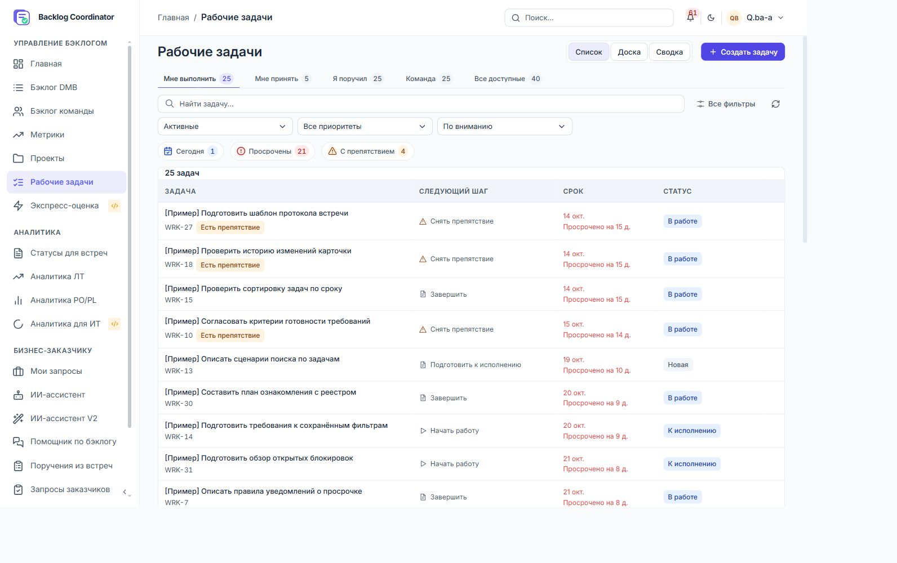
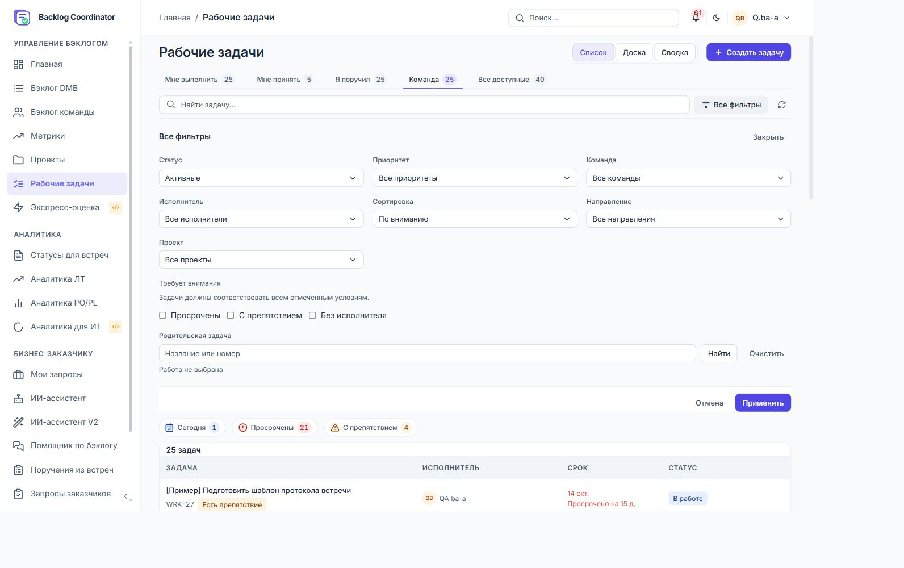
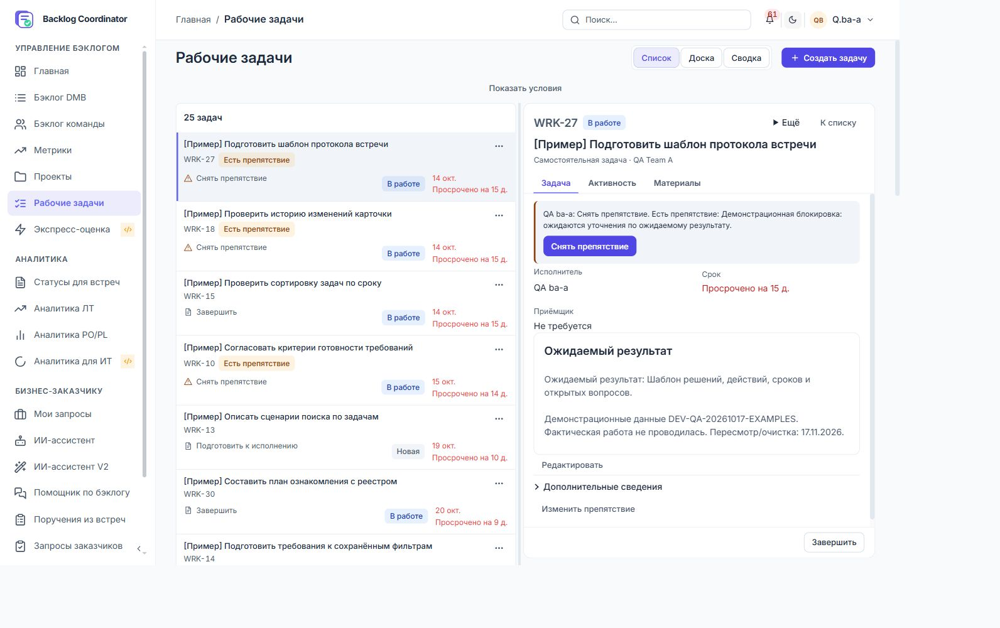
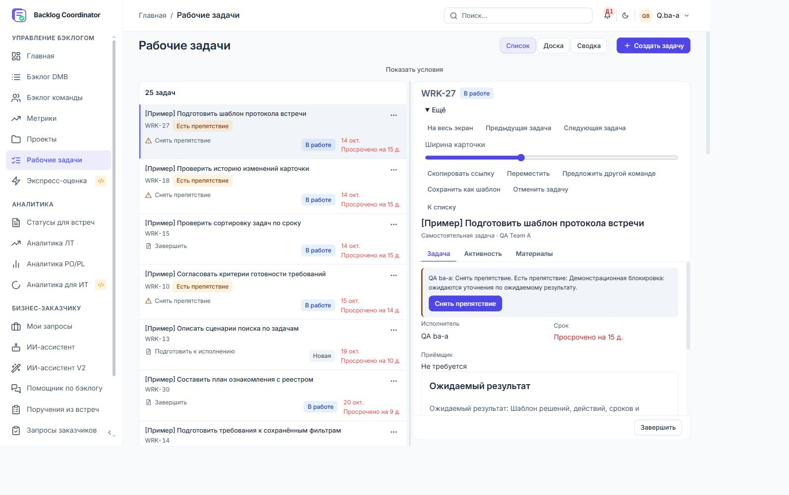
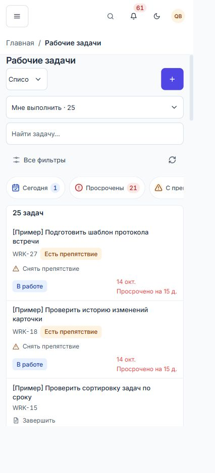
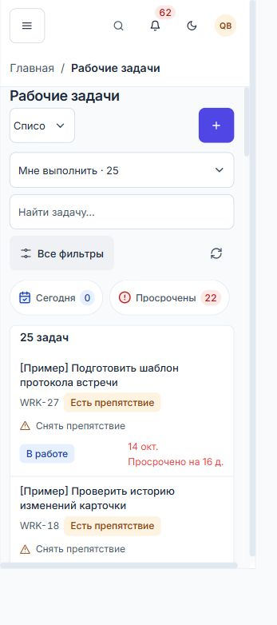
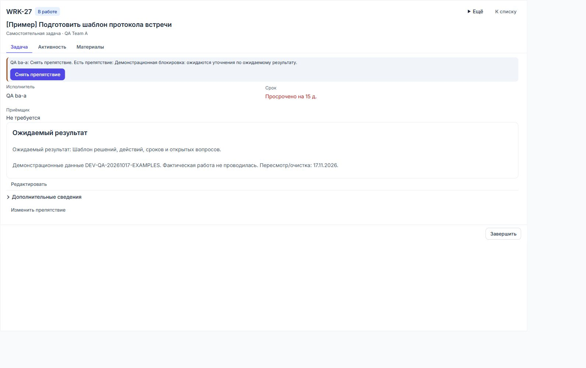
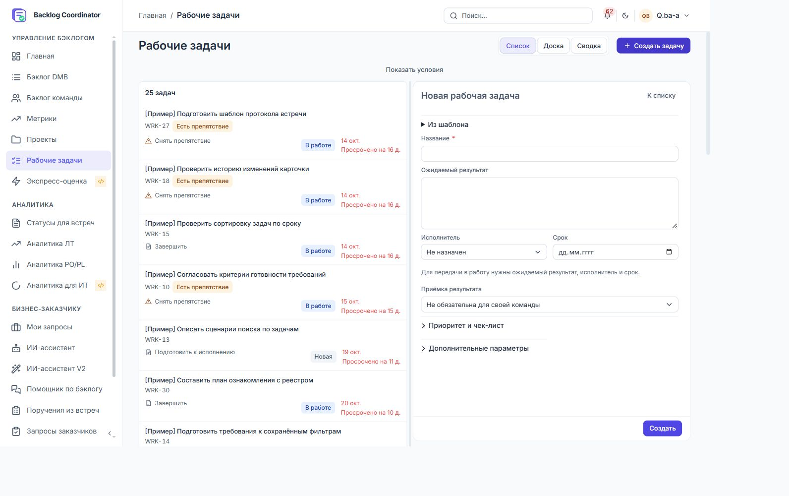
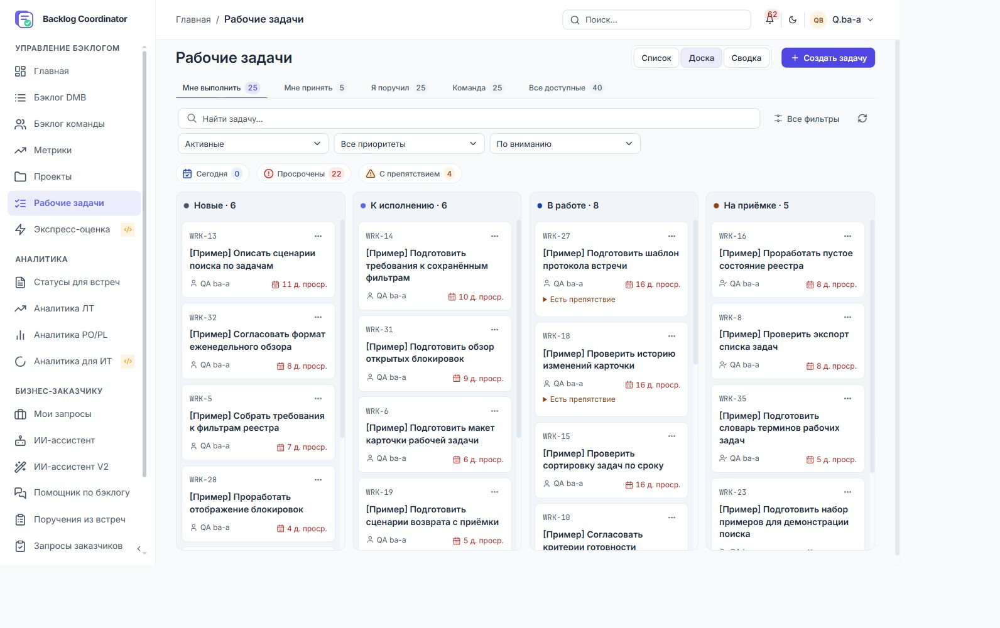
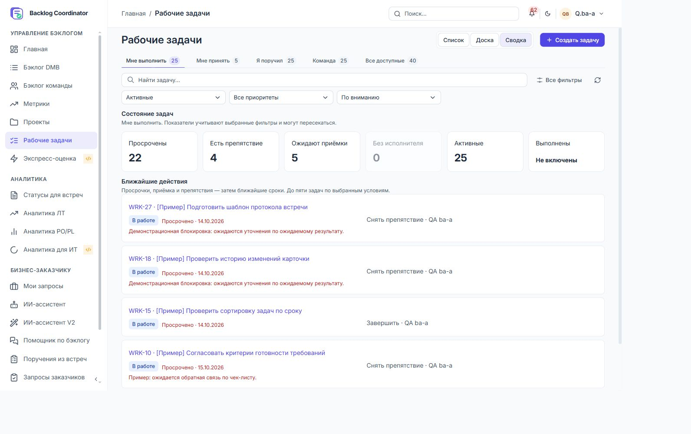

# Подробное визуальное ревью рабочих задач

Рабочие задачи пока не выглядят собранным рабочим местом. Отдельные компоненты в основном аккуратны, но общая композиция перегружена управлением, меняется при открытии задачи и заставляет читать много повторяющихся сигналов. Косметическая смена цветов и скруглений этого не исправит. Главная доработка — организация пространства между очередью, условиями отбора и содержанием задачи.

На вопрос «всё ли расположено ровно?» ответ тоже отрицательный: в свойствах карточки есть измеренное смещение подписей примерно на 4 px и значений на 2 px. При этом сетка раскрытых фильтров действительно ровная. Различать эти два случая важно: основная проблема страницы — композиция и иерархия, а не повсеместно сломанные отступы.

Зафиксировано **28 находок: 6 воспроизведённых дефектов, 20 дизайнерских рекомендаций и 2 замечания по коду и контролю качества**. Приоритеты: **5 P1, 20 P2, 3 P3**. Это визуальный аудит с перечисленным ниже покрытием, а не полная функциональная или межролевая приёмка.

## Область проверки

Проверено живое приложение `http://127.0.0.1:8000`, раздел `#/work-tasks`, под готовым QA-профилем BA/участника команды. Осмотрены личная и командная очереди, канбан, сводка, инспектор, полноэкранная карточка, вкладки задачи, активности и материалов, форма создания, дополнительные параметры, фильтры, пустая выдача и обе темы.

Основные точные размеры браузерной области, подтверждённые `innerWidth` и `innerHeight`: **1440 × 900, 390 × 844 и 320 × 711 CSS px**. Дополнительно осмотрен промежуточный настольный размер **1138 × 853**. Ранние снимки с именами `1440` и `1024` были получены до калибровки средства изменения окна: фактические области составляли 1454 × 909 и 1138 × 853. Для итоговых настольных иллюстраций используются файлы с суффиксом `desktop` и измеренная область 1440 × 900.

Наблюдения начались 29 октября и продолжились после полуночи 30 октября по Москве. Поэтому на снимках одной и той же задачи встречается просрочка 15 и 16 дней, а счётчик просроченных изменился с 21 на 22. Это смена календарной даты, не найденная ошибка счётчика.

Рабочие записи, комментарии, файлы и назначения не сохранялись. Проверка пустой формы остановилась на обязательном поле названия. Защищённые данные не изменялись. Во время аудита сессия штатно истекла; повторный вход выполнен обычной QA-учёткой без изменения политики сессий.

В рабочем дереве уже находилось много изменений; во время ревью обновлялась и документация UI Kit. Настоящий отчёт привязан к сохранённым экранам и проверенному коду. Он не отменяет предыдущие отчёты о функциональных исправлениях и не объявляет их недействительными целиком.

## Общая оценка

| Область | Оценка | Основание |
|---|---|---|
| Общая композиция | Требует переработки | Несколько конкурирующих рядов управления; раскрытие условий почти вытесняет очередь |
| Базовая сетка | В основном аккуратная | Общие левые границы, одинаковая высота полей; отдельный дефект свойств карточки |
| Визуальная иерархия | Слабая | Мелкие названия задач, равный кегль названия и внутреннего заголовка, рассеянные действия |
| Плотность | Нестабильная | Открытие инспектора увеличивает строки очереди; телефон показывает мало задач |
| Цвет | Требует адресной коррекции | Низкий контраст просрочки в списке; остальные проверенные поверхности не выглядят разрушенными |
| Канбан | Приемлемая основа | Понятные колонки и карточки; управление над доской слишком велико |
| Карточка | Требует переработки | Меню раздвигает шапку, срок теряет точную дату, полноэкранный текст растягивается |
| Мобильная версия | Работает с существенными оговорками | Крупные основные контролы, но высокая шапка, скрытая быстрая выборка и переполнение на 320 px |
| Контроль качества | Проверяет лишь часть результата | Есть проверки геометрии, но некоторые тесты закрепляют спорные визуальные решения |

## Что уже сделано хорошо

Эти решения стоит сохранить при переработке:

- Одинаковая основа у списка, доски и сводки; создание находится в ожидаемой правой части шапки.
- Подборки «Мне выполнить», «Мне принять», «Я поручил» выражают реальные рабочие роли. Их смысл полезнее абстрактных технических разделов.
- В командной очереди есть имя исполнителя и аватар; в личной очереди освободившееся место используется для следующего шага.
- Поиск имеет понятное пустое состояние, сохраняет контекст очереди и предлагает сбросить условия.
- У фильтров на телефоне есть именованный диалог, явное закрытие, закреплённая нижняя панель и понятная кнопка «Показать задачи».
- Основные мобильные кнопки и вкладки имеют высоту около 44 px; первичные действия не превращены в мелкие иконки.
- Выбранная задача выделена в очереди, а статус написан текстом. Информация не передаётся одним цветом.
- В инспекторе есть закреплённый футер и ограниченная область содержимого. Скрытие условий действительно поднимает верх карточки примерно до 163 px на 1440 × 900.
- В форме создания обязательность названия обозначена, а условия передачи в работу объяснены отдельной фразой.
- Канбан имеет видимые названия этапов и счётчики. Разная высота карточек сама по себе не является дефектом: содержание у них разное.

## Первая очередь исправлений

### V01 Недостаточный контраст текста просрочки

**P1 · воспроизведённый дефект читаемости.** В списке используется `rgb(239, 68, 68)` для текста 12–13 px. На белом фоне контраст составляет **3,76:1**. На выделенной строке тёмной темы с фоном `rgb(22, 33, 62)` — **4,22:1**. Это ниже порога 4,5:1 для обычного текста. Порог и способ оценки по цветам браузера, а не сглаженным пикселям, описаны в [W3C Understanding SC 1.4.3](https://www.w3.org/WAI/WCAG22/Understanding/contrast-minimum.html).

В карточке просрочка окрашена другим токеном — `danger-text`; страница отдельно переопределяет срок очереди через `danger`. Таким образом, один смысл имеет разную читаемость на двух соседних поверхностях. Причина находится в `work-workplace.css`, строка 42.

**Изменить:** использовать текстовый семантический токен, отдельно проверить обычный фон, выделение и наведение в обеих темах. **Приёмка:** каждая фактическая пара цветов даёт не менее 4,5:1; текст срока остаётся различимым без увеличения кегля и без опоры только на красный цвет.

### V02 Раскрытые фильтры почти вытесняют результаты

**P1 · дизайнерская рекомендация по композиции.** В настольном состоянии полная форма фильтров занимает около **556 px**; таблица начинается приблизительно на **781 px** от верха окна. На экране высотой 900 px остаётся место примерно для одной строки. При этом пользователь открыл условия именно для работы с очередью, а сравнивать их результат почти негде.

Поле родительской задачи растянуто почти на всю ширину, проект занимает одиночную ячейку очередного ряда, ниже отдельно идут признаки внимания и широкая полоса применения. Поля выровнены, но форма похожа на самостоятельную страницу настроек.

**Изменить:** вынести расширенные условия в боковую панель либо компактный диалог с собственной прокруткой; поиск и 1–2 частых условия оставить рядом с результатами. **Приёмка:** открытие расширенных условий на 1440 × 900 не сдвигает верх очереди; видны хотя бы пять обычных задач. На телефоне сохраняется отдельный полноэкранный диалог.

### V03 Открытие инспектора резко меняет плотность очереди

**P1 · дизайнерская рекомендация по рабочему месту.** Без инспектора первые проверенные строки имеют высоту около **59–67 px**. При ширине очереди около 554 px после открытия карточки они становятся примерно **103–111 px**. Таблица теряет заголовки и превращается в набор мини-карточек: название и ID сверху, следующий шаг ниже, статус и срок справа.

Данные не пропадают, но при обычном действии «посмотреть задачу» пользователь теряет привычные координаты соседних задач и видит существенно меньше очереди. Скрытие условий экономит верхнюю часть экрана, однако не решает увеличение каждой строки.

**Изменить:** сделать отдельный компактный состав строки для режима инспектора: название, короткая строка метаданных, один сигнал внимания. Проверить ширину очереди и карточки совместно. **Приёмка:** открытие задачи сохраняет видимую выбранную строку и соседей; типовая двухстрочная запись не превышает согласованного бюджета, например 80–88 px. Это предлагаемый бюджет, а не уже действующее правило UI Kit.

### V04 Меню Ещё раздвигает шапку карточки

**P1 · воспроизведённый дефект компоновки.** При раскрытии «Ещё» команды встраиваются в поток шапки. Название задачи, вкладки и содержание опускаются; «К списку» переходит на отдельную строку. В панели шириной 560 px открытое меню отнимает значительную часть доступной высоты. В нём смешаны просмотр, переходы по очереди, изменение ширины, перенос и отмена задачи.

После выбора «На весь экран» меню остаётся раскрытым и переносит тот же набор в растянутую шапку. Это воспроизведено в живом интерфейсе. В CSS открытый `details.work-more-actions` получает `display:flex; flex-wrap:wrap`, то есть работает как расширение документа.

**Изменить:** использовать стандартное всплывающее меню с ограниченной высотой; закрывать его после выбора. Навигацию и увеличение вынести в постоянную компактную группу. **Приёмка:** координаты заголовка и вкладок до и после раскрытия отличаются не более чем на 1 px; меню доступно мышью и клавиатурой, закрывается после выполненной команды и не перекрывает единственный выход из карточки.

### V05 Телефон начинает показывать задачи слишком низко

**P1 · дизайнерская рекомендация по плотности.** На ширине 390 px до первой задачи идут общая шапка, хлебные крошки, название страницы, выбор представления, создание, выбор очереди, поиск, фильтры с обновлением и быстрые выборки. Первая запись появляется примерно в нижней половине экрана. На 320 × 711 целиком видна одна высокая задача и часть следующей; на 390 × 844 помещается лишь несколько записей.

Все эти функции полезны по отдельности. Проблема в том, что каждая получает собственный горизонтальный ряд. Перенос с настольного экрана сохраняет почти всю административную высоту, хотя места стало намного меньше.

**Изменить:** объединить название и создание; использовать одну компактную строку очереди и представления; поиск раскрывать по явной команде или совмещать с фильтрами; хлебные крошки на этой глубине пересмотреть. **Приёмка:** первая задача начинается не ниже 260–300 px на 390 × 844, без уменьшения основных целей нажатия; до прокрутки видны минимум три типовые короткие записи. Эти числа — целевое предложение для следующего макета.

## Геометрия и содержание карточки

### V06 Подписи и значения соседних свойств не выровнены

**P2 · воспроизведённый дефект геометрии.** В одной строке свойств подпись «Исполнитель» начинается на `y ≈ 423,83`, «Срок» — на `y ≈ 427,82`: разница около **4 px**. Значения начинаются на `447,81` и `449,81`: около **2 px**. Такое же расхождение обнаружено на телефоне. Ширины колонок одинаковые, поэтому проблема именно в вертикальном оформлении.

У срока семантический класс предупреждения совмещён с правилами, задающими отступ и кегль. В `work-tasks.css`, строки 231–232, `.work-warning` меняет геометрию, а не только цвет. Это вероятный источник расхождения; связь требует окончательного подтверждения исправлением и повторным измерением.

**Изменить:** развести тон и размеры компонента, задать одинаковые line-height и внутренние отступы свойств. **Приёмка:** верх подписей и верх значений в соседних ячейках расходятся не более чем на 1 px в обеих темах, со сроком обычным, просроченным и отсутствующим.

### V07 В карточке пропадает точная дата просроченного срока

**P2 · воспроизведённый дефект представления данных.** Список показывает «14 окт.» и длительность просрочки, но карточка той же WRK-27 показывает только «Просрочено на 15 д.». В соответствующем `dd` нет точной даты, ссылки или подсказки с ней. Чтобы узнать установленный срок, приходится возвращаться к очереди или входить в редактирование.

Карточка должна давать более полное объяснение объекта. Относительное предупреждение не заменяет календарное значение, особенно при обсуждении переносов и истории.

**Изменить:** показывать `14 октября 2026` основным значением, а просрочку — дополнительной строкой или сигналом. **Приёмка:** точный срок доступен в режиме просмотра для всех дат, включая «Сегодня», «Завтра» и прошлый год; мобильному пользователю не нужна hover-подсказка.

### V08 На 320 px воспроизводится горизонтальное переполнение страницы

**P2 · воспроизведённый дефект с нелокализованной причиной.** На первом измерении `innerWidth=320`, `documentElement.clientWidth=312`, `scrollWidth=328`. При повторном открытии списка после входа получено `scrollWidth=347`; на снимке виден нижний горизонтальный скролл. В мобильной доске подобное переполнение в проверенном состоянии не проявилось. Источник пока не установлен: видимые элементы за правой границей не объяснили весь диапазон.

Переполнение полосы быстрых выборок внутри её собственного скроллера — отдельное, допустимое поведение. Оно не доказывает причину горизонтального скролла корневого документа.

**Изменить:** локализовать элемент или слой, увеличивающий ширину документа, включая скрытые меню. Не закрывать дефект общим `overflow-x:hidden`. **Приёмка:** `documentElement.scrollWidth <= innerWidth` после холодного входа, загрузки списка, раскрытия и закрытия меню, фильтрации и возвращения из карточки на 320 px.

### V09 Постоянные подписи фильтров скрыты

**P2 · дизайнерская рекомендация.** В закрытой форме остаются значения «Активные», «Все приоритеты», «По вниманию», а подписи «Статус», «Приоритет», «Сортировка» визуально скрыты. На стандартных значениях смысл угадывается, но после выбора конкретного значения пользователь должен узнавать назначение контрола по его содержимому. В расширенной форме подписи возвращаются, то есть один и тот же контрол меняет способ чтения.

**Изменить:** использовать компактные подписанные условия, например «Статус: Активные» и «Порядок: По вниманию», либо устойчивые короткие метки над контролами. **Приёмка:** назначение фильтра понятно при любом одиночном и множественном выборе; подписи доступны визуально и через программную связь с полем.

### V10 Инспектор скрывает текущую подборку и условия

**P2 · дизайнерская рекомендация.** При открытии задачи исчезают подборки, поиск, фильтры и быстрые выборки; остаётся «Показать условия». Карточка выигрывает высоту, но выбранный контекст очереди становится невидим. Приёмщик и исполнитель могут смотреть одинаковый список задач и не видеть, почему в нём оказалась именно эта запись.

**Изменить:** оставить компактную строку контекста — например «Мне выполнить · Активные · 25» и короткий индикатор дополнительных условий. **Приёмка:** контекст читается без раскрытия панели; восстановление полного управления не сбрасывает выбранную задачу и её прокрутку.

### V11 Одинаковые признаки внимания имеют разные правила сочетания

**P2 · замечание по коду и понятности.** Быстрые кнопки «Просрочены» и «С препятствием» собираются как объединение, что прямо проверяет тест `several focus shortcuts form one OR selection`. Флажки с такими же названиями в полной панели требуют соответствия всем выбранным признакам; это объясняется внутри панели. Разница оправдана технически, но снаружи она неочевидна.

Живой аудит подтвердил наличие обоих способов управления, а сочетание нескольких признаков оценено по коду и существующему тесту; отдельный количественный прогон всех комбинаций не выполнялся.

**Изменить:** явно назвать режимы «Любое из условий» и «Все условия», либо согласовать одну семантику для обеих поверхностей. **Приёмка:** пользователь может предсказать результат двух выбранных признаков до нажатия, а состояние показывается одинаково в панели и строке применённых условий.

### V12 Следующий шаг выглядит как команда но является текстом

**P2 · дизайнерская рекомендация.** В личной очереди рядом с пиктограммой написано «Завершить», «Начать работу», «Снять препятствие». Эти слова сформулированы как действия, но ячейка представляет собой статический `div`. Настоящие операции находятся в меню строки или внутри карточки.

**Изменить:** либо дать безопасную явную кнопку для допустимого следующего действия, либо переименовать колонку и тексты в описательные состояния: «Можно начать», «Нужен результат», «Есть препятствие». **Приёмка:** визуальные команды реагируют на нажатие; информационный текст отличается от интерактивного по оформлению и формулировке. Критичные переходы сохраняют необходимые проверки и подтверждения продукта.

### V13 Название задачи почти не отличается по масштабу от служебных контролов

**P2 · дизайнерская рекомендация.** Фактический стиль названия строки — примерно `13px / 18px`, вес 500. Поля и кнопки рядом также используют 13 px; ID и дата — 12 px. В результате основной объект лишь немного выделен среди панели управления и метаданных. В коде есть несколько переопределений названия: 14 px в одном слое и общий control-font в другом.

**Изменить:** утвердить и проверить реальную иерархию: название 14–15 px, служебные подписи 12–13 px, компактный ID. Увеличение не должно автоматически раздувать высоту строки. **Приёмка:** главным визуальным якорем остаётся название задачи на светлой и тёмной теме; проверяется вычисленный стиль в полном приложении, а не наличие декларации 14 px в одном CSS-файле.

### V14 Управление группировкой спрятано после всей очереди

**P2 · дизайнерская рекомендация.** Команда «Группировать задачи» рендерится в футере после 25 или 30 записей. Для изменения способа чтения длинного списка сначала нужно дойти до его конца. Это настройка представления, поэтому её текущее положение неожиданно.

**Изменить:** разместить компактную команду рядом с сортировкой или в меню представления над очередью. **Приёмка:** группировка доступна до прокрутки результатов, виден текущий режим, а заголовки групп не выдают количество на текущей странице за глобальную сумму.

### V15 Препятствие повторяется в нескольких визуальных слоях

**P2 · дизайнерская рекомендация.** Для WRK-27 одновременно видны значок «Есть препятствие» в очереди, следующий шаг «Снять препятствие», подробное сообщение в карточке, основная кнопка «Снять препятствие» и отдельная команда «Изменить препятствие» ниже. Факт препятствия и действия с ним занимают несколько уровней внимания.

Само предупреждение полезно и должно оставаться заметным. Дублирование не добавляет содержания, зато уменьшает место для ожидаемого результата и решения по задаче.

**Изменить:** оставить один короткий сигнал в очереди и один содержательный блок в карточке; внутри блока собрать изменение и снятие препятствия. **Приёмка:** причина и ответственный видны без поиска; одинаковая команда не повторяется в разных местах одного режима просмотра.

### V16 Переходы к соседним задачам спрятаны в Ещё

**P2 · дизайнерская рекомендация.** «Предыдущая задача», «Следующая задача» и «На весь экран» доступны, но находятся в том же раскрытии, что перенос и отмена. Для последовательного просмотра очереди приходится каждый раз открывать меню. Эти команды относятся к просмотру и не должны конкурировать с операциями над записью.

**Изменить:** небольшая постоянная группа навигации в шапке с понятными подсказками; счётчик позиции в пределах текущей страницы. **Приёмка:** переход к соседней задаче требует одного действия, не меняет подборку; граница страницы объяснена и не маскируется под конец всех результатов.

### V17 Полный экран растягивает текст почти на всю ширину

**P2 · дизайнерская рекомендация.** На 1440 × 900 блок ожидаемого результата имеет ширину около **1392 px** при тексте 14 px. Между исполнителем и сроком образуется большой пустой промежуток; короткое описание занимает длинные строки. Полноэкранный режим увеличивает расстояния, но почти не улучшает структуру чтения.

**Изменить:** ограничить ширину основного текста примерно 68–80 знаками; использовать второй столбец для свойств и контекста. **Приёмка:** на широком экране текст не превращается в полосу; поля не разнесены по противоположным краям, а на телефоне колонки складываются без горизонтальной прокрутки.

### V18 Внутренний заголовок спорит с названием задачи

**P2 · дизайнерская рекомендация.** Название задачи и «Ожидаемый результат» имеют фактически одинаковые **18 px / 24 px, вес 600**. ID WRK-27 также получает крупный заголовочный стиль. Самая важная фраза карточки не обладает достаточным преимуществом перед служебным разделом.

**Изменить:** ID сделать вторичным; название оставить главным; секционные заголовки уменьшить до 14–16 px или облегчить. **Приёмка:** при беглом взгляде первым читается название задачи, затем смысловой блок, затем свойства. Крупные внутренние заголовки не раздувают короткую карточку.

### V19 Операции разбросаны между шапкой содержимым и футером

**P2 · дизайнерская рекомендация.** В просмотренной карточке редактирование находится под ожидаемым результатом, изменение препятствия ещё ниже, снятие — в заметке сверху, завершение — в нижнем футере, отмена — в «Ещё». Следующий шаг выделен, но общая схема размещения команд требует изучения каждой части.

**Изменить:** определить постоянные зоны: просмотр и навигация в шапке, действие с конкретным сигналом внутри этого сигнала, решение по состоянию задачи в футере. Редактирование основных данных сделать предсказуемым. **Приёмка:** для каждого статуса одна явная следующая операция; вторичные операции стоят рядом и не вытесняют содержание. Порядок должен проверяться отдельно для исполнителя и приёмщика.

### V20 Форма комментария занимает начало вкладки активности

**P2 · дизайнерская рекомендация.** При открытии «Активности» сначала показаны многострочное поле и крупная кнопка отправки, затем фильтры «Всё / Комментарии / Изменения», затем пустой блок комментариев и история. В инспекторе существенная часть доступной высоты расходуется до первого события.

В режиме «Всё» код выводит секцию комментариев и отдельно историю, а не одну смешанную хронологическую ленту. Живой пример имел ноль комментариев, поэтому вывод о порядке при насыщенном обсуждении требует отдельного прогона.

**Изменить:** компактный редактор с раскрытием по фокусу, фильтры перед лентой; историю и комментарии организовать по выбранному сценарию чтения. **Приёмка:** сразу видно несколько последних событий, редактор не теряет черновик при переключении режима, пустая секция не выглядит дополнительным обязательным шагом.

## Формы канбан и адаптивность

### V21 Значимые поля новой задачи скрыты под общим названием

**P2 · дизайнерская рекомендация.** «Дополнительные параметры» скрывают команду выполнения, направление и контекст. Для задачи в проекте её принадлежность — существенная характеристика, а не необязательная техническая настройка. При этом наверху достаточно места для большой пустой области описания.

**Изменить:** явно показать текущую команду и контекст в краткой строке; раскрытие назвать содержательно, например «Команда и связь с проектом». Приоритет и чек-лист можно оставить вторичным раскрытием. **Приёмка:** до сохранения понятны команда и принадлежность задачи; пользователь не создаёт самостоятельную работу по ошибке, не заметив скрытый контекст.

### V22 Пустое название вызывает только браузерную подсказку

**P2 · воспроизведённый дефект согласованности валидации.** Нажатие «Создать» в пустой форме корректно блокирует запись и переводит фокус в название. Ошибка показывается нативной браузерной плашкой «Заполните это поле». В DOM не появляется постоянное сообщение под полем; визуальная обратная связь зависит от браузера и исчезает после ухода с поля.

**Изменить:** использовать общую валидацию UI Kit с текстом рядом с полем, состоянием invalid и связью через `aria-describedby`. Не убирать защиту обязательности. **Приёмка:** после попытки сохранения причина видна и после смены фокуса; порядок чтения понятен; тест подтверждает отсутствие созданной записи и наличие локального сообщения. Полная проверка серверных ошибок относится к отдельному функциональному прогону.

### V23 На телефоне часть быстрых выборок скрыта за краем

**P2 · дизайнерская рекомендация.** «Сегодня», «Просрочены» и «С препятствием» помещены в одну горизонтальную полосу. На 390 px третья кнопка видна фрагментом, на 320 px не читается совсем. Внешний вид не даёт ясной подсказки, что полосу можно прокрутить; важное состояние требует обнаружить скрытый жест.

**Изменить:** компактные формулировки, перенос в два ряда либо явное меню «Внимание». Если сохраняется горизонтальный скролл, нужен видимый признак продолжения. **Приёмка:** все три выборки обнаруживаются без случайного свайпа; доступны клавиатурой и не создают корневое переполнение страницы.

### V24 Короткое название имеет небольшую область нажатия

**P2 · дизайнерская рекомендация по взаимодействию.** На мобильном списке короткий заголовок измерен как кнопка высотой около **18 px** внутри записи высотой более 130 px. Открытие привязано к тексту названия, а не ко всей свободной поверхности записи. При этом меню строки имеет нормальную область около 44 px.

**Изменить:** увеличить область открытия за счёт свободного пространства, сохранив независимость меню и будущих быстрых действий. **Приёмка:** название удобно нажимать пальцем; нажатие на меню не открывает карточку; выделение текста и клавиатурная навигация остаются возможными. Это замечание об удобстве, а не заявление о нарушении конкретного WCAG-критерия размера цели.

### V25 Личная доска повторяет исполнителя на каждой карточке

**P3 · дизайнерская рекомендация.** В подборке «Мне выполнить» на каждой просмотренной карточке повторяется QA ba-a с пиктограммой человека. В личном контексте это преимущественно повтор уже известного условия. На узких карточках такая строка конкурирует со сроком и признаками препятствия.

**Изменить:** в личной доске оставить имя только когда следующий ответственный отличается от текущего пользователя, например на приёмке; в командной доске сохранять исполнителя. **Приёмка:** сокращение не скрывает передачу ответственности, а высвобождённое место улучшает читаемость сроков и сигналов.

### V26 В ряду показателей смешаны числа и состояние отсутствия выборки

**P3 · дизайнерская рекомендация.** В сводке первые карточки показывают крупные числа, а последняя — текст «Не включены» под «Выполнены». Это честнее ложного нуля, однако равная карточка с другой структурой выглядит незавершённым показателем. Состояние исключения из выборки требует отдельной визуальной грамматики.

**Изменить:** сохранять одинаковый каркас метрик; исключённый показатель оформлять как вторичную ссылку «Включить выполненные» с явным смыслом. **Приёмка:** «0», «Не включены», «Загрузка» и «Ошибка» визуально различаются, число не заменяет отсутствие данных; включение статуса имеет предсказуемый эффект на выборку.

### V27 Глобальный и локальный поиск недостаточно различаются по названию

**P3 · дизайнерская рекомендация.** В общей шапке стоит поле с видимым «Поиск…», ниже — «Найти задачу…». В программных названиях различие есть, но пользователь видит два похожих поиска в одном направлении взгляда. Локальный поиск работает по ID, названию, описанию и результату, однако расширенная подсказка визуально скрыта.

**Изменить:** «Поиск по системе» в оболочке и «Поиск в этой очереди» в разделе; короткая подсказка об области поиска при фокусе. **Приёмка:** область и последствия ввода понятны без пробного запроса; локальный поиск не выглядит дублирующим общую шапку.

### V28 Часть тестов закрепляет наличие элементов а не удобство

**P2 · замечание по коду и контролю качества.** В `workToolbar.spec.mjs` специально проверяется, что визуальная ширина label не больше 1 px, а все быстрые фильтры имеют `toBeVisible()`. Это может проходить и при скрытых подписях, и при кнопке за краем собственного горизонтального скроллера. `workDensity.spec.mjs` использует тестовую оболочку, подмену API и другое окружение; его геометрические бюджеты не доказывают такой же результат в живой оболочке.

Существующие тесты полезны для регрессии структуры. Они не означают, что текущая композиция прошла дизайнерскую приёмку. Новые прогоны этих тестов в рамках настоящего ревью не выполнялись, их результаты не присваивались.

**Изменить:** проверять пересечение целей с видимой областью контейнера, реальные вычисленные стили, дельту геометрии при раскрытии меню, число полностью видимых задач в полном приложении. **Приёмка:** кейсы V01–V08 имеют адресные воспроизводимые проверки; эталонный screenshot дополнен ручной оценкой, а не автоматически принят как красивый только потому, что он совпал с предыдущим.

## Предлагаемая композиция следующего макета

### Настольный список

Одна шапка с названием, переключением списка и доски, созданием. Ниже — подборки, затем одна компактная панель поиска, частых условий, сортировки и меню расширенных условий. Активные ограничения показывать коротко и не превращать каждое в отдельный ряд.

Для очереди оставить основное пространство экрана. Название и контекст — слева; срок и статус — устойчивыми компактными колонками. Следующий шаг либо действительно является действием, либо описывает состояние. Группировка доступна в верхней панели.

### Режим инспектора

Список и карточка образуют одно рабочее место. Сохраняется компактный контекст очереди. Слева меняется состав сведений строки, но не происходит резкого удвоения её высоты. Справа: ID и навигация, главное название, короткие свойства, результат и ожидаемый результат, контекстные сигналы, одна зона решения.

Вспомогательные операции открываются поверх содержания. Они не перестраивают шапку. Ширина текста ограничивается отдельно от ширины панели. Точная дата всегда доступна в просмотре.

### Телефон

На первом экране приоритет получает очередь. Шапку оболочки и локальные панели нужно оценивать вместе: уменьшение только отступов задачи не компенсирует сотни пикселей управления над ней. Расширенные условия и карточка могут оставаться отдельными полноэкранными поверхностями; возврат сохраняет прежнюю запись и место в списке.

Не следует одновременно делать все контролы миниатюрными. Проблема решается группировкой и раскрытием по потребности, при сохранении достаточной площади нажатия.

## Измерения и доказательства

| Наблюдение | Фактический результат | Основание |
|---|---|---|
| Верх инспектора | Около 163,44 px | Живой DOM, 1440 × 900 |
| Размер инспектора | Около 560 × 724,56 px | Живой DOM, 1440 × 900 |
| Высота строк без инспектора | Примерно 59–67 px в проверенных первых строках | Живой DOM |
| Высота строк с инспектором | Примерно 103–111 px | Живой DOM |
| Высота формы всех фильтров | Около 556 px | Ранний живой замер 1454 × 909, поздний снимок 1440 × 900 воспроизводит композицию |
| Начало таблицы с фильтрами | Около 781 px | Живой замер |
| Смещение подписей свойств | Около 4 px | Живой DOM на настольном и мобильном экранах |
| Смещение значений свойств | Около 2 px | Живой DOM |
| Заголовок задачи и секции | Оба 18 px / 24 px, вес 600 | Вычисленные стили |
| Название строки списка | Около 13 px / 18 px, вес 500 | Вычисленные стили полного приложения |
| Текст в полном экране | Блок шириной около 1392 px при 14 px | Живой DOM, 1440 × 900 |
| Контраст красного на белом | 3,76:1 | Расчёт относительной яркости по RGB браузера |
| Контраст на тёмном выделении | 4,22:1 | RGB текста 239/68/68, фона 22/33/62 |
| Мобильные первичные кнопки | Высота около 44 px | Живой DOM |
| Короткая кнопка названия | Высота около 18 px | Живой DOM |
| Корневой scrollWidth при innerWidth 320 | 328 и 347 px в двух состояниях списка | Живые измерения; причина требует локализации |

[Сохранённые структурированные измерения](evidence/work-visual-review-2026-10-30/geometry.json) содержат часть исходных выборок DOM. Таблица выше также включает измерения из протокола интерактивного прогона. Это не полная телеметрия всех состояний.

## Матрица покрытия

| Путь | Действие и ожидаемый результат | Фактический результат | Статус визуальной проверки |
|---|---|---|---|
| BA → личная очередь | Открыть список, прочитать задачи и условия | Список доступен; V01, V09, V12–V14 | PARTIAL |
| BA → командная очередь | Увидеть исполнителей и текущую подборку | Имена и аватары показаны, сетка устойчива | PASS для осмотренного состояния |
| Список → инспектор WRK-27 | Читать задачу, сохраняя соседей | Карточка открывается, очередь перестраивается; V03, V06–V07 | FAIL по указанным дефектам |
| Инспектор → Ещё | Открыть операции без потери структуры | Меню раздвигает шапку; V04 | FAIL |
| Инспектор → полный экран | Увеличить область чтения | Режим работает, текст растянут; V17 | PARTIAL |
| Карточка → Активность | Просмотреть события и редактор | Показаны ноль комментариев и четыре события; V20 | PARTIAL |
| Карточка → Материалы | Увидеть файлы и зависимости | Пустой список файлов, загрузка и раскрытие зависимостей доступны | PASS только для осмотренной пустой поверхности |
| Очередь → Все фильтры | Уточнить выборку и продолжить работу | Форма открывается ровной сеткой, вытесняет таблицу; V02 | PARTIAL |
| Поиск → нет совпадений | Получить понятное объяснение и выход | Явное пустое состояние, кнопка сброса, контекст сохранён | PASS для пустого поиска |
| Создать → пустая форма | Понять обязательность и ошибку | Запись блокируется, только нативная подсказка; V22 | PARTIAL |
| Создать → дополнительные параметры | Найти контекст и команду | Поля доступны, структура требует улучшения; V21 | PARTIAL |
| Доска → активные задачи | Прочитать этапы, название и сигналы | Четыре активные колонки, локальные скроллеры | PARTIAL |
| Сводка → показатели | Отличить числа и исключённые данные | Состояния честно различаются, оформление неоднородно; V26 | PARTIAL |
| Тёмная тема → список и инспектор | Сохранить читаемость | Основной текст читаем, просрочка выделенной строки недостаточно контрастна | FAIL по V01 |
| Телефон 390 → список и доска | Увидеть очередь, сменить представление | Доступно; большая высота управления, скрытая выборка | PARTIAL |
| Телефон 390 → фильтры и карточка | Полноэкранные поверхности и выход | Диалог фильтров и карточка работают в осмотренном состоянии | PARTIAL |
| Телефон 320 → список | Отсутствие корневого горизонтального скролла | Переполнение воспроизведено дважды | FAIL |

PASS здесь относится только к сформулированному наблюдению. Он не означает прохождения всех действий и всех данных внутри поверхности.

## Очерёдность доработок

1. **Исправить воспроизводимые дефекты:** контраст, меню в потоке, свойства, точный срок, переполнение, валидацию — V01, V04, V06–V08, V22. Добавить проверки по воспроизведениям, не фиксируя текущий неудачный макет как эталон.
2. **Согласовать три состояния одного рабочего места:** настольная очередь, очередь с инспектором, телефон. Разрешить V02–V03, V05 и V09–V14 совместно, поскольку отдельное уменьшение отступов переносит проблему между ними.
3. **Пересобрать карточку:** постоянные зоны действий и навигации, иерархия заголовков, содержательный полный экран, компактная активность — V15–V20.
4. **Уточнить вторичные поверхности:** создание и контекст, мобильные выборки и нажатия, личный канбан, состояния метрик и поиск — V21, V23–V27.
5. **Повторить живую приёмку:** до и после, на одинаковых данных, размерах и темах; закрывать находки по критериям, а не по факту изменения CSS.

## Границы полной приёмки

Следующие области остаются открыты и не должны подразумеваться пройденными:

- Полная матрица исполнителя, приёмщика, постановщика, руководителя и пользователя без доступа; проверен один профиль BA и его доступные подборки.
- Насыщенные истории с комментариями разных авторов, реальные вложения, длинные названия на пределе 255 символов, результат после возврата, отменённые и выполненные задачи во всех представлениях.
- Сохранение новой задачи, изменение статуса, снятие препятствия, перенос, передача команде, комментарий и загрузка файла: визуальные точки входа осмотрены, записи не выполнялись.
- Фокус по всей странице, screen reader, реальное сенсорное устройство, браузерный zoom 200 процентов и высококонтрастный режим. Изменение размера окна не заменяет их.
- Ошибки сервера, медленная сеть, отсутствие доступа и конкурентные изменения; принудительные сбои не создавались.
- Промежуточные брейкпоинты 768, 900, 1080 px и проверка на нескольких браузерах. Один дополнительный настольный размер не закрывает этот диапазон.
- Доска при большом количестве записей, переносы между колонками, вид выполненных и отменённых, пагинация больше 30 записей.
- Проверка всех пар цветов UI Kit. Измерены конкретные цвета срока, а не соответствие всей страницы WCAG.

Отсутствие этих проверок не мешает исправлять подтверждённые V01–V08, но не позволяет объявить весь раздел окончательно выверенным.

## Источники в проекте

| Источник | Что подтверждает |
|---|---|
| [workTasks.js](../../dmb-backlog/frontend/js/components/workTasks.js) | Подборки, перенос полей фильтров, сводка, поиск и меню очереди; ориентиры 80–235, 381–420 |
| [workQueue.js](../../dmb-backlog/frontend/js/components/workQueue.js) | Формат срока, следующий шаг как статический текст, структура строки, группировка в футере; 11–20, 54–71 |
| [workTaskDrawer.js](../../dmb-backlog/frontend/js/components/workTaskDrawer.js) | Меню, свойства, ожидаемый результат, форма, активность и перенос команд; 130–260, 330–345 |
| [work-workplace.css](../../dmb-backlog/frontend/css/work-workplace.css) | Пропорции колонок, вычисляемая типографика, красный danger и полная панель фильтров; 25–42, 124–177 |
| [work-tasks.css](../../dmb-backlog/frontend/css/work-tasks.css) | Геометрия карточки, warning с отступом, more-actions, container queries и названия; 231–232, 375–377, 603–631, 743–758 |
| [work-board.css](../../dmb-backlog/frontend/css/work-board.css) | Размеры колонок, переносы названий, локальные скроллеры и мобильный режим |
| [detailComponents.js](../../dmb-backlog/frontend/js/ui/detailComponents.js) | Общие свойства и SectionCard |
| [workToolbar.spec.mjs](../../dmb-backlog/frontend/e2e/workToolbar.spec.mjs) | Условия скрытия label, visible быстрых кнопок, OR-семантика |
| [workDensity.spec.mjs](../../dmb-backlog/frontend/e2e/workDensity.spec.mjs) | Плотность в изолированной оболочке с подменой API |
| [Правила визуального ревью](UX_UI_REVIEW_METHOD_2026-10-12.md) | Разделение screenshot, DOM, геометрии и функционального результата |
| [Первая поставка плана рабочих задач](WORK_ROADMAP_IMPLEMENTATION_2026-10-29.md) | Ранее реализованные функции и сохранённые границы интеграционной приёмки |
| [Видение и план рабочих задач](../WORK_TASKS_VISION_AND_ROADMAP_2026-10-29.md) | Прежняя продуктовая очередь; настоящий аудит углубляет визуальную часть |

Локальные номера строк приведены как ориентиры на момент проверки и могут меняться при параллельных правках. Сохранённые экраны имеют приоритет для утверждений о наблюдавшемся внешнем виде.

## Последующая поставка 30.10.2026

Замечания V01–V28 обработаны в [отчёте об исправлениях](WORK_TASKS_VISUAL_FIXES_2026-10-30.md).
Исходные наблюдения выше сохранены как доказательства состояния до исправлений;
результаты повторного прогона и оставшиеся границы приёмки перечислены отдельно.
