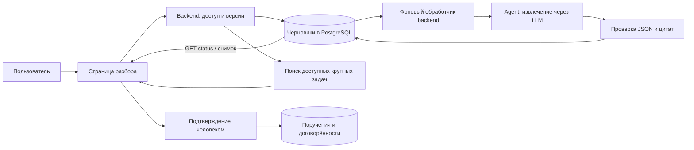

# Агент «Поручения из встреч»

**29.10.2026 — общий StepForm.** Индикатор этапов использует UI Kit:
«Расшифровка → Анализ → Проверка результатов → Сохранение». Текущий этап
проецируется из прежнего состояния процесса, объявляется через aria-current
и status. Навигация по этапам не добавлена: переходами по-прежнему управляют
предметные действия и ответы API. Анализ, подтверждение и сохранение не изменены.

Дата проектирования: **09.10.2026**; запуск и подключение LLM проверены **12.10.2026**. Статус: **AS-IS PARTIAL** —
первый сквозной сценарий реализован; дальнейшее развитие выделено отдельно.
Пункт бокового меню добавлен; контекстные точки вызова предложены ниже.

Клиентский путь и фоновый анализ проверены **17.10.2026**: 19 изолированных
backend-тестов, четыре frontend unit-теста и 20 браузерных сценариев с подменным
API. Отдельная живая проверка с реальным агентом описана ниже.

Фоновый прогон **17.10.2026 — PASS**: разбор
`DEV-QA-20261017-MEETING-BACKGROUND-04` продолжился после перехода на главную;
при возврате автоматически восстановились три AI-пункта. Для
`DEV-QA-20261017-MEETING-BACKGROUND-REFRESH-05` страница обновлена сразу после
принятия задания: восстановлен выполняющийся анализ, затем получены шесть
пунктов. PostgreSQL хранит оба результата со статусом `completed`; журнал
backend подтверждает ровно один `POST analyze` на каждый разбор. Время работы
агента на этих примерах — 9,8 и 13,1 секунды. Подтверждённых поручений эти
два теста не создавали. Это синтетические smoke-примеры, не нагрузочная приёмка.

Живой прогон **17.10.2026 — PASS**: ожидание, получение реального AI-результата,
человеческая проверка, подтверждение и повторное открытие из истории проверены
в работающем приложении под QA-профилем участника команды, с PostgreSQL и
OpenCode Go (`glm-5.3-flash`), без подмены API/LLM.

Первый прогон блокировался HTTP 401 `api_key_expired`: прежняя настройка,
ключ из локального профиля OpenCode Go и отдельно разрешённая проверка ключа
из `agents/business-analyst-experimental/.env` не восстановили доступ. После входа пользователя в OpenCode
Console и его отдельного подтверждения создан новый персональный ключ с
правами `Restricted → Models: Request`, остальные права `None`, без срока
истечения. Ключ сохранён только в `agents/business-analyst/.env`, основной агент перезапущен.
Значения ключей не включались в вывод, снимки, Git или документы; ключи других
сервисов и локальный профиль CLI не менялись.

На синтетической встрече агент вернул два поручения и две договорённости.
Все четыре цитаты дословно присутствуют в источнике; несогласованная идея
PDF-экспорта не включена. Служебная QA-пометка о плановой очистке попала в
договорённости и была исключена человеком при проверке: это ограничение
содержательной точности, а не подтверждение идеального качества извлечения.
Проверены раскрытие цитаты, правка деталей, снятие отметки проверки (счётчик
1 → 0), повторная проверка, переход к следующему непроверенному пункту,
явное «Без привязки», установка календарного срока первого поручения и
сохранение другого пункта без календарного срока/исполнителя.
После подтверждения созданы ровно три обычные QA-записи (два поручения и
договорённость о UTF-8); повторное открытие из истории показывает те же три
записи и внесённые правки.

Отдельная расшифровка только с вопросами и явно непринятыми решениями дала
пустой результат реального агента. UI показывает «Разбор завершён», не
предлагает подтверждать пустой список, сохраняет исходный текст и допускает
его редактирование. Этот прогон — проверка двух синтетических примеров,
а не оценка качества на реальных встречах или нагрузочная приёмка.

Исправлены обнаруженные проблемы: блок анализа после нажатия кнопки внизу
формы теперь прокручивается в видимую область и получает фокус; отказ
авторизации AI объясняет необходимость проверки настройки вместо обычного
совета повторить запрос. Заголовок итогового просмотра/сохранённого результата
также получает фокус и прокручивается в видимую область при подтверждении и
открытии из истории: прежняя прокрутка больше не скрывает результат.
Проверено в живом приложении после обновления.
Ручной путь проверен отдельно: два синтетических поручения, выбор «Без
привязки», снятие отметки после правки, переход к непроверенному пункту,
сохранение черновика и итоговый просмотр двух записей. В этом ручном прогоне
финальное создание поручений не выполнялось; он отделён от успешного
AI-сценария выше. Оставлены обычный сохранённый QA-разбор
`DEV-QA-20261017-MEETING-LIVE-01` (три подтверждённые записи) и черновики
`DEV-QA-20261017-MEETING-MANUAL-02`, `DEV-QA-20261017-MEETING-EMPTY-03`;
защищённые записи приложения не менялись.
Регрессии: 15 изолированных backend-тестов (без создания защищённых записей),
4 frontend unit-теста и 11 браузерных сценариев с подменным API — PASS.

## Назначение

Пользователь загружает расшифровку, получает предложенные поручения и
договорённости, исправляет и дополняет их, выбирает связи с крупными задачами
и подтверждает сохранение. Последнее решение всегда принимает человек.

Поручение — действие с ожидаемым результатом. Договорённость — принятое
решение, которое не обязательно требует действия. Вопросы, идеи, отменённые
предложения и предположения не должны автоматически становиться поручениями.
Проверка содержательной точности остаётся обязательной.

## Сценарий страницы

Маршрут: `#/meeting-capture`. Общий UI kit, тема приложения, одноколоночный
режим на узком экране. Пункт «Поручения из встреч» расположен в боковом меню
рядом с ИИ-ассистентом V2. Видимость соответствует доступу API: внутренний
пользователь с правом редактировать все задачи либо задачи своей команды
при наличии команды. Из встреч и карточек задач переходов пока нет.

1. **Источник.** Название и дата встречи, вставка текста или загрузка
   TXT/MD/SRT/VTT в UTF-8. До 240 000 байт на файл и 60 000 символов текста.
   DOCX/PDF, аудио, видео и транскрибация в этот этап не входят.
2. **Черновик.** Перед анализом текст сохраняется в PostgreSQL. AI извлекает
   до 60 пунктов: тип, название, результат/контекст, имя исполнителя текстом,
   срок исходной формулировкой и точную цитату. Календарную дату пользователь
   задаёт сам; относительные сроки автоматически не вычисляются.
3. **Редактирование.** Пункты можно исправить, удалить или добавить вручную.
   Цитаты AI-пунктов сохраняются с источником. После появления пунктов
   исходный текст фиксируется в UI. Повторный анализ не перезаписывает правки:
   для другого разбора создаётся новая встреча.
4. **Привязка.** Пользователь запрашивает предложения, выбирает крупную задачу
   или явно отмечает «Без привязки». Есть поиск по названию/номеру. Предложение
   не устанавливает связь автоматически.
5. **Проверка.** Каждый нужный пункт отмечается «Проверено». Изменение полей
   или связи снимает отметку. Отсутствующие исполнитель и срок видны, но
   не блокируют сохранение: их нельзя выдумывать ради заполнения формы.
6. **Подтверждение.** Отдельный экран показывает только выбранные записи,
   исполнителей, сроки и связи. Кнопка подтверждения создаёт их одной
   транзакцией. До этого черновик не считается поручением.
7. **Результат.** Сохранённый разбор доступен в личной истории страницы;
   есть ссылки на крупные задачи. Повторное подтверждение не создаёт дубли.

Черновики сохраняются явно и перед анализом/итоговой проверкой, без
автосохранения при каждом вводе. При выходе с правками есть предупреждение.
Расшифровка не записывается в localStorage. При ошибке AI сохраняются источник
и ручной путь. История показывает последние 100 разборов пользователя.

### Ожидание, восстановление и проверка — 17.10.2026

Верхняя шкала показывает текущий этап: «Расшифровка → Анализ → Проверка
результатов → Сохранение» (`aria-current=step`). Кнопка запуска называется
«Найти поручения и договорённости». Во время сохранения источника и анализа
правая область заменяет исходную заглушку явным состоянием ожидания.
Подтверждение «Расшифровка сохранена» появляется только после успешного
сохранения. После принятия сервером задания источник остаётся доступен для
чтения и копирования, изменения и повторный запуск блокируются. Можно уйти
со страницы, создать другой разбор, вернуться, закрыть вкладку или обновить
страницу: само вычисление не зависит от браузерного запроса.

Индикатор не обещает процент готовности или оставшееся время. Сервер сообщает
состояние очереди/обработки; деталей выполнения внутри модели нет. Показано
время с постановки задания на сервере, сохраняемое после обновления; через 60 секунд
появляется пояснение, что ответ ещё ожидается и повторный запуск не нужен.
Это порог пояснения, а не SLA. Таймер не озвучивается каждую секунду,
смена состояния сообщается через live-region, анимация учитывает reduced-motion.
При запуске и завершении фокус переводится на заголовок состояния или первого
пункта, чтобы блок анализа/результат не оставались за пределами видимой области.

Пустой ответ имеет отдельное завершённое состояние «Явных поручений и
договорённостей не найдено»: можно изменить источник или добавить пункт
вручную. Ошибка сохранения не выдаётся за сохранённый черновик. После ошибки
вызова анализа клиент перечитывает разбор: если результат уже сохранён,
восстанавливает его без повторного LLM-вызова. При сетевом сбое без результата
объясняется неопределённый исход и доступна кнопка «Проверить результат».
Перед явным повторным запуском клиент снова проверяет серверную версию;
новые результаты не перезаписываются. При конфликте с локальными правками
пользователь получает предложение скопировать их и открыть версию из истории.
Ответы провайдера 401/403 передаются через безопасную категорию
`meeting_ai_auth` (внутренний HTTP 503, в фоне — сохранённая ошибка задания). UI показывает «Нужно проверить
настройки AI», сохраняет ручной путь и предлагает повтор только после
настройки. Сырые ответы провайдера и реквизиты не возвращаются клиенту.

Найденные пункты показываются компактными раскрывающимися карточками с
названием, исполнителем, сроком и состоянием проверки. Первый пункт открыт;
«Следующий непроверенный» раскрывает следующий пункт и переводит фокус на его
заголовок. Сводка показывает типы записей, количество проверенных, отсутствие
исполнителей и календарных сроков. Последние два признака не блокируют
подтверждение. Изменение полей или связи снимает отметку проверки и обновляет
счётчики. Привязка к крупной задаче находится в отдельном раскрытии.

«Перейти к подтверждению — N» доступно при наличии проверенных пунктов;
затем «Создать выбранные записи — N» подтверждает транзакцию. Непроверенные
пункты остаются в составе разбора. Экран поясняет, что имя из расшифровки
не назначает пользователя и не отправляет уведомления.

Состояния `idle → queued → running → completed/failed`, время запуска/окончания,
идентификатор текущего запуска и безопасный код ошибки хранятся в PostgreSQL.
Пустой успешный результат — `completed` с пустым `items`, а не отсутствие запуска.
В `sessionStorage` хранится только UUID последнего открытого разбора, отдельно
для каждого пользователя. Источник, реквизиты и результаты туда не записываются.
При возврате/обновлении страница получает актуальный снимок с сервера; пока он
загружается, показывается восстановление вместо пустой формы нового разбора.
В другой вкладке можно открыть тот же разбор из личной истории.

Страница опрашивает лёгкий `GET .../status` через 1 секунду после открытия,
далее раз в 2 секунды. Этот путь пассивный для idle-сессии; клиент тоже передаёт
`passive: true`. При завершении загружается полный снимок. После навигации,
смены разбора или результата опрос прекращается. Запоздалые ответы прежнего
разбора не меняют новый редактор; смена запуска в другой вкладке отслеживается.
Ошибки чтения статуса повторяют только чтение, не вызов модели. Загрузка истории
не блокирует навигацию или восстановленный разбор. Если браузерное хранилище
недоступно, источником восстановления остаётся личная история на сервере.

Один daemon-поток в каждом процессе backend забирает `queued` через PostgreSQL
`FOR UPDATE SKIP LOCKED` и CAS. Транзакция/соединение БД закрываются до обращения
к агенту. Публикация результата проверяет запуск, версию и статус: старый ответ
не может затереть правки или новый запуск. Повторный `analyze` для текущего
`queued/running/completed` возвращает существующее состояние. Для успешного
пустого результата новый анализ разрешается после изменения источника/даты.
После `failed` требуется явное действие пользователя; автоматического
повторного запуска дорогостоящего запроса нет.

Очередь переживает перезапуск backend. Захваченный запуск, не завершившийся за
600 секунд, переводится в `failed/interrupted` при очередном проходе worker.
При остановке процесса выполнявшийся запрос не переотправляется автоматически:
до истечения этого срока может отображаться `running`. Это ограничение
восстановления после сбоя сервера, не обещание точного тайм-аута провайдера.

## Архитектура и автономность

Извлечение — отдельная операция стандартного `agent`, без нового сервиса
и зависимости от Agent V2/Task Prioritiser. Используется действующий
LLM-провайдер агента; текст передаётся ему. Mock не выдаётся за реальный
разбор: при нём операция недоступна, ручной путь остаётся рабочим.

Модель получает только текст и дату. Ей не передаются реестр задач,
пользователи, команды, права или инструменты записи. Инструкции внутри
расшифровки трактуются как данные. JSON проверяется строгой схемой, каждая
цитата должна буквально присутствовать в источнике. Некорректный результат
отклоняется целиком, без создания записей и показа сырого ответа модели.
Цитата подтверждает происхождение, но не гарантирует правильной интерпретации
договорённости — нужен человеческий просмотр.

Подбор соответствий детерминированный: нормализованные слова названия и
описания поручения сравниваются с названиями/описаниями доступных крупных
задач. Совпадение в названии весит больше. Возвращаются до трёх кандидатов
с объяснением. Выборка ограничена 500 подходящими записями по убыванию ID;
это эвристический поиск, не полный семантический retrieval и не вероятность.

## Хранение и доступ

- `meeting_captures`: UUID, владелец, название/дата, источник, JSON пунктов,
  версия, статус `draft`/`saved`, временные отметки; отдельные `analysis_status`,
  `analysis_run_id`, requested/started/finished timestamps, безопасный error_code.
  Миграция `b6f4c2d9e821` добавляет эти поля и индекс статуса, без новых таблиц.
- `meeting_actions`: подтверждённые `action`/`agreement`, текст, исполнитель
  текстом, календарный и исходный сроки, цитата, происхождение, разбор и
  необязательная FK на существующую `Task`.
- Уникальность `(capture_id, item_id)` предотвращает повторное создание.
  Создание разбора использует клиентский UUID. Черновик обновляется через
  compare-and-swap по версии и статусу. Перевод в `saved` и создание всех
  выбранных записей выполняются одной транзакцией.
- Доступ только создателю с внутренней ролью и правом редактирования задач.
  Customer-only и read-only пользователи исключены. Поиск учитывает чтение
  и область редактирования. Связи проверяются повторно при сохранении и
  подтверждении; чужой разбор отвечает 404.
- Пользователи, роли, справочники, состав и атрибуты команд не изменяются.
  Имя исполнителя не создаёт назначения пользователя или уведомления.

В текущем коде нет универсальной рабочей задачи из
[целевой структуры](work-structure.md). Новые записи не создаются как крупные
`Task` и не добавляются в их бэклог. Пока это отдельные поручения из встреч,
доступные в истории страницы, без трекера статусов исполнения. Связи с
крупными задачами уже хранятся в БД.

## API

Префикс публичного API: `/api/v1/meeting-capture`, авторизация обязательна.

| Метод и путь | Назначение |
|---|---|
| `GET /sessions` | Последние 100 собственных разборов |
| `POST /sessions/{uuid}` | Создание; повторный UUID возвращает существующий разбор |
| `GET /sessions/{uuid}` | Источник, пункты, версия, состояние, доступные связи |
| `PUT /sessions/{uuid}` | Полный черновик и ожидаемая `version` |
| `POST /sessions/{uuid}/analyze` | `{version}`; HTTP 202 со снимком, постановка пустого черновика в очередь; повтор не создаёт новый запуск |
| `GET /sessions/{uuid}/status` | Приватный пассивный снимок статуса, версии, ID запуска, времени и безопасной ошибки; без текста/пунктов |
| `GET /tasks?q=...` | Поиск по названию/номеру; 2–255 символов; до 20 результатов |
| `POST /suggestions` | Один пункт; до 3 кандидатов |
| `POST /sessions/{uuid}/confirm` | `{version}`; атомарное создание выбранных записей |

Внутренний `POST /api/agent/meetings/extract` защищён `X-Agent-Secret`;
вход `transcript`, `meeting_date`, выход `items`. Gateway не повторяет
дорогой LLM-вызов автоматически. Ошибки: 403 — права/связь, 404 — отсутствующий
или чужой разбор, 409 — конфликт версии/закрытый разбор, 422 — валидация,
502/503 — транспорт запуска/другие интеграции. После HTTP 202 сбой фонового
анализа читается через `analysis_status=failed`, `analysis_error_code` и
`analysis_error_message`, а не как ошибка уже завершившегося POST. Для отказа
авторизации провайдера код задания — `meeting_ai_auth`.
Нововведений в переменных окружения нет.

Стандартный launcher обязательно запускает сервис `agent`, включающий разбор
встреч. Страница: `http://127.0.0.1:8000/#/meeting-capture`. Для всего локального
V1 настроен OpenCode Go, модель `glm-5.3-flash`; провайдер передаёт
`x-opencode-session` в обычных и потоковых запросах. Ключ хранится только в `.env`.

## Дальнейшие этапы — не реализованы

- Перенос подтверждённых поручений в универсальные рабочие задачи после
  утверждения модели: статусы, назначение исполнителя, уведомления.
- Семантический поиск и reranking кандидатов с оценкой на реальных примерах.
- Поиск дублей между разными встречами; текущая идемпотентность защищает
  повторные запросы одного разбора, а не повторную загрузку того же текста.
- DOCX/PDF, разбиение длинных расшифровок, поиск по истории.
- Командный доступ, пересмотр сохранённых решений, удаление и сроки хранения
  расшифровок по согласованной политике.

## Предлагаемые контекстные точки вызова

Это предложения, не реализованные переходы. Первым приоритетом рекомендуются
встреча и карточка крупной задачи.

| Точка | Действие | Передаваемый контекст |
|---|---|---|
| Встреча / её итоги | «Разобрать расшифровку» | Название, дата, текст и обсуждавшиеся задачи; наиболее естественный старт после встречи |
| Карточка крупной задачи | «Добавить поручения из встречи» | Текущая задача как предложенная связь, с возможностью изменить или снять её у каждого пункта |
| Бэклог команды | «Поручения из встречи» | Команда и текущие фильтры как область подбора, с соблюдением серверных прав |
| Текстовое вложение | «Извлечь поручения» | Содержимое поддерживаемого файла и ссылка на источник; без повторного скачивания/загрузки |

Переход должен открывать тот же редактор. Контекст помогает заполнить источник
и предложить связи, но не подтверждает их и не сохраняет поручения автоматически.

## Проверки и источники

Изолированные backend-тесты создают только две новые таблицы и обычные записи,
без пользователей/команд/справочников. Проверены подтверждение, версии,
идемпотентность, личный доступ, сохранение источника при ошибке, схема и цитаты.
Frontend: файлы, подтверждение, UI kit, маршрутизация. Playwright с подменным
API: извлечение → правка → выбор связи → подтверждение → открытие из истории,
ошибка AI и ручное продолжение, ширины 1440/390 px. PostgreSQL DDL проверен offline;
миграция применена к локальной БД. Backend и Agent перезапущены, readiness
успешен; маршруты проверены по live OpenAPI. Защищённые записи не изменялись.

Живой вызов LLM на выдуманном примере, отдельно разрешённый пользователем,
09.10.2026 завершился ответом провайдера **403 Forbidden**. 12.10.2026 весь локальный V1 переключён на OpenCode Go; после штатного
перезапуска реальный вызов `/api/agent/meetings/extract` вернул HTTP 200
и поручение с исполнителем, сроком и дословной цитатой на выдуманном примере.
Записи в БД не создавались. Это smoke-проверка, не оценка качества на реальных встречах.

Источники: [API](../dmb-backlog/backend/routers/meeting_capture_router.py),
[контракт](../dmb-backlog/backend/meeting_contract.py),
[извлечение](../agents/business-analyst/business_analyst/meeting_task_extractor.py),
[страница](../dmb-backlog/frontend/js/components/meetingCapture.js),
[миграция](../dmb-backlog/backend/alembic/versions/b7e3a9d1c542_meeting_captures.py).
