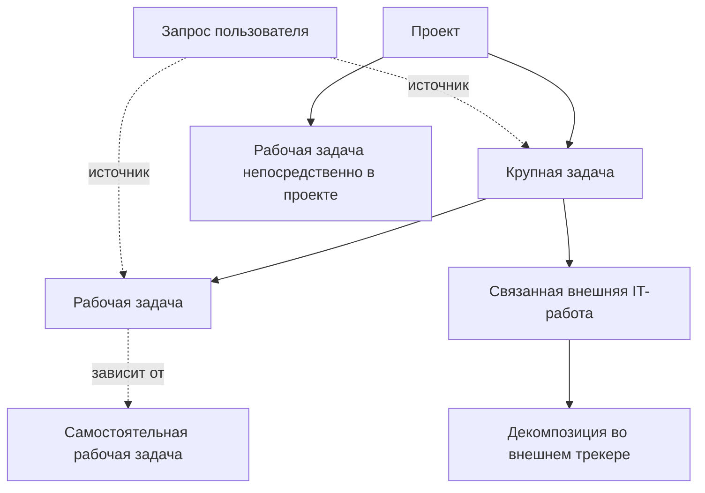
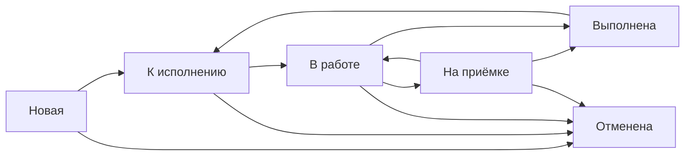

# Адаптация системы к структуре работ трайба

Уточнение **29.10.2026**: проект — продолжающееся направление работ с
пересматриваемым квартальным/годовым планом. Task в интерфейсе проекта —
«Задача бэклога». Слово «обязательство» в исходном обсуждении ниже не обозначает
отдельную сущность. [Текущий интерфейс](../dmb-backlog/docs/WORK_TASKS.md#проекты--проверено-29102026).

Уточнение 17.10.2026: [локальный контур и этап 5](../dmb-backlog/docs/WORK_TASKS.md) реализованы. Ниже сохранён целевой проект и исходный AS-IS на 09.10.2026; текущие возможности описывает профильный документ.

Дата исходного проектирования и проверки кода: **09.10.2026**.
Дата уточнения проекта по решению пользователя: **15.10.2026**.
Статус: **TO-BE PROPOSED**, кроме явно зафиксированных решений пользователя.
Основание — [Структура работ трайба](work-structure.md) и уточнение 15.10.2026.
AS-IS ниже относится к чтению рабочего дерева 09.10.2026. Уточнение меняет
целевой проект, а не дату проверки реализации. БД и живой интерфейс приложения
в рамках проектирования не проверялись.

**Текущие задачи сохраняют все атрибуты, данные, жизненный цикл, бэклоги
и отчёты.** Для локального исполнения добавляется отдельная упрощённая
`WorkTask`. Рабочие задачи имеют собственный список и компактную карточку.
Связанные рабочие задачи показываются внутри карточки текущей задачи.

Решение от 15.10.2026 заменяет прежние предложения общего списка равнозначных
записей и расширения атрибутов `Task`. Общий список, новые поля Task и
переклассификация существующих задач исключены. «Крупная задача» далее
обозначает текущую Task в структуре работ, без обязательного переименования
действующей сущности в интерфейсе.

## 1. Выводы по предметной модели

1. **Проект — контекст, крупная задача — обязательство, рабочая задача — действие.**
   Проект и крупная задача необязательны. Рабочая задача не имеет дочерних
   рабочих задач. Название «поручение» допустимо в пояснениях, но не как тип.
2. **Назначение независимо от уровня.** Продуктовая работа и деятельность
   трайба доступны крупным и рабочим задачам. Направление дочерней работы
   описывает её результат и не наследуется как жёсткое ограничение.
   Это предметное различие не требует нового атрибута у текущей Task.
   Направление новых рабочих задач не требует классифицировать старый бэклог.
3. **Запрос сохраняется как отдельный документ потребности.** Его принятие,
   размещение в структуре и удовлетворение потребности — разные события.
4. **Исполнение имеет две ветки.** Локальные действия и внешняя IT-разработка
   показываются рядом. Их количество и статусы не образуют общий процент
   выполнения бизнес-обязательства автоматически.
5. **Квартал — атрибут планирования.** Сущности «Квартальный план», новый
   уровень целей и отдельный тип «годовая цель» не нужны.

На схеме показаны допустимые связи, а не обязательное наличие каждого уровня.
Крупная задача может существовать без проекта; рабочая — без обоих контейнеров.
Кардинальность источников и правила зависимостей предлагаются в разделе 4.

## 2. Что уже есть и что необходимо изменить

| Область | Подтверждённое AS-IS | Проектируемое изменение |
|---|---|---|
| Проекты | `Project` имеет код, название, описание, статус и ответственного; CRUD расположен в admin-router | Отдельная пользовательская страница проекта и состав работ; существующие ID и справочные записи сохраняются |
| Задачи | `Task` содержит команду, владельца, проект, тип, сроки через справочник, оценку, эффект, прогресс и отчётные статусы | Сохранить все атрибуты и контракты; добавить в карточку связанный список рабочих задач |
| Ежедневное исполнение | В модели `Task` нет отдельного локального уровня с родителем, исполнителем, конкретным сроком и результатом | Добавить `WorkTask` с собственным жизненным циклом |
| Создание | `TaskCreate` требует тип задачи, канал, дату поступления и команду | Для рабочей задачи компактная форма без обязательной финансовой и портфельной классификации |
| Запросы | `RequirementRequest.task_id` — nullable FK с `unique=True`; есть версии, история требований и решений | Типизированные связи запроса с крупной или рабочей задачей; выбор результата ревью и сохранение редакции основания |
| Ревью | При переходе запроса в `in_progress` с BA создаётся `Task` в «СБОР ТРЕБОВАНИЙ», если её ещё нет | Явное размещение: создать крупную, создать рабочую или связать существующую; запрет автоматического создания дубля |
| Экспресс-оценка | `Epic` и `Story` содержат декомпозицию и трудозатраты | Оставить отдельным контуром оценки, не превращать в рабочие задачи и не считать зеркалом Jira |
| Jira | `link_jira` хранит ссылки; `TaskJiraLink` нормализует URL для импорта | Отдельные внешние объекты, состояние синхронизации и связь с крупной задачей |
| Доступ | `auth.py` использует командный/глобальный scope; командный редактор не переносит задачу в другую команду | Согласованная политика межкомандного назначения и объектного доступа к рабочим задачам |
| Интерфейс | Общий и командный бэклоги, канбан, карточка задачи, ревью, портал заказчика, отчёты | Сохранить действующие бэклоги; отдельный список рабочих задач и вкладка в текущей карточке |
| Совместная работа | Версионирование Task/Request, комментарии, вложения, история, transactional outbox | Переиспользовать механизмы, добавить тип адресата и контракты для рабочих задач |

Основания: [модели](../dmb-backlog/backend/models.py),
[схемы API](../dmb-backlog/backend/schemas.py),
[ревью запросов](../dmb-backlog/backend/routers/agent_router.py),
[контроль доступа](../dmb-backlog/backend/auth.py),
[проекты в admin-router](../dmb-backlog/backend/routers/admin_router.py),
[карточка задачи](../dmb-backlog/frontend/js/components/modal.js),
[навигация](../dmb-backlog/frontend/js/components/sidebar.js).
Синхронизация с внешним трекером не обнаружена в проверенных backend routers/services;
это не утверждение о возможных интеграциях вне репозитория.

## 3. Архитектурное решение

Таблица `tasks`, её атрибуты, API и списки сохраняются. Новая таблица
`work_tasks` хранит локальные рабочие задачи. Связь
`work_tasks.major_task_id → tasks.id` позволяет получить их для карточки
родителя без новых колонок, переписывания данных и переклассификации Task.

Списки и DTO разделены: действующий `/tasks` и новый `/work-tasks`.
Общий `/work-registry`, UNION ALL двух сущностей и универсальная карточка
не используются. Технический target `(kind, id)` допустим для связей и
уведомлений, но не задаёт общий список UI. Рабочие задачи получают отдельный
публичный префикс, например WRK-123; существующие ID задач сохраняются.

Первый выпуск расширяет текущий backend и SPA. Новые правила реализуются
в сервисах work_tasks, work_relations, request_resolution, work_access и
external_execution. Оценка, финансы и отчётность Task сохраняют свои контракты.
Рефакторинг всех текущих задач и миграция стека не требуются.

## 4. Модель данных и ограничения

### Проект и текущая задача

Проекты сохраняются. На странице проекта текущие задачи и рабочие задачи
непосредственно в проекте имеют отдельные разделы или вкладки. Рабочие задачи
внутри текущей задачи доступны из её карточки. Общего счётчика равнозначных
работ и смешанной таблицы нет. Статусы проекта остаются существующими.

**Изменений атрибутов tasks нет.** Сохраняются team_id, owner_id, project_id,
task_type_id, deadline_id, involved_teams, progress, оценки, финансы, описание,
отчётные статусы и остальные поля с прежним смыслом. Новые год/квартал,
направление, критерии приёмки и итог не добавляются ни в Task, ни скрытым
расширением рядом с ней.

Связанный список загружается отдельным запросом к work_tasks. Его счётчики
вычисляются из рабочих задач и не становятся атрибутами Task. Новые категории
в существующие справочники не добавляются.

### Рабочая задача

| Группа | Предлагаемые поля и обязательность |
|---|---|
| Идентичность | `id`, `public_id`, `title`, `description`, `version`, timestamps, `created_by`, `is_deleted` |
| Собственный результат | `work_direction`; описание `description` содержит ожидаемый результат перед началом исполнения |
| Контекст | `major_task_id` nullable FK → `tasks`; `direct_project_id` nullable FK → `projects` |
| Ответственность | `requester_id` и `requester_team_id` фиксируются при постановке; `execution_team_id` обязательно; `assignee_id` может быть пустым до принятия в исполнение |
| Сроки | `due_date` может быть пустой в новой задаче, обязателен перед началом; календарная дата в часовом поясе продукта, для локальной эксплуатации Europe/Moscow |
| Исполнение | `status`, `blocked_reason` отдельно от статуса; `assignment_state = proposed | accepted | declined` |
| Приёмка | `acceptance_required`, `acceptor_id` при обязательной приёмке; `result_text`, ссылки/вложения результата, `completed_at` |
| История | Причины отказа от назначения, отмены, возврата и переоткрытия; история изменения состава контекста и исполнителя |

Минимум для создания: **название, направление, команда выполнения**.
В личном/командном представлении команда подставляется из доступного контекста,
но видна в форме. Постановщик берётся из авторизованной сессии.
Выбор другого постановщика в первом выпуске не предлагается.
Направление можно предзаполнить из представления рабочих задач с возможностью
изменения до сохранения. Нового поля направления у Task не предполагается.

Основные видимые поля: **название, описание ожидаемого результата, исполнитель,
срок, статус, связанная задача/проект, фактический результат**. Направление
и команда находятся в дополнительных настройках; постановщик и служебные
поля заполняются автоматически. Ожидаемый результат вводится в одно поле
описания: отдельный expected_result в первом выпуске не нужен. Параметры
приёмки показываются только для соответствующего сценария. Финансовый эффект,
матрица компетенций, портфельные типы, Hard/Soft и отчётные поля Task не копируются.

Ограничение БД: `major_task_id IS NULL OR direct_project_id IS NULL`.
Три допустимых состояния: только крупная задача, только прямой проект, оба
поля пустые. Поля `parent_work_task_id` нет. В ответе API `effective_project_id`
вычисляется через крупную задачу либо берётся из `direct_project_id` и доступен
только для чтения.

Перемещение выполняется отдельной командой с версиями: проверяются права на
исходный объект и новый контекст; направление сохраняется. Перенос крупной
задачи в другой проект меняет вычисляемый проект её рабочих задач, но не их
команды, исполнителей и сроки. Пользователь до сохранения видит последствия.

Связь не добавляет блокировок существующим операциям с Task. Удаление
родителя не удаляет и не закрывает рабочие задачи: при soft-delete сохраняются
FK и метка недоступного контекста; при физическом удалении FK очищается через
ON DELETE SET NULL, исходный контекст остаётся в истории рабочей задачи.
Активные рабочие задачи остаются в своём списке. Новые связи с удалённой
задачей запрещены. Действующие правила удаления/архивации Task не меняются.

### Источники и зависимости

**Предложение:** поддержать M:N запросов и работ. Таблица
`request_work_links` содержит `request_id`, одно из `major_task_id` /
`work_task_id`, `request_revision`, `scope_text`, `coverage = full | partial`,
автора, время и состояние связи. CHECK требует ровно один target FK;
частичные уникальные индексы запрещают повтор одной активной пары.
Удаление связи — завершение её действия с причиной, а не уничтожение истории.
Ссылка на редакцию разрешается в сохранённый immutable snapshot; для старого
JSON-history при миграции проверяется существование указанной редакции.

`scope_text` объясняет, какую часть потребности покрывает работа.
Несколько частичных связей сами по себе не означают полное покрытие.
Состояние покрытия (`unmapped | partial | full`) подтверждает ревьюер отдельно;
состояние выполнения (`not_started | in_progress | needs_verification | fulfilled`)
отдельно подтверждает уполномоченный ревьюер с итоговым результатом.
Отмена работы делает её связь требующей пересмотра.

`work_dependencies`: направленная связь **A зависит от B**, где каждый конец
— крупная либо рабочая задача. На каждом конце ровно один типизированный FK.
Самоссылки и повторные активные пары запрещены. Зависимости должны быть
ацикличны; проверка цикла выполняется в транзакции с сериализацией изменений
графа, чтобы две параллельные команды не создали цикл. В первом выпуске
это информационный блокер: он предупреждает и попадает в фильтр внимания,
но автоматически не запрещает смену статуса и не копирует сроки.

Структурная принадлежность не смешивается с зависимостью. Для добавления
источника/зависимости нужны права редактирования изменяемого объекта и
чтения целевого объекта. Новая связь не выдаёт доступ к другому запросу,
проекту или всем соседним работам.

### Комментарии и вложения

Сохранить существующие `TaskComment`, `TaskAttachment`, `TaskHistory` для
крупных задач. Для рабочих добавить таблицы с FK на `work_tasks` и общие
сервисные операции над типизированным target. Так не потребуется ослаблять
старые FK ради универсального `entity_type/entity_id` без ссылочной целостности.
Скачать файл можно только после проверки доступа к его работе. Исходные
вложения запроса не становятся общедоступными через связь с работой.

## 5. Жизненные циклы и ответственность

### Рабочая задача

Предлагаемые коды: `new`, `ready`, `in_progress`, `in_acceptance`, `done`,
`cancelled`. Это контракт новой сущности, не пополнение существующего
справочника статусов `Task`.

| Действие | Кто и при каких условиях — предложение |
|---|---|
| Принять назначение / перевести «К исполнению» | Редактор команды выполнения; назначены активный исполнитель этой команды, срок и ожидаемый результат |
| Начать работу | Назначенный исполнитель либо редактор команды выполнения |
| Передать на приёмку | Исполнитель/редактор; обязателен текст результата; приёмщик задан |
| Завершить без приёмки | Исполнитель/редактор; `acceptance_required=false`, результат обязателен |
| Принять результат / вернуть | Заданный приёмщик; для возврата обязательна причина |
| Отменить | Постановщик до начала; после начала — редактор команды выполнения или глобальный редактор, с причиной |
| Переоткрыть | Приёмщик либо редактор команды выполнения, с причиной и новой версией; прежний результат остаётся в истории |
| Отметить блокер | Исполнитель/редактор; причина обязательна, основной статус сохраняется |

Рекомендуемое правило для первого выпуска: приёмка обязательна для
межкомандных поручений и задач, созданных по запросу; для внутренних —
выбирается при создании, по умолчанию выключена. Это **неутверждённое правило**.
Приёмщик может быть постановщиком только при наличии внутреннего доступа;
для customer-запроса назначается внутренний ревьюер/владелец работы.

### Межкомандное назначение

Постановщик с разрешением создавать рабочие задачи своей команды может
предложить работу другой команде. Создаётся `assignment_state=proposed`,
`status=new`, исполнитель ещё не назначен. Только получатель с правом
редактирования в команде выполнения принимает поручение и назначает
исполнителя. Отказ требует причины и не удаляет запись. Изменение команды
после принятия требует нового согласования; предыдущий исполнитель снимается.
Изменение исходных требований/срока после принятия показывается в истории
и уведомлении, существенная смена контекста проводится отдельной командой.

Постановщик, исполнитель и назначенный приёмщик получают доступ именно к
этой рабочей задаче. Команда выполнения получает доступ в пределах
согласованного командного scope. Постановка не открывает все работы другой
команды. Изменение поручения не меняет членство пользователя в команде,
поля PO/PL/CL или роли.

### Текущая задача и связанные показатели

Существующие статусы, переходы, прогресс и PI/экспресс-процесс сохраняются.
Рабочая задача не изменяет атрибуты родителя.

- **Прогресс текущей задачи** — существующий Task.progress с прежним смыслом.
- **Рабочие задачи** — отдельный счётчик выполненных и активных записей;
  отменённые отдельно, находящиеся на приёмке не считаются выполненными.
- **Внешнее исполнение** — отдельные сведения о связанных IT-работах,
  свежести и полноте данных; интеграция остаётся самостоятельным этапом.

Новые критерии завершения, обязательное обоснование закрытия и новая роль
приёмщика для Task не вводятся. Незавершённые рабочие задачи видны в связанном
списке, но не блокируют workflow родителя. Изменение рабочей задачи не выполняет
PATCH Task, не пересчитывает её прогресс, финансы или отчётные статусы.
Обратного каскадного закрытия также нет.

В связанном списке — «Выполнено N из M» с отдельными сигналами просрочки
и блокеров. Это показатель рабочих задач, а не новый процент готовности
текущей. Пустой список не означает 100% готовности.

## 6. Запрос и AI-ассистент

Ревью сохраняет подготовленные требования, редакции и автора. После оценки
содержания ревьюер выбирает один из результатов:

| Решение | Форма и результат |
|---|---|
| Создать текущую задачу | Действующая форма и контракт Task с прежними атрибутами и обязательностью; без новых полей |
| Создать рабочую задачу | Компактная форма; размещение: самостоятельная / в проекте / в крупной задаче |
| Связать существующую работу | Сначала выбор «Текущая задача» / «Рабочая задача», затем отдельный поиск по выбранной сущности; без дубликата |
| Разбить потребность | Несколько результатов размещения со своими частями покрытия; реализуется отдельным инкрементом |
| Вернуть / отклонить | Причина и существующая история ревью |

При выборе крупной задачи для новой рабочей проект автоматически отображается
через родителя и не редактируется отдельно. Итоговый preview показывает,
какие записи и связи будут созданы. Команда сохранения атомарна: решение,
создание работ, связи, версии, аудит и outbox фиксируются одной транзакцией.
Повторная отправка с тем же idempotency key возвращает прежний результат.

Существующие статусы запроса не следует молча переименовывать:
`in_progress` сейчас обозначает передачу BA с созданием задачи, а `approved`
является отдельным переходом. Ввести явные данные решения (`review_decision`,
`decided_at`, `decided_by`) и покрытия/выполнения, затем мигрировать отображение.
Исторический `approved` без проверки результата **не означает** `fulfilled`.
Для старых неоднозначных запросов выводить «Требует сверки размещения».

AI-ассистент предлагает описание, направление рабочей задачи и размещение.
Для Task используется действующий набор полей. Он не выбирает квартальное обязательство и не принимает
межкомандное поручение самостоятельно. Утверждение и создание работ выполняет
серверная команда ревью с правами человека. Доставка V1 и V2 должна использовать один сервис размещения, без двух
различающихся реализаций правил.

В «Моих запросах» пользователь видит решение, покрывающие работы в разрешённой
проекции, следующий шаг и результат. Несколько источников у одной работы
не открывают заказчику чужие запросы, внутренние комментарии и файлы.

## 7. Внешний IT-трекер

Первый целевой объём интеграции — **чтение внешнего исполнения**.
Поставщик, экземпляр трекера, способ авторизации, разрешённые проекты,
частота обновления и допустимый состав данных требуют согласования.

Модель: `external_connections` (конфигурация подключения),
`external_issues` (provider ID, стабильный remote ID, текущий ключ, URL, тип,
заголовок, raw status, нормализованная группа состояния, remote parent,
remote updated time, last successful sync, ошибка/недоступность),
`major_external_links` (крупная задача → внешняя работа).
Секрет подключения хранится в защищённой конфигурации, а не в карточке.

Уникальность внешнего объекта: `(connection_id, remote_id)`; отображаемый
ключ может измениться. У одной крупной задачи несколько корней внешнего
исполнения. Для первого выпуска предлагается один основной локальный
владелец внешнего корня, чтобы не удваивать учёт; дополнительное участие
других крупных задач — информационные ссылки. Если нужен M:N учёт внешней
работы, предварительно определить владельца результата и правила агрегации.

Иерархия хранится как типы и parent-связи провайдера, без предположения,
что каждая установка совпадает с примером Jira. Сначала загружаются явно
связанные корни; потомки раскрываются постранично. Не создаётся копия полного
IT-трекера в локальных рабочих задачах.

| Ситуация | Поведение |
|---|---|
| Ссылка добавлена, подключение отсутствует | «Только ссылка»; переход по URL; никаких вымышленных статусов |
| Успешное обновление | Актуальный статус и время получения |
| Сбой сети/лимит | Сохранить последний snapshot, пометить устаревание, повторять с ограниченной задержкой |
| Объект удалён/недоступен | Метка недоступности и последний успешный sync; локальная крупная задача сохраняется |
| Частичная выдача | Отметка неполноты; прогресс по неполному набору не показывается как итог |

Состояние синхронизации отделено от рабочего статуса. Прямой URL не
используется как произвольный адрес серверного запроса: допустимые хосты и
проекты ограничиваются настройкой подключения. Политика публикации внешнего
snapshot должна учитывать права внешнего трекера: привязка к доступной
крупной задаче сама по себе не даёт права видеть закрытый IT-контент.

Существующие `Epic`/`Story` сохраняются в экспресс-оценке. В UI они получают
явную подпись «Декомпозиция оценки». Автоматическое сопоставление по
названию с внешними задачами запрещено. Создание/изменение внешних задач
и двусторонняя синхронизация в первый выпуск не входят.

## 8. Информационная архитектура и UX/UI

### Раздельная навигация

Сохраняются «Бэклог DMB», «Бэклог команды», их таблицы, фильтры, колонки,
канбан и ссылки. Они содержат только текущие задачи. Добавляется раздел
**«Рабочие задачи»** с представлениями «Мои», «Команды», «Назначенные мной»
и «На моей приёмке». В нём только рабочие задачи. Общего пункта «Все работы»
со смешанными строками не будет.

Связь с Task или проектом — колонка рабочего списка, а не отдельная строка
родителя среди равнозначных работ. В проекте текущие задачи и прямые
рабочие задачи также разделены; рабочие задачи родителя доступны из его карточки.

### Рабочие задачи внутри текущей карточки

**Рекомендуемый вариант — дополнительная вкладка «Рабочие задачи · N».**
Существующие вкладки, атрибуты, порядок и формы редактирования сохраняются.
Новая вкладка не заменяет «Основное», отчётные статусы, комментарии, файлы
или историю. Постоянная ссылка открывает карточку сразу на ней.

Содержимое вкладки:

1. Компактная сводка: всего, выполнено, просрочено, ожидает приёмки.
2. Таблица: **Название → Исполнитель → Срок → Статус**.
3. Действия «Создать рабочую задачу» и «Привязать существующую» по правам.
4. Отбор «Все / Активные / Выполненные». Просрочка — отдельный сигнал.
   Отменённые доступны явно и исключены из активных.

Строка открывает компактную панель рабочей задачи, сохраняя текущую карточку.
Закрытие панели возвращает к той же вкладке и позиции. На mobile это отдельный
экран с явным возвратом к родителю. По мере роста списка — серверная пагинация;
весь список не загружается ради вычисления счётчиков.

При создании из карточки связь с родителем уже заполнена. Форма показывает
название, описание, исполнителя, срок и дополнительные настройки. Поиск
существующей рабочей выводит только доступные WorkTask. Для самостоятельной
записи привязка меняет её контекст. Для уже размещённой задачи сначала
показываются прежний и новый контекст и отдельное действие переноса; молча
второй родитель не появляется. Отвязка делает рабочую задачу самостоятельной,
не удаляя её и не включая автоматически в проект.

Пустое состояние: «Рабочих задач пока нет» и доступные действия. Ошибка загрузки
не выглядит пустым списком. Счётчик учитывает только доступные пользователю
рабочие задачи. События обновляют связанный список без сброса черновика
редактирования атрибутов Task.

Вариант для сравнения — компактный блок на «Основном» со ссылкой на полный
список. Для первого варианта рекомендуется новая вкладка: она меньше
затрагивает действующую компоновку. Перестройка остальных областей не нужна.

### Компактная карточка рабочей задачи

| Поле | Поведение |
|---|---|
| Название | Короткое действие |
| Описание | Что сделать и какой результат ожидается; одно поле |
| Исполнитель | Один ответственный |
| Срок | Конкретная дата |
| Статус | Собственный жизненный цикл рабочей задачи |
| Связанная задача или проект | Один контекст; текущая задача отображается ссылкой |
| Результат | Заполняется при завершении/передаче на приёмку |

Постановщик, комментарии, файлы и история доступны вторым уровнем.
Направление, команда, межкомандное назначение и параметры приёмки — в
дополнительных настройках по необходимости. FK, version и timestamps не
являются полями формы. Финансы, рейтинги, IT-компетенции и отчётные статусы
Task в рабочей карточке отсутствуют.

### Отдельный список рабочих задач

Колонки: название, исполнитель, срок, статус, связанная задача/проект.
Фильтры: человек, команда, назначенные мной, направление, срок/просрочка,
статус, блокер и родитель. Возможна собственная доска; действующая доска
Task сохраняется. Смена статуса доступна также через меню с клавиатуры.

Создание: «Самостоятельная / В проекте / В текущей задаче»; в последнем
случае проект вычисляется через родителя. Смена размещения сохраняет черновик.
В ревью сначала выбирается тип результата, затем отдельный поиск или форма
соответствующей сущности. Портал заказчика сохраняет представление запроса
и результата, не превращаясь в смешанный бэклог.

### Визуальная система и состояния

Использовать текущую [дизайн-систему](../dmb-backlog/docs/DESIGN_SYSTEM.md)
и UI kit. Добавляются вкладка, компактная панель и отдельный список.
Существующая карточка не перерабатывается ради появления WorkTask.

Для новых областей нужны loading, empty, ошибка с повтором, отсутствие прав,
конфликт версии и защита черновика. Ошибка новой вкладки не мешает чтению Task.
На mobile строки рабочих задач становятся компактными карточками; контекст,
срок и статус остаются видимыми. Возврат восстанавливает focus и прокрутку,
диалог удерживает focus, Escape учитывает несохранённые данные. Цвет дополняет
текстовый статус и не является единственным сигналом.

## 9. API и серверные правила

Ниже новые **предлагаемые** маршруты относительно `/api/v1`.
Существующий `/tasks` продолжает обслуживать только крупные задачи.

| Контракт | Назначение |
|---|---|
| `GET /work-tasks` | Список только рабочих задач с фильтрами и пагинацией |
| `GET /tasks/{id}/work-tasks` | Связанный список и доступные счётчики для новой вкладки |
| `GET /projects/{id}/work-tasks` | Прямые рабочие задачи проекта; текущие задачи загружаются отдельно |
| `POST /work-tasks`, `GET/PATCH /work-tasks/{id}` | Создание, чтение и изменение рабочей задачи |
| `POST /work-tasks/{id}/transitions` | Смена статуса с expected version, результатом/причиной |
| `POST /work-tasks/{id}/assignment-decisions` | Принятие/отклонение межкомандного назначения |
| `POST /work-tasks/{id}/placement` | Перемещение между допустимыми контекстами |
| `POST /work-dependencies` | Добавление зависимости; удаление отдельной командой с причиной |
| `POST /requests/{id}/resolution` | Атомарное решение ревью и размещение; старый agent endpoint становится совместимым адаптером |
| `GET /requests/{id}/fulfillment` | Покрытие, состояние исполнения и подтверждённый итог |
| `GET/POST /tasks/{id}/external-links` | Чтение/создание локальной связи с внешним исполнением |
| `POST /tasks/{id}/external-refresh` | Постановка обновления в очередь, без записи в IT-трекер |
| `GET /customer/work/{kind}/{id}` | Ограниченная проекция работы для заказчика |

Краткий target-контракт: `{ "kind": "work", "id": 123 }`.
Рабочее размещение: `{ "kind": "major", "id": 45 }`,
`{ "kind": "project", "id": 7 }` либо `{ "kind": "standalone" }`.
На уровне хранения он раскладывается по FK; передать рабочую задачу в качестве
родителя нельзя даже через API, bulk или импорт.

DTO WorkTask содержит её поля, контекст, version и available_actions.
DTO, схемы создания/редактирования и правила Task сохраняются. Связанный
список запрашивается отдельно, без универсального ответа двух сущностей.
Сервер проверяет права при каждом действии.

Все изменения требуют optimistic version. Конфликт возвращает 409 с новой
версией без потери клиентского черновика; ошибки контекста/перехода — 422;
действие без права — 403, чтение недоступного объекта — согласно единой
политике нераскрытия 404. List/search/count/export и SSE используют один
объектный scope. JOIN по источникам/зависимостям не должен дублировать работы
в соответствующем списке: использовать EXISTS или уникальные ключи.

Новые события outbox адресуют `(aggregate_type, aggregate_id)`; в payload
уведомления добавляется тип target. Старое `Notification.task_id` сохраняется
для крупных задач. Для рабочих добавляется отдельный FK/target с CHECK,
без подстановки их числового ID в `task_id`. UI target resolver получает
новые постоянные ссылки. Получателей определяет сервер после проверки
доступа; повторная доставка события не создаёт повторное уведомление.

## 10. Доступ и отчётность

Предлагается расширять policy-функции поверх существующих разрешений,
а не создавать роли по названиям. Конкретная матрица подлежит согласованию.
До её утверждения межкомандные назначения не включаются для всех пользователей.

| Участник | Предлагаемая область |
|---|---|
| Исполнитель | Своя рабочая задача: исполнение, результат, комментарии; без произвольной смены команды/постановщика |
| Постановщик | Своё поручение и его результат; предложение другой команде; изменение принятого обязательства через явную команду |
| Приёмщик | Чтение конкретной задачи, принятие/возврат результата |
| Редактор команды | Принятие входящих назначений и управление исполнением команды в рамках существующего scope |
| Владелец крупной | Управление её контекстом и декомпозицией при наличии object edit; право владельца само по себе не расширяет текущий role scope |
| Глобальный редактор | Управление работами в глобальном scope с аудитом |
| Бизнес-заказчик | Свои запросы и разрешённая проекция результата; без внутреннего командного реестра |

Для просмотра агрегата учитываются только доступные объекты; нельзя через
счётчик, поиск, файл или связь раскрыть закрытую работу. Участие в дочернем
поручении не открывает целиком родительскую крупную задачу или проект.
Точные правила организационной видимости проекта нужно утвердить отдельно.

Существующие финансовые и квартальные отчёты на первом этапе продолжают
читать `tasks`. Эффект крупной задачи не копируется детям и не суммируется
с их вкладом. Плановые оценки крупной и учёт локального труда — разные
показатели; складывать их можно только после определения непересекающегося
состава затрат.

Отчёт команды добавляет отдельную секцию рабочих задач: сроки, блокеры,
ожидающая приёмка, межкомандные предложения. Снимки прошедших встреч
сохраняются; новая секция получает собственный контракт снимка. Отчёт
руководителя показывает крупные обязательства, подтверждённые итоги и риски
локальной/внешней веток. Не смешивать общий счётчик строк с количеством
обязательств и не усреднять проценты разных уровней.

## 11. Миграция и совместимость

1. **Проверка без записи.** Зафиксировать ссылки на Task, поведение удаления,
   API и контрольные значения отчётов. Не переклассифицировать AD-HOC,
   Research и остальные существующие задачи.
2. **Добавление WorkTask.** Alembic создаёт новые таблицы рабочих задач,
   комментариев, файлов, истории и связей с FK/CHECK/индексами. Таблица
   tasks не получает новых колонок и backfill. Справочники, пользователи,
   роли, членство и атрибуты команд не меняются.
3. **Подключение UI.** Отдельный список рабочих задач и новая вкладка текущей
   карточки. Старые страницы, ссылки, фильтры, табы и формы сохраняются.
   Создание/привязка WorkTask не изменяет Task.
4. **Связи запросов — отдельный этап.** Существующий task_id запроса можно
   отразить в таблице связей, сохранив исходный FK и историю. Не переписывать
   Task и не подтверждать покрытие без основания. Unique-ограничение
   legacy task_id снимается после перевода потребителей и до включения M:N.
5. **Совместимость запросов.** Для рабочих и нескольких связей старому клиенту
   возвращать явно неподдерживаемый вариант с переходом к новому UI,
   не подставлять первую Task. Один writer обслуживает новую команду
   и legacy-проекцию запроса в одной транзакции.
6. **Внешние связи — отдельный этап.** Исходные Jira URL и декомпозиция оценки
   сохраняются. Проверенные внешние объекты связываются в новых таблицах
   без изменения текущих атрибутов Task.

Перенос дедлайнов в новые год/квартал, заполнение направления текущих задач,
переклассификация Task в WorkTask и перенос финансов/истории исключены.
Рабочие задачи создаются как новые записи с собственным содержанием.

Откат отключает новые команды/UI, сохраняя новые данные и доступное чтение
рабочих задач в совместимом релизе. Удалять их таблицы после появления
пользовательских данных нельзя. Интеграция отключается независимо;
действующий бэклог продолжает работать.

## 12. Порядок внедрения и приёмка

| Этап | Результат | Условие завершения |
|---|---|---|
| 0. Правила | Согласованы семь решений из следующего раздела, схема и матрица доступа | Нет неоднозначности в создании, назначении, приёмке и покрытии |
| 1. Локальное исполнение | WorkTask, три размещения, направление, сроки, результат, история, комментарии/файлы, новые события | Все допустимые размещения работают; вложенность рабочих запрещена на всех путях записи |
| 2. Рабочее место | Отдельный список рабочих, вкладка текущей карточки, компактная панель и межкомандное принятие | Сущности не смешаны; прежние атрибуты и сценарии Task сохранены |
| 3. Запросы | Явное размещение и привязка существующей работы, несколько запросов к одной работе, customer-проекция | Нет дубля при retry; исходные требования и права сохранены |
| 4. Внешнее исполнение | Настроенное чтение внешних корней, состояния синхронизации, раскрытие потомков | Работают недоступность, частичная выдача и повторное обновление; нет записи в трекер |
| 5. Покрытие и управление | Разбиение одного запроса, отчёты по рабочим задачам, согласованные агрегаты | Нет двойного эффекта, ложного 100% и утечек через связанные объекты |

Первый полезный выпуск — этапы 1–3 после решений этапа 0. Показ ссылок внешнего
исполнения доступен раньше интеграции; автоматическое получение статусов
нельзя обещать до предоставления подключения. Оценка сроков разработки
требует инвентаризации БД, выбранного трекера и доступной команды; эта таблица
задаёт зависимость инкрементов, а не календарное обязательство.

Ключевые сквозные проверки для будущей реализации:

| Сценарий | Критерий |
|---|---|
| Самостоятельное поручение | Создаётся без проекта/крупной задачи, видно исполнителю |
| Прямая задача проекта | Не требует искусственной крупной задачи |
| Рабочая внутри крупной | Проект вычисляется; нельзя задать конфликтующий прямой проект |
| Попытка вложить рабочую | API, импорт, bulk и UI отклоняют операцию |
| Разные направления | Организационная рабочая допустима в продуктовой крупной; самостоятельное продуктовое изменение для организационной работы оформляется отдельно и связано зависимостью |
| Межкомандная работа | Предложение → принятие/отказ; команда и её состав остаются неизменными |
| Приёмка и переоткрытие | Результат обязателен; полномочия соблюдены; причина и предыдущий итог сохранены |
| Повторное/параллельное ревью | Одно решение и один комплект работ; stale version даёт 409 |
| Несколько источников | Рабочая задача не дублируется в своём списке и не раскрывает чужой запрос |
| Частичное выполнение запроса | Завершение одной части не удовлетворяет запрос целиком |
| Зависимости | A → B → A запрещено, включая параллельное создание связей |
| Только внешняя ветка | Крупная задача не требует локальных поручений; закрытие Jira не закрывает обязательство |
| Архив/удаление контейнера | Рабочие задачи сохраняются; нет каскадного удаления результата и новых блокировок Task |
| Сохранность Task | Создание, привязка, перенос, выполнение и удаление WorkTask не меняют бизнес-поля, прогресс, статус и версию Task |
| Раздельные списки | Бэклоги Task не содержат WorkTask; список WorkTask не содержит равнозначные строки Task |
| Контекст карточки | Открытие/закрытие рабочей сохраняет вкладку, черновик и позицию родительской карточки |
| Отчёты и экспорт | Прежние показатели и формулы Task сохранены; рабочие задачи не участвуют в них |
| Доступ | Список, счётчики, поиск, файл, customer, SSE и прямой URL одинаково применяют policy |
| Внешний сбой | Старый snapshot и время видны, ложного нуля/100% нет |
| UX и доступность | Основные пути доступны с клавиатуры, mobile, при ошибке и конфликте; черновик восстанавливается |

Для тестирования использовать изолированную среду; применение изменений к
защищённым данным требует прямого разрешения. Проверки схемы и инвариантов
не должны запускать seed и менять реальные справочники/пользователей/команды.

## 13. Решения для согласования

| Вопрос исходной структуры | Рекомендуемый вариант | Влияние |
|---|---|---|
| Приёмка результата | Обязательна для межкомандных и созданных по запросу; опциональна для внутренних | Переходы и выбор приёмщика |
| Жизненный цикл | Шесть статусов рабочей задачи, блокер отдельно; переоткрытие с причиной | API, доска, уведомления |
| Межкомандное назначение | Предложение команде, затем её принятие; доступ только участникам поручения и разрешённому командному scope | Политика доступа и очередь входящих |
| Категории и поля | Два направления без новых подкатегорий; компактный минимум при создании, полнота перед исполнением | Форма и ограничения схемы |
| Готовность текущей задачи | Прежний прогресс и workflow; у связанных рабочих только собственные счётчики | Сохранение Task подтверждено 15.10.2026; детали сводки предлагаются |
| Внешний трекер | Чтение связанных корней и потомков, один основной локальный владелец, свежесть и полнота; без обратной записи | Подключение, права и учёт |
| Покрытие запросов | M:N модель; сначала одна цель размещения на решение, затем разбиение; подтверждение покрытия и результата отдельно | Миграция singular task_id и customer UX |

Уточнение 15.10.2026 уже фиксирует сохранение атрибутов Task и разделение
списков. Повторного согласования этих правил не требуется. Приёмка рабочих
задач, межкомандные права и интеграция остаются предложениями. Рекомендуемое
место связанного списка — новая вкладка текущей карточки; это UX-предложение.

## 14. Точки изменения и доказательная база

| Область | Проверенные источники и будущий scope |
|---|---|
| Схема, контракты, миграции | [models.py](../dmb-backlog/backend/models.py), [schemas.py](../dmb-backlog/backend/schemas.py), [Alembic](../dmb-backlog/backend/alembic/versions/) |
| Совместимость текущих задач без изменения периодов | [tasks_router.py](../dmb-backlog/backend/routers/tasks_router.py), в том числе `_year_from_deadline`, `task_to_response`, `create_task` |
| Запрос и доставка | [agent_router.py](../dmb-backlog/backend/routers/agent_router.py), `REQUEST_STATUS_TRANSITIONS`, `agent_request_status`; [customer_router.py](../dmb-backlog/backend/routers/customer_router.py) |
| Доступ | [auth.py](../dmb-backlog/backend/auth.py), `can_access_task`, `task_read_scope_clause`, `can_edit_task` |
| Оценка и приоритет | [express_router.py](../dmb-backlog/backend/routers/express_router.py), [prioritiser_router.py](../dmb-backlog/backend/routers/prioritiser_router.py); оставить Task-контракты |
| Сотрудничество и события | [task_collaboration_router.py](../dmb-backlog/backend/routers/task_collaboration_router.py), [notifications.py](../dmb-backlog/backend/notifications.py), EventOutbox/Notification в моделях |
| Отчёты | [reporting_meetings.py](../dmb-backlog/backend/reporting_meetings.py), [reports_router.py](../dmb-backlog/backend/routers/reports_router.py), [task_analytics.py](../dmb-backlog/backend/services/task_analytics.py) |
| Навигация и реестры | [router.js](../dmb-backlog/frontend/js/router.js), [sidebar.js](../dmb-backlog/frontend/js/components/sidebar.js), [taskTable.js](../dmb-backlog/frontend/js/components/taskTable.js), [teamBacklog.js](../dmb-backlog/frontend/js/components/teamBacklog.js), [kanbanBoard.js](../dmb-backlog/frontend/js/components/kanbanBoard.js) |
| Карточки и запросы | [modal.js](../dmb-backlog/frontend/js/components/modal.js), [reviewPage.js](../dmb-backlog/frontend/js/components/reviewPage.js), [customerPortal.js](../dmb-backlog/frontend/js/components/customerPortal.js), [agentChat.js](../dmb-backlog/frontend/js/components/agentChat.js) |
| Регрессионная база | [test_requirement_artifact_integrity.py](../dmb-backlog/backend/tests/test_requirement_artifact_integrity.py), [test_customer_task_scope.py](../dmb-backlog/backend/tests/test_customer_task_scope.py), [test_task_concurrency.py](../dmb-backlog/backend/tests/test_task_concurrency.py) |

Перечисленные тесты прочитаны как контракты, но не запускались: runtime-код
в этой задаче не изменялся. Исторический граф использован только для поиска
зависимостей; утверждения AS-IS выше проверены по коду 09.10.2026. Строки старого
графа не использовались как доказательство текущей реализации.

При реализации обновляются профильные DATA_MODEL, API_SPEC, PAGE_LOGIC,
DESIGN_SYSTEM, SECURITY, TESTING и SCHEMA_CHANGES с фактической датой проверки.
Настоящий проект не заменяет их AS-IS до внедрения.

## Статус реализации на 16.10.2026

Добавлен локальный контур рабочих задач, явное размещение запросов, зависимости и внешние ссылки. [Фактический scope и ограничения проверки](../dmb-backlog/docs/WORK_TASKS.md). Это первый инкремент, не заявление о завершении всех этапов. По ответу пользователя 16.10.2026 внешняя интеграция ограничена ссылками; автоматическое получение статусов не входит в текущий выпуск.

Продолжение 16.10.2026: реализован этап 5 — разбиение запросов, снимки рабочих
задач встреч и отдельные агрегаты. Миграция применена в PostgreSQL; результаты
и границы проверки перечислены в [WORK_TASKS](../dmb-backlog/docs/WORK_TASKS.md).
