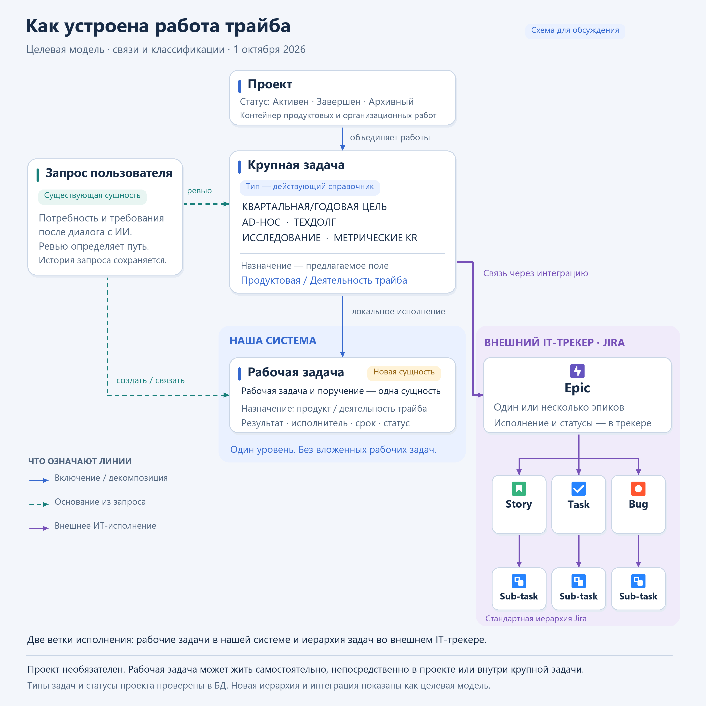
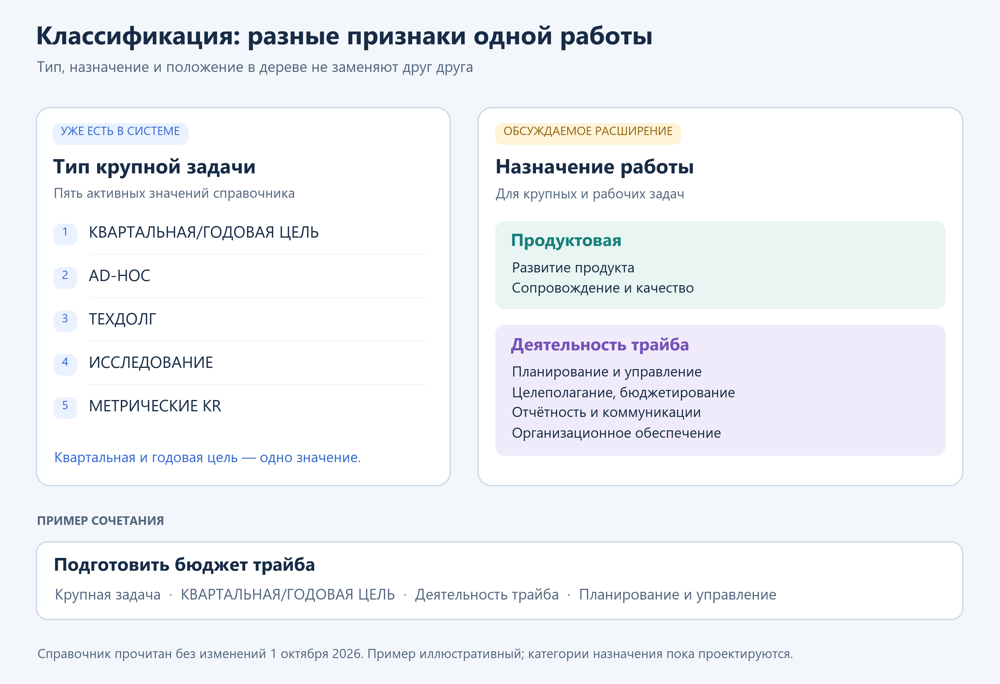

# Структура работ трайба

Дата фиксации решений: **09.10.2026**.
Уточнение границ изменений и UI: **15.10.2026**.
Статус: **TO-BE APPROVED** для явно согласованных правил;
предложения и открытые вопросы выделены отдельно.
Это целевая предметная модель, а не описание уже внедрённого функционала.

Система ведёт весь пул работ трайба: продуктовые изменения, крупные
обязательства, организационные работы и небольшие поручения. Трайб объединяет
продуктовые и непродуктовые команды, совместно создающие платформу.
Техническое исполнение разработки остаётся в Jira или другом внешнем IT-трекере.

Основная структура: **Проект → Крупная задача → Рабочая задача**.
Проект и крупная задача необязательны для создания рабочей задачи.
**Внутри нашей системы есть только один уровень рабочих задач:
рабочая задача не содержит других рабочих задач.**

## 1. Сущности и их назначение

| Сущность | Назначение | Основные связи |
|---|---|---|
| Проект | Объединяет работы в общем контексте; может включать продуктовые и организационные работы | Крупные задачи и рабочие задачи непосредственно в проекте |
| Крупная задача | Описывает значимый объём работ и ожидаемый результат; может быть квартальным или годовым обязательством | Необязательный проект, рабочие задачи, внешние IT-задачи, исходные запросы |
| Рабочая задача | Единица локального исполнения: что сделать, кто выполняет, к какому сроку и с каким результатом | Крупная задача, непосредственно проект либо самостоятельное существование; источники и зависимости |
| Запрос пользователя | Фиксирует потребность и бизнес-требования, подготовленные в диалоге с AI-ассистентом и переданные на ревью | Создаваемая или существующая работа, которая удовлетворяет запрос |
| Задача внешнего IT-трекера | Единица технического исполнения, которой управляют в Jira или другом трекере | Связь с крупной задачей нашей системы и собственная иерархия внешнего трекера |

**Рабочая задача и поручение — одна сущность.** Отдельный тип
«бизнес-задача» для противопоставления поручению не вводится. Ранее в обсуждении
слово «подзадача» также обозначало рабочую задачу в контексте более крупной
работы. Оно не означает отдельный тип или дополнительный уровень вложенности.
В целевой схеме используется единое название «Рабочая задача».

Крупная квартальная задача — прежде всего обязательство выполнить
согласованный объём работ. Она не обязана быть отдельной измеримой целью.
Объект «Квартальный план» не вводится. Квартал, год, сроки и действующий тип
задачи описывают планирование без дополнительного уровня иерархии.

## 2. Иерархия и допустимые контексты

| Размещение | Допустимо | Смысл |
|---|---|---|
| Крупная задача в проекте | Да | Работа относится к общему проектному контексту |
| Крупная задача без проекта | Да | Проект не является обязательным контейнером |
| Рабочая задача внутри крупной задачи | Да | Локальная часть её исполнения |
| Рабочая задача непосредственно в проекте | Да | Для небольшой работы не требуется искусственная крупная задача |
| Самостоятельная рабочая задача | Да | Работа не обязана относиться к проекту или крупной задаче |
| Рабочая задача внутри другой рабочей задачи | **Нет** | Пользователем выбран один уровень рабочих задач |

На схеме рабочая задача и Epic расположены рядом как части исполнения
крупной задачи. Это сопоставление их роли: рабочая задача может быть как
небольшим поручением, так и существенным объёмом локальной работы.
Равенство масштаба или обязательная связь каждой рабочей задачи с Epic
не предполагаются. У крупной задачи может быть только локальная ветка,
только внешняя IT-ветка или обе ветки одновременно.

Крупная задача может включать несколько рабочих задач и несколько внешних
эпиков. Подробная IT-декомпозиция хранится во внешнем трекере.

**Предлагаемое уточнение для модели данных:** у рабочей задачи один основной
контекст учёта. При размещении внутри крупной задачи проект определяется
через неё; дополнительные заинтересованные работы обозначаются связями.
Это позволяет учитывать один результат один раз. Точные поля и ограничения
БД должны быть определены при техническом проектировании.

## 3. Классификации

Следующие характеристики описывают разные стороны работы и не заменяют
друг друга:

| Характеристика | На какой вопрос отвечает | Примеры |
|---|---|---|
| Сущность и место в структуре | Как организована работа? | Проект, крупная задача, рабочая задача |
| Тип крупной задачи | Как она классифицирована в существующем справочнике? | КВАРТАЛЬНАЯ/ГОДОВАЯ ЦЕЛЬ, AD-HOC, ТЕХДОЛГ |
| Назначение работы | Какого результата она касается? | Продуктовая работа или деятельность трайба |
| Период и сроки | Когда планируется и выполняется работа? | Квартал, год, конкретный срок |
| Место исполнения | Где ведутся действия и их статусы? | Наша система или внешний IT-трекер |

### Действующий справочник типов крупных задач

При чтении справочника **01.10.2026** были подтверждены пять значений:

| Код | Название |
|---|---|
| `quarterly_goal` | КВАРТАЛЬНАЯ/ГОДОВАЯ ЦЕЛЬ |
| `adhoc` | AD-HOC |
| `tech_debt` | ТЕХДОЛГ |
| `research` | ИССЛЕДОВАНИЕ |
| `metric_kr` | МЕТРИЧЕСКИЕ KR |

Квартальная и годовая цель — **одно значение** существующего справочника.
Наличие типа «МЕТРИЧЕСКИЕ KR» не создаёт отдельную сущность цели в предлагаемой
иерархии. Приведён датированный снимок справочника; его изменение этим
документом не предусматривается.

Для проекта в том же обсуждении подтверждены статусы: **Активен, Завершен,
Архивный**. Это статусы проекта, а не типы работ.

### Назначение работы

Согласовано разделение всех работ на два направления:

1. **Продуктовая работа** — результат относится к продукту или платформе.
2. **Деятельность трайба** — планирование, управление, бюджетирование,
   отчётность, коммуникации и организационное обеспечение.

Направление применяется и к крупным, и к рабочим задачам на уровне предметного описания.
Уточнение 15.10.2026: это не предусматривает добавление нового атрибута
в существующие задачи; их поля сохраняются. Продуктовая работа
не обязательно означает программирование: подготовка бизнес-требований,
продуктовое исследование или бизнес-приёмка могут выполняться в нашей системе.

Рабочий вариант детализации, который ещё не является справочником в БД:

| Направление | Предлагаемые категории |
|---|---|
| Продуктовая работа | Развитие продукта; сопровождение и качество |
| Деятельность трайба | Планирование и управление, включая целеполагание и бюджетирование; отчётность и коммуникации; организационное обеспечение |

Классификация определяется ожидаемым результатом, а не форматом материала.
Презентация может быть отчётом о деятельности трайба или результатом
продуктового исследования. Организационная задача тоже может быть крупной
квартальной работой, а продуктовая — небольшим поручением.

### Сочетание направлений

- В продуктовой крупной задаче допустимы организационные рабочие задачи,
  например согласование бюджета для запуска функциональности.
- В организационной крупной задаче основная декомпозиция организационная.
  Если для её выполнения требуется самостоятельное продуктовое изменение,
  оно оформляется отдельной продуктовой работой и связывается зависимостью.
- Проект может объединять оба направления.
- Направление рабочей задачи не обязано совпадать с направлением крупной
  задачи. Направление характеризует её собственный результат.

## 4. Виды связей

| Связь | Значение | Пример |
|---|---|---|
| Включение в проект | Общий контекст работ | Проект включает крупную задачу и отдельное поручение |
| Декомпозиция крупной задачи | Работа является частью достижения её результата | Согласовать бизнес-требования для запуска функциональности |
| Источник | Объясняет, из какой потребности возникла работа | Запрос пользователя связан с задачей, покрывающей его потребность |
| Зависимость | Самостоятельной работе нужен результат другой работы | Подготовка отчёта зависит от новой продуктовой выгрузки |
| Связь с внешним исполнением | Показывает техническую часть крупной задачи | Несколько Epic из Jira относятся к одной крупной задаче |

Самостоятельная организационная работа, которая нужна для продуктовой
задачи, может оставаться отдельной и связываться зависимостью. Если это
конкретный шаг именно для результата крупной задачи, он размещается внутри
неё как рабочая задача.

Связь-источник и зависимость не создают дополнительные уровни вложенности.
Для каждой связи при реализации потребуется определить направление,
кардинальность, влияние на доступ и правила изменения. Автоматическая
блокировка действий или распространение статусов пока не утверждены.

## 5. Дальнейший путь запроса пользователя

Запрос возникает из диалога пользователя с AI-ассистентом по подготовке
бизнес-требований. Затем его рассматривает продуктовый владелец или
бизнес-аналитик. Ревью определяет дальнейшее размещение потребности:

| Результат ревью | Действие |
|---|---|
| Новый значительный объём работ | Создать крупную задачу и связать с запросом |
| Небольшая самостоятельная работа | Создать рабочую задачу, при необходимости непосредственно в проекте |
| Небольшая работа в рамках существующей крупной задачи | Создать в ней рабочую задачу и сохранить связь с запросом |
| Потребность уже покрывается существующей работой | Привязать запрос к этой работе без создания дубля |
| Недостаточно данных | Вернуть на уточнение |
| Потребность не принимается | Отклонить с причиной |

Запрос сохраняется как исходное основание: автор, содержание требований,
редакции и решение ревью должны оставаться прослеживаемыми. Создание задачи
не означает удаления или подмены запроса. По запросу должно быть понятно,
какая работа выполняется и какой результат получен.

Принятие запроса и включение работы в квартальное обязательство — разные
решения. Нельзя автоматически считать любую принятую потребность
квартальной целью.

**Предложение для дальнейшего проектирования:** поддержать несколько
исходных запросов у одной работы и разбиение одного запроса на несколько
работ. Правила частичного покрытия, кардинальности и отображение выполнения
по запросу требуют отдельного согласования.

## 6. Граница с внешним IT-трекером

В нашей системе ведутся крупные работы и локальное исполнение. Во внешнем
трекере ведутся технические задачи разработки, их декомпозиция и рабочие
статусы. Интеграция должна связывать эти представления.

Для Jira на схеме используется стандартная иерархия:

| Уровень | Типы |
|---|---|
| Крупная IT-работа | **Epic** |
| Обычная IT-задача | **Story**, **Task**, **Bug** — на одном уровне |
| Детализация обычной IT-задачи | **Sub-task** |

У Story, Task или Bug могут быть свои Sub-task. Story и Task не образуют
последовательные уровни. В конкретной установке схема может быть настроена
иначе; наша предметная модель не должна зависеть от единственного внешнего
трекера. Стандартные уровни описаны в
[документации Atlassian](https://support.atlassian.com/jira-cloud-administration/docs/what-are-issue-types).

У одной крупной задачи может быть несколько Epic и множество связанных
с ними IT-задач. В общем обзоре крупной задачи одновременно видны локальные
рабочие задачи и техническая ветка исполнения. Локальные задачи могут
сопровождать разработку: подготовка требований, согласования, бизнес-приёмка.
Работы без IT-разработки не требуют создания внешних задач.

Закрытие задач в Jira само по себе не означает выполнения всего
бизнес-обязательства: могут оставаться локальные действия и проверка результата.

**Предложение, а не утверждённый объём реализации:** начать с получения
доступных данных и статусов из внешнего трекера. Создание или изменение
внешних задач, двусторонняя синхронизация, частота обновления и расчёт общего
прогресса отдельно не согласованы.

При реализации следует различать существующую декомпозицию для
экспресс-оценки и фактическое исполнение во внешнем трекере. Совпадение слов
Epic и Story не является основанием автоматически объединять их записи.

## 7. Работа сотрудников и руководителей

Пользователи локального трекера — сотрудники команд и руководители.
Межкомандные поручения необходимы: команда, которой нужен результат,
и команда выполнения могут различаться.

Рабочая задача должна позволять управлять исполнителем, сроком, статусом
и результатом. В обсуждении также предусмотрены комментарии и вложения.
Конкретные обязательные поля, статусы, права и уведомления остаются предметом
следующего этапа проектирования.

**Уточнение пользователя от 15.10.2026:** текущие задачи сохраняют атрибуты
и действующие списки. Текущие и рабочие задачи не показываются в одном списке
как равнозначные сущности. Рабочие задачи имеют меньше атрибутов и отдельные
личные/командные представления. Связанные рабочие задачи нужно показывать
в карточке текущей большой задачи; конкретное место остаётся UX-предложением.

Это уточнение заменяет прежнее предложение общего реестра. Связь с рабочими
задачами не требует новых атрибутов текущей задачи. Подробности:
[проект адаптации системы](work-structure-system-design.md).

## 8. Примеры

**Запуск новой функциональности.** Крупная задача с типом
«КВАРТАЛЬНАЯ/ГОДОВАЯ ЦЕЛЬ» и продуктовым назначением относится к проекту.
В нашей системе у неё есть рабочие задачи «Согласовать требования»,
«Согласовать бюджет» и «Провести бизнес-приёмку». Бюджетная задача относится
к деятельности трайба. Во внешнем трекере несколько Epic раскладываются
на Story, Task, Bug и Sub-task. Локальные рабочие задачи дальше не вкладываются.

**Подготовка бюджета трайба.** Организационная крупная задача включает
рабочие задачи по сбору и согласованию данных. IT-ветка не обязательна.
Если потребовалась новая функциональность для выгрузки, создаётся отдельная
продуктовая работа, связанная зависимостью.

**Небольшой запрос.** После ревью создаётся самостоятельная рабочая задача
или задача непосредственно в проекте. Если подходящая работа уже есть,
запрос связывается с ней. Искусственная крупная задача для этого не нужна.

## 9. Открытые вопросы

1. Обязательна ли приёмка результата постановщиком и для каких работ?
2. Каков точный жизненный цикл рабочей задачи и правила её переоткрытия?
3. Кто назначает межкомандную работу, принимает назначение и получает доступ?
4. Какие категории назначения и обязательные поля входят в первый выпуск?
5. Как считать готовность крупной задачи с локальной и внешней ветками?
6. Каков первый объём интеграции: уровни связей, данные, статусы и обновление?
7. Как обрабатывать запрос, удовлетворяемый несколькими работами или частично?

Эти вопросы не отменяют согласованного ограничения: **рабочие задачи
в нашей системе не имеют вложенных рабочих задач**.

## 10. Статус материалов и приоритет решений

Основание этой целевой структуры — решения пользователя в обсуждении
29.09–09.10.2026, включая повторное подтверждение одного уровня рабочих
задач 09.10.2026. Значения справочников приведены по чтению 01.10.2026.
Схемы сохранены в репозитории вместе с описанием; дата 01.10.2026 на них
относится к исходной визуализации обсуждения.

[Ранний проект трекера](archive/design/business-work-tracker-design.md) от 29.09.2026
сохранён как история анализа. Его разделение бизнес-задач и поручений,
вложенность рабочих задач и исключение интеграции с Jira **заменены**
решениями этого документа. Остальные технические предложения раннего
проекта не становятся утверждёнными автоматически.

Реализация, миграции, API и детальные правила доступа должны проектироваться
по этой структуре и отдельно согласованным ответам на открытые вопросы.
Для фактического AS-IS используются исполняемый код и профильные документы
из [навигатора Backlog coordinator](../dmb-backlog/docs/README.md).
