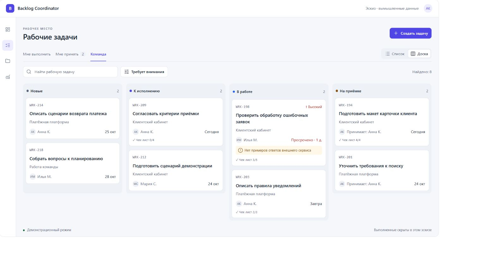
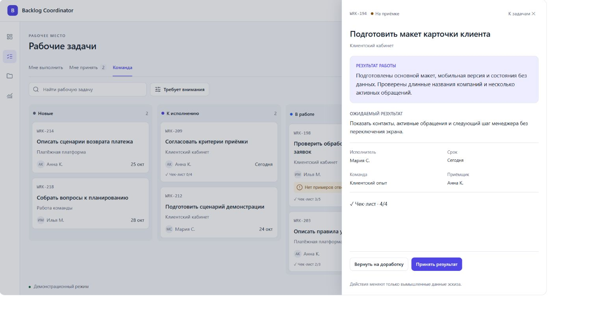

# Предложение по дизайну рабочих задач

Рабочим задачам нужен цельный пересмотр композиции: более читаемый список, спокойный канбан, содержательная карточка и короткие пути к действию. Предлагается сохранить существующие бизнес-правила и объединённое рабочее место, но перестроить иерархию информации и управление состояниями.

Это предложение от **21 октября 2026 года**, а не описание внедрённого дизайна. Подробный контракт реализации — [ТЗ на редизайн](work-tasks-redesign-spec.md). Существующее [ТЗ на канбан](work-tasks-kanban-spec.md) сохраняет бизнес-правила, API и незакрытые критерии; изменения визуального поведения перечислены в новом ТЗ отдельно.

## Что предлагается

**Спокойное рабочее место с акцентом на результат и следующее действие.** Светлый нейтральный фон, чёткая типографика, тонкие разделители, один индиговый акцент. Статусы узнаваемы по подписи и небольшому маркеру. Цвет занимает мало площади и помогает заметить исключение. Тёмная тема строится на тех же отношениях контраста и плотности.

Пользователь сначала видит название работы, затем исполнителя и срок, затем причину внимания. Номер, контекст, обычный приоритет и служебные действия не конкурируют с названием. В карточке на приёмке первым содержательным блоком становится предъявленный результат. В карточке заблокированной работы — конкретное препятствие и доступный способ его изменить.

Основные решения:

1. Сохранить «Список / Доска / Сводка», единые подборки и одну карточку задачи. Назвать раздел «Рабочие задачи», чтобы отличать его от крупных задач бэклога.
2. Разделить три уровня управления: **чьи задачи → как показать → какие условия**. Не смешивать их в набор одинаковых кнопок.
3. Сделать список действительно удобным для быстрого просмотра: выровненные колонки на широком экране, компактные строки рядом с карточкой, читаемые элементы на телефоне.
4. Сделать канбан обзором потока: четыре активных этапа, выполненные по явному переключателю периода, карточки с коротким содержанием и стабильной структурой.
5. Открывать задачу в достаточно широкой панели, сохранять контекст и показывать одно основное действие. Применять один компонент карточки во всех точках входа.
6. Показывать применённые условия, точный смысл чисел, состояния загрузки, конфликта и сохранения. Не обозначать скрытые или неизвестные значения нулём.

### Эскиз предлагаемого направления

Иллюстрации ниже показывают вымышленные задачи. Эскиз сокращён: он демонстрирует визуальную иерархию, переключение списка/доски и карточку результата, но не весь набор фильтров, меню и состояний из ТЗ. Интерактивная версия приложена к сообщению с предложением. Финальные производственные размеры, адаптивные режимы и доступность принимаются по ТЗ.

## Что уже работает и должно сохраниться

В текущем коде уже есть общий раздел WorkTask, список, доска, сводка, подборки, URL состояния, приоритеты, чек-листы, персональные шаблоны, комментарии, файлы, история, приёмка, межкомандное назначение, черновики, версия записи и обработка конфликтов. На доске есть меню действий, дополнительное перетаскивание, серверные возможности переходов и независимые страницы колонок.

Основания: [рабочее место](../dmb-backlog/frontend/js/components/workTasks.js), [канбан](../dmb-backlog/frontend/js/components/workBoard.js), [карточка](../dmb-backlog/frontend/js/components/workTaskDrawer.js), [сервер доски](../dmb-backlog/backend/services/work_board.py). Текущий статус реализации: [WORK_TASKS](../dmb-backlog/docs/WORK_TASKS.md), [WORK_BOARD](../dmb-backlog/docs/WORK_BOARD.md).

Поэтому задача редизайна — улучшить уже существующую систему и устранить её несогласованности. Создавать ещё один независимый канбан или отдельную модель задач не требуется.

## Основание аудита

Проведён живой обзор `http://127.0.0.1:8000` под готовым QA-профилем участника команды. Осмотрены список, канбан, фильтры, сводка, создание без отправки, карточка работы с препятствием WRK-27 и карточка приёмки WRK-16. Доска просмотрена в светлой и тёмной темах; список, доска и приёмка — в узком режиме. Рабочие записи и защищённые данные не изменялись. Тема восстановлена.

Средство просмотра масштабировало заданные размеры: при запросе 1440 px `innerWidth` был около 1454 px; при запросе 390/320 px измеренная ширина документа была 426/348 CSS px. Это живой качественный обзор широкого и узкого интерфейса, **не сертификация точных breakpoint 320/390 px**. Точные размеры входят в будущую приёмку.

Существующие отчёты о тестах не переобъявляются результатами этого аудита. Полная ролевая матрица, ошибки сети, запись переходов, нагрузка и работа экранного диктора здесь не перепроверялись. Наблюдения ниже разделены на непосредственно видимое поведение и выводы из кода.

## Найденные проблемы

Приоритет **P1** означает обязательную часть редизайна. **P2** — улучшение следующей поставки либо уточнение после проверки с пользователями. Это приоритет UX-работ, а не оценка критичности аварии.

| ID | Наблюдение и основание | Почему мешает | Предлагаемое решение | Приоритет |
|---|---|---|---|---|
| UX-01 | Название раздела «Задачи» соседствует с бэклогами крупных Task. Живое меню и `renderWorkTasks` | Непонятно, чем рабочая задача отличается от задачи бэклога | «Рабочие задачи» в меню, заголовке и крошках; крупная задача — контекст | P1 |
| UX-02 | Список состоит из двух широких ячеек. Название/контекст/исполнитель слева, срок/статус справа, между ними большой незанятый участок. [Список](assets/work-tasks-design-2026-10-21/as-is-list.png), `renderWorkQueue` | Глаз проходит длинный путь между связанными данными; сравнение исполнителей затруднено | Семантические колонки в широком списке; компактный режим рядом с инспектором | P1 |
| UX-03 | На каждой строке повторяются «Самостоятельная задача», имя текущего пользователя и «Обычный». Обычный приоритет скрыт на доске, но показан в списке | Второстепенная информация занимает несколько строк и создаёт неравномерную плотность | Нейтральный приоритет убрать из обзорных представлений; отсутствие контекста показывать в карточке; имя компактно выровнять | P1 |
| UX-04 | Список выделяет большинство названий цветом ссылки; на доске названия нейтральные. В обоих случаях это открытие той же карточки | Один объект имеет разную визуальную семантику | Единый тёмный/светлый основной цвет названия, состояние hover/focus/selected | P1 |
| UX-05 | Признак внимания доступен и через раскрытие «Требует внимания», и через одноимённый select в дополнительных фильтрах. Применённые условия в основном передаются счётчиком. [Фильтры](assets/work-tasks-design-2026-10-21/as-is-filters.png) | Несколько способов менять одно условие; трудно понять состав выборки | Один источник состояния, видимые удаляемые чипы условий, объяснение сочетания признаков | P1 |
| UX-06 | В дополнительных фильтрах период выполненных виден даже при активных задачах; доступны общие формулировки «Все задачи» и «Активные», смысл которых приходится сопоставлять | Пользователь может менять условие без видимого эффекта | Контекстное поле периода и явный переключатель включения выполненных | P1 |
| UX-07 | В сводке при `status=active` отображается «Выполнены · 0». Код использует `summary[key] ?? 0`. [Сводка](assets/work-tasks-design-2026-10-21/as-is-summary.png) | Отсутствие в выборке выглядит как отсутствие выполненных работ; отсутствующее поле тоже превращается в ноль | «Не включены» и действие «Показать за 7 дней»; неизвестное значение — «—» | P1 |
| UX-08 | Карточки доски содержат отдельные строки номера/«Действия», названия, самостоятельного контекста, участника, срока и препятствия. Измеренные первые две карточки около 173 и 190 CSS px. [Доска](assets/work-tasks-design-2026-10-21/as-is-board.png) | Полезная плотность невысока; длинные причины резко меняют высоту | Меню «…», 2–3 строки названия, одна строка контекста при наличии, компактный нижний ряд, до двух строк исключения | P1 |
| UX-09 | Все колонки имеют постоянный нижний блок «1–6 из 6 / Назад / Далее», даже когда обе кнопки недоступны. `renderColumn` | Повторяемое неработающее управление отнимает место и внимание | Не выводить блок листания при одной странице; при нескольких — компактные кнопки и диапазон | P1 |
| UX-10 | «Выполнены» при активном фильтре занимает узкую колонку «Скрыта фильтром» у правого края. В широком живом виде она частично вне видимой области | Пользователь видит обрезанный служебный столбец вместо ясного управления завершёнными | Переключатель «Выполненные: скрыты / 7 дней / 30 дней / всё время»; реальная пятая колонка появляется только при включении | P1 |
| UX-11 | На узком канбане перед первой карточкой идут заголовок, режимы, создание, подборка, поиск, инструменты, отдельный выбор этапа и повторный заголовок этапа. Первая карточка в измеренном состоянии начинается около y=452. [Мобильная доска](assets/work-tasks-design-2026-10-21/as-is-mobile-board.png) | Половина экрана уходит на управление; видно мало самих задач | Две компактные строки управления, раскрываемый поиск/фильтры, один заголовок выбранного этапа | P1 |
| UX-12 | На широком списке карточка встроенная, на доске при той же ширине — модальное окно с затемнением. [Карточка доски](assets/work-tasks-design-2026-10-21/as-is-board-card.png), `openSelected` | Одно действие по-разному влияет на рабочий контекст | Единый адаптивный режим; немодальная панель, если остаётся достаточно места для рабочего представления | P1 |
| UX-13 | В карточке приёмки результат расположен после свойств, ожидаемого результата, пояснения следующего шага и «Моих шаблонов». [Приёмка](assets/work-tasks-design-2026-10-21/as-is-mobile-acceptance.png) | Приёмщику приходится искать предмет решения; шаблоны конкурируют с текущей работой | Результат и критерий приёмки наверху; шаблоны в создании и меню «Сохранить как шаблон» | P1 |
| UX-14 | В списке у работы на приёмке показывается исполнитель. Доска показывает «Принимает: …». В сводке `nextWorkStep` соединён с `assignee_name` | Следующий ответственный отображается неодинаково; потенциально можно адресовать действие не тому участнику | Отдельно «Исполнитель» и «Следующее действие / участник»; единый серверный описатель следующего действия | P1 |
| UX-15 | Группы списка построены только из текущей страницы; уточнение есть в скрытом caption. `renderWorkQueue` | Группа выглядит полной, хотя её продолжение может быть на следующей странице | Видимая подпись об области группировки; не показывать локальное число как общий итог | P1 |
| UX-16 | Сообщение о 409 предлагает закрыть и открыть карточку. Подтверждено чтением обработчика, живой конфликт не вызывался | Разрывается работа и усложняется сравнение черновика с актуальной версией | Встроенная сверка изменений, явное повторное сохранение, сохранение введённого текста | P1 |
| UX-17 | Связи, файлы, перенос и передача команде находятся в одной вкладке; история спрятана внутри обсуждения. Код карточки | Просмотр материалов и изменение организационного контекста трудно различить | Материалы и связи оставить в содержимом; перенос/передачу вынести в меню; историю выделить фильтром активности | P2 |

На узких проверенных состояниях переполнение ширины документа не обнаружено. Поэтому адаптивность не объявляется полностью сломанной: основная подтверждённая проблема — расход высоты и избыточная вложенность управления.

## Предлагаемая организация экрана

### Общая область

Верхняя строка: **Рабочие задачи**, переключатель «Список / Доска / Сводка» и единственная основная кнопка «Создать задачу». Ниже — подборки «Мне выполнить», «Мне принять», «Я поручил», «Команда», «Все доступные». Ещё ниже — поиск, фильтры и компактное меню вида. Активные нестандартные условия видны отдельными чипами.

Счётчик подборки не меняет своего смысла при переключении списка и доски. Быстрые признаки показываются рядом с фильтрами, не занимая отдельную страницу или ряд крупных KPI-карточек. Подборка «Мне принять» показывает конкретные работы, ожидающие решения текущего приёмщика.

Глобальный поиск и локальный поиск получают разные подписи: «Поиск по системе» и «Найти рабочую задачу». Панель не должна создавать впечатление двух одинаковых поисков.

### Список

Широкий список — аккуратная таблица без вертикальных линий: название и короткий контекст, исполнитель, срок, статус, меню. Высокий/срочный приоритет и препятствие находятся рядом с задачей. Выбранная строка имеет мягкую заливку и узкий маркер, а не тяжёлую рамку.

При открытии карточки список становится компактной очередью. Название остаётся первым, срок и статус собираются в короткую нижнюю строку. На телефоне сохраняется тот же порядок информации; одинаковые подписи отсутствующего контекста не повторяются.

### Канбан

Постоянно видны четыре активных этапа: **Новые → К исполнению → В работе → На приёмке**. Завершённые включаются рядом с управлением видом и получают полноценную пятую колонку с периодом. Отменённые доступны через фильтр; смешивать их с выполненными не следует.

Колонки имеют нейтральную подложку и лёгкий заголовок со счётчиком. Карточки светлее подложки в светлой теме и немного контрастнее её в тёмной. Большие цветные заливки колонок, декоративные градиенты и постоянные тени не нужны.

В карточке: номер и исключительный приоритет; читаемое название; реальный проект/родитель, если есть; участник и срок; компактный сигнал препятствия/возврата. Детали и история — в общей карточке. Меню «…» доступно всегда; перетаскивание остаётся дополнительным способом перехода.

Не нужно искусственно вмещать пять колонок и открытую карточку в любой экран. На широком экране панель оставляет не менее двух читаемых колонок и горизонтальную прокрутку внутри доски. На меньшем — используется модальный просмотр. На телефоне — один выбранный этап с ясным переключением.

### Карточка

Наверху — номер, статус, меню, закрытие; ниже — название и текущая ситуация. Для новой задачи ситуация объясняет недостающие условия готовности. Для выполняемой — препятствие, если оно есть. Для приёмки — результат и автор предъявления, когда эти сведения доступны. Для выполненной — принятый/зафиксированный результат и дата завершения.

Содержание организовано вокруг результата: ожидаемый результат, чек-лист, фактический результат, свойства. Обсуждение и материалы доступны без потери введённого текста. Единственное основное действие закреплено снизу: «Начать работу», «Передать на приёмку», «Завершить» или «Принять результат» по серверным возможностям. Возврат — вторичное действие; отмена и перенос — в меню.

### Создание

Показывать существенные поля сразу: название, ожидаемый результат, команду, исполнителя и срок. Приёмку раскрывать явным переключателем; межкомандное назначение объяснять до отправки. Контекст проекта/крупной задачи выбирать по названию. Дополнительные параметры и шаблоны не должны сдвигать название за первый экран.

Создание новой задачи и подготовка к исполнению — разные шаги. Можно сохранить новую задачу без всех условий готовности; интерфейс показывает, что потребуется для передачи исполнителю. Дополнительное действие «Создать и передать» в первую поставку не входит.

## Визуальные ориентиры

| Элемент | Предложение |
|---|---|
| Основной шрифт | Существующий Inter, без нового внешнего шрифта; JetBrains Mono только для номеров и технических значений |
| Цвет | Нейтральные поверхности, индиго для действия/выбора; красный для просрочки/ошибки, янтарный для препятствия |
| Размеры | Заголовок страницы 24/32; название строки/карточки 14/20 или 14/21; основной текст карточки 14/22; метаданные 12/18 |
| Геометрия | Шаги 4/8/12/16/24/32; радиус карточки 10–12, панели 12–16; тонкая граница, тень только у плавающих слоёв |
| Управление | Обычная высота 36, компактная 32; на сенсорном экране область действия 44×44 |
| Плотность | Строка обычного списка 64–72 px; карточка доски обычно 132–176 px, рост разрешён ради содержания |
| Движение | Короткие переходы 120–180 мс; без начального каскада анимаций и без потери фокуса |

Это исходные параметры для макетов и проверки; внедрение идёт через существующий [UI kit](../dmb-backlog/docs/UI_KIT.md), а не через новую независимую систему стилей.

## Порядок реализации

| Поставка | Содержание | Результат |
|---|---|---|
| A | Общая композиция, список, фильтры, счётчики, нейтральная типографика | Понятно, где пользователь находится и почему видит эти работы |
| B | Карточка, приёмка, создание, сохранение и конфликт | Основные сценарии выполняются последовательно, без поиска нужного действия |
| C | Канбан, плотность, мобильное управление, сохранение позиции, доступные переходы | Доска помогает видеть поток и работать с ним |
| D | Сводка, связность сценариев, итоговая визуальная и ролевая приёмка | Единое качество всех представлений |

Поставки A–D входят в обязательный объём. WIP, метрики времени цикла, произвольные колонки, ручное ранжирование, массовые операции, серверные сохранённые представления и автоматизации — отдельное развитие после проверки основного интерфейса.

## Как оценивать результат

Оценка состоит из трёх частей: визуальная приёмка по конкретным размерам и состояниям, функциональная регрессия действующих правил и короткие испытания с исполнителем, постановщиком и приёмщиком. Красивый статичный экран не считается завершённой поставкой без ошибок, длинных названий, пустых колонок и реальных сценариев.

Предлагаемые цели пилота: подготовленную задачу начать не более чем за два нажатия из строки/карточки; исполнителя, срок и причину внимания находить за 5 секунд в большинстве контрольных заданий; предъявленный результат находить без переключения вкладки. Скорость выполнения и число ошибок сравниваются с исходным интерфейсом на одинаковом наборе синтетических задач. Это цели будущего теста, не уже измеренный эффект.

Доступность проверяется по [контрасту W3C](https://www.w3.org/WAI/WCAG22/Understanding/contrast-minimum.html), [размеру целей](https://www.w3.org/WAI/WCAG22/Understanding/target-size-minimum.html) и [альтернативе перетаскиванию](https://www.w3.org/WAI/WCAG22/Understanding/dragging-movements.html). Проектная цель 44×44 для сенсорного ввода строже минимального критерия 24×24 с исключениями.

Дизайн-предложение не требует изменения защищённых справочников, пользователей, ролей, состава и атрибутов команд. Общая модель WorkTask и действующие разрешения сохраняются.
