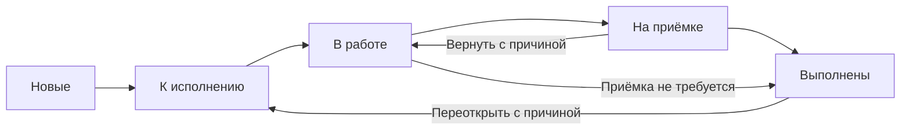
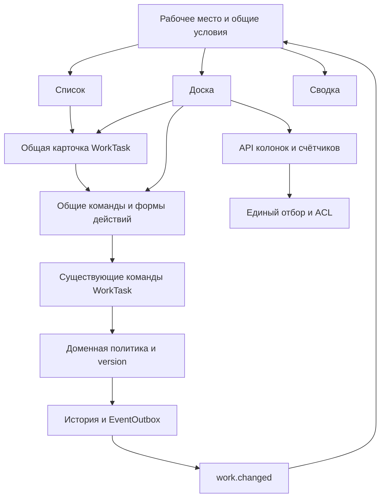

# Техническое задание на канбан рабочих задач

> Реализация локального пилота проверена 21.10.2026: [AS-IS, результаты и незакрытые критерии](../dmb-backlog/docs/WORK_BOARD.md). Наличие реализации не означает автоматического принятия всех AC ниже.

Канбан становится представлением раздела «Задачи» и показывает поток исполнения
рабочих задач `WorkTask`: подготовку, начало работы, предъявление результата и
приёмку. Список, доска и сводка используют одни записи, права, подборки и фильтры.
Крупные задачи `Task` остаются контекстом работ и самостоятельными обязательствами.

Документ предназначен для продуктового владельца, дизайнера, frontend/backend
разработчиков и QA. Это целевое ТЗ для оценки и реализации; статус не означает,
что описанная доска уже внедрена или все решения утверждены пользователем.
Нормативные требования первой версии обозначены `R1`, последующее развитие — `R2`.
Внутренние шаги поставки R1 не сокращают её итоговые критерии приёмки.

## 1. Цель и ожидаемый эффект

Пользователь должен быстро отвечать на вопросы:

1. Какие работы готовы к исполнению и что можно взять следующим?
2. Какие работы начаты, кем выполняются и что мешает их завершить?
3. Какие результаты ожидают приёмки и кто должен их принять?
4. Что завершено за выбранный период?
5. Какие рабочие задачи относятся к выбранному проекту или крупной задаче?

Для исполнителя основной сценарий — начать и завершить конкретную работу.
Для руководителя команды — видеть распределение исполнения и задержки.
Для постановщика — следить за поручением и межкомандным назначением.
Для приёмщика — принять результат или вернуть его с объяснением.

На пилоте сравниваются время нахождения следующей работы, число действий до
передачи результата, понятность препятствий и ожидания приёмки. Целевой UX:
начало подготовленной работы через меню карточки занимает не более двух нажатий;
через перетаскивание — один жест. Результат, причина и обязательные поля вводятся
по существующим правилам. Выполнение большого числа задач само по себе не является
показателем качества сотрудника; персональные рейтинги производительности не вводятся.

## 2. Основание и текущая реализация

Срез исходников проверен 21.10.2026. Источник истины — исполняемый код,
конфигурация, миграции и тесты. Исторические отчёты и прототипы не расширяют AS-IS.

| Уже существует | Основание | Использование в R1 |
|---|---|---|
| Отдельная WorkTask, шесть статусов, назначение команды, результат, version | [Модель](../dmb-backlog/backend/models.py) | Сохранить сущность и её идентификаторы |
| Проверка переходов и прав, история, outbox | [Сервис](../dmb-backlog/backend/services/work_tasks.py) | Единый источник правил |
| Команды transitions, assignment-decisions, placement, reassignment | [Роутер](../dmb-backlog/backend/routers/work_tasks_router.py) | Использовать существующие команды |
| Строгие входные контракты | [Контракты](../dmb-backlog/backend/work_contract.py) | Не разрешать произвольную запись статуса через PATCH |
| Список, сводка, подборки, URL и открытая карточка | [Рабочее место](../dmb-backlog/frontend/js/components/workTasks.js) | Добавить третье представление |
| Карточка, результат, причины, черновики и действия | [Карточка](../dmb-backlog/frontend/js/components/workTaskDrawer.js) | Общая карточка для списка и доски |
| Приоритет, чек-лист, персональные шаблоны в текущем коде | [Миграция](../dmb-backlog/backend/alembic/versions/d7f3b1c50e42_work_productivity.py) | Переиспользовать, не создавать дублирующие поля |
| Старый канбан Task с 13 колонками и запросом до 500 записей | [Канбан](../dmb-backlog/frontend/js/components/kanbanBoard.js) | Сохранить на время переключения; не переносить его запись статуса на WorkTask |

Профильный документ [WORK_TASKS.md](../dmb-backlog/docs/WORK_TASKS.md) описывает
реализованные этапы рабочего места. Доска использует уже существующие приоритет,
чек-листы и личные шаблоны. Перед поставкой проверяются состояние целевой БД
и применённые миграции.

В предыдущем анализе живым чтением осмотрены список рабочих задач и старый канбан.
11 изолированных проверок [бизнес-правил](../dmb-backlog/backend/work_tests/test_work_tasks.py)
прошли. Это основание для повторного использования доменной логики, а не приёмка
новой доски, нагрузки или всех ролей.

## 3. Объём поставки

### 3.1. Обязательная первая версия R1

- «Список / Доска / Сводка» в едином разделе «Задачи».
- Пять основных колонок; отменённые работы доступны отдельно.
- Подборки и общие фильтры, серверные счётчики, независимая пагинация колонок.
- Компактные карточки, общая подробная карточка, сохранение контекста и черновиков.
- Действия через меню и drag-and-drop с одинаковыми правилами и результатами.
- Межкомандное принятие, приёмка, возврат, отмена и переоткрытие без обхода прав.
- Обработка ошибок, конкурентных изменений и событий `work.changed`.
- Светлая/тёмная темы, клавиатура, touch, узкие экраны и масштабирование.
- Переключение старой навигации после приёмки и возможность отката.
- Автоматические проверки, живой ролевой smoke и актуализация документации.

### 3.2. Последующее развитие R2

- Согласованные WIP-лимиты и предупреждения о превышении.
- Время в состоянии, возраст незавершённой работы, длительность выполнения.
- Группировка строками по исполнителю или крупной задаче.
- Общий ручной порядок карточек и отдельные правила приоритизации очереди.

Эти возможности не блокируют выпуск R1 и не изображаются в R1 как действующие.
Их контракты и условия включения приведены в разделе 17.

### 3.3. За пределами ТЗ

Вложенные рабочие задачи, спринты, story points, новый редактор workflow,
автоматическое создание работ из встреч, синхронизация с внешним IT-трекером,
новая портфельная доска крупных задач, изменение финансовых/квартальных расчётов.
Существующие связи и внешние ссылки остаются доступны через общую карточку.

## 4. Предметные ограничения

| ID | Требование |
|---|---|
| BR-01 | Карточка доски представляет ровно одну WorkTask. Крупная Task не попадает в эту выдачу |
| BR-02 | Работа может быть самостоятельной, непосредственно в проекте или в крупной задаче. Дополнительная вложенность не вводится |
| BR-03 | Статусы и условия переходов общие для доски, списка, карточки и API |
| BR-04 | Выполнение рабочих задач не меняет автоматически статус, прогресс, оценку или финансовые поля крупной задачи |
| BR-05 | Выполнение запроса и полнота покрытия его требований сохраняют отдельные правила подтверждения |
| BR-06 | Блокировка — отдельный признак на текущем этапе, а не колонка или новый статус |
| BR-07 | Достижение 100% чек-листа не выполняет и не принимает задачу автоматически |
| BR-08 | Перетаскивание внутри колонки в R1 не меняет порядок или приоритет |
| BR-09 | Неизвестный, неполный и скрытый фильтром результат не обозначается числом 0 |
| BR-10 | Все карточки, счётчики, контексты, фильтры и подсказки соблюдают серверные права чтения |
| BR-11 | В рамках реализации и тестирования не создавать и не менять пользователей, роли, справочники, состав и атрибуты команд без прямого разрешения пользователя |
| BR-12 | Доска не создаёт новый набор статусов в защищённом справочнике TaskStatus |

## 5. Участники и права

Названия участников описывают функцию в конкретной работе. Не следует жёстко
привязывать интерфейс к строковому названию роли BA, PO или администратора.
Основание — действующая политика `read_scope`, `editor`, поля участников и
серверные возможности `available_actions`, `can_edit`, `can_block`,
`can_check`, `can_decide_assignment`, `can_place`, `can_reassign`.

| Участник | Основной сценарий | Ограничение |
|---|---|---|
| Исполнитель | Начать работу, предъявить результат, обозначить препятствие | Назначение исполнителем не предоставляет право менять требования |
| Постановщик | Контролировать поручение, уточнить новую работу, следить за назначением | Не получает автоматически права приёмщика или редактора чужой команды |
| Редактор исполняющей команды | Подготовить работу, назначить исполнителя, принять межкомандное поручение | Используется действующая область редактирования |
| Назначенный приёмщик | Принять результат, вернуть, переоткрыть выполненную работу | Администратор без этого назначения не подменяет приёмщика |
| Наблюдатель | Читать доступные карточки и показатели | Отсутствуют доступные операции записи и drag-and-drop |
| Внешний бизнес-заказчик | Использовать свой существующий портал запросов | Прямой доступ к рабочей доске не предоставляется |

Недоступные рабочие записи не загружаются в браузер. При ограниченном доступе
общий счётчик не раскрывает число чужих задач. Меню чтения не превращается в меню
изменений только потому, что пользователь видит доску.

## 6. Состояния и переходы

### 6.1. Колонки

| Код | Название колонки | Смысл |
|---|---|---|
| new | Новые | Зафиксированы; могут требовать уточнения и принятия командой |
| ready | К исполнению | Назначение принято, есть описание результата, исполнитель и срок |
| in_progress | В работе | Исполнение начато |
| in_acceptance | На приёмке | Результат предъявлен назначенному приёмщику |
| done | Выполнены | Результат принят либо допустимо завершён без обязательной приёмки |

`cancelled` отображается отдельной сворачиваемой областью «Отменённые», если
выбранный набор условий включает этот статус. Область использует те же карточки
в режиме чтения и собственную пагинацию. Отмена не является завершением результата.



Отмена разрешается отдельно из незакрытых состояний по действующей политике.
Из отменённой работы переходов нет. Новая возможность восстановления отменённой
работы в R1 не добавляется.

### 6.2. Матрица действий R1

| Исходное состояние | Цель / действие | Кто | Обязательные условия и ввод |
|---|---|---|---|
| new | ready / Передать исполнителю | Редактор исполняющей команды | Принятое назначение, активный исполнитель своей команды, срок, ожидаемый результат |
| ready | in_progress / Начать работу | Исполнитель или редактор команды | Сохраняются обязательные поля и принятое назначение |
| in_progress | in_acceptance / Передать на приёмку | Исполнитель или редактор команды | Приёмка настроена, есть приёмщик; ввод фактического результата |
| in_progress | done / Завершить | Исполнитель или редактор команды | Приёмка не обязательна; ввод фактического результата |
| in_acceptance | done / Принять результат | Только назначенный приёмщик | Просмотр предъявленного результата; подтверждение приёмки |
| in_acceptance | in_progress / Вернуть на доработку | Только назначенный приёмщик | Непустая причина возврата |
| done | ready / Переоткрыть | Редактор команды или приёмщик | Непустая причина; completed_at очищается, редакция результата меняется по доменному правилу |
| new, ready | cancelled / Отменить задачу | Редактор команды или постановщик | Непустая причина |
| in_progress, in_acceptance | cancelled / Отменить задачу | Редактор исполняющей команды | Непустая причина |

`new → in_progress`, `ready → done`, `in_acceptance → ready` и прямое завершение
при обязательной приёмке запрещены. Соседство колонок не означает разрешение
перехода. Причина и результат проверяются после удаления краевых пробелов.
Ограничения длины совпадают с существующим контрактом: результат до 30000 символов,
причина до 5000. UI не сокращает серверный предел незаметно для пользователя.

При незавершённых пунктах чек-листа форма предъявления/завершения показывает
«Не выполнено пунктов: N». Это предупреждение, не новый запрет на переход.
Существующий блокер также не вводит дополнительный серверный запрет автоматически.
Снятие препятствия — явное отдельное действие; его история сохраняется.

### 6.3. Межкомандная работа

`assignment_state` сохраняется независимо от статуса. На новой карточке:

- `proposed` — «Ожидает принятия командой»; начало исполнения недоступно;
- `declined` — «Назначение отклонено»; постановщику доступен существующий путь уточнения/повторного предложения;
- `accepted` — дополнительных отметок не требуется.

«Принять назначение» использует `assignment-decisions`, а не подменяется переносом
в ready. Принимающая команда указывает исполнителя и срок; ожидаемый результат
должен быть заполнен. Отклонение требует причины. Эти действия вызываются из меню
или общей карточки; перетаскивание не принимает поручение другой команды автоматически.

Переназначение другой команде сохраняет действующий сброс исполнителя, возврат в
new и новое согласование назначения. Такая команда не меняет членство пользователя
в команде или атрибуты самой команды.

## 7. Навигация и сохранение контекста

### 7.1. Единое рабочее место

В заголовке «Задачи» — переключатель «Список / Доска / Сводка» и действие
«Создать задачу». Выбранное представление имеет явное состояние. Отдельная
страница с собственной карточкой, подборками и дублирующей логикой не создаётся.

Канонические ссылки:

```text
#/work-tasks?display=board&view=mine&status=active&sort=attention
#/work-tasks?display=board&view=team&team=12&status=active&sort=priority
#/work-tasks/125?display=board&view=all&status=active&parent=42
```

Числа в примерах условные, их нельзя использовать как команды над живой БД.
Параметр `view` означает подборку, `display` — способ отображения.
При отсутствии display сохраняется нынешний выбор list. Прямой URL доски без
условий нормализуется в mine + active + attention. Пустой набор «Мне выполнить»
не переключается сам на команду или «Все доступные».

### 7.2. Правила восстановления

| Данные | Где сохраняются | Поведение |
|---|---|---|
| Представление, подборка, фильтры, сортировка, выбранная работа | URL | Обновление и переданная ссылка воспроизводят смысловую выборку |
| Выбранная мобильная колонка | URL `column` | Сохраняется при reload, нормализуется при исключении колонки фильтром |
| Прокрутка доски и колонок, открытые страницы колонок | sessionStorage с user ID и ключом условий | Возвращается в пределах сессии; содержимое перепроверяется у сервера |
| Черновик карточки / результата / причины | Существующий механизм черновиков | Изолирован по пользователю и работе; не содержит credentials |
| Страница обычного списка | Состояние представления list | Не используется как номер страницы доски |

Переключение между list/board/summary сохраняет условия отбора. Пагинация каждого
представления независима. Первое посещение другого представления начинает его
выдачу с первой страницы. Back/Forward воспроизводят смысловое состояние без
циклического переписывания истории; ввод поискового текста не создаёт запись
истории на каждый символ.

Открытая задача, которая перестала соответствовать фильтрам после записи,
остаётся открытой до закрытия пользователем с заметкой «Задача больше не входит
в текущую подборку». Она не добавляется в колонку вопреки фильтру. Если право
чтения отозвано, данные и черновик этой работы удаляются из отображения и локального
кэша; показывается «Доступ к задаче изменился». Черновик недоступной записи
нельзя использовать для обхода новых ограничений.

## 8. Подборки, фильтры и сортировка

### 8.1. Общие условия

Сохраняются «Мне выполнить», «Мне принять», «Я поручил», «Команда», «Все доступные».
Счётчики подборок пересекаются и не суммируются. Фильтр команды в подборке
«Команда» использует выбранную команду, по умолчанию свою; отсутствие команды
обозначается явно. Область чтения не расширяется от выбора другой команды.

| UI / URL | API | Правило |
|---|---|---|
| Поиск / q | q | Название или WRK-номер, trim; экранирование wildcard как в текущем списке |
| Команда / team | execution_team_id | Исполняющая команда |
| Исполнитель / assignee | assignee_id | Конкретный исполнитель; «Без исполнителя» задаётся отдельным условием |
| Крупная задача / parent | major_task_id | Только доступный родитель; запрещено переиспользовать legacy query `task` |
| Проект / project | effective_project_id, новый параметр | Прямые работы плюс работы доступных крупных задач этого проекта |
| Направление / direction | work_direction | product / organizational |
| Приоритет / priority | priority | low / normal / high / urgent |
| Статус / status | status | Существующие статусы, active, новый active_done или пустое значение |
| Выполненные за период / done_period | done_period, новый параметр | all / 7d / 30d; ограничивает только done |
| Требует внимания / attention | overdue, blocked, unassigned | Несколько выбранных признаков образуют пересечение |
| Сортировка / sort | sort | attention / priority / due / newest |

Новый effective_project_id не меняет смысл старого direct_project_id.
Для недоступного родителя или проекта возвращается согласованный ответ без
раскрытия названия. При фильтрации по проекту нельзя обнаружить принадлежность
недоступной крупной задачи через изменение счётчика: применяется та же политика
доступа к контексту, что и при его отображении. Прямое размещение в проекте
подчиняется существующей политике проектов. Несовместимые доступные фильтры
дают пустую выдачу, а не молчаливое расширение условий.

### 8.2. Активные, выполненные и отменённые

По умолчанию сохраняется `status=active`. Четыре активные колонки раскрыты,
«Выполнены» представлена компактным блоком «Скрыты фильтром» без числа 0.
Действие «Показать за 7 дней» явно устанавливает `status=active_done&done_period=7d`.
Этот набор означает четыре активных статуса плюс выполненные за период, без cancelled.
Список и сводка обязаны поддержать те же новые параметры.

| Условие | Доска |
|---|---|
| active | Четыре активные колонки; выполненные явно скрыты условием |
| active_done | Активные плюс выполненные за done_period |
| Конкретный активный статус | Одна развёрнутая колонка; подпись выбранного условия |
| done | Колонка выполненных с выбранным периодом |
| cancelled | Область отменённых; без пустых пяти колонок |
| Пустой status («Все статусы») | Пять колонок плюс сворачиваемая область отменённых |
| Подборка acceptance | Только относящиеся к пользователю in_acceptance; нельзя показывать выполненные, сохраняя эту подборку |

Без done_period действует all для обратной совместимости. Период 7d означает
сегодня и шесть предыдущих календарных дней по Москве: от полуночи даты начала
до времени формирования ответа включительно. 30d определяется аналогично.
Используется completed_at; старые закрытые записи без достоверной даты показываются
при all, не получают выдуманную дату и не входят в ограниченный период.

Быстрый фильтр «Просрочено» относится только к активным работам. Поэтому включение
done не отменяет этот фильтр и может оставить завершённую колонку пустой. В UI
видны все действующие условия и действие сброса конкретного условия.

### 8.3. Порядок и объём выдачи

R1 сохраняет семантику существующих сортировок. attention: просрочка, приёмка,
препятствие, отсутствие исполнителя, остальные активные; далее срок по возрастанию,
NULL последними, ID по убыванию. priority: urgent, high, normal, low, затем срок
и ID. due: срок и ID. newest: ID по убыванию. Сортировка одинакова в списке и
внутри каждой колонки. Дополнительный ручной порядок в R1 отсутствует.

Первая загрузка содержит до 20 карточек на включённую колонку. Каждая колонка
имеет собственные следующую/предыдущую страницу и точный total. Следующая порция
заменяет текущие 20 карточек этой колонки; остальные колонки не сбрасываются.
Подпись «21–40 из 76» отличает размер страницы от общего количества. Элементы
пагинации доступны также при прокрутке колонки. Значение page_size: 20 по умолчанию,
максимум 50; UI первой версии использует 20. Автозагрузка всех страниц запрещена.

## 9. Пользовательские сценарии

| ID | Сценарий | Ожидаемое поведение |
|---|---|---|
| UC-01 | Открыть свою доску | Применены mine/active, показаны колонки, счётчики и понятное пустое состояние |
| UC-02 | Переключить список на доску | Условия и сортировка сохранены, записи соответствуют тому же серверному набору |
| UC-03 | Начать подготовленную работу | Меню «Начать работу» или drop в «В работе», одна команда, версия обновлена |
| UC-04 | Передать результат на приёмку | Открывается форма результата, сохранение выполняет переход; отмена формы оставляет исходный статус |
| UC-05 | Принять или вернуть | Приёмщик видит предъявленный результат; при возврате обязательна причина |
| UC-06 | Принять межкомандное поручение | Явное действие назначения с исполнителем и сроком, без обхода через drop |
| UC-07 | Указать препятствие | Общий редактор препятствия; карточка остаётся на этапе, появляется текстовый сигнал |
| UC-08 | Завершить при active | Карточка выходит из выборки; сообщение поясняет фильтр и предлагает показать выполненные |
| UC-09 | Открыть работу по ссылке | Карточка открыта даже вне текущей выдачи, если доступна; контекст не теряется |
| UC-10 | Изменения двух участников | Второй устаревший запрос получает 409, ввод сохранён, показан путь сверки |
| UC-11 | Работа на телефоне | Выбор одной колонки, действия касанием, возврат из карточки к прежнему месту |
| UC-12 | Найти работы проекта | Учитываются прямые работы и доступные работы внутри крупных задач проекта |
| UC-13 | Переоткрыть выполненную работу | Причина обязательна, переход только в ready, существующие подтверждения результата обрабатываются доменным сервисом |
| UC-14 | Отменить работу | Команда через «Ещё», причина обязательна; нет drop-зоны отмены |
| UC-15 | Обновить после фонового изменения | Карточки и счётчики актуальны; открытый ввод, фокус и положение не уничтожены |

## 10. Дизайн и компоновка R1

### 10.1. Визуальное направление

Доска продолжает действующий UI kit Backlog Coordinator. Сохраняются оболочка,
боковая навигация, глобальный поиск, тема и акцент пользователя. Не добавляются
новая гарнитура, декоративные градиенты, отдельная палитра кнопок или уменьшенные
ради плотности шрифты. Пространство выделяется содержимому работ.

Нормативные источники: [UI kit](../dmb-backlog/docs/UI_KIT.md),
[токены](../dmb-backlog/frontend/css/tokens.css),
[типографика](../dmb-backlog/frontend/css/ui/typography.css),
[геометрия контролов](../dmb-backlog/frontend/css/ui/sizing.css).
Размеры ниже — целевые значения при 100% масштабе и стандартной плотности.
Изменение темы, плотности и масштаба использует общие токены и не ломает доступность.

### 10.2. Иерархия рабочего экрана

Порядок сверху вниз:

1. Общая оболочка приложения.
2. Заголовок «Задачи»; справа «Список / Доска / Сводка» и «Создать задачу».
3. Подборки с числами в существующем формате.
4. Поиск, сортировка, «Требует внимания», «Фильтры», условный «Сбросить».
5. Компактная строка действующих условий, если они требуют пояснения.
6. Доска; при применимости отдельная сворачиваемая область отменённых.

Строка KPI, диаграмма, приветственный блок и повторное описание назначения доски
над колонками не добавляются. Сводка остаётся самостоятельным представлением.
Фильтр состояния доступен через существующую панель и видимый чип текущего условия.

Схема широкого экрана; числа и подписи условные:

```text
┌──────────────────────────────────────────────────────────────────────────────┐
│ Задачи                         Список  [Доска]  Сводка       + Создать задачу │
│ Мне выполнить · 8   Мне принять · 2   Я поручил · 5   [Команда · 26]   Все   │
│ [Название или WRK-номер…] [По вниманию ▾]  Найти  Требует внимания  Фильтры  │
│ Команда: Аналитика ×   Активные и выполненные ×   Выполненные: 7 дней ×      │
├──────────────┬───────────────┬────────────────┬────────────────┬─────────────┤
│ Новые · 4    │ К исполнению │ В работе · 8   │ На приёмке · 3 │ Выполнены   │
│              │ · 6           │                │                │ · 5 / 7 дн. │
│ ┌──────────┐ │ ┌───────────┐ │ ┌────────────┐ │ ┌────────────┐ │ ┌─────────┐ │
│ │ WRK…   ⋯ │ │ │ WRK…    ⋯ │ │ │ WRK…     ⋯ │ │ │ WRK…     ⋯ │ │ │ WRK…  ⋯ │ │
│ │ Название │ │ │ Название  │ │ │ Название   │ │ │ Название   │ │ │ Название│ │
│ │ Контекст │ │ │ Контекст  │ │ │ Контекст   │ │ │ Контекст   │ │ │ Контекст│ │
│ │ Участник │ │ │ Участник  │ │ │ Участник   │ │ │ Приёмщик   │ │ │ Участник│ │
│ │ Срок     │ │ │ Срок      │ │ │ Препятствие│ │ │ Срок       │ │ │ Выполн. │ │
│ └──────────┘ │ └───────────┘ │ └────────────┘ │ └────────────┘ │ └─────────┘ │
└──────────────┴───────────────┴────────────────┴────────────────┴─────────────┘
```

Схема определяет расположение, а не заменяет размеры, типографику и состояния
из следующих подразделов. Пять полных колонок не обязаны умещаться на 1280 px.
Допускается горизонтальная прокрутка самой доски; переполнение всей страницы запрещено.

### 10.3. Геометрия доски

| Элемент | Контракт |
|---|---|
| Рабочее поле | Занимает доступную ширину страницы; не наследует ограничение ширины текстового документа |
| Расстояние между колонками | 12 px, `--space-3` |
| Полная колонка | Минимум 240 px, предпочтительно 260–280 px; на очень широком поле максимум 320 px |
| Колонка выполненных, скрытая active | Компактный блок шириной 120 px с переносом текста, без повёрнутой надписи |
| Внешний радиус колонки | 12 px, `--radius-lg` |
| Заголовок колонки | Не менее 44 px; название и полный счётчик, перенос до двух строк |
| Внутренние отступы тела | 8 px; между карточками 8–12 px по общему шагу |
| Карточка | Ширина тела колонки, padding 12 px, радиус 8 px, граница 1 px |
| Вертикальный размер | Зависит от содержимого; две строки названия обычно дают высоту 148–176 px |
| Нижняя часть колонки | Диапазон выдачи и кнопки независимой пагинации |
| Область прокрутки | Desktop: общая горизонтальная прокрутка и вертикальная внутри колонок; mobile: обычная вертикальная прокрутка страницы |

Высота desktop-доски определяется доступной высотой от её начала до нижнего
отступа 16 px. Заголовки колонок и пагинация остаются видимыми. Если после
масштабирования или раскрытия фильтров остаётся менее 280 px, фиксированная
высота отключается: экран использует прокрутку страницы и остаётся управляемым.
Не вводить одновременно ещё одну вложенную вертикальную прокрутку внутри карточки.

Горизонтальная полоса прокрутки доступна без поиска нижнего края длинной страницы.
На клавиатуре к области можно перейти и прокрутить её; при фокусе на карточке
она полностью вводится в видимую часть. Колёсико не перехватывается так, чтобы
пользователь не мог покинуть доску. Sticky-элементы не перекрывают фокус.

### 10.4. Анатомия карточки

| Порядок | Содержимое | Оформление и ограничение |
|---|---|---|
| 1 | WRK-номер; приоритет high/urgent; меню «Действия» | Номер моноширинный, метаданные 12/18; меню постоянно доступно, не только hover |
| 2 | Название | 14/21, weight 500, до трёх строк; полное название доступно в карточке и общей подсказке |
| 3 | Крупная задача / проект / самостоятельная работа | 12/18, вторичный цвет, до двух строк; недоступный контекст обозначается без ссылки |
| 4 | Следующий участник | В обычной работе исполнитель; на приёмке «Принимает: Имя»; имя 12/18, до двух строк |
| 5 | Срок и необязательный прогресс чек-листа | «Сегодня», дата или «Просрочено на N д.»; чек-лист «2/5», не процент исполнения всей задачи |
| 6 | Исключения | Препятствие, ожидание принятия командой, отказ или возврат; текст плюс значок |

Статус не повторяется бейджем внутри карточки: он задан колонкой. Обычный и низкий
приоритет доступны в подробностях; на доске постоянно выделяются только высокий
и срочный. Высокий приоритет не следует путать с просрочкой или блокировкой.

Для приёмки имя исполнителя доступно в подробностях, имя приёмщика видно сразу.
Если пользователь сам следующий участник, допускается подпись «Вы» с полным именем
в доступном названии. Наличие аватара не заменяет текстовое имя.

Выполненная карточка показывает «Выполнена DD.MM» вместо сигнала просрочки;
срок остаётся в подробностях. Исторические препятствия закрытых задач не окрашивают
их как активный риск. У возврата виден текст «Возвращено на доработку»; причина
доступна при открытии без поиска истории. Если препятствие и возврат существуют
одновременно, отображаются оба сигнала. Лимит высоты не скрывает существенную ошибку.

Содержимое названия и контекста экранируется. Вся карточка не становится кнопкой
с вложенными кнопками: ссылка/кнопка названия и меню — отдельные семантические
контролы; на свободном фоне можно открывать карточку указателем. Выделение текста
и клики по меню не запускают перетаскивание.

### 10.5. Типографика, цвета и компоненты

| Роль | Размер / line-height / weight | Источник |
|---|---|---|
| Заголовок страницы | 24 / 30 / 600 | `pageHeader`, общая роль страницы |
| Название колонки | 14 / 21 / 600 | Общая типографика, без uppercase |
| Название карточки | 14 / 21 / 500 | Inter |
| Метаданные | 12 / 18 / 400 | Общая роль метаданных |
| Номер WRK | 12 / 18 / 400 | Комплектный JetBrains Mono |
| Кнопки и поля | 13 / 20 / 500 или 400 | Общий контрол UI kit |

Обычные кнопки имеют высоту по UI kit, исходно 32 px. При coarse pointer
интерактивная область не меньше 44×44 px. Локальные CSS-правила не меняют размер
общих кнопок, поля, иконки и начертание выбранного состояния.

Фон страницы — `--bg-primary`, карточки — `--bg-secondary`, фон колонок —
доступная нейтральная поверхность темы. Основной/вторичный текст использует
`--text-primary` / `--text-secondary`, границы — `--border-color`.
Выбранная карточка имеет акцентную границу и слабый акцентный фон без изменения
геометрии. Фокус использует общий focus ring и различим отдельно от выбранности.

Сигналы: просрочка/ошибка — danger, препятствие/ожидание — warning,
успешное завершение — success. Фон колонки не заливается ярким цветом статуса.
Заголовкам можно дать тонкий семантический маркер; основное различие — название.
Для цветного текста используются контрастные семантические рецепты UI kit,
а не буквальное применение любого базового цвета из tokens.css.

Светлая и тёмная темы проверяются отдельно. Контраст обычного текста — минимум
4.5:1, значимых границ/индикаторов — 3:1. Размер шрифта не уменьшается при 200% zoom.
Иконки — из существующего набора Lucide; для интерактивной иконки есть доступное имя.

Переиспользовать `pageHeader`, `button`, `badge`, `field`, общий action menu,
popover/tooltip, feedback и механизм диалогов. Новым предметным компонентом
являются колонка и карточка доски; копирование всего CSS старого Task-канбана запрещено.

### 10.6. Подробная карточка и формы переходов

Используется содержимое `workTaskDrawer`, включая обсуждение, историю, файлы,
связи, чек-лист, шаблоны и права. Представление доски задаёт способ размещения:

| Доступная ширина контейнера C | Размещение |
|---|---|
| C ≥ 1360 px | Немодальная панель справа шириной 440–480 px; доске остаётся не менее 900 px |
| 640 ≤ C < 1360 px | Боковой dialog поверх правой части доски, ширина 440–480 px; фон inert, сохранена прокрутка |
| C < 640 px | Полноэкранная карточка/диалог в пределах viewport, «К доске» и возврат к прежней колонке |

Содержание шириной 440 px должно переноситься; размеры общих контролов сохраняются.
На широком экране открытие панели не сжимает колонки ниже минимальной ширины.
Модальная панель использует реальную семантику dialog, focus trap и общий механизм
вложенных подтверждений. Не добавляется второй независимый редактор WorkTask.

Порядок чтения подробностей: название → ожидаемый результат → участники/срок →
следующий шаг → результат/возврат → дополнительные разделы. Редактирование явное.
На доске кнопка возврата называется «К доске», в списке — «К списку».
Escape сначала закрывает меню/подтверждение верхнего уровня, затем панель.

Форма результата открывается в той же карточке, сразу показывает название работы
и ожидаемый результат, переводит фокус в поле «Фактический результат».
Основная кнопка названа конкретным действием: «Передать на приёмку» / «Завершить».
Приёмщик видит предъявленный результат и кнопку «Принять результат»; перенос в
done открывает эту же форму подтверждения. Возврат/отмена/переоткрытие запрашивают
причину. У форм есть «Назад»; ввод сохраняется при ошибке. Двойная общая форма
«Вы уверены?» поверх уже явного подтверждения не добавляется.

Начало подготовленной работы и передача исполнителю выполняются без второго
подтверждения. Если обязательных данных нет, интерфейс показывает, что заполнить,
и открывает доступный редактор; не подставляет фиктивные срок, исполнителя или результат.

### 10.7. Адаптивность и мобильный экран

При C < 640 px доска показывает одну выбранную колонку на всю ширину.
Над ней — доступный select «Этап» с названием и счётчиком, кнопки предыдущего/
следующего доступного этапа. Swipe не является единственным способом навигации.
Скрытые условиями этапы не предлагаются как пустые: они недоступны с объяснением.

```text
┌──────────────────────────────────┐
│ Задачи                           │
│ Список   [Доска]   Сводка         │
│ + Создать задачу                 │
│ [Мне выполнить · 8          ▾]   │
│ [Название или WRK-номер…     ]    │
│ [По вниманию ▾]   [Фильтры · 2]  │
│ [‹] [В работе · 3           ▾][›]│
│ ┌──────────────────────────────┐ │
│ │ WRK-125   Высокий         ⋯  │ │
│ │ Подготовить критерии         │ │
│ │ приёмки результата           │ │
│ │ Контекст: крупная задача     │ │
│ │ Исполнитель: Анна            │ │
│ │ Сегодня           Чек-лист 2/5│ │
│ └──────────────────────────────┘ │
│             Следующие 20         │
└──────────────────────────────────┘
```

Заголовок и действия переносятся по контракту pageHeader. Поиск занимает полную
строку. Дополнительные фильтры открываются общим popover/dialog с доступным
закрытием. Нет горизонтальной прокрутки страницы, уменьшения шрифтов или
обязательного drag-and-drop. Меню карточки и все команды работают касанием.
На touch в R1 не вводится обязательное длительное удержание для начала переноса;
меню является основным способом смены этапа. На fine pointer доступно перетаскивание.

### 10.8. Состояния компонентов

| Состояние | Отображение и поведение |
|---|---|
| Первая загрузка | Скелетоны заголовков/карточек, aria-busy; неизвестные счётчики обозначены тире |
| Обновление уже загруженной доски | Существующая выдача остаётся с индикатором обновления; нет вспышки пустого экрана |
| Пустая колонка | Небольшой текст «Задач нет», без большого повторяющегося рисунка |
| Пустая доска по условиям | «По выбранным условиям задач нет», видимые условия и их сброс; создание доступно по правам |
| Создание невозможно | Не предлагать недействующую кнопку; допустимо объяснение области доступа |
| Колонка скрыта условием | «Скрыта фильтром» и действие изменения условия; total=null, не 0 |
| Частичная ошибка загрузки | Ошибка внутри нужной колонки и «Повторить»; другие колонки доступны |
| Общая ошибка | Понятное сообщение, повтор; без ложного общего количества |
| Hover / selected / focus | Различимые состояния без скачка размеров и только по цвету не кодируются |
| Перенос | Исходная карточка обозначена, валидные цели подсвечены, видна подпись действия |
| Сохранение | Карточка и её команды busy; повторная запись недоступна |
| Успешный переход | Положение и счётчики обновлены; короткое сообщение с номером и действием |
| 409 | «Задача изменена другим участником. Проверьте актуальные данные»; ввод сохранён |
| Потеря доступа | Содержимое удалено из UI/кэша, нейтральное объяснение без чужих данных |
| Отключение сети / событий | Видна устарелость данных; ручное обновление доступно, запись не ставится в скрытую очередь |

### 10.9. Перетаскивание и доступность

Drag начинается после порога движения 6 px на fine pointer, а не при обычном
нажатии. Активные интерактивные элементы и выделяемый текст исключаются из
drag-start. Во время drag подсвечиваются только цели, для которых сервер вернул
доступное действие. Для цели с обязательным вводом показывается «Указать результат»
или «Указать причину»; завершение жеста открывает форму, не сохраняет пустую команду.

Drop внутри исходной колонки — отсутствие изменения. Drop вне цели и Escape
отменяют жест. Для отмены работы нет скрытой зоны удаления/корзины. Во время
ожидания подтверждения сервером карточка остаётся в исходной колонке с busy;
окончательное перемещение происходит после успешного ответа. Отмена формы
возвращает обычное состояние без запроса изменения.

Автопрокрутка при приближении к краю ограничена контейнером доски и прекращается
сразу после завершения/отмены жеста. При изменении задачи внешним событием во
время жеста команда перепроверяется; устаревшее действие не применяется молча.

Все операции доступны без drag: название открывается Enter, меню — стандартной
клавиатурой, варианты действий имеют понятные имена. Для screen reader колонки —
именованные section, карточки — элементы списка, пагинация имеет имя колонки.
Клавиатурная доступность и альтернатива указателем проверяются независимо.
После действия фокус возвращается на карточку в новом месте; если она скрылась
условием — на заголовок исходной колонки или ближайший устойчивый контрол.
Через aria-live=polite объявляется итог, но не зачитывается вся доска при каждом SSE.

Анимация перемещения 150–200 ms допускается только без потери управления;
prefers-reduced-motion отключает перемещение/автоскролл с анимацией. Нет мигающих
предупреждений. Подсказки не заменяют обязательные подписи и сообщения ошибок.

## 11. Техническая архитектура R1

### 11.1. Компоненты и ответственность



Предлагаемые модули, точные имена могут уточняться без изменения контракта:

| Модуль | Ответственность |
|---|---|
| workTasks.js | Переключение представлений, подборки, URL, жизненный цикл рабочего места |
| workFilters.js | Нормализация общих условий и преобразование URL ↔ API; выделить из текущего компонента при необходимости |
| workBoard.js | Колонки, локальное состояние выдачи, страницы, фокус, drag-and-drop |
| workBoardCard.js | Компактный рендер DTO; без HTTP и самостоятельной политики доступа |
| workActions.js | Выбор операции, получение обязательного ввода, отправка команды, ошибки и busy; общий для карточки и доски |
| workTaskDrawer.js | Подробности и общий редактор с режимом размещения для доски |
| workQuery / work_board service | Общий отбор, агрегаты, cursor pagination, пакетная подготовка компактных DTO |

Используется существующий стек FastAPI/SQLAlchemy/PostgreSQL и vanilla JavaScript.
Переезд SPA на новый framework, отдельный сервис и отдельная таблица копий
карточек не требуются. Доска является проекцией WorkTask.

### 11.2. Общая политика команд

Запись выполняется через существующие transitions, assignment-decisions,
reassignment, placement и PATCH разрешённых полей. Ни DnD, ни меню не отправляют
status_id, не вызывают `/tasks/{id}` и не обновляют WorkTask.status напрямую.

Политика выполняется заново в транзакции каждой команды. `available_actions`
в прочитанном DTO — подсказка для UI, не разрешение обходить проверку сервера.
Проверка version, изменение, история и outbox атомарны. Обработка события
браузером не создаёт повторных уведомлений.

Для понятных недоступных переходов вводится дополнительная метаинформация
`transition_options`, полученная из той же политики, а не из второй таблицы
правил на frontend. Существующее поле available_actions сохраняется.

### 11.3. Схема данных и миграции

Для базовой доски R1 не нужны новая сущность задачи, новый статус или сохранённая
копия доски. Приоритет, чек-лист и ссылки используются из действующей модели.
Допустимы только обоснованные планом запросов индексы, например для сочетаний
execution_team_id/status/due_date/id и assignee_id/status/due_date/id с учётом
is_deleted. Их окончательный состав определяется EXPLAIN ANALYZE, а не добавлением
всех возможных комбинаций.

Отдельные timestamp-проекции, политика WIP и ручной rank относятся к R2.
Внедрение R1 не требует backfill пользователей, справочников, команд или крупных
задач. Миграции схемы не выполняют seed и не переписывают исторические результаты.

## 12. Контракт API R1

Все пути ниже относительно `/api/v1`. Новые read-маршруты регистрируются до
динамического `/work-tasks/{work_id}`. Существующие маршруты сохраняют совместимость.

### 12.1. Начальная выдача

`GET /work-tasks/board` принимает общие параметры раздела 8 и `page_size`.
По умолчанию view=mine, status=active, sort=attention, done_period=all, page_size=20.
Параметры page/per_page списка не применяются к доске. Неизвестные значения
enum и некорректные ID дают 422; несовместимые доступные условия могут дать
корректную пустую выдачу. Некорректный запрос не заменяется «всеми доступными».

Ответ:

| Поле | Тип | Значение |
|---|---|---|
| query_key | string | Непрозрачный ключ нормализованных условий и пользователя для проверки курсоров; не credential |
| snapshot_at | datetime UTC | Время согласованного чтения этого ответа |
| timezone | string | Europe/Moscow для календарных условий |
| filters | object | Нормализованные применённые условия, без скрытых подмен |
| total | integer | Число всех WorkTask в выбранной подборке и условиях, до пагинации |
| summary | object | Существующие показатели списка в тех же условиях |
| collection_counts | object | Счётчики подборок по существующему правилу: общие фильтры до ограничения выбранной подборкой |
| columns | array | Пять дескрипторов в порядке new, ready, in_progress, in_acceptance, done |
| cancelled | object | Дескриптор отменённых, отдельно от основных пяти колонок |

Дескриптор колонки:

| Поле | Тип | Правило |
|---|---|---|
| status | enum | Код состояния |
| title | string | Русское название |
| state | included / filtered | Колонка участвует в отборе либо исключена условиями |
| filter_reason | string или null | Безопасное объяснение: например active_only или acceptance_collection |
| total | integer или null | Полный счётчик; null у filtered |
| items | array | Компактные DTO текущей страницы; у filtered пустой массив |
| range_start, range_end | integer или null | Человеческий диапазон: 1–20; 0/0 для включённой пустой колонки; null для filtered |
| next_cursor, previous_cursor | string или null | Навигация только внутри этой колонки и query_key |

`total` равен сумме total всех included-дескрипторов, включая cancelled,
в одном ответе. Ошибка загрузки не кодируется как included с total=0.
Карточка не дублируется между колонками. Полные счётчики нельзя вычислять по DOM
или длине items. После включения фильтров `summary`, total и columns согласованы.

Первичная выдача и агрегаты читаются в одном согласованном снимке БД: одним
SQL-выражением с CTE либо короткой транзакцией с подходящей изоляцией чтения.
Транзакция не остаётся открытой на время пользовательской работы.

### 12.2. Независимые страницы колонок

`GET /work-tasks/board/columns/{status}` принимает тот же набор условий,
page_size и необязательный cursor. Без cursor возвращает первую страницу.
Ответ содержит query_key, snapshot_at и один дескриптор. cancelled допустим
только когда он включён общими условиями; исключённый статус возвращает filtered.

Курсор привязан к пользователю, колонке, фильтрам, sort и page_size; содержит
граничные ключи сортировки и направление. Данные курсора валидируются сервером,
не допускают инъекций и подмены области доступа. На каждом запросе ACL применяется
заново. Курсор не является разрешением доступа и не фиксирует права на будущее.

Используется keyset pagination с однозначным ID как последним ключом. Если порядок
зависит от московской даты, курсор учитывает дату расчёта. После смены даты он
считается устаревшим. Срок жизни курсора — не более 30 минут; по истечении UI
получает новый снимок и объясняет обновление позиции. Между запросами нет гарантии
неизменяемого исторического снимка: concurrent updates могут переместить карточки.
Клиент устраняет повторы по ID и обновляет затронутые колонки при событиях.

При смене фильтров/сортировки все курсоры сбрасываются. При изменении только
одной задачи сохраняется визуальный якорь остальных колонок; запрос новой страницы
не сбрасывает горизонтальную прокрутку. Показанный диапазон отражает текущий
ответ и не выдаётся за неизменяемую позицию во всём историческом наборе.

### 12.3. Компактный DTO

Доска получает только поля для карточек и действий:

| Группа | Поля |
|---|---|
| Идентичность | id, public_id, title, version, status |
| Контекст | work_direction, context, effective_project_id при доступности |
| Участники | execution_team_id/name, assignee_id/name, acceptor_id/name, next_actor_label |
| Назначение и приёмка | assignment_state, acceptance_required |
| Внимание | priority, due_date, blocked, blocked_reason_preview, is_overdue |
| Результат | completed_at, return_feedback_present; полное содержание читается из detail |
| Чек-лист | checklist_progress.done, checklist_progress.total |
| Возможности | available_actions, transition_options, can_edit, can_block, can_check, can_decide_assignment |

Дополнительные возможности переноса/переназначения читаются из общего detail при
открытии карточки, либо включаются компактно без расширения прав. Полное описание,
фактический результат, чек-лист, комментарии, история и вложения не загружаются
для каждой карточки доски. blocked_reason_preview — до 160 символов с явным
признаком сокращения; полный текст доступен в подробностях. Недоступный контекст
возвращается как нейтральный объект без ID, project ID и чужого названия.

Данные участников и контекстов подготавливаются пакетно. Нельзя вызывать отдельные
SQL-запросы User/Task/Project/History для каждой из 100 карточек. Приёмщик и признак
возврата вычисляются без раскрытия недоступных связанных записей.

`transition_options` содержит варианты только для переходов из текущего состояния:

```json
{
  "target": "in_acceptance",
  "label": "Передать на приёмку",
  "enabled": true,
  "requires_input": ["result_text"],
  "disabled_reason_code": null,
  "missing_fields": []
}
```

enabled означает возможность начать действие, в том числе открыть форму ввода.
Отсутствие result_text до открытия формы само по себе не делает действие disabled.
Для неподготовленной работы с правом редактирования ready возвращает disabled
с missing_fields: description/assignee_id/due_date и понятным действием заполнения.
Для отсутствия полномочий не возвращаются имена скрытых участников или детали
чужих ролей. Frontend не выводит технические коды пользователю.

### 12.4. Команды и примеры

Существующая команда перехода:

```http
POST /api/v1/work-tasks/125/transitions
Content-Type: application/json

{
  "version": 7,
  "status": "in_acceptance",
  "result_text": "Подготовлены критерии приёмки и примеры проверок.",
  "reason": ""
}
```

Успех возвращает актуальный WorkTask DTO и новую version. При предъявлении
результата после доработки предыдущий текст можно восстановить в поле для
редактирования, но пользователь явно отправляет актуальную редакцию. Нельзя
автоматически считать старый результат подтверждённым после переоткрытия.

Номер и содержание примера синтетические. При реализации не выполнять этот
пример над живой записью. Создание остаётся существующим POST /work-tasks с
Idempotency-Key; форма создания из доски сначала создаёт new. R1 не создаёт
задачу сразу в произвольной колонке и не цепляет скрытый переход после создания.

### 12.5. Ошибки

| HTTP | Новый read API | UI |
|---|---|---|
| 400 | Невалидный cursor | Сохранить условия, предложить обновить колонку |
| 401 | Сессия истекла | Штатное восстановление входа без продления сессии обходным способом |
| 403 | Нет доступа к рабочему контуру | Экран недоступности, без данных и счётчиков |
| 404 | Недоступен выбранный контекст / feature выключен | Понятное состояние; не подставлять другой объект |
| 409 | cursor_expired / query_changed | Перезагрузить выдачу, обозначить обновление позиции |
| 422 | Неверные фильтры/значения | Ошибка соответствующего условия; не расширять выборку |
| 5xx / сеть | Получить данные не удалось | Повтор чтения, существующие данные отмечены как устаревшие |

Новые read-ошибки используют `detail.code`, `detail.message`, при необходимости
`detail.field_errors`. Существующие команды сохраняют совместимые статусы:
409 при устаревшей version, 422 при недопустимом переходе/вводе, 403 при отсутствии
права действия, 404 при недоступной записи. Клиент поддерживает существующие
строковые и структурированные detail через общий обработчик ошибок.

## 13. Состояние клиента и конкурентная работа

Для каждого запроса чтения используются generation/token и отмена предыдущего
запроса, когда это доступно. Ответ старых фильтров, закрытой карточки или прежнего
пользователя никогда не подменяет текущий экран. На уходе со страницы снимаются
подписки, drag listeners, таймеры и ResizeObserver.

Одна WorkTask может иметь не более одной команды записи в полёте в данном
рабочем месте. Повторное нажатие/дроп не создаёт второй запрос. Другие задачи
остаются доступными, если это не мешает открытой форме и её сохранению.
Формы переходов и карточка используют общий busy и не конкурируют друг с другом.

После успеха карточка заменяется данными ответа; счётчики и затронутые колонки
перепроверяются. Если сортировка требует другой позиции, запись занимает её
после завершения операции. Условие, исключившее работу из доски, объясняется
сообщением; фильтр не меняется автоматически.

При 409 сохраняется введённый текст, открывается путь сверки с текущей записью.
Повторная отправка возможна только после получения свежих данных и повторной
проверки доступного действия. Автоматическая замена version с повтором команды
запрещена. Комментарий/чек-лист другого участника также могут изменить version.

При потере ответа на запись результат считается неизвестным. Клиент сначала
читает запись и при необходимости историю. Совпадение одного текущего статуса
не доказывает, что именно потерянная команда была выполнена. Пока исход не
установлен, UI предлагает сверку и сохраняет ввод; не повторяет запись автоматически.
Офлайн-очередь изменений в R1 не вводится.

`work.changed` используется как сигнал актуализации. Известная карточка обновляется
вместе с исходной/целевой колонками; неизвестная запись тоже может войти в текущие
условия, поэтому счётчики перепроверяются. События объединяются с задержкой
300–500 ms, но непрерывный поток не откладывает обновление более чем на 2 секунды.
Не более одного чтения одного набора условий одновременно; повторный сигнал
оставляет один отложенный refresh.

Во время drag изменение этой записи отменяет устаревший жест с сообщением.
Во время ввода внешнее изменение не перерисовывает поля: показывается заметка
о новой версии. После reconnect, возврата к вкладке и смены московской даты
данные сверяются; старые курсоры и календарные сигналы не используются молча.
Не добавляется отдельный частый polling при работающем существующем event stream.

## 14. Безопасность и целостность

- Список, доска, summary, поиск, detail и счётчики используют общий read_scope.
- Все команды повторно проверяют права, версию и предметные условия на сервере.
- Скрытая карточка не отправляется клиенту для последующего скрытия CSS.
- Доступ к крупной задаче и её проекту проверяется отдельно от доступа к WorkTask.
- Текстовые поля рендерятся безопасно; содержимое title/blocker не исполняется как HTML.
- Курсор не содержит credential и не используется как подтверждение прав.
- Черновики изолированы по текущему пользователю; выход/смена пользователя очищает
  состояние доски и не восстанавливает данные предыдущего участника.
- Секреты, cookies, токены и реквизиты QA не попадают в URL, снимки, логи и Git.
- Успешная команда записывает историю и событие один раз; неуспешная не оставляет
  частичного перехода, дублирующего события или подтверждения результата.
- Существующие ограничения комментариев, вложений, CSRF/auth и сессий сохраняются.
- Проверки используют готовые QA-профили и обычные рабочие записи в пределах
  [паспорта тестовых данных](dev-testing/TEST_DATA_PASSPORT.md). Защищённые записи
  не создаются и не исправляются автоматически.

## 15. Производительность и наблюдаемость

Целевые показатели ниже — требования к приёмке, не заявление о текущих измерениях.
Среда прогона, CPU/RAM, версия PostgreSQL, объём данных и число одновременных
клиентов фиксируются вместе с результатом. Сравнение до/после проводится в одной среде.

| Показатель R1 | Цель |
|---|---|
| Начальный объём | Не более 20 карточек на включённую колонку, максимум 100 для основной доски |
| Размер ответа board | До 512 KiB UTF-8 JSON на стандартной странице при предельных названиях/preview |
| SQL бизнес-выдачи | Не более 15 запросов на initial board, без общих запросов аутентификации; число не растёт линейно с карточками |
| API board, колонка | p95 не более 800 ms на согласованном DEV-профиле при 10 одновременных читателях и 10000 обычных рабочих записей |
| Отрисовка после получения ответа | Не более 300 ms на контрольном desktop для стандартных 100 карточек |
| Отзыв на открытие меню/выбор этапа | Не более 100 ms до визуального ответа без ожидания сети |
| Фоновое обновление | Нет полной перезагрузки маршрута, потери ввода и сброса прокрутки |

Набор в 10000 записей — целевая нагрузочная фикстура только в разрешённой среде.
Он не даёт разрешения менять защищённые справочные записи или запускать seed.
Если нужной среды нет, результат отмечается как непроверенный; малый mock-набор
не выдаётся за подтверждение нагрузочного критерия.

Измеряются время read API, число SQL, размер ответа, доля 409/422, время команды,
ошибки refresh и доступность event stream. В технические журналы не записывается
содержимое результата, причины или полного DTO. Для диагностики достаточно
request ID, типа операции, статуса, длительности и технического идентификатора
записи в пределах действующей политики логирования. Новый внешний сборщик
телеметрии в R1 не подключается.

## 16. Проверки и критерии приёмки R1

### 16.1. Автоматические проверки

| Группа | Обязательные случаи |
|---|---|
| Домен | Все строки матрицы переходов, запрещённые перескоки, обязательная приёмка, возврат, переоткрытие, отмена, отсутствующие поля |
| Политика UI/API | available_actions и transition_options согласованы с фактическими командами; исполнитель не меняет требования |
| Выдача | Более 100 работ, все шесть статусов, несколько страниц каждой колонки, пустая/filtered, total и summary |
| Отбор | Все подборки, пересечения фильтров, project с прямыми/вложенными работами, недоступный контекст, поиск WRK |
| Даты | Московская полночь, граница 7/30 дней, completed_at=null, due_date=null, просрочка только активных |
| Курсоры | Подмена статуса/фильтра/пользователя, TTL, смена даты, concurrent insert/update, отсутствие дублей в одном ответе |
| Конкурентность | Двойной drop, двойное нажатие, 409, потерянный ответ, поздний HTTP-ответ, SSE во время формы и drag |
| Навигация | Прямой URL, reload, Back/Forward, смена представлений, сохранение условий/выбранной записи/прокрутки |
| Редактор | Одинаковый результат команд из списка, карточки и доски; черновик после ошибки, формы причины/результата |
| Доступность | Tab/Shift+Tab, Enter/Space, Escape, focus return, alternative pointer actions, доступные имена, screen-reader announcements |
| Стабильность | Уход и возврат на маршрут без дублирующих слушателей и записей, смена пользователя, истечение сессии |

Unit-тесты не должны просто воспроизводить таблицу реализации без проверки
поведения. Контрактные проверки работают с реальными функциями фильтрации и
правил; E2E с подменённым API проверяют реальный Router и компоненты. PostgreSQL
проверяется отдельно: транзакции, конкуренция, запросы и индексы. SQLite in-memory
допустима для существующих изолированных тестов, но не заменяет штатную БД проекта.

### 16.2. Матрица визуальной приёмки

| Экран / режим | Проверить |
|---|---|
| 1920×1080 | Пять колонок, немодальная карточка при достаточном C, предсказуемая прокрутка |
| 1440×900 | Плотность, заголовки, меню у правого края, боковой dialog |
| 1280×600 и 1440×600 | Первая карточка начинается не ниже 240 px при штатно свёрнутых фильтрах; видны минимум две обычные карточки контрольной фикстуры |
| 1024×768 | Горизонтальная прокрутка только доски, управление с открытой панелью |
| 768×1024 | Фактическая ширина контейнера определяет режим, а не только viewport |
| 390×844 и 320×568 | Одна колонка, доступные 44 px цели, длинные имена, полноэкранная карточка, нет overflow страницы |
| 200% и 400% zoom | Корректное переключение компоновки, нет обрезанных команд/полей, читаемый текст |
| Light / dark / auto | Контраст, фокус, selected, сигналы, поля и popup, фактический Inter |
| Reduced motion / keyboard / touch | Эквивалентные действия и возврат фокуса |

Контрольная фикстура плотности: название в две строки, контекст в одну, участник,
срок, без дополнительных предупреждений; её содержимое фиксируется в E2E.
Для длинного названия и нескольких сигналов допускается увеличение карточки,
но не скрытие обязательного текста/управления. Размеры текста и кнопок проверяются
через computed styles против общих компонентов UI kit.

Дизайнерская поставка включает экраны: общая доска, active со скрытыми выполненными,
приёмка, блокировка/возврат, открытая карточка, форма результата, конфликт,
пустая выдача, частичная ошибка и мобильный режим. Эталонные снимки делают
на синтетических данных без секретов в обеих темах. Макет не является
доказательством работающего API.

### 16.3. Живой ролевой smoke

Использовать действующие готовые QA-профили минимальной достаточной роли.
Первый выбор — существующая разрешённая сессия. Для повторного входа действуют
ограничения AGENTS.md и origin `http://127.0.0.1:8000`.

Проверить исполнителя, редактора команды, другую принимающую команду,
назначенного приёмщика, наблюдателя без редактирования и внешнего заказчика.
Обычные рабочие записи можно создать для прогона с уникальным QA-маркером;
пользователи, пароли, роли, справочники и атрибуты команд не меняются.

Обязательный сквозной путь: создать new → подготовить → начать → предъявить →
вернуть с причиной → повторно предъявить → принять → переоткрыть.
Отдельно: работа без приёмки, межкомандное назначение, отмена, событие второй
сессии, 409, сохранение черновика и переход между представлениями.
Каждый сценарий фиксирует ожидаемый результат, фактический результат и границы
проверки. Подменные E2E не обозначаются как живой ролевой smoke.

### 16.4. Итоговые критерии AC

| ID | Условие приёмки |
|---|---|
| AC-01 | В «Задачах» доступны три представления одного набора условий |
| AC-02 | В доске нет Task-карточек, дублированных WorkTask и новых статусов |
| AC-03 | Колонки, total и summary соответствуют серверному набору, включая выборки больше 100 записей |
| AC-04 | У filtered total=null и явное объяснение; ошибка не маскируется пустотой |
| AC-05 | Пагинация одной колонки не сбрасывает другие и не загружает весь набор |
| AC-06 | Действия меню и drop дают одинаковые доменные результаты и ограничения |
| AC-07 | Невозможно обойти приёмщика, назначение команды, обязательные поля и version |
| AC-08 | Отмена формы не меняет статус; двойное действие не дублирует историю/событие |
| AC-09 | Результат/причина сохраняются при ошибке, 409 и навигации по разрешённому контракту |
| AC-10 | SSE/reload/переключение не уничтожают ввод и восстановимый контекст |
| AC-11 | Скрытие завершённой задачи фильтром объясняется пользователю |
| AC-12 | Проектный фильтр охватывает прямые и доступные работы крупных задач без утечки контекста |
| AC-13 | Интерфейс полностью управляется клавиатурой и касанием без drag |
| AC-14 | Пройдена визуальная матрица, общие размеры/шрифты и темы сохранены |
| AC-15 | Доступная только для чтения запись не имеет операций записи; внешний заказчик не получает рабочие данные |
| AC-16 | Нет новых ошибок JS, дублирующих подписок и заметного регресса списка/сводки/общей карточки |
| AC-17 | Выполнены или явно зафиксированы как не пройденные целевые нагрузочные критерии; полная приёмка требует их подтверждения |
| AC-18 | Проверены включение/выключение feature, совместимость старой ссылки и откат |
| AC-19 | Обновлены профильные документы и матрица UI kit; проверены локальные Markdown-ссылки |
| AC-20 | Нет изменений защищённых данных, runtime-артефактов, секретов и graphify-out в поставке |

## 17. Последующее развитие R2

### 17.1. Ограничение незавершённой работы

Перед включением команда определяет начало/конец исполнения, владельца пересмотра
лимитов и действия при перегрузке. Лимит — верхняя граница, не целевой объём для
заполнения. Числовые значения выбираются на пилоте; универсальное ограничение
«три задачи на человека» не зашивается. Первый выпуск R2 предупреждает о
превышении и не запрещает команду. Жёсткие ограничения требуют отдельного решения.

| Показатель | Определение |
|---|---|
| WIP команды | Начатые и ещё не завершённые/отменённые циклы работ текущей исполняющей команды |
| В исполнении | Текущий in_progress, включая работы с препятствием |
| На приёмке | Текущий in_acceptance; входит в общий WIP |
| Начаты ранее | Незавершённые циклы в new/ready после переназначения; не исчезают из WIP |
| Готовы к исполнению | ready без открытого цикла исполнения; очередь перед началом, не WIP |

Первый вход в in_progress начинает цикл. Возврат с приёмки продолжает этот цикл.
Переназначение другой команде не завершает цикл и не обнуляет возраст работы;
нагрузка относится к текущей исполняющей команде. Выполнение и отмена закрывают
цикл с разными исходами. После переоткрытия новый цикл исполнения начинается
при следующем in_progress.

В заголовке: «В работе · 8 / лимит 6», при превышении warning и текст «Лимит
превышен на 2». При фильтрах видимое количество отделяется от области лимита:
«Показано 3; в команде 8 / 6». Глобальное число доступно только при полном праве
чтения соответствующей области команды. При частичном ACL: «Доступна часть работ;
WIP команды нельзя оценить». «Мне выполнить» не уменьшает знаменатель лимита команды.

Политики хранятся отдельно, например `work_board_policies`: execution_team_id,
version, nullable wip_total_limit / in_progress_limit / acceptance_limit,
updated_by, updated_at. null — лимит не задан; заданный лимит — положительное
целое. Настройки версионируются, изменения журналируются; запись выполняет
пользователь с действующим правом редактирования работ выбранной команды.
Поля Team/Role/User, состав команд и назначения руководителей не меняются.
Автоматическое изменение защищённых ролей для добавления новых прав запрещено.

### 17.2. Метрики времени

Источник — реальные переходы и история. updated_at не является датой начала
этапа: комментарий, чек-лист и изменение названия не обнуляют время исполнения.
Исходные timestamps хранятся в UTC, календарные срезы отображаются по Москве.

| Метрика | Определение |
|---|---|
| Время на этапе | От последнего фактического входа в текущий статус до now либо выхода |
| Возраст незавершённой работы | От начала открытого цикла до now; включает ожидание и препятствия |
| Cycle time | От начала цикла до done; отмена не считается выполнением |
| Ожидание приёмки | От входа в in_acceptance до решения; текущий интервал отделяется от суммы интервалов |
| Выполнено за период | Число различных WorkTask с событием done в периоде; повтор внутри периода считается один раз |
| Возвраты и переоткрытия | Отдельные счётчики событий с обозначенным периодом |

При повторном завершении в другом периоде работа может входить в показатель
того периода; число повторно завершённых работ показывается отдельно. Исторический
факт приёмки не исчезает после переоткрытия. Метрика событий не подменяет текущую
колонку done. Выборки длительности явно обозначают единицу: циклы или уникальные работы.

Допускаются timestamp-проекции и таблица циклов. Они обновляются в транзакции
команды и восстанавливаются из истории только при достаточных данных.
Неполная история означает «Нет данных», без синтетической подстановки created_at.
Изменение текста существующего препятствия не разрывает интервал блокировки;
интервалы разделяются фактическим снятием и последующим появлением.

Метрики находятся в компактном режиме/сводке; на карточке достаточно одного
сигнала возраста. Прогноз сроков/SLE включается после накопления репрезентативной
истории с указанием вероятности и объёма выборки. Он не меняет due_date автоматически.

### 17.3. Группировка и ручной порядок

Допускается одна группировка: по исполнителю или крупной задаче. Есть группы
«Без исполнителя» и «Самостоятельные / прямые работы проекта». Название
недоступного родителя не раскрывается. Перенос между строками исполнителей
не меняет назначение без отдельной явной команды и проверки прав.

Полные счётчики групп/ячеек вычисляются сервером. Группировка одной загруженной
страницы не выдаётся за весь состав команды. До реализации server-side выдачи
группировка не включается. На телефоне выбираются группа и этап; многомерная
широкая матрица и несколько уровней вложенных групп не вводятся.

Ручной порядок включается явной сортировкой для одной выбранной исполняющей
команды. Он общий, не заменяет priority/due_date и хранится отдельно от WorkTask
в области команды/статуса. Команда передаёт опорные соседние ID и версию порядка;
сервер проверяет доступ и атомарно вычисляет позицию. Конфликт даёт 409.
Фильтры не переставляют скрытые работы и не раскрывают их ID. Переход статуса
согласован с постановкой в новую очередь. Массовое переписывание rank и version
всех WorkTask при каждом движении запрещено.

## 18. Порядок внедрения и откат

### 18.1. Шаги внутри R1

| Шаг | Результат | Условие перехода |
|---|---|---|
| 1. Контракт и компоненты | Общие фильтры, DTO, политика переходов, дизайн-состояния в UI-каталоге | Контрактные проверки и визуальный разбор |
| 2. Выдача | API колонок/курсоров, проектный фильтр, обновлённые список и сводка | Совпадение выборок, ACL, проверки более 100 записей |
| 3. Доска и действия | Карточки, формы, меню, URL, сохранение контекста | Сквозные E2E с подменённым API |
| 4. Перетаскивание и адаптивность | DnD, touch-альтернатива, темы, клавиатура, конфликт, SSE | Визуальная матрица и конкурентные сценарии |
| 5. Пилот и переключение | Живой ролевой smoke, нагрузка, исправления, новая навигация | AC-01…AC-20, нет открытых блокирующих дефектов |

Шаг 3 без drag можно демонстрировать как промежуточный результат, но не объявлять
полной R1. Трудоёмкость оценивается по этим блокам. Фиксированный календарный срок
без оценки исполнителями документ не обещает.

### 18.2. Управляемое включение

Новый флаг `WORK_TASK_BOARD_ENABLED`, по умолчанию false до приёмки.
Backend сообщает board_enabled в `/work-tasks/options`; frontend не предполагает
доступность самостоятельно. При false новые board read-маршруты недоступны,
старый канбан и рабочий список работают. Прямой display=board показывает
объяснение и переход к списку с сохранением совместимых условий.

После включения:

- В навигации остаётся один пункт «Задачи» для рабочего контура.
- Старый пункт «Канбан-доска» убирается; `#/kanban` сохраняется как совместимая ссылка.
- Старый маршрут перенаправляет на `#/work-tasks?display=board&view=team&status=active&sort=attention`
  для пользователя с командой; без команды — view=all в пределах ACL.
- Однократное сообщение: «Доска рабочих задач находится в разделе „Задачи“».
- Старые Task ID и query task не трактуются как WorkTask ID.
- Доступ определяется правилами рабочего контура; привязка старого канбана к
  backlog_dmb не переносится автоматически.
- Крупные задачи остаются в бэклогах, структуре проекта и своих карточках;
  заказчик остаётся в своём портале.

Флаг не создаёт и не меняет справочники, роли и команды. Перед переключением
проверяются старые ссылки, меню и прямой маршрут каждого релевантного профиля.

### 18.3. Откат

Выключение флага возвращает старую навигацию и скрывает доску. WorkTask, история
и результаты сохраняются; выполненные пользователями переходы не откатываются.
Для отката бинарной версии новые параметры URL нормализуются с объяснением:
нельзя передавать active_done старому API как неизвестный обычный статус.

Read-индексы могут оставаться. Destructive downgrade пользовательских таблиц,
истории, шаблонов и чек-листов не входит в сценарий. Проверяются отключение
с открытой карточкой, прямая ссылка и отсутствие потери ввода.

## 19. Документация и комплект поставки

При реализации профильные документы обновляются с датой фактической проверки:

| Документ | Что обновить |
|---|---|
| [WORK_TASKS.md](../dmb-backlog/docs/WORK_TASKS.md) | Доска, фильтры, действия, охват и границы проверок |
| [PAGE_LOGIC.md](../dmb-backlog/docs/PAGE_LOGIC.md) | Навигация, URL, старый маршрут, состояния, адаптивность |
| [API_SPEC.md](../dmb-backlog/docs/API_SPEC.md) | Read API, DTO, курсоры, фильтры, ошибки, board_enabled |
| [DATA_MODEL.md](../dmb-backlog/docs/DATA_MODEL.md) и [SCHEMA_CHANGES.md](../dmb-backlog/docs/SCHEMA_CHANGES.md) | Фактически добавленные индексы/поля/таблицы |
| [UI_KIT.md](../dmb-backlog/docs/UI_KIT.md) и [матрица](../dmb-backlog/docs/UI_KIT_MIGRATION_MATRIX.md) | Компоненты, состояния и проверки |
| [TESTING.md](../dmb-backlog/docs/TESTING.md) | Команды, фикстуры, автоматические и живые проверки |
| [LOCAL_DEVELOPMENT.md](LOCAL_DEVELOPMENT.md) и [DEPLOYMENT.md](../dmb-backlog/docs/DEPLOYMENT.md) | Флаг, включение и откат |
| [.env.example](../dmb-backlog/.env.example) | Документированный default флага без секретов |
| [Карта проекта](index.md) и [навигатор DMB](../dmb-backlog/docs/README.md) | Статус ТЗ и ссылки на реализованный контур |

Комплект приёмки: исходники, необходимые миграции, тесты, макеты/эталоны состояний,
отчёт визуальной и ролевой проверки, измерения нагрузки, инструкция включения и
отката. Непроверенные сценарии перечисляются отдельно. Runtime-логи, БД, backup,
виртуальные окружения, .env и graphify-out не включаются в Git.

## 20. Проектные решения и последующие уточнения

Для оценки R1 приняты: пять колонок; active по умолчанию; явное включение
выполненных за 7 дней; отменённые в отдельной области; единая карточка; 20 записей
на страницу колонки; сортировки без ручного порядка; команды меню и DnD;
мобильный режим одной колонки. Это проектные решения данного ТЗ, не утверждение
о полученном отдельном одобрении пользователем каждого значения.

До R2 определяются численные WIP-лимиты, необходимость группировок, область
ручного порядка и достаточность истории для прогнозов. Это не мешает реализации
R1 по описанному контракту.

## 21. Связанные материалы

- [Структура работ трайба](work-structure.md) и [системный проект](work-structure-system-design.md).
- [Текущий рабочий контур](../dmb-backlog/docs/WORK_TASKS.md).
- [Kanban Guide](https://kanbanguides.org/the-kanban-guide): единица работы,
  начало/окончание потока, правила и WIP. Применение к WorkTask является проектным решением.
- [W3C, Dragging Movements](https://www.w3.org/WAI/WCAG22/Understanding/dragging-movements):
  альтернатива перетаскиванию посредством указателя; клавиатура проверяется дополнительно.


