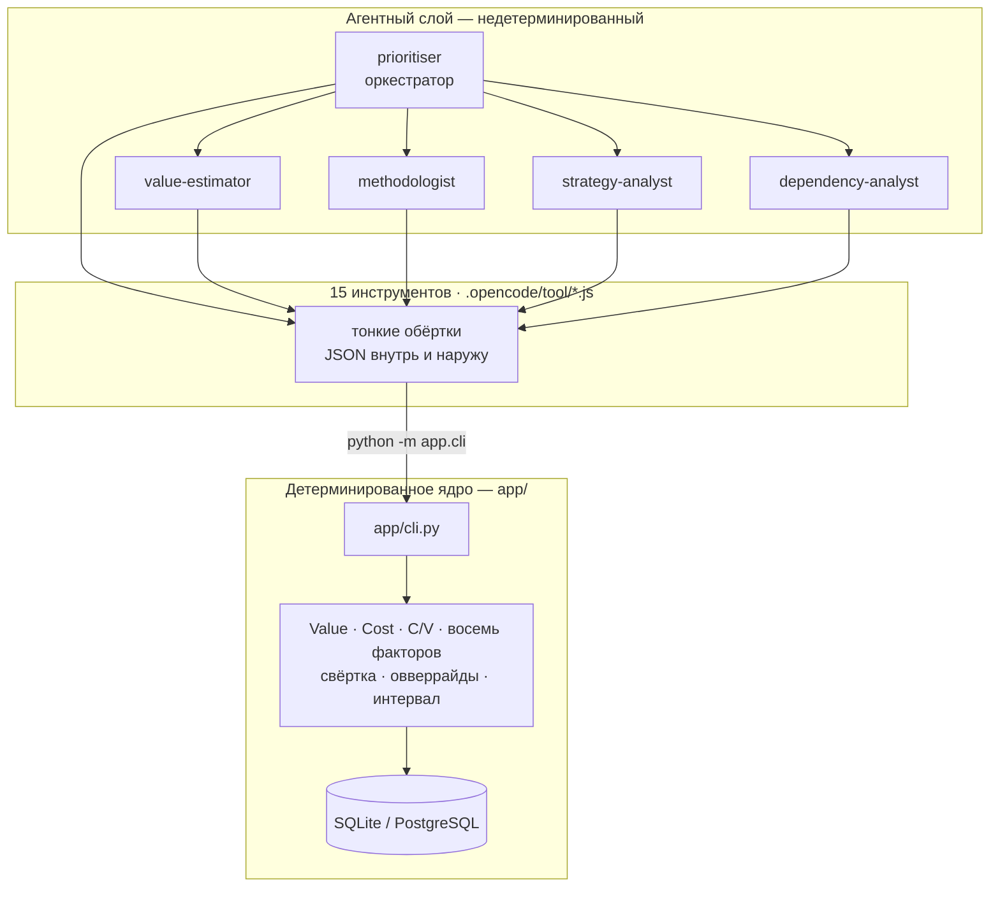
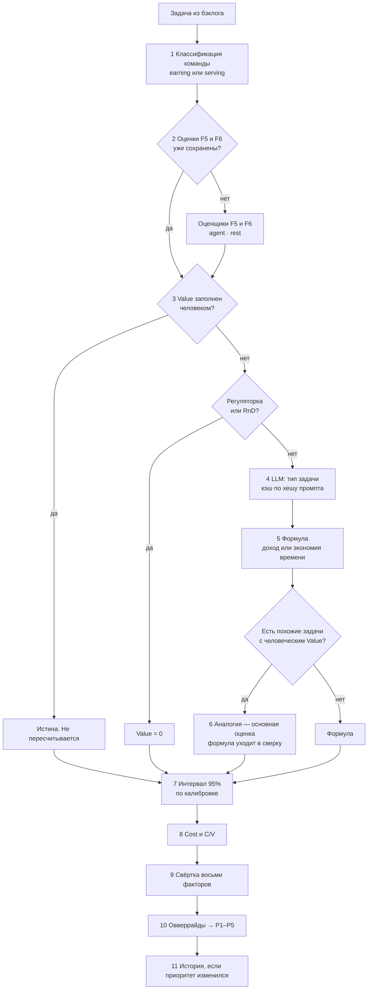
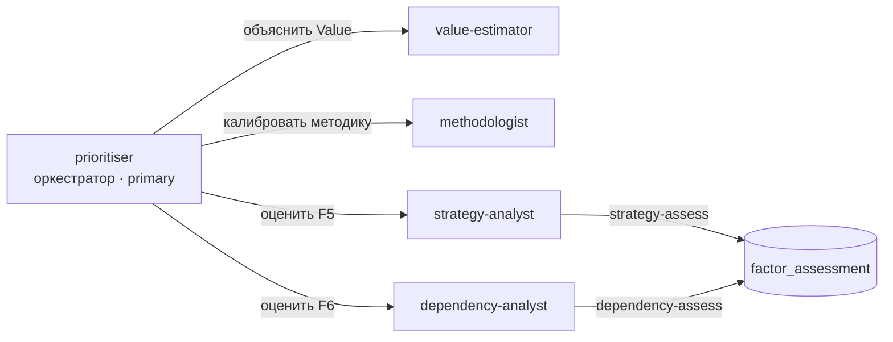
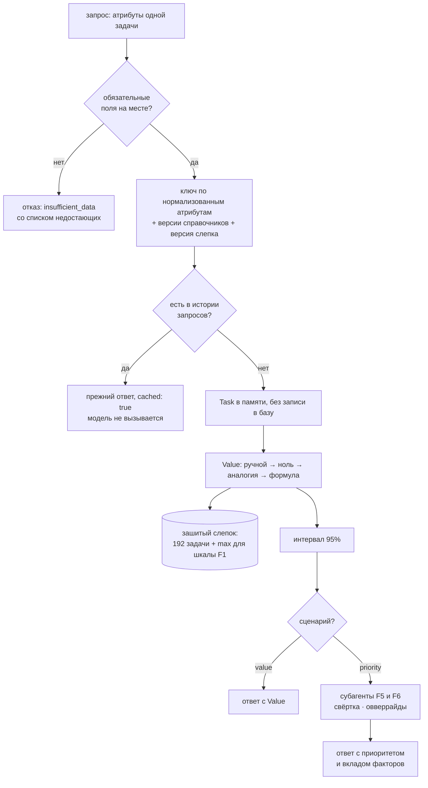

# Архитектура: как работает агент

> AS-IS сверено с интегрированным кодом и тестами 07.09.2026.

Документ описывает устройство агента в объёме, достаточном для встраивания в
продовую версию Единого бэклога. Точки, которые придётся менять при переносе,
собраны в конце.

Модель эмбеддингов прогревается в единственном фоновом задании на процесс.
`/ready` не инициирует блокирующую загрузку: он возвращает текущее состояние
`loading`, `ok` или `error:<тип>`, поэтому повторные проверки готовности не
создают конкурирующие экземпляры модели.

## Главное разделение: два контура



**Агент не считает числа.** Value, приоритет, C/V, веса, границы интервала —
всё вычисляет Python. Модель собирает вводные, отвечает на критерии рубрики и
объясняет результат человеку.

Это требование воспроизводимости, а не архитектурная придирка: два прогона
одного бэклога обязаны давать одинаковые приоритеты, иначе методику нельзя
защитить перед методологом как объективную.

**Практическое следствие для ПРОМ:** ядро самодостаточно. Всё, что делает агент,
доступно через `app/cli.py` и FastAPI без единой строчки opencode. Агентный слой —
это интерфейс для человека, а не обязательное звено расчёта.

## Конвейер оценки одной задачи

Порядок шагов зафиксирован в `app/core/service.py::_prepare_task` и не
переставляется произвольно.



Шаги 1–8 выполняются по каждой задаче отдельно. Шаг 9 требует агрегатов по
всему бэклогу: фактор F1 (Value) нормализуется относительно максимума.
**Поэтому пересчёт одной задачи всё равно читает весь бэклог** — иначе она
получила бы балл в другой шкале, чем соседи.

C/V на шаге 8 считается для карточки задачи, но в свёртку не входит: он
выводится из Value и трудозатрат, уже учтённых факторами F1 и F4. Разбор —
`docs/DEVIATIONS-FROM-TZ.md`, раздел 3.

## Где включается модель, а где RAG

Три разных механизма, которые легко перепутать.

| Механизм | Что делает | Когда включается | Обращений к модели |
|---|---|---|---|
| **LLM-классификация** | Определяет вид задачи (доход / экономия времени / регуляторка / RnD), когда атрибутов не хватает | Только если Value не заполнен вручную и задача не помечена как регуляторная | 1 на задачу, кэшируется по хешу промпта в `llm_call` |
| **RAG по корпусу** | Ищет материалы о продуктах и командах | Инструмент `rag-search` у агента; оценщики F5/F6 при `provider=agent` | 0 — это поиск, а не генерация |
| **Индекс аналогий** | Ищет похожие задачи с человеческим Value | Всегда при расчёте Value, если `PRIORITISER_VALUE_ANALOGY=1` | 0 — только эмбеддинги |

Последние два используют одну модель эмбеддингов `intfloat/multilingual-e5-base`,
но **это разные индексы**: корпус знаний (1263 фрагмента) и задачи с ручным Value
(193 записи). Модель загружается один раз на процесс и делится между ними
(`app/rag/embeddings.py`).

### Корпус RAG: четыре слоя

| Слой | Фрагментов | Источник |
|---|---:|---|
| `k3` | 741 | Зашифрованный пакет знаний банка: продуктовый альбом ДИД, акционерные и мезонинные продукты, критерии применимости |
| `backlog` | 444 | Исторические задачи |
| `methodology` | 78 | Документы `docs/` |
| `knowledge` | 25 | Обезличенные описания команд трайба |

Поиск гибридный: BM25 плюс FAISS, объединение через RRF, с ограничением доли
одного источника в выдаче. Устройство и метрики качества — `docs/RAG.md`.

**Важно для ПРОМ:** массовый пересчёт бэклога RAG не использует вообще. RAG
включается только когда человек задаёт вопрос агенту или когда субагент
обосновывает оценку F5/F6.

## Как анализируется запрос человека

Запрос идёт в оркестратор `prioritiser`. Его системный промпт
(`agent-prompts/prioritiser/orchestrator.md`) задаёт единственное жёсткое
правило: **сначала вызови инструмент, потом говори**. Приоритет, Value, C/V или
вес фактора не называются по памяти.

Типичная цепочка на вопрос «почему у задачи такой приоритет»:

```
task-explain TASK-100-011
  → карточка: приоритет, вклад каждого из восьми факторов,
    вводные Value, аналоги, сработавшие овверрайды, история
assessments-read TASK-100-011        (если речь о F5 или F6)
  → на чём стоит оценка: ответы по критериям, обоснование, источники
rag-search --layer k3 "..."          (если нужно понять продукт)
  → фрагменты с указанием источника
```

Оркестратор **не может** записывать оценки — только читать. Изменение оценок
делегируется профильным субагентам.

## Субагенты



| Субагент | Задача | Что пишет | t |
|---|---|---|---|
| `value-estimator` | Разбирает, из чего собран Value, формулирует вопросы автору по недостающим вводным | ничего | 0.2 |
| `methodologist` | Помогает калибровать веса, константы, овверрайды; считает эффект изменений | ничего | 0.1 |
| `strategy-analyst` | Отвечает на пять критериев рубрики F5, опираясь на корпус | `factor_assessment` (только F5) | 0.1 |
| `dependency-analyst` | Перечисляет команды-зависимости и тип связи (F6) | `factor_assessment` (только F6) | 0.1 |

**Права разделены намеренно.** Каждый аналитик пишет только свой фактор; ни
оркестратор, ни остальные субагенты записывать оценки не могут. Субагент,
способный двигать оба фактора одним суждением, легко подогнал бы их под желаемый
приоритет.

Ни один субагент не может править справочники и не имеет доступа к `bash`,
`edit`, `write`. Полная матрица прав — в `opencode.json`.

Порядок работы аналитика: `rubric-read` → `assessments-read` (вдруг оценка уже
есть) → `task-explain` → `rag-search` → `*-assess`. Инструмент записи
валидирует ответ по рубрике и возвращает ошибку с перечнем допустимых
вариантов — неполная оценка не сохраняется молча.

## Выходной контракт

Что агент записывает в каждую задачу — это и есть интерфейс для ПРОМ-бэклога:

| Поле | Тип | Смысл |
|---|---|---|
| `priority` | `P1`…`P5` | Итоговый приоритет |
| `priority_score` | float | Сырой скор 0–1; нужен для сортировки внутри одного P |
| `priority_reason` | text | Какие факторы дали наибольший вклад |
| `factor_scores` | json | Балл каждого из восьми факторов |
| `factor_contributions` | json | Вклад каждого фактора в скор |
| `applied_overrides` | json | Сработавшие правила с указанием причины |
| `value_internal_mln` | float | Финансовый эффект для приоритизации |
| `value_low_mln` / `value_high_mln` | float | Границы, куда истина попадает в 95% случаев |
| `value_external_mln` | float | **Только доходный метод.** У обслуживающих команд `null` |
| `value_external_status` | `computed` / `tbd` | `tbd` до запуска ex-post атрибуции |
| `value_source` | `manual` / `analogy` / `revenue` / `time_saving` / `zero` | Каким методом получено |
| `value_confidence` | `high` / `medium` / `low` | Уровень уверенности |
| `value_inputs` | json | Все промежуточные вводные, аналоги, сверка с формулой (НФ19) |
| `value_hint` | text | Готовый текст подсказки под полем Value (Ф22) |
| `cost_rub`, `cost_to_value` | float | Затраты и C/V — диагностика, в приоритет не входят |
| `strategy_fit_raw` | float | Балл F5 1–10 |
| `dependency_score`, `dependency_teams` | float, json | Балл F6 и разбор зависимостей |
| `computed_at` | timestamp | Когда пересчитано |

Поля исходного бэклога агент **не изменяет никогда** — включая
`value_manual_mln` и `Приоритет задачи в бэклоге команды`
(`backlog_priority_original`). Он пишет только в свои колонки.

## Сервис для Backlog coordinator

Всё, описанное выше, — полный прогон по бэклогу из своей базы. В ПРОМ-варианте
агент работает иначе: **базы у него нет**, атрибуты одной задачи приходят в
запросе от Backlog coordinator.



Слой — `app/service/`: `scenarios.py` собирает `Task` в памяти из атрибутов и
прогоняет его через то же ядро, что и полный пересчёт; `history.py` отвечает за
повторяемость. Дублировать расчёт ради stateless-режима было бы хуже: две
реализации одной методики неизбежно разъезжаются.

**Три вещи, которых нет в полном прогоне:**

* **Проверка совпадения атрибутов до вызова модели.** Модель недетерминирована:
  два вызова с одним промптом могут выбрать разные наборы драйверов, и одна
  задача получила бы две разные оценки. Ключ включает версии справочников —
  правка весов методологом обязана давать новый расчёт, а не выдачу из истории.
* **Зашитый слепок вместо базы** — `app/snapshot.py`. Оттуда аналоги и максимум
  Value для шкалы F1.
* **Отказ вместо оценки.** Без трудозатрат и заказчика приоритет не считается:
  это 32% веса, и правдоподобное число на нейтральных значениях хуже честного
  отказа.

Контракт с примерами — `docs/COORDINATOR-CONTRACT.md`.

## Хранилище

| Таблица | Что хранит |
|---|---|
| `task` | Задача: 29 исходных полей в `raw`, нормализованные производные, результат работы агента |
| `priority_history` | Каждое изменение приоритета: было, стало, причина, время (Ф21, откат по НФ17) |
| `factor_assessment` | Оценки F5 и F6: ответы по рубрике, обоснование, источники, провайдер, модель. Активная одна, предыдущие сохраняются |
| `reference` | Справочники: каждое сохранение — новая версия с автором и временем |
| `llm_call` | Кэш и журнал обращений к модели: хеш промпта, токены, время, ошибки (НФ5, НФ18) |
| `attribution_run` | Запуски ex-post атрибуции `value_external`; JSON-результат фиксирует `population_task_keys` |
| `agent_request` | История запросов Backlog coordinator: атрибуты, ответ, метод, версии. Основа повторяемости |

## Справочники

Девять YAML в `data/references/`, загружаются в таблицу `reference` при
инициализации. Расчёт читает активную версию из БД; при её отсутствии падает
обратно на YAML — это нужно тестам и CLI без базы.

| Справочник | Кто правит | Что задаёт |
|---|---|---|

| `factor_weights` | методолог | Веса восьми факторов (сумма = 1), пороги P1–P5, нормализация |
| `overrides` | методолог | Правила-овверрайды и ключевые слова для их условий |
| `teams` | методолог | Зарабатывающие и обслуживающие команды |
| `customer_levels` | методолог | Уровни бизнес-заказчиков: люди, коллективные заказчики, подразделения — **сейчас все `unknown`** |
| `task_types` | методолог | Коэффициенты фактора F7 |
| `value_drivers` | методолог, финансист | Величины расчёта эффекта, ставки труда, дисконт, производственный календарь |
| `value_defaults` | методолог | Типовые вводные формулы — **непроверенные допущения** |
| `strategy_rubric` | методолог | Критерии F5 и типы зависимостей F6 |
| `value_intervals` | **скрипт** | Множители интервала; правится только `scripts/value_calibrate.py` |

## Производительность

| Операция | Время | Норматив ТЗ |
|---|---:|---|
| Пересчёт 440 задач | 21 с | НФ8: 264 с на этот объём |
| Одна задача через CLI | ~16 с | **НФ7: 10 с — нарушается** |
| Поиск в корпусе внутри процесса | 0.026 с | — |
| Загрузка модели эмбеддингов | 13.6 с | — |

Норматив НФ7 рушит не расчёт, а то, что каждый вызов инструмента поднимает новый
процесс Python и заново грузит модель. В живом процессе запрос стоит 26
миллисекунд. **Это первое, что нужно исправить при переносе в ПРОМ:** вынести
ядро в постоянный сервис, чтобы инструменты ходили по HTTP.

## Точки интеграции с ПРОМ-бэклогом

Что придётся заменить:

**1. Источник данных.** Сейчас `app/core/loader.py` читает JSON-слепок. В ПРОМ
нужен адаптер к API Единого бэклога: чтение атрибутов и запись результата.
Точка расширения — функция `load_backlog`; формат внутренней модели менять не
нужно.

**2. Триггеры пересчёта.** Сейчас — ручной запуск. По ТЗ (И1) нужен webhook или
polling не реже 30 секунд. Ядро к этому готово: `recompute_task` пересчитывает
одну задачу, `recompute_all` — весь бэклог.

**3. Хранилище.** SQLite → PostgreSQL: смена `PRIORITISER_DB_URL`. Схема не
использует SQLite-специфичных конструкций.

**4. Аутентификация.** Заглушка `require_methodologist` в `app/api/main.py`
закрывает все админ-эндпоинты. Подключение AD/OIDC — правка одной функции.

**5. Модель.** Сейчас единственный проверенный путь — заглушки без сети.
Адаптеры GigaChat и GigaCode написаны по схеме strategy-decomposer, но **ни разу
не выполнялись**: снаружи контура их проверить нечем.

**6. Модель эмбеддингов** качается с Hugging Face при первой сборке индекса. В
контуре её нужно положить локально и указать `PRIORITISER_RAG_EMBEDDING_MODEL`.

**7. Офлайн-установка.** `torch` и `faiss` (1.3 ГБ), npm-пакеты opencode
(185 МБ), бинарник `age` для расшифровки пакета знаний.

## Чего агент не делает

* **Не пересчитывает Value, введённый человеком.** Никогда, никаким методом.
* **Не изменяет исходные поля бэклога.**
* **Не выдумывает числа.** Отсутствующая вводная — это вопрос автору задачи и
  пониженная уверенность, а не правдоподобная подстановка.
* **Не выпускает наружу экономию времени.** Схема `TaskExternalOut` физически не
  содержит поля `value_internal`, поэтому выгрузка `GET /backlog/external` не
  может его отдать даже по ошибке.
* **Не правит справочники** — это решение методолога, фиксируемое с автором и
  временем.
* **Не запускает ex-post атрибуцию сам** — только по прямой команде, с
  подтверждением.

## Куда смотреть дальше

| Документ | О чём |
|---|---|
| [METHODOLOGY.md](METHODOLOGY.md) | Формулы, константы, факторы, овверрайды |
| [VALUE-ANALOGY.md](VALUE-ANALOGY.md) | Оценка Value по аналогии и интервал |
| [FACTOR-ASSESSMENT.md](FACTOR-ASSESSMENT.md) | Рубрики F5 и F6, субагенты, хранение оценок |
| [RAG.md](RAG.md) | Корпус знаний, пакет K3, метрики качества поиска |
| [CALIBRATION-FINDINGS.md](CALIBRATION-FINDINGS.md) | Что показал прогон на 440 задачах |
| [DEVIATIONS-FROM-TZ.md](DEVIATIONS-FROM-TZ.md) | Все расхождения с ТЗ и как их вернуть |
| [../AGENTS.md](../AGENTS.md) | Контракт агентного слоя |
